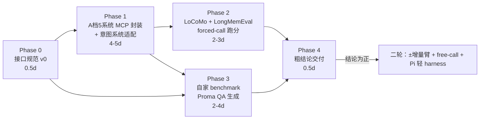

# memory-bench 开发计划 v1

> 状态：已与用户对齐（2026-08-18）。本计划是 MCP 封装 → 通用 benchmark → 自家 benchmark（出题平台第一实例）→ 粗结论交付的执行契约，第二轮（论文级可复现 + Pi 轻 harness）方向已锚定但细节后补。
> 配套 runbook：`DEPLOY.md`（环境与记忆系统安装矩阵，2026-08-18 已验证）

## 1. 两阶段目标

| 阶段 | 目标 | 交付物 |
|---|---|---|
| **第一阶段（本计划主体）** | 给樊嘉铭一个粗结论：意图系统在通用/专门 benchmark 上能否领先、领先多少 | 分数对比表 + 一页结论 |
| **第二轮（粗结论为正后启动）** | 论文级可复现：±增量臂、free-call 臂、Pi 轻 harness | Run manifest + event log + 完整实验矩阵 |

**期望管理（写给未来的自己）**：通用 benchmark（LoCoMo/LongMemEval）的问题不依赖意图理解，意图系统在那里的任务是"打平不拖后腿"——**"领先多少"的数字只能来自自家 benchmark**。通用上打平是设计使然，不是失败。

## 2. 已锁定决策

**记忆系统筛选框架**（对比对象的来历）：按"记忆住在哪一层"筛成两类——

- **MCP 层可植入（A档，5 个）**：Mem0 / Graphiti(Zep) / A-MEM / MemOS / Mandol——记忆住在独立进程里，MCP 封装后可挂到任意 harness，forced-call 无头跑台直接评；
- **agent loop 层（B档）**：Letta / MRAgent——记忆机制（self-editing / 主动遍历）住在 agent 循环内部，被动 MCP 化即变质，只能以其自身运行时为 SUT 整体评。

这个分法同时决定接入方式与时间线：A档进一轮，B档进二轮（见 §9）。

| 决策点 | 结论 | 备注 |
|---|---|---|
| 意图臂位 | **先 a（独立参赛），b（±控制层）二轮** | a 回答"谁的检索准"，b 回答"意图层带来多少增量"（乘数叙事） |
| 评测跑台 | **无头 Python 脚本 + MCP client** | forced-call 协议天然成立，无真 agent，全自动；multica 留给二轮 free-call 臂做部署真实感 |
| 通用 benchmark | **LoCoMo + LongMemEval 都跑** | 先 LoCoMo 拿基线，LongMemEval 随后（ingest 重，~115K tokens/题） |
| 记忆系统范围 | **A档 5 个**：Mem0 / Graphiti(Zep) / A-MEM / MemOS / Mandol | B档（Letta / MRAgent）延后，理由见上方筛选框架 |
| 意图系统 | **无需封装，写统一接口适配层** | intent-recall-mcp 已是 MCP；补 `add_conversation/retrieve/reset/stats` 契约适配 |
| 调用协议 | **forced-call**（每题必须检索，评测脚本强制） | 指令级"必须调用"→ 二轮升级为机制级（harness 预调用 / 事后校验重试） |

## 3. 总览



## 4. Phase 0 · 接口规范 v0（0.5d，一切的地基）

文件：`docs/interface-spec.md`（v0.1 已起草 2026-08-18，待 smoke test 脚本配套）

统一契约（每个记忆系统一个 MCP server 或适配器实现）：

```
add_conversation(session_id, turns[], scope)   # 灌入；scope 显式化（user/session/episode 语义差异在这里归一）
retrieve(query, query_mode, top_k) → canonical_envelope[]
reset()                                         # 每次 run 前清状态，一等公民
stats() → {n_memories, tokens_used, latency_ms, ...}
snapshot(tag) / restore(tag)                    # ingest 后状态可复用——LongMemEval 重灌不可接受
```

规范必须写死的五件事（来自 2026-08-18 研判结论）：

1. `query_mode: fixed | model_formulated`——query 归属是实验变量（fixed 控方差，model_formulated 保生态效度），显式声明
2. **Canonical result envelope**：所有系统返回统一渲染（markdown snippet + session/时间戳 + 统一截断上限）。不归一化比的是呈现格式不是记忆内容
3. `stats` 必含 **token 用量 + 延迟**——各系统内部成本结构不对称（Mem0 内部还调 LLM），审稿必问
4. **state snapshot/restore** 不只是 reset
5. **scope 语义显式化**——Mem0 是 `user_id`、Mandol 是 session 级、Graphiti 是 episode 级，接口层吃掉这个差异

## 5. Phase 1 · A档 MCP 封装（4-5d）

进度（2026-08-18 深夜收工）：**Phase 1 全部完成**——七个系统全过 smoke 门禁：mock / mem0 / graphiti / mandol / amem / memos / **intent（主角）**，均 6/6，质量抽查通过（年份正确、事实保真）。各系统性能基线见 DEPLOY.md。A-MEM 独立 venv（.venv-amem，官方 repo pip -e）、Mandol 独立 venv（.venv-mandol）。踩坑记录见 servers/ 下各文件头注释。

| 系统 | 形态 | 工作量 | 优先级 |
|---|---|---|---|
| Mem0 | pip lib（官方 remote MCP 不用——数据不出机，自封装本地 lib） | ~0.5d | P0 |
| Graphiti (Zep) | pip lib + Neo4j Docker | ~0.5d | P0 |
| MemOS | pip（注意包名大写 `MemOS`） | ~0.5d | P0 |
| A-MEM | pip/git API 薄包装 | ~1d | P1（科研代码质量风险，卡住则降级） |
| Mandol | pip/git API 薄包装 | ~1d | P1（同上） |
| 意图系统 | intent-recall-mcp 适配层 | ~1d | P0 |

- 最小可跑集合 = Mem0 + Graphiti + MemOS + 意图系统（三个成熟 lib + 意图）；A-MEM/Mandol 卡住不阻塞主线
- 每个封装 = FastMCP 模板（100-200 行）+ 接口映射；评测端用 MCP client SDK headless 调，不需要真起 agent
- **每个系统封装完立即用 smoke case 验**：灌 3 轮对话 → retrieve 一条 → reset → 确认幂等

## 6. Phase 2 · 通用 benchmark（2-3d）

流程（LoCoMo 先行，LongMemEval 随后同管线）：

```
1. ingest：benchmark 会话历史逐 session 调 add_conversation（Phase 1 契约）
   → snapshot("ingested") —— 之后所有 run 从 snapshot 起，不重灌
2. 逐题 forced-call：question → retrieve(query, mode=fixed 先行)
   → canonical envelope → LLM + 证据生成 answer
3. 判分：span 类 F1，开放类 LLM-judge；记录 stats（token/延迟）
4. 出分：按问题维度切片（single/multi-hop/temporal/update/abstention）
```

实验臂（臂位 a 矩阵）：

| 臂 | retrieve 由谁做 |
|---|---|
| baseline 1 | full-context 全塞（证明记忆系统有必要） |
| baseline 2 | 裸向量 RAG |
| Mem0 / Graphiti / MemOS / (A-MEM / Mandol) | 各自 retrieve |
| **意图系统** | intent retrieve |

- 判分 LLM 固定一个、prompt 固定、每题记录原始输出（判分本身可复核）
- 每臂 n≥3 次重复（LLM 非确定性），报均值±方差

## 7. Phase 3 · 自家 benchmark（2-4d，粗结论的承重墙）

**终态是平台，不是题库**：自定义 benchmark 的设想是一个出题平台——任何用户的聊天记录（jsonl 文件夹 / zip）丢进来，自动出题、自动评测、自动出分；语料源可替换，题目随语料长出来，整套平台可原样迁移到不同 user 做 user study。Phase 3 用本地 Proma 聊天 QA（intent-recall-mcp 已在索引同一数据源）做平台的**第一个实例**；corpus 遍历与生成管线的工程落点 = REPRO-PLAN 的 A 层（目录/zip 输入）+ BG 模块。

方法论双参考：

- **Benchmark-Agent**（[arXiv 2606.06462](https://arxiv.org/abs/2606.06462)，本地 repo `~/Documents/repo/Benchmark-Agent`）：管**生成管线**，走其 L1 三件套（契约优先，不跑他们的 Python 管线）：
  1. **subtask 带 sample_schema**：每类题先定义 input/output 字段 + answer_type，题目只能填空
  2. **grounding 检查**：每题指回具体真实 QA 数据 + 变换方案；反捷径检查——答案不能从 context 直接读出
  3. **三态验证**：valid / 可修复（挪字段不改内容）/ reject（语义缺失不许编造）
- **PAST-Bench**（[arXiv 2608.04003](https://arxiv.org/abs/2608.04003)）：管**题型设计**——按能力轴分型（memory / procedural reuse / information gathering / update），并用 retained-experience on/off 对照隔离增益归因；我们的 b 臂（±控制层）与 event log 不变式与其独立收敛。

建议覆盖的题型（对齐意图系统卖点；后两条借 PAST-Bench 能力轴）：
- 意图追溯型："我当时为什么决定 X？"（考 session 间意图链）
- 时序意图型："这个想法从什么时候开始变？"（考意图演化）
- 多源缝合型：跨 session 的方案对比题
- 更新替换型（PAST-Bench · update 轴）："我之前说 X 后来改成 Y，现在按哪个做？"——考过时记忆替换，意图系统卖点之一
- 流程复用型（PAST-Bench · procedural reuse 轴）："上次这类任务我是怎么做的？"——考流程/工具例程记忆，公平性第二锚点
- 对照组：纯事实型（意图系统不应显著优于 RAG 的题型，作公平性锚点）

生成后人工抽检 ≥20%，再进 Phase 4。

## 8. Phase 4 · 粗结论交付（0.5d）

- 一张总表：benchmark × 臂 × 维度切片 × 分数
- 三句话结论模板：
  1. 通用 benchmark：意图系统 vs 记忆系统基线（预期：打平 ± X%）
  2. 自家 benchmark：意图系统领先 Y%（承载数字）
  3. 成本：token/延迟对比
- 附"领先来源"归因：按题型切片看优势集中在意图型还是事实型

## 9. 第二轮方向（粗结论为正后展开，此处只锚定）

1. **b 臂（±控制层）**：意图层作为 query 前置模块套在每个记忆系统上，5×2 矩阵，"乘数"叙事
2. **free-call 臂**：模型自主决定调用 → 测部署端到端价值；机制级强制（harness 预调用或事后校验）替代 prompt 指令
3. **Pi 轻 harness**：ContextInjector + ToolProvider 抽象、run manifest（benchmark × SUT × seed 声明式）、append-only event log——不变式："模型可见的一切输入（system prompt、注入上下文、工具返回）必须全部落盘，可回放可归因"（借鉴 deepseek-harness 设计）、混淆控制协议（off 臂占位工具等长描述、n≥3）
4. **multica free-call**：部署真实感
5. Letta（用其自身 SDK 当独立 SUT 臂，不硬封 MCP）、MRAgent（`agent_decide` 钩子方案另行设计）
6. **user study**：出题平台迁移到不同 user——任意 jsonl 语料 in → 自动出题 → 跑分，把个性化记忆评测做成可部署的服务形态（平台愿景的最终出口）

## 10. 风险表

| 风险 | 影响 | 缓解 |
|---|---|---|
| A-MEM / Mandol 科研代码跑不起来 | 臂矩阵缩水 | 降级 P1，最小集 3 系统 + 意图先行 |
| 检索粒度不对齐（意图= session 级 vs Mem0= memory 条目级） | 横向比较公平性受质疑 | canonical envelope 统一最终交付粒度；论文里显式声明各系统原生粒度 |
| LongMemEval ingest 慢 | 时间线 | snapshot 机制（Phase 0 契约）+ 排在 LoCoMo 之后 |
| 智谱 coding 通道积分耗尽 | run 中断 | 积分制：每 5h 窗口 28,000，非高峰 50% 折扣；耗尽时 runner 捕获配额错误 → 挂起，约 5h 后窗口重置可续跑（可设 timer 提醒）；ingest 顺序执行避免浪费 |
| 推理深度方差/耗时 | 可复现性 + 时间线 | 已钉住：MEMBENCH_THINKING=low（粗结论阶段，add 20s→4s，抽取质量验证无损）；论文阶段换 enabled(max) 重跑正式数 |
| forced-call 下意图优势不显现 | 粗结论变弱 | 预期内：通用 benchmark 就不该显现；自家 benchmark 承载主张 |
| 判分 LLM 偏差 | 分数不可信 | 固定判分模型 + 原始输出落盘可复核 + 人工抽检 20% |

## 11. 时间线（净工作日）

| 周 | 内容 |
|---|---|
| W1 前半 | Phase 0 规范 + Mem0/Graphiti/MemOS 封装 + 意图适配 |
| W1 后半 | A-MEM/Mandol 封装 + LoCoMo 管线打通（ingest→snapshot→跑分） |
| W2 前半 | LongMemEval + 全臂跑完 + 自家 benchmark 生成（L1 SOP） |
| W2 后半 | 自家 benchmark 跑分 + 粗结论交付 |

**粗结论预计 2 周内到樊嘉铭手上。**

## 12. Phase 1 核查闭环（2026-08-19 凌晨）

子会话 deep-verification 抓到 2 致命 + 2 严重问题，全部修复并验证：
- P1 mem0 reset 悬挂句柄（reset→add 静默丢数据）✅ 修复 + 门禁第 7 步
- P2 amem 多 scope collection 互踩（同进程共享内存 Client）✅ per-scope collection 名 + 门禁第 8 步
- P3 mem0 filter.scope_id 残留覆盖行（跨 scope 泄漏）✅ 已删
- P4 amem temperature=0.7 违约 ✅ 强制 0
- P5 intent reasoning_effort 死代码 ✅ 真实现
- P6 配置偏离未声明 ✅ spec §7 逐系统配置清单表

**最终门禁状态：7 系统 × 8 步全部通过**（含 reset→add 链路 + 双 scope 隔离两类新门禁）。
Phase 2 入口就绪：loaders/locomo.py（10 conv / 272 session / 5882 turn / 1986 QA，category 权威映射 1-5）。
