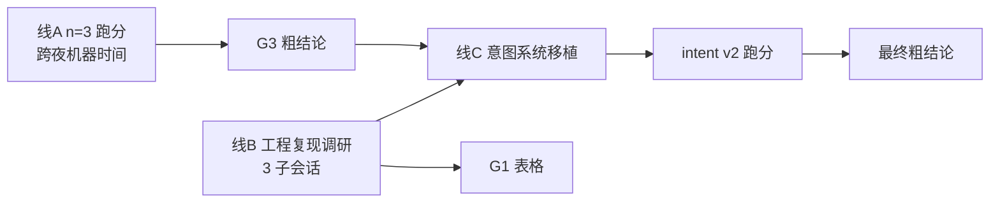

# memory-bench 周末推进计划 v2

> [!abstract] v2 相对 v1 的变化
> v1 只覆盖了「跑分」和「粗结论」两条线，漏掉了**第三条线：memory 工程复现与移植**。
> v2 按你的四个 goal 重组，并新增两个比 v1 的 `n=1` 更根本的核查发现：**thinking 从未真正关闭**（方差根因，可修）、**intent 检索时调 LLM 而其他臂不调**（公平性问题，影响结论口径）。

---

## 0. 四目标 ↔ 三线映射

| 你的 Goal | 对应线 | 状态 | 产物 |
|---|---|---|---|
| **G1** memory 工程复现（要表格） | **线 B · 调研** | ✅ **已完成**（3 子会话已收敛） | §4.1-4.7 七张表 |
| **G2** benchmark 设计对齐（我们实现了啥） | — | ✅ 本文档即答案 | §3 |
| **G3** 粗结论（决定 G4 方向） | **线 A · 跑分** | ⏸ 待批准开跑 | §6.1 |
| **G4** 改进意图系统（借鉴 G1） | **线 C · 移植** | ⏸ **清单已就绪，P0/P1 可立即开工** | §4.7 + §6.3 |



> [!important] 三线的真实依赖关系
> 线 A 是**纯机器时间**，不占人力；线 B 是**纯调研**，已在跑；**只有线 C 需要你的决策和我的编码**。
> 所以「边跑边硬编码」不仅可行，而且是唯一能在两天内闭环的排法。

---

## 1. 现状复位（2026-08-29 13:30 核实）

| 项 | 事实 |
|---|---|
| repo 最后改动 | `2026-08-23 17:56`，唯一 commit `4218897` |
| 停摆 | 08-24~28 主线转 HCMC proposal |
| 已完成 | Phase 0 契约 / Phase 1 八臂门禁 / Phase 2 第一版跑分 |
| 未开始 | Phase 3 自家 benchmark 出题平台 |
| 产物 | `runs/locomo-r1`（7 臂 × 3 conv，3905 行，n=1）、`runs/s2b-mock`（intent，仅 conv-30，105 题） |
| 快照 | `.state/__snapshots__` 1.2G，7 系统齐（memos 无快照，设计如此） |
| 服务 | vLLM ✅ / 智谱 ✅ / memos `:8000` ❌ / `membench-neo4j` ❌ Exited(255) |

---

## 2. 核查发现（决定计划怎么排）

### 2.1 ★★★ 新发现：thinking 从未真正关闭 —— 方差的根因

`docs/bench-design.md` §2.2 明确要求：

> qwen3 系 hybrid thinking **必须显式关闭**，否则判分/答题输出被 `<think>` 污染且**耗时翻倍**
> vLLM chat API：`extra_body={"chat_template_kwargs": {"enable_thinking": false}}`
> 落地后跑 3 题验证输出无 `<think>` 段，写入 run manifest

**实际实现是"让它 think，然后把 thinking 剥掉"**——`bench/llm.py:75` 与 `:100` 只有事后正则剥离，请求体里**没有任何关闭参数**。

我实测了四种关法（Anthropic 兼容面）：

| 方式 | 结果 |
|---|---|
| A 现状（无参数） | `blocks = thinking, text` ❌ thinking 开着 |
| B `thinking:{"type":"disabled"}` | ❌ 无效，仍有 thinking |
| **C `chat_template_kwargs:{"enable_thinking":false}`** | ✅ **`blocks = text`，真正关闭** |
| D prompt 追加 `/no_think` | ❌ 无效 |

**关闭前后的稳定性实测**（mem0 臂 conv-30 前 10 题，每题 3 次重复，temp=0）：

```text
thinking 开（现状）：3 次完全一致 4/10   ← 60% 的题不稳定
                     PARSE_ERROR 出现 3 次（thinking 烧光 max_tokens）
thinking 关（方式C）：3 次完全一致 7/10   ← 不稳定率减半
                     PARSE_ERROR 0 次
```

> [!danger] 三条推论
> 1. **`n=1` 是症状，thinking 没关是病因。** 昨天算的 ±3.2pt 噪声，主要来自 thinking 采样路径的随机性。
> 2. **修 thinking 是一行代码**（`bench/llm.py` 请求体加 `chat_template_kwargs`），但**关掉后仍不是完全确定**（vLLM continuous batching 的浮点非确定性）→ **`n≥3` 依然必要，两个措施互补不是二选一**。
> 3. **修了 thinking 等于换了测量仪器 → 现有 answers 全部作废，rep0 也不能留。** 但 evidence（检索结果）与答题器无关，**仍可完全复用**。

**成本反而下降**（thinking 耗时翻倍，关掉后单题减半）：

| 方案 | 待答题数 | 单题耗时 | 总耗时 |
|---|---|---|---|
| v1 方案（留 thinking，补 rep1/rep2） | 7812 | ~2.32s | ~5.0h |
| **v2 方案（关 thinking，重跑 rep0/1/2）** | 11718 | ~1.16s | **~3.8h** |

### 2.2 ★★★ 新发现：intent 在检索阶段调 LLM，其他臂不调

`servers/intent/server.ts:243-279, 351-360`：Tier 2 精读（`deepRead`）**已经接在 retrieve 路径里**——对 Tier1 top-k 的 session 原文做一次 glm-5.3 调用，提炼逐字引用。

`docs/bench-design.md` §10 记录了这条演进：

| 步 | 机制 | conv-30 结果 |
|---|---|---|
| A | envelope 附命中 turn 原文摘录 + 修 timestamp | 0.048 → 0.152 |
| A+ | Tier1 双通道打分（意图摘要 ∨ 原文 turn 取 max） | 0.152 → **0.257**（≈ mock 0.276） |
| B | **接入 Tier2 LLM 精读** | 0.257 → **0.286** |

> [!warning] 口径问题：0.286 不是同口径数字
> 其余所有臂（mem0/memos/mandol/graphiti/rag/mock）的 retrieve 都是**纯检索，零 LLM**。
> intent 每题多花 1 次 LLM 调用（105 题 = 430k tokens），才拿到 0.286。
> **严格同口径（纯检索面）的 intent 分数是 Tier1-only 的 0.257 —— 低于同 run 的 mock（0.276）。**

> [!important] ★ 但“不公平”这个定性是错的，见 §4.0
> MRAgent（ICML 2026, arXiv:2606.06036）的 **Theorem 4.1 证明 active retrieval ⪷ passive retrieval**。
> intent 的 Tier1+Tier2 本就属于 **active 类**，而我们把它放进 passive 类的表里比。
> 正确做法不是“把 Tier2 当作弊单列”，而是按 `interface-spec.md` §9 自定的规矩：**A 档测被动面、B 档测 agentic 面，两者不可混表**。
> 代价：agentic 面目前**没有任何对照组**（MRAgent / MemHarness / Letta 均未接），所以那一面既不能声称领先也不能声称落后。

### 2.3 `n=1` 与跨 run 比较（v1 已述，保留结论）

- `full_context` 注入内容 105/105 逐字节相同，两次 run 仍差 **6.7pt**
- 由此外推 558 题的两臂可区分阈值 ≈ **3.1pt**
- **被推翻 2**：「intent 打平基线偏上」是跨 run 比较放大；同 run 对照 mock=0.276 vs intent=0.286，105 题差 1 题

> [!check] 关于「embedding < 关键词」：我昨天的判定要修正一半
> 昨天我说这条发现建在噪声上（2.0pt < 3.1pt 阈值）。**关于 judge_acc 的部分仍然成立**，但子会话 1 做了一个我没想到的**确定性裁决实验**：用 LoCoMo 的 gold `evidence` dia_id 反算**真实证据召回率**，该指标完全不受答题器噪声影响。
>
> | 臂 | recall@5 | cat2 | cat4 | cat5 |
> |---|---|---|---|---|
> | mock（关键词） | **0.363** | **0.505** | 0.404 | **0.349** |
> | rag_baseline（向量） | 0.314 | 0.409 | 0.402 | 0.202 |
>
> 两臂 chunk **完全同源同粒度**，唯一差别是打分函数 —— 这是天然受控实验。且 cat4 召回打平（0.402 vs 0.404）、acc 也打平（0.332 vs 0.332），交叉验证口径正确。
>
> **修正后的准确表述**：关键词在此语料上的**检索优势是真实且确定的**（召回 +4.9pt），只是这个优势在 judge_acc 上被答题器噪声淡化成了 2.0pt。机制解释（事实题吃精确匹配）**现在有独立证据支持了**，但证据不是当时那个。
> 补充机制：关键词打分不做长度归一化（分母是 query 长度），天然偏好**长而信息密集**的 turn；余弦相似度是长度归一化的，会把 `"[2023-07-09] Jon: Bye!"` 这类短空转 turn 推到高位。

### 2.4 配置漂移未留痕

`mock` 两次 run 检索内容 **0/105 相同**（`top_k` 均为 5）→ 08-21→08-22 之间改过 mock server 或语料切分，无记录。含义：`s2b-mock` 的 intent 数据与 `locomo-r1` 表不可直接横比。

### 2.5 未榨取的维度：token 效率

`full_context` 15822 tok/题 → 0.518；`mem0` 446 tok/题 → 0.401。**27–36x 压缩下保住上界 77%**。这个切片比裸 acc 排名更贴近「压缩在使用时」的主张，且不需要 Phase 3。

---

## 3. G2 · benchmark 现在到底实现了什么

> 三份设计文档 + 代码的完整 recap。这一节是给"我都忘了"准备的。

### 3.1 契约层：六工具统一接口（`docs/interface-spec.md` v0.1）

所有系统封装成 MCP stdio server，**工具名与签名逐字段一致**，评测脚本对系统无感知：

| 工具 | 用途 | 幂等 |
|---|---|---|
| `add_conversation(session_id, turns[], scope, metadata)` | ingest 灌入 | 否 |
| `retrieve(query, query_mode, top_k, filter)` | 检索，forced-call | 是 |
| `reset()` | 清空状态 | **必须幂等** |
| `stats()` | token/延迟/条目数 | 是 |
| `snapshot(tag)` / `restore(tag)` | 状态快照 | — |

### 3.2 公平性机制（这是整套设计的核心，也是最容易忘的部分）

| 机制 | 内容 |
|---|---|
| **Canonical Envelope** | 所有系统返回统一渲染：`{memory_id, text≤600字符, source{session_id,turn_range}, timestamp, score, raw_format}`。**这批 envelope 的渲染结果就是喂给答题 LLM 的证据文本**——格式不同 = 混淆，所以锁死 |
| **scope 归一化** | 各系统原生语义差异（mem0=user_id / graphiti=group_id+episode / mandol=space / memos=user+cube）在接口层吃掉 |
| **内部 LLM 统一** | 全部 glm-5.3 + temp=0 + reasoning_effort=low，逐系统配置清单见 spec §7；偏离项显式声明（amem 用本地 MiniLM 嵌入、memos 容器内温度不可控） |
| **时间前缀** | loader 统一把轮次时间编成 `[YYYY-MM-DD]` 前缀写进 content——因为实测 glm-5.3 抽取会擅自补错年份（"五月"→"2027年5月"） |
| **top_k=5 全臂一致** | — |
| **错误码语义** | `SNAPSHOT_UNSUPPORTED` / `FILTER_IGNORED` / `PARTIAL_INGEST` 内嵌返回，不走 MCP 协议错误 |

### 3.3 门禁：8 步 smoke test（`scripts/smoke_test.py`）

封装完必须全绿才能进矩阵：add→retrieve→字段齐全→snapshot→reset→reset 幂等→restore 一致→**reset 后 add 链路**（P1 事故后加）→**双 scope 隔离**（P2 事故后加）。
**7 系统 × 8 步全过**（2026-08-19 deep-verification 闭环，修了 2 致命 + 2 严重）。

### 3.4 评测循环（`bench/runner.py`，两阶段）

```text
Phase A  ingest（一次性，逐系统顺序）
         → 逐 conv 逐 session add_conversation
         → 进度落 .state/ingest_progress/ 支持断点续灌（add 非幂等）
         → snapshot("locomo_full")

Phase A' evidence 生成（每 run）
         → restore → 逐题 retrieve(query=题面, mode=fixed, top_k=5)
         → envelope 渲染成 evidence 文本 → evidence/{arm}.jsonl

Phase B  答题 + 判分（★ 完全从 evidence 文件读，不碰 MCP server）
         → 答题 LLM（temp=0）→ JSON {answer, quote}
         → 双轨判分：本地 F1 + LLM-judge
         → answers.jsonl append-only

幂等键 = arm|conv|qa_id|rep     挂起阈值 = 连续 5 次 LLM 失败 → SUSPENDED 落盘
--resume 对两阶段各自跳过已完成行
```

### 3.5 判分（`bench/scoring.py`，双轨）

- **轨 1 · F1**：SQuAD 式词级 F1，multi-answer 取 max；cat5 不适用
- **轨 2 · LLM-judge**：全题，严格口径（partial = incorrect），主表口径与 LoCoMo 官方/mandol 92.21% 声明一致
- **判分模型 = 答题模型**（`MEMBENCH_JUDGE_MODEL` 未设，fallback）——same-model bias 已知，待修
- cat1-4 主表、**cat5 单列**（对齐 mem0 原版排除 cat5 的惯例）
- 判分原始输出全量落盘，可事后复核

### 3.6 数据（`loaders/locomo.py`）

LoCoMo10：**10 conv / 272 session / 5882 turn / 1986 QA**，category 权威映射（对齐 Mandol 官方脚本）：

`1=multi-hop  2=temporal  3=open-domain  4=single-hop  5=adversarial`

已跑：conv-30(105题) / conv-41(193题) / conv-42(260题) = 558 题/臂。

### 3.7 明确**还没做**的

| 项 | 状态 | 出处 |
|---|---|---|
| LongMemEval | 未跑（PLAN 说 LoCoMo 之后） | `PLAN.md` §6 |
| 全量 10 conv | 未跑（S5） | `bench-design.md` §9 |
| `n≥3` 重复 | **未做**（这是 §2.1/2.3 的核心问题） | `PLAN.md` §6 |
| 独立 judge 复核 | 未做 | `bench-design.md` §6.3 |
| **Phase 3 自家 benchmark 出题平台** | **完全未开始**（粗结论的承重墙） | `PLAN.md` §7 |
| b 臂（±意图控制层，"乘数"叙事） | 二轮 | `PLAN.md` §9 |
| free-call 臂 / Pi 轻 harness | 二轮 | `PLAN.md` §9 |
| B 档（Letta / MRAgent） | 未接，只预留 `agent_decide` 钩子形状 | `interface-spec.md` §9 |

> [!note] 一句话总结 G2
> **已实现 = 一套公平的、可复现的、能横向比较"裸检索面"的评测台，跑通了 7 个系统 × 3 个 conv。**
> **未实现 = 承载"意图系统领先多少"这个主张的自家 benchmark（Phase 3），以及让数字可信的统计纪律（n≥3、独立 judge）。**

---

## 4. G1 · memory 工程复现表

> [!success] 状态：三个子会话已收敛（2026-08-29 14:05）
> 全部结论带文件:行号；arXiv 号来自代码/文档的实际字符串，未找到的显式标注。

### 4.0 完整论文地图与实测覆盖率

> [!warning] 这一节是 v2 的补漏（用户 2026-08-29 指出）
> v2 的 §4.1-4.7 只覆盖了**已封装的 5 个系统**，但文献库里的记忆系统论文远不止这些。
> 真源：`wafo-base/literature/_index.md` §159 「Agent Memory」分区 + `docs/agent-memory-pain-points.md`（2026-08-18 痛点矩阵，14 系统）。

#### 分层判据（沿用 Zhoubian-2026 §II 的自我划界）

- **LLM 层** = 记忆机制实例化在**模型架构内**或与 forward 计算紧耦合（KV cache、recurrent state、可写参数、模型内 lookup）
- **AgentOS 层** = 依赖**外部编排/管线/数据库**的 agent 记忆工程（会话记忆、画像、经验库、记忆图）

> [!danger] memory-bench 完全没碰 LLM 层
> 我们的 8 个臂**全部在 AgentOS 层**。LLM 层的 4 篇（TransMem / LiveMem / Memory Decoder / Zhoubian 综述）描述的是另一条技术路线，它们不能被 MCP 封装（要改模型）。
> 对外说「我们横评了记忆系统」时，**必须限定为 AgentOS 层**。

#### 表 A：文献库里的记忆系统论文（已入库，带 PDF + OB 笔记）

| 层 | 论文 | arXiv | 核心机制 | memory-bench |
|---|---|---|---|---|
| AgentOS | **Huang et al. 2026** · A Survey of Agent Memory in the Second Half | 2602.06052v4 | TMLR，90 页，200+ 系统三维 taxonomy。**本层地图来源** | —（综述） |
| AgentOS | **Zhang et al. 2026** · Mandol: An **Agglomerative** Agent Memory System | 2606.29778 | SemanticMap+SemanticGraph 单进程 + 无 LLM 定量检索；LoCoMo 92.21% / LongMemEval 88.40% 双 SOTA | ✅ 已测 0.294 |
| AgentOS | **Ji et al. 2026** · MRAgent: Memory is Reconstructed, Not Retrieved | 2606.06036 | ICML，NUS Bryan Hooi。Cue–Tag–Content 图 + LLM 主动多步重构；**Theorem 4.1 证明 active ⪷ passive**；LoCoMo +23.3%，token 降 81% | ❌ **未测（B 档）** |
| AgentOS | **Yang et al. 2026** · PlugMem: Task-Agnostic Plugin Memory Module | 2603.03296 | ICML。命题性（knowing that）+ 处方性（knowing how）知识图，插件不改 agent；三基准 SOTA，token 仅对手 1/16 | ❌ **未测** |
| AgentOS | **Zheng et al. 2026** · GAMER: Bridging Inference-Time Scaling and Episodic Memory | 2607.27415 | Action-Centric Graph + Dual-Stream TD（Q⁺/Q⁻）；**记忆=搜索剪枝信号而非检索模块**；比 A-MEM 省 50% token | ❌ **未测** |
| AgentOS | **Wu et al. 2026** · MemHarness: Memory Is Reconstructed, Not Replayed | （库内无 arXiv 号） | GRPO RL 驱动记忆重构（Retrieve→Critique→Reconstruct→Act） | ❌ **未测** |
| AgentOS | **Xue et al. 2026** · PAST-Bench | 2608.04003 | trajectory 级评测 + persistence on/off 消融 + 机制证据分；26 scenarios/204 episodes | —（benchmark） |
| AgentOS | Brunzema et al. 2026 · Agentic Bayesian Optimization | 2608.00316 | surrogate-augmented autoresearch | —（旁支） |
| **LLM** | **Zhoubian et al. 2026** · Memory for Large Language Models | 2607.25380 | 三轴 taxonomy（representation/update dynamics/persistence），**显式排除 agent 层**。**本层判据来源** | ❌ 不适用 |
| **LLM** | Lei et al. 2026 · TransMem | 2607.29032 | 冻结 backbone 的稀疏 hidden states → gated residual 注入；LoCoMo F1 +11.58~+29.25 | ❌ 不适用 |
| **LLM** | Liu et al. 2026 · LiveMem | 2608.02515 | 长时推理中的记忆状态连续性 | ❌ 不适用 |
| **LLM** | Wei et al. 2026 · Memory Decoder at Scale | 2607.27919 | 预训练参数化长期记忆，410M+6.9B≈12B，省 39% 参数 | ❌ 不适用 |

> [!bug] 修正子会话 2 的一个误判
> 子会话 2 说："agglomerative 这个词是我们自己的表述，84 个 py 文件里零命中，建议后续文档改口径"。
> **实际上 `Agglomerative` 就写在论文标题里**（`_index.md:166`）。所以不是我们说错了，而是**论文标题与代码实现的落差**：标题叫 agglomerative，包内只有 Leiden/DBSCAN，而我们跑的路径实测 **0 边**。
> 这比原判断更有攻击性，也更安全——不用改我们的口径。

#### 表 B：痛点矩阵 14 系统 → 实测映射

来源：`docs/agent-memory-pain-points.md`（2026-08-18，9 论文 + 5 业界开源）。

| 系统 | 方法论路线 | memory-bench | 为什么 |
|---|---|---|---|
| Mem0 | LLM 抽取管线 | ✅ 0.401 | P0 baseline |
| Zep/Graphiti | 时间感知 KG | ✅ 0.226 | 图路线代表 |
| MemOS | 异构记忆统一编址 | ✅ 0.387 | 与 AgentOS L3 命名重叠 |
| A-MEM | Zettelkasten 网络 | ⚠️ 已封装但移出 | ingest 22h+ 不可行 |
| Mandol | 定量确定性检索 | ✅ 0.294 | 无 LLM 检索路线代表 |
| **MemGPT/Letta** | Self-editing | ❌ | **B 档**：机制住在 agent loop 内，被动 MCP 化即变质 |
| **MRAgent** | 主动重构检索 | ❌ | **B 档**；但它的 Theorem 4.1 直接关系 intent 定位（见下） |
| **GAMER** | 记忆=优化信号 | ❌ | 需奖励信号（AgentBoard 类），LoCoMo 不适用 |
| **PlugMem** | 三层知识图 + 交替多跳 | ❌ | **未封装。与 intent 的“摘要作索引+回原文”同构**，应补 |
| **TEPA** | 生命周期状态机 + Beta-Bernoulli revoke | ❌ | **连 PDF 都没入库**（`_index.md` 无此条）。却是 §4.7 P3“非破坏性版本归档”的正统来源 |
| **MemHarness** | RL 驱动重构 | ❌ | 与 Tier2 同路线 |
| **Σ-Mem** | 存可靠性而非内容 | ❌ | **连 PDF 都没入库**；正交于内容记忆，优先级最低 |
| PAST-Bench | — | — | 是 benchmark，已写进 `PLAN.md` §7 题型设计 |
| Huang Survey | — | — | 是地图 |

**实测覆盖率：12 个真系统里测了 5 个（含 1 个已移出）= 有效 4/12。**

> [!important] ★★★ 框架修正：intent 的 Tier2 不是“不公平”，是“跨档”
> 我在 §2.2 把 Tier2 定性为公平性问题（intent 检索时调 LLM，别人不调）。**这个定性不准。**
>
> 痛点矩阵 §2 的路线 4 写着：**主动重构检索（MRAgent / MemHarness）——表达力理论上限最高**。而 MRAgent 的 **Theorem 4.1 证明 active ⪷ passive**（并以此证伪了 Mandol 的被动检索假设类）。
>
> 也就是说：**intent（Tier1 筛 + Tier2 LLM 精读）本来就属于 active 类，而我们把它放进 passive 类的表里跟 mem0 比。**
> `interface-spec.md` §9 自己就写了这句话：*"A 档测被动检索面，B 档测 agentic 面，**两者不可混表**"* ——我们自己定的规矩，自己没执行。
>
> **对粗结论的直接影响**：
> - ❌ 旧口径：“intent 0.286，落后 mem0 0.401 十一个点”
> - ✅ 新口径：“**被动检索面**：intent Tier1-only 0.257，与关键词靶 0.276 同档，落后 mem0；**agentic 面**：Tier1+2 0.286——但这一面本轮没有任何对手（MRAgent/MemHarness/Letta 均未接），所以**无法声称领先也无法声称落后**”
>
> 这把一个“我们输了”的叙事，换成了一个**诚实且可辩护**的叙事，代价是得承认 agentic 面目前无对照组。

#### 本节产生的新待办

| 优先级 | 待办 | 理由 |
|---|---|---|
| 高 | 精读 **MRAgent Theorem 4.1**（PDF 已在库） | 它是 intent Tier2 的理论辩护，直接改写粗结论口径 |
| 高 | 补 **TEPA** 入库（现在连 PDF 都没有） | 它是 §4.7 P3 “非破坏性归档”的正统来源，比抄 memos 的工程近似更正 |
| 中 | 精读 **PlugMem**（PDF 在库） | 三层知识图与 intent 的索引/原文分离同构 |
| 低 | Σ-Mem 入库 | 正交于内容记忆 |

---

### 4.1 身份与接入形态（已封装的 8 臂）

| 系统 | 原论文 | arXiv | 证据位置 | 上游形态 | 我们的封装 | 额外基建 |
|---|---|---|---|---|---|---|
| **mem0** | Mem0: Building Production-Ready AI Agents with Scalable Long-Term Memory | **2504.19413** | `mem0ai-2.0.18.dist-info/METADATA:330-336` BibTeX | pip `mem0ai==2.0.18` | MCP 薄封装 283 行 | **零**（chroma 本地目录） |
| **memos** | MemOS: A Memory OS for AI System（姊妹篇 MAG: 2505.22101） | **2507.03724** | `MemOS/README.md:11,:326` | 独立 repo + Docker Compose | REST 客户端 160 行 | **Neo4j + Qdrant + API 三容器** |
| **mandol** | **标题未找到**（本地包内无任何标题字符串） | **2606.29778** | `mandol-0.1.0.dist-info/METADATA` 的 `Project-URL: Paper` | pip `mandol==0.1.0` | MCP 薄封装 259 行 | 独立 venv（锁 numpy<2）；依赖 torch+faiss+spacy+neo4j |
| **graphiti** | Zep: A Temporal Knowledge Graph Architecture for Agent Memory | **2501.13956** | `graphiti_core-0.29.3.dist-info/METADATA:92,:169` | pip `graphiti-core` | MCP 薄封装 272 行 | **Neo4j 容器**；site-packages 有手打 patch（重建 venv 会丢） |
| **amem** | A-MEM: Agentic Memory for LLM Agents | **2502.12110** | `A-mem/README.md:23` | 独立 repo `pip -e`，核心仅 1127 行 | MCP 薄封装 300 行 | 独立 venv |
| mock | 自写契约靶，无论文 | — | — | — | 136 行 | 零 |
| rag_baseline | 自写对照臂，无论文 | — | — | — | 201 行 | 零 |
| full_context | runner 内置上界 | — | — | — | — | 零 |

> [!warning] amem 的一条致命前提
> `A-mem/README.md:21` 官方自陈：**"If you want to reproduce the results presented in our paper, please refer to: https://github.com/WujiangXu/AgenticMemory"**
> ——**我们装的这个官方 repo 明确不是论文复现代码。** 对外任何关于 A-MEM 的结论都必须带这条限制。

### 4.2 Pipeline data flow

| 系统 | Ingest 路径 | LLM 次数/session | 存储粒度 | Retrieve 路径 | retrieve 调 LLM |
|---|---|---|---|---|---|
| **mem0** | 取上一 session 末 10 条 + 向量召回既有 10 条 fact → **1 次 LLM**（8.4k token prompt）抽 fact → md5 去重 → chroma | **1** | fact 条目：**实测 1785 条/272 session = 6.56 条/session**，压缩比 2.7:1 | embed → cosine top-60 →（BM25 通道 + 实体 boost 通道）→ 融合 top-5 | ❌ |
| **memos** | 1024-token 滑窗（overlap 200）→ **每窗 1 次 LLM** 抽原子条目 → Neo4j 节点 + Qdrant 向量 | ⌈tok/1024⌉ ≈ **1-3** | 原子记忆条目，保留 `sources[]` 回指原 turn | Qdrant 向量召回 →(id) → Neo4j 取节点 → cosine 本地重排 | ❌（FAST 模式） |
| **mandol** | 逐 turn → embedding-3 → FAISS + 图节点 | **0** | turn 级 | FAISS 单路 dense kNN | ❌ |
| **graphiti** | 整 session 一个 episode → 抽实体 → 抽边 → **每条边 2 次混合检索 + 1-2 次 LLM** 做去重/失效判定 | **2 + (1~2)×边数** | 三层：episode 原文 / 边 fact 单句 / 实体 | embed → BM25 + cosine → RRF → 返回边 fact | ❌ |
| **amem** | **逐 turn** → 每 note 1 次 LLM 演化 → 内存 chroma（MiniLM 384d） | **= turn 数** | turn 级 note，原文逐字保留 | MiniLM 向量 top-k → 链接扩散 | ❌ |
| **rag_baseline** | 逐 turn → embedding-3 → 本地余弦 | **0** | turn 级，**6644 chunk/272 session** | 余弦暴力扫 top-5 | ❌ |
| **intent（我们）** | 整 session → **1 次 LLM** 生成四段式意图摘要 → `session-intent.json` + 原文 JSONL | **1** | **session 级**，原文全留 | Tier1 关键词双通道 max → **Tier2 再 1 次 LLM 精读原文** | ✅ **唯一一个** |

### 4.3 ★ 我们测的到底是哪一面（对外结论的生死线）

> [!danger] 核心发现：几乎所有系统的论文核心机制，在我们的评测里都没有生效
> 这不是我们配置错了，多数是**上游默认关闭**或**我们只接了第一级**。对外必须逐条声明，否则每一条都是被打穿的点。

| 系统 | 论文核心机制 | 在本次评测中 | 实证 |
|---|---|---|---|
| **mem0** | ADD/UPDATE/DELETE 记忆操作 | ❌ **是 dead code** | `prompts.py:176`/`406` 全包**零调用点**；实际 prompt 第一句是 *"Your sole operation is ADD"*（`prompts.py:472`）；history 里 event 硬编码 `"ADD"`（`main.py:1066`） |
| **mem0** | Hybrid search（语义+BM25+实体图） | ❌ **两通道全灭** | chroma 无 `keyword_search`（基类 `return None`）；运行日志实锤 `s4_first_batch.log:22`；spaCy 未装 → chroma 里**只有 1 个 collection，没有 entities** |
| **mem0** | Memory linking | ❌ prompt 产出被丢弃 | `prompts.py:1000` 要求输出 `linked_memory_ids`，落库代码 `main.py:1020-1035` 根本不读 |
| **memos** | 三类记忆（明文/激活/参数） | ⚠️ **1 实 1 偏 1 空** | 参数记忆是占位符，`lora.py:1-6` 自陈 *"do not use this as a functional module yet"*，`dump()` 写字面量 `b"Placeholder"` |
| **memos** | 树状记忆重组（PARENT/INFERS/FOLLOWS） | ❌ **默认关闭** | `api/config.py:1235` `MOS_ENABLE_REORGANIZE` 默认 `false`，我们的 `.env` 未设 → Neo4j 里只有孤立节点 |
| **memos** | — | ⚠️ **add/search 模式不对称** | 我们的 add 走 `fine`（有 LLM），search 默认 `FAST`（零 LLM），fine 检索的六路召回+reasoner 完全没接 |
| **mandol** | 层级记忆图 | ❌ **实测 0 边** | 只读反序列化 `rx_graph.pkl`：**5882 nodes / 0 EDGES**；`add_unit` 全体无 `add_edge` |
| **mandol** | 92.21% SOTA 的完整管线 | ❌ **绕过 13,395 行** | L0 contextual 增强 / L1·L2 摘要 / episodic / entity-relation / 三塔 / BM25+SPLADE / BAAI cross-encoder / 级联剪枝，**一个都没接** |
| **mandol** | — | 🔴 **Router 消费数据集 gold category** | `triple_tower_retriever.py:620` category 外部传入；`:629` gold 给 0.9 置信、推断给 0.65。且 `locomo_tower_router.py:163-168` 对 adversarial 直接给答案模板 |
| **graphiti** | 时序知识图谱（valid_at/invalid_at/expired_at） | ⚠️ **写入端真实，读取端零使用** | 四时间字段确实持久化（`edges.py:271-280`）；但 `search/` 目录**无任何 `expired_at IS NULL` 过滤**，`graphiti.py:1571` 传空 `SearchFilters()` → 失效的边照样返回 |
| **graphiti** | community / 层次摘要 | ❌ 未启用 | `build_communities()` 存在但 `server.py` 从不调用 |
| **graphiti** | cross-encoder rerank + BFS 多跳 | ❌ 用的是降级 API | 官方 docstring 自陈 `search()` 是 *"basic out-of-the-box search"*（`graphiti.py:1543`）；我们配了 reranker 但 RRF 分支根本不调用 |
| **amem** | 结构化 note（keywords/tags/context） | ❌ **从未执行** | `analyze_content()` 定义在 `memory_system.py:159`，**全 repo 仅此 1 处出现**；每条 note 出生时元数据全空 |
| **amem** | Zettelkasten 链接网络 | ❌ **存的是位置序号** | 邻居以 `"memory index:{i}"` 喂给 LLM（`:306`），返回值直接存进 `links` → 后续 `self.memories.get("0")` 永远 None |
| **amem** | 链接扩散检索 | ❌ **被切片截死** | neighbor 追加到列表末尾，最后 `return memories[:k]`（`:585`）→ 扩散贡献恒为 0 |

> [!bug] 🔴 有一个 bug 是我们自己的（可修，影响对外数字）
> `servers/graphiti/server.py:190` 用 `created_at`（入库墙钟）而非 `valid_at`（事实时间）渲染 envelope。
> **实测 9930 条 envelope 时间戳年份分布 = {'2026': 9930}，100% 错。**
> 后果实例：gold=`February, 2023`，graphiti 证据显示 `2026-08-22 · ...perform at a nearby festival next month`，模型答 **"September 2026"**。
> 修复后估算 0.226 → **~0.280**（cat2 从 0.269 提到 mem0 水平）。**「graphiti 弱」的方向不变，但「弱多少」在对外说之前应先修掉重跑。**

### 4.4 一个干净的自然对照（本次调研最有价值的副产品）

把"是否在 ingest 期做 LLM 加工"单独拎出来看：

| 对照组 | ingest 加工 | 检索方式 | acc |
|---|---|---|---|
| rag_baseline | 无（turn 原文） | embedding cosine | 0.204 |
| mandol | 无（turn 原文） | FAISS dense kNN | 0.294 |
| memos | **有**（滑窗 LLM 抽原子条目） | 向量 | 0.387 |
| mem0 | **有**（8.4k prompt 抽 fact） | 向量（BM25/实体通道已失效） | 0.401 |

> [!important] ingest 期 LLM 改写的净值 ≈ **+0.09 ~ +0.20**
> mem0 的检索侧已退化成与 rag_baseline **同一个算法**（都是纯 cosine），两者 **+0.197 的全部差距来自 ingest**。
> memos vs mandol 的 +0.093 是同一结论的独立复现。
> **⇒ 排名差异的主要解释变量是 ingest 期的 LLM 加工质量，不是检索花活。这直接决定 intent 该往哪投入。**

### 4.5 三份调研的冲突与裁决

子会话之间出现了一处**表面矛盾**，我做了裁决：

| 立场 | 来源 | 证据 |
|---|---|---|
| **不要**给 intent 加向量检索 | 子会话 1（mem0/rag） | 受控实验：mock 与 rag_baseline chunk 完全同源，只差打分函数。**实测 gold-evidence 召回 recall@5：mock 0.363 > rag 0.314**；cat2 0.505 > 0.409，cat5 0.349 > 0.202。关键词在此语料上确实更强 |
| **要**加向量检索（列为第 0 项） | 子会话 2、3（独立收敛） | intent `server.ts:133` 自陈：**英文 query vs 中文摘要 tokenize 几乎零重叠，session 召回卡在 0.429**。纯关键词在跨语言下失效 |

> [!success] 裁决：两者不矛盾，它们说的是不同通道
> intent 的 Tier1 是**双通道取 max**：
> - **通道 2**（英文 query vs 英文原文 turn）：同语言，关键词有效 → **保持关键词，不要换向量**（子会话 1 正确）
> - **通道 1**（英文 query vs **中文**意图摘要）：跨语言，token 重叠≈0，**该通道目前事实上是死的** → **必须上向量**（子会话 2、3 正确）
>
> **精确结论：只给通道 1（意图摘要）加稠密向量，通道 2（原文）保持关键词，融合由 max 换 RRF。**
> 这比任何单份调研的建议都更准，且工作量更小。

### 4.6 intent 已经领先的地方（写进给樊嘉铭的报告）

| 项 | intent | 对手 |
|---|---|---|
| envelope 用**事实时间**而非入库时间 | ✅ `server.ts:210-213` 用 `entry.startedAt` | ❌ graphiti 用 `created_at`，100% 错成 2026 年 |
| 索引命中后**回原文取答案** | ✅ Tier2 `deepRead` + `pickExcerpt` | ❌ graphiti 把边 fact 直接当答案，原文在 episode 里但检索永不返回 |
| **session 粒度** | ✅ 1 次 LLM/session | ❌ amem 用 turn 粒度 → 1451 次 LLM/3conv → **实测 4.7h，全量外推 15.6h** |
| **原文不压缩** | ✅ 原文 JSONL 全留 | ❌ mem0 只保留每 scope 最近 10 条消息然后 SQL 淘汰，**原文真正丢弃**（压缩比 2.7:1 不可逆） |
| 意图结构深度 | ✅ 四段式 `{scenario, intent, method, conclusion}` | ⚠️ amem 只有扁平 `context` 字符串（虽然其 prompt 已含 "purpose" 维度） |

> [!quote] 子会话 3 的一条判断，值得原样保留
> **A-MEM 是七个系统里唯一在"信息哲学"上与 intent 同源的**——不压缩原文、元数据只作索引、链接网络而非原子事实库。`MemoryNote(content=原文, keywords, context, tags, links)` 与 intent 的 `session-intent.json` + 另存原文 JSONL **是同一个数据模型的两种写法**。
> 差别只在：**粒度**（A-MEM turn / intent session——intent 的选择更好也更省）与**索引间是否互联**（A-MEM 有 `links` 但实现是坏的）。
> **所以真正可移植的不是 A-MEM 的代码，而是它想做但没做成的那件事**：在意图摘要之间建可解引用的链接网络。它用一份烧了 22 小时的失败实现，替我们标出了三个必踩的坑。

### 4.7 移植清单（G4 的执行依据）

| 优先级 | 机制 | 来源 | 薄/厚 | 工作量 | 重灌 | 预期收益 |
|---|---|---|---|---|---|---|
| **P0** | **通道 1 加稠密向量 + max 换 RRF**（只改意图摘要通道，原文通道保持关键词） | graphiti RRF `search_utils.py` + 子会话 2/3 收敛 | **薄** | ~120 行 | 否 | 全类别。修复跨语言零重叠这个**当前最大单点故障** |
| **P0** | **`turn_range` 落地**（现在恒 null，intent 已有 turn 索引只是硬写了 null） | rag_baseline R2 | **薄** | ~15 行 | 否 | 无直接 acc 收益，但**让后续所有 A/B 能算真实证据召回**——没有它就无法归因 |
| **P1** | **Tier1/Tier2 分离上报**（同口径 0.257 与原生形态 0.286 各出一个数） | 本文 §2.2 | **薄** | ~20 行 | 否 | 结论诚实性，非 acc |
| **P1** | **短 chunk 降权 / 长度感知打分**（把 "Bye!" 这类空转片段挤出 top-5） | rag_baseline R3 | **薄** | ~20 行 | 否 | cat1 multi-hop |
| **P1** | **MAD 离群剔除**（统计上剔掉该丢的低分证据，而非硬 top-k） | mandol `cascade_pruner.py:410` | **薄** | ~40 行，纯统计无依赖 | 否 | cat5 adversarial |
| **P2** | **绝对日期落地**（prompt 强制把 yesterday/last week 按 `[YYYY-MM-DD]` 解析成绝对日期写进摘要） | mem0 `prompts.py:544-556,770-773` + memos `mem_reader_prompts.py:1` | **厚** | prompt +8~30 行 | **是** | **cat2 temporal**。mem0 0.591 vs rag 0.269 的主因 |
| **P2** | **多 fact 抽取替代单条摘要**（一 session 抽 5-8 条自足陈述作多锚点索引，原文全留） | mem0 M1 | **厚** | ~120 行 | **是** | cat4（最大头 241/558 题）+ cat1 |
| **P2** | **代词/别名消解 + 第三人称自包含改写** | memos prompt 第 2/3 条 | **厚** | ~20 行 prompt | **是** | cat4、cat1 |
| **P2** | **跨 session 上下文注入 ingest** | mem0 M4 | **厚** | ~30 行 | **是** | cat1 multi-hop |
| **P3** | **L0 双视图分离**（`original_content` / `enhanced_content` 硬分离，推理路径永不读 enhanced） | mandol `l0_views.py`（185 行） | 薄（结构）/ 厚（填充） | ~60 行 | 结构否 | **立场 1+3 的正统落地，理论价值最高** |
| **P3** | **session 间意图链接网**（A 的 conclusion 是 B 的 scenario） | amem（避开其三个坑） | **厚** | ~250-350 行 | 是 | cat1、cat3 |
| **P3** | **非破坏性版本归档**（`status`+`history`+`evolve_to`+`timespec`） | memos `item.py:49-91,105-166` | **厚** | ~200 行 | 是 | cat2、cat5；**是 intent 立场 1 的正统实现**（更新不覆盖只归档） |
| ❌ | ADD/UPDATE/DELETE 冲突消解 | mem0 | **别抄** | — | — | 2.0.18 里是 dead code，不是 0.401 的来源 |
| ❌ | 边失效 / 矛盾检测 | graphiti | **别抄** | — | — | 失效候选靠有损检索召回，且结果在检索时压根没用上 |
| ❌ | memory evolution（回头改旧记忆） | amem | **别抄** | — | — | 实现是坏的；且 `agent-memory-pain-points.md:29` 已把"self-editing 无治理生命周期"列为我们要填的洞 |
| ❌ | Category Router 按题型选策略 | mandol | **别抄** | — | — | 消费数据集 gold label，抄了等于复制它的水分 |
| ❌ | 图数据库 / 三塔 / SPLADE / KV-cache / LoRA | graphiti·mandol·memos | 不可移植 | — | — | 依赖重基建，与"本地存储优先"冲突 |

> [!tip] 成本提示
> P2 那一批（绝对日期 + 多 fact + 消解 + 跨 session 上下文）**应打包做一次重灌**，边际成本远低于分开做。
> mem0 的 prompt 是 8.4k token，但**不需要全抄**——取四条核心压到 ~1.5k token，272 session 重灌成本可降到 **~600k token**。
> **建议先在 conv-30 单 conv 做 A/B（19 session，约 45k token）**，验证 cat2/cat4 是否抬头再决定全量。

---

### 4.8 三类系统的接入形态

| 类别 | 含义 | 成员 | 我们怎么接的 |
|---|---|---|---|
| **A 档 · MCP 可封装** | 记忆住在独立进程里，封装后可挂任意 harness，forced-call 无头跑台直接评 | mem0 / graphiti / memos / amem / mandol | ✅ 已封装，各 160-300 行，全过 8 步门禁 |
| **自建对照臂** | 我们自己写的锚点，不是外部系统 | mock（关键词靶）/ rag_baseline（裸向量）/ full_context（上界） | ✅ 已实现 |
| **B 档 · 不可 MCP 化** | 记忆机制住在 agent loop 内部（self-editing / 主动遍历），被动 MCP 化即变质 | Letta / MRAgent | ❌ 未接。只在 `interface-spec.md` §9 预留 `agent_decide(phase, context)` 钩子形状；**必须以其自身运行时为 SUT 整体评**，或硬编码实现钩子 |

> [!important] "MCP 封装" vs "硬编码植入" 的两层含义（这里容易混）
> **第一层（作为对比臂）**：A 档 = MCP 薄封装即可；B 档 = 无法薄封装，要么用其 SDK 当独立 SUT，要么硬编码 `agent_decide` 钩子。
> **第二层（作为移植源）**：任何系统的机制要进 intent，都是**硬编码植入 intent 自己的代码**——这与它作为对比臂如何接入无关。
> 表 4.3 讲的是第二层。

---

## 5. 模型分层（G2 的一部分，v1 已澄清，保留）

| 层 | 职责 | 模型 | 位置 | 烧额度 |
|---|---|---|---|---|
| 记忆系统内部 LLM | ingest 抽取/建图/摘要 | `glm-5.3` temp=0 effort=low | 智谱 `/coding` | ✅ **大户** |
| Embedding | 向量化（amem 除外，它用本地 MiniLM） | `embedding-3` | 智谱普通通道 | ✅ 少量 |
| 答题（考生） | 拿 evidence 写答案 | `qwen38-27b-nvfp4` | 本地 vLLM → ngrok | ❌ 免费 |
| 判分（阅卷） | 判对错 | **同上，同模型同 endpoint** | 同上 | ❌ 免费 |

- **额度耗尽只影响 ingest，不影响考试**——这是"跑分几乎免费"的原因
- `MEMBENCH_THINKING=low` 是给**智谱**的（记忆系统内部），**不管 vLLM 答题**——这正是 §2.1 的坑
- `bench-design.md` §2.1 提到网关另有 `qwen3.8-max`，**换独立 judge 可能零成本**，值得验证

### 5.1 mock 是什么

`servers/mock/server.py` 头注释：**"无 LLM 的契约验证靶，interface-spec 的最小合法实现"**——内存 dict + 关键词重叠打分。本来只是验证管线的假人，意外成了"最笨的关键词匹配能拿几分"的基线。

> [!important] intent 与 mock 的检索内核同源
> `servers/intent/server.ts:173` 注释明说 tokenize"与 mock server 的 Python 实现语义对齐"。
> **intent Tier1 = mock 的关键词内核 + 一层意图摘要通道。** 打平 mock 不是巧合，是机制同源。

---

## 6. 三线作战

### 6.1 线 A · 跑分（纯机器时间，今晚启动跨夜）

| 步 | 动作 | 成本 |
|---|---|---|
| A1 | `bench/llm.py` 请求体加 `chat_template_kwargs:{"enable_thinking":false}` | 1 行 |
| A2 | 验证：跑 5 题确认 `content` 无 thinking block，写入 manifest | 2min |
| A3 | evidence 扩 rep：`rep0` → `rep1`/`rep2`（~30 行脚本，**检索结果可完全复用**） | 10min |
| A4 | 新 run-id `locomo-r2`，全臂 `n=3` Phase B，**锁 `--concurrency 16`** | ~3.8h 跨夜，零额度 |

```bash
cd ~/Documents/repo/memory-bench
# A1/A2 改完并验证后：
python scripts/expand_reps.py --from-run locomo-r1 --to-run locomo-r2 --reps 3
nohup python main.py run --run-id locomo-r2 --resume --n 3 \
  --arms full_context,mem0,memos,mandol,graphiti,mock,rag_baseline \
  --concurrency 16 > runs/locomo-r2/n3_phaseb.log 2>&1 &
```

> [!warning] 为什么开新 run-id
> 修 thinking = 换测量仪器。`locomo-r1` 的 answers 全部作废但**必须保留作对照**（用来量化 thinking 的影响，这本身是一个可发表的观察）。新数据进 `locomo-r2`。

### 6.2 线 B · 工程复现调研（✅ 已完成）

3 个子会话已收敛，产出 §4.1-4.7。**本线无待办。**

子会话记录（可回溯完整推理过程）：

| 子会话 | 负责 | 最大单条发现 |
|---|---|---|
| 1 | mem0 + rag_baseline | mem0 的 BM25/实体图两通道实际失效，**+0.197 全部来自 ingest** |
| 2 | memos + mandol | mandol 图**实测 0 边**；其复现配置**消费数据集 gold category** |
| 3 | graphiti + amem | graphiti 渲染 bug 是我们的（`created_at` vs `valid_at`）；A-MEM 与 intent **数据模型同源** |

### 6.3 线 C · 意图系统移植（唯一需要人力的线）

**分两波，第一波不等调研就能开工**：

| 波次 | 内容 | 依赖 | 何时 |
|---|---|---|---|
| **C1 无悔项（全部薄，不重灌）** | §4.7 的 **P0 + P1 四项**：① 通道 1 加稠密向量 + max→RRF（~120 行）② `turn_range` 落地（~15 行）③ Tier1/Tier2 分离上报（~20 行）④ 短 chunk 降权（~20 行） | **无**——调研已回，四项均不动 schema、不重灌 | **今晚可开工** |
| **C2 借鉴项（厚，要重灌）** | §4.7 的 **P2 打包**：绝对日期落地 + 多 fact 抽取 + 代词消解 + 跨 session 上下文 | 先在 conv-30 做 A/B（~45k token） | 周六下午 |

> [!tip] 为什么 ① 是 P0（本次调研最重要的单条行动项）
> `servers/intent/server.ts:133` 的注释自陈："LoCoMo 英文 query vs 中文摘要 tokenize 几乎零重叠，session 召回 0.429 卡死下游"。
> **意图摘要是中文、query 是英文 → 通道 1 事实上是死的，0.286 基本靠通道 2（query vs 原文 turn）撞着**。
> 也就是说：**intent 的"意图摘要"这个核心卖点，在当前 benchmark 里几乎没有参与打分。** 修了它，才是真正在测意图系统。

> [!tip] ② 的判断依据
> intent 返回 session 级 envelope（`turn_range` 恒 null），而 `single-hop = 0.341` / `multi-hop = 0.091` 都要求定位到具体 turn。
> 它**不动摇"session 是意图的天然单元"这一立场**——session 仍是召回单元，turn 只是呈现精度。而且没有它，后续所有 A/B **都无法计算真实证据召回**，归因无从谈起。

### 6.4 时间表

```text
今晚 8/29
  A1-A4  修 thinking → 扩 rep → 启动 locomo-r2 跨夜（~3.8h，零额度）
  B      3 子会话收敛 → §4 表格落地
  C1     开工无悔项（Tier1/2 分离上报 + turn 级定位）
  S3?    intent 补 conv-41/42 ingest（~2M 智谱）——待你拍板

周六 8/30 上午
  收 locomo-r2 → 带 ±方差的可信表 + thinking 影响量化
  读 §4 移植清单 → ★决策：C2 选哪 1-2 个机制
周六下午/晚上
  实施 C2 → intent v2 全量跑（跨夜）
周日 8/31
  上午  v1 vs v2 归因切片（按 category / token 效率）
  下午  粗结论成文 → 樊嘉铭
```

> [!failure] 注意日期
> 今天是 **8/29 周六**，不是 8/28。上面时间表已按"今天=周六"重排：**周日 8/30 是最后一天**，周一 8/31 不在窗口内。若粗结论必须周日交，C2 的实施窗口只有周六晚。

---

## 7. 待决策

| # | 决策 | 建议 | 影响 |
|---|---|---|---|
| **D1** | 今晚是否启动线 A（修 thinking + n=3） | ✅ 开。零额度、比 v1 方案更快、数据质量高一档 | 决定周日有无可信表 |
| **D2** | intent 是否补灌 conv-41/42（~2M 智谱） | ⚠️ 建议**在当前代码下重跑三个 conv**，而非拼接旧 conv-30 数据（§2.4 配置漂移） | 决定 intent 能否进正式表 |
| **D3** | C2 移植深度：薄 / 厚 / 等调研 | 建议**薄**——周末唯一能闭环的选项 | 决定周末能否交付 |
| **D4** | 粗结论用哪个 intent 数字 | 建议**两个都报**：0.257（同口径纯检索）+ 0.286（原生 Tier1+2 形态） | 决定结论的诚实度与说服力 |
| **D5** | 是否换独立 judge（网关有 `qwen3.8-max`） | 若零成本则值得，可与 n=3 一起跑 | 消除 same-model bias |

---

## 8. 风险与边界

| 风险 | 影响 | 缓解 |
|---|---|---|
| 关 thinking 后所有分数变化 | 无法与旧表对比 | 保留 `locomo-r1` 作对照，量化 thinking 影响 |
| ngrok 隧道重启换 URL | 跨夜中断 | 启动前 ping；runner 挂起 + `--resume` |
| C2 触发重灌 | 周末闭不了环 | D3 选薄移植 |
| 只测答题方差，未测检索方差 | 结论有边界 | 显式声明；mock/rag/intent/mem0 检索本身确定 |
| 考生=阅卷同模型 | 方法论被质疑 | D5 或结论中声明 |
| 时间只剩两天 | C2 可能压缩 | C1 无悔项优先，C2 可降级为"清单交付不实施" |

> [!failure] 本计划不做
> 全量 10 conv（S5）/ LongMemEval / Phase 3 出题平台 / b 臂 / free-call 臂 / amem（22h+ ingest 不可行）/ B 档 Letta·MRAgent

---

## 9. 粗结论必须包含的声明（诚实性护栏）

- [ ] 考生与阅卷是同一模型（除非 D5 换掉）
- [ ] thinking 状态（旧数据开、新数据关），及其对分数的影响量级
- [ ] 测的是**裸检索面**，不是完整产品管线（mandol 声称 92.21%，此处 0.294——差距在其 router/tri-tower + 自家 judge 口径 + GPT 系模型）
- [ ] intent 报两个数字：Tier1-only（同口径）与 Tier1+Tier2（原生形态，多 1 次 LLM/题）
- [ ] cat5 adversarial 全臂 ~3%：答题器不拒答 + judge 严格，协议层问题
- [ ] 检索侧方差未测
- [ ] 通用 benchmark 上「打平不拖后腿」是**设计预期**，「领先多少」只能来自 Phase 3 自家 benchmark（尚未开工）
- [ ] **每个对手系统都要声明「测的是哪一面」**（§4.3 逐条）：mem0 的 BM25/实体图失效、memos 的树重组默认关、mandol 被绕过 13.4k 行且其复现配置消费 gold category、graphiti 用的是官方自标降级 API、A-MEM 官方自陈非论文复现代码
- [ ] **graphiti 的 0.226 含我们自己的渲染 bug**（用 `created_at` 而非 `valid_at`），修后估 ~0.280——对外报数字前应先修再跑

---

> [!note] 审阅要点
> 需要你拍板的是 §7 的 D1-D5。其中 **D1 决定今晚机器有没有活干**，其余可以周六上午再定。
