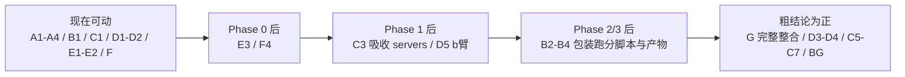

# 可复现轨工程计划（REPRO-PLAN）

> 定位：本计划属于** fork 会话的可复现轨**，与 `PLAN.md`（Phase 0-4，另一会话执行）互补。
> 分工原则：**另一会话产出实验资产（MCP 封装、benchmark、跑分管线）；本轨产出实验仪器（可复现 harness）**。仪器不复制资产，只定义契约 + 包装器，把资产吸收进来。
> 平台愿景对齐：本轨 A 层（任意聊天记录目录/zip 进来）+ BG 层（自动出题）+ B/E 层（跑分/报告）合起来 = PLAN.md Phase 3 的出题平台——"jsonl in → 题目随语料自动长出来 → 自动 benchmark"，语料可替换，整套可迁移到不同 user 做 user study。
> 起草：2026-08-18。基于当时资产盘点（见 §1）。

## 1. 已存在资产盘点（2026-08-18 22:00 核实）

| 资产 | 状态 | 将来被吸收为 |
|---|---|---|
| `docs/interface-spec.md` v0.1（envelope/公平性配置/错误语义/snapshot/B档预留） | ✅ 已落地 | ToolProvider 契约的底层 |
| `servers/common/`（base/envelope/stats）+ `mem0/` + `mock/` | 🚧 进行中（mem0 首个） | harness 的 MCP 工具源 |
| `servers.yaml`（server 注册表 + env_required 显式声明） | ✅ | SUT 配置素材 |
| `scripts/smoke_test.py` = 契约测试 | ✅ | harness 的 probe 命令雏形 |
| `PLAN.md` Phase 2 评测脚本、Phase 3 benchmark 产物 | ⏳ 待产出 | BenchmarkAdapter 包装对象 |

## 2. 工程模块清单与 effort

### A · Corpus 层（聊天记录遍历，R1 需求）

| 项 | 内容 | effort | 依赖 |
|---|---|---|---|
| A1 | 统一 session schema（session/turn/role/tool_call/artifact） | 0.5d | 无 |
| A2 | Proma JSONL parser → schema（intent-recall-mcp 的 reader.ts 逻辑移植） | 0.5d | A1 |
| A3 | Claude Code JSONL parser | 0.5d | A1 |
| A4 | 目录/zip 输入 + 遍历（"给地址就能走"） | 0.3d | A2 |
| A5 | 通用导出格式（微信/WhatsApp…） | 各 ~1d | optional，后置 |

小计 ~2d。**零依赖，现在就能动**。自家 benchmark（Phase 3）的语料也走这条路。

### B · Benchmark 适配层（R2 需求：任何 benchmark 可插）

| 项 | 内容 | effort | 依赖 |
|---|---|---|---|
| B1 | `BenchmarkAdapter` 接口：`load()→tasks / run(SUT)→raw / score(raw)→metrics` | 0.5d | 无 |
| B2 | LoCoMo adapter（包装 Phase 2 脚本） | 0.5d | Phase 2 产出 |
| B3 | LongMemEval adapter | 0.5d | Phase 2 产出 |
| B4 | 自家 benchmark adapter（接收 Phase 3 的 evaluation.json 格式） | 0.5d | Phase 3 产出 |
| B5 | lm-evaluation-harness 桥（通用 MCQ 面覆盖） | 1d | optional |

小计核心 ~2d。

### C · SUT 层（被测对象三层抽象）

| 项 | 内容 | effort | 依赖 |
|---|---|---|---|
| C1 | `SUT` 接口：`manifest / prepare() / answer() / collect_events()` | 0.5d | 无 |
| C2 | model-only（裸 API 臂） | 0.3d | C1 |
| C3 | model+MCP（forced-call **机制级强制**：harness 预调 retrieve→注入 context，替代 prompt 指令） | 1d | C1 + Phase 1 servers |
| C4 | free-call（模型自主调用 + 事后校验"调用确实发生"+ 重试） | 1d | C1 |
| C5 | dsh-as-SUT（Python SDK jsonrpc-agent 驱动） | 1-2d | P2 |
| C6 | Letta-as-SUT（自身 SDK，B档正名：测的就是 Letta） | 1-2d | P2 |
| C7 | multica-as-SUT（free-call 部署真实感臂） | 1-2d | P2 |

小计核心 ~2.5d（C1-C4）。**C3 是 forced-call 从指令级升机制级的家**。

### D · 可注入能力层（意图/记忆 = 第一类实验变量）

| 项 | 内容 | effort | 依赖 |
|---|---|---|---|
| D1 | `ContextInjector` 接口 + 注册（每轮注入什么） | 0.5d | 无 |
| D2 | `ToolProvider` 接口 + 注册（MCP 是一种实现） | 0.5d | 无 |
| D3 | 意图系统 ContextInjector（intent→相关 session 摘要注入） | 1d | D1 + 粗结论为正 |
| D4 | 记忆系统 ContextInjector（ingest 后每轮注入） | 1d | D1 + 粗结论为正 |
| D5 | b 臂实现（意图层 query 前置改写，±控制层矩阵） | 1d | D2 + Phase 1 |

小计 ~3.5d。D1/D2 是接口定义，现在就能动。

### E · Run 层（可复现核心，"model-visible means logged"）

| 项 | 内容 | effort | 依赖 |
|---|---|---|---|
| E1 | Run manifest schema：`benchmark_id × sut_config × seed × data_hash × snapshot_tag` | 0.5d | 无 |
| E2 | Append-only event log（JSONL）：模型可见输入/工具调用/返回全落盘 + 不变式断言 | 1d | E1 |
| E3 | 快照编排（ingest→snapshot→多 run 复用，对接 spec §5） | 0.5d | spec ✅ 已落地 |
| E4 | 报告生成：manifest × 臂 × 维度切片 → 表 | 1d | E1 |
| E5 | 版本化：benchmark 数据 hash / prompt 版本 / 判分器版本 / 环境锁定（uv.lock + docker tag） | 0.5d | E1 |

小计 ~3.5d。**E1/E2 是全轨最高杠杆项**：越早定格式，另一会话的脚本越容易顺手对齐。

### F · 方法学协议（混淆控制，多为约定+默认配置）

| 项 | 内容 | effort |
|---|---|---|
| F1 | 双臂协议（forced/free）默认配置化 | 0.3d |
| F2 | 占位工具协议（off 臂等长工具描述） | 0.5d |
| F3 | n≥3 重复 + 均值±方差报告 | 0.3d |
| F4 | query_mode 协议（fixed/model_formulated，对接 spec） | 0.3d |

小计 ~1.5d。

### G · CLI 整合

| 项 | 内容 | effort |
|---|---|---|
| G1 | `run / probe / report` 三命令（one-command rerun = 审稿人最低要求） | 1d |
| G2 | 声明式实验组合（类 dsh profile 的薄版） | 0.5d |

小计 ~1.5d。

### BG · Benchmark 生成模块（Benchmark-Agent 管线 + PAST-Bench 题型轴植入 harness）

| 项 | 内容 | effort | 依赖 |
|---|---|---|---|
| BG1 | L1 SOP as code：subtask schema 契约模板（题型轴参照 PAST-Bench [arXiv 2608.04003](https://arxiv.org/abs/2608.04003) 四能力轴：memory / procedural reuse / information gathering / update） | 0.5d | 无 |
| BG2 | grounding 检查器（指回真实样本 + 反捷径） | 1d | BG1 |
| BG3 | 三态验证器（valid/可修复/reject，不许编造） | 1d | BG1 |

小计 ~2.5d。产出"从 corpus 生成 benchmark"的能力，Phase 3 的产物格式应与 BG 对齐（反向吸收）。

## 3. 总 effort 与时间预算

| 范围 | 净工作日 |
|---|---|
| 核心仪器（A+B+C1-C4+D1/D2/D5+E+F+G） | **~16-17d** |
| + BG 生成模块 | +2.5d |
| + P2（C5/C6/C7/A5/B5） | +6-8d |

一人全职约 3-4 周；与另一会话**并行**时，先行部分（A + B1 + C1 + D1/D2 + E1/E2 + F ≈ 5-6d）可即刻动工，不占另一会话的路径。

## 4. 依赖图与并行窗口

**吸收边界（本轨不做）**：不封装 MCP server（另一会话 Phase 1）、不写 Phase 2 跑分逻辑、不生成 benchmark 数据（Phase 3）——本轨只提供契约、包装器和编排。

## 5. 论文可复现 checklist（审稿人视角 → 模块映射）

| 审稿人要的 | 模块 |
|---|---|
| 配置即数据（实验可 diff） | E1 |
| 模型可见的一切可从日志重建 | E2 |
| 数据/prompt/判分器可追溯版本 | E5 |
| 种子 + 重复 + 方差 | F3 |
| 环境可重建（lock + docker tag） | E5 |
| 一条命令复跑 | G1 |
| 对照臂公平性（占位工具/双臂/query_mode） | F1/F2/F4 |
| "测的 Letta 就是 Letta"（B档正名） | C6 |

## 6. 建议的启动顺序（本轨 P0）

1. **E1+E2**：manifest schema + event log 格式——纯 schema 零依赖，且越早定，另一会话的评测脚本越容易顺手对齐（可以在 interface-spec 旁边加一个 run-log 附录，请另一会话参考）
2. **A1+A2+A4**：统一 session schema + Proma parser + 遍历入口——R1 需求直接交付，自家 benchmark 语料同源
3. **B1+C1+D1/D2**：四个接口定义一个 `docs/harness-contracts.md`——吸收原则的落点，后面所有包装器照此实现

## 7. 落点约定

- 起步代码放本 repo `harness/` 子目录（避免新建 repo 的迁移摩擦）
- 粗结论为正、需要接 dsh/Pi 时再评估是否独立 repo（`eval-harness`）
- 本文档随进展更新状态列；与 `PLAN.md` §9 保持单向引用（REPRO-PLAN 展开 §9）
