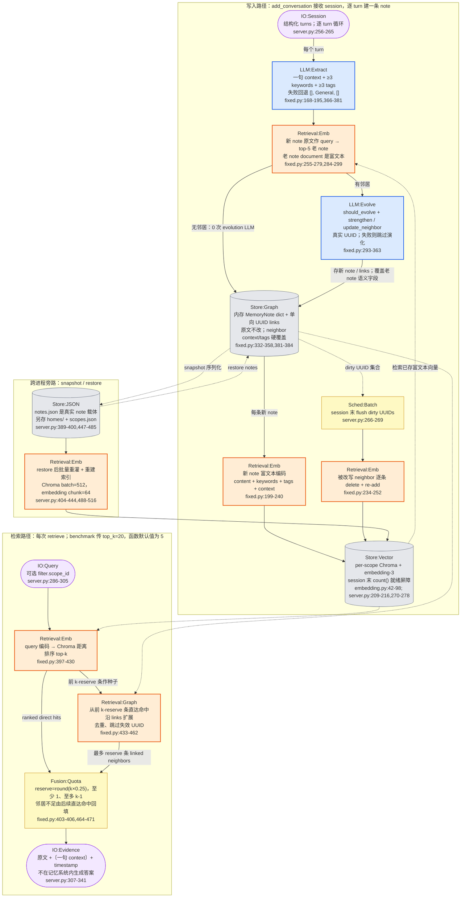

# A-Mem methodology 流程图

> [!note] 来源与口径
> 本系统按 [[METHODOLOGY-FLOW-SPEC]] 的特例只画 **Code 视角**，不补 Paper 视角。主真源是同目录 [[ARCHITECTURE]]，节点与边已逐项回查 `fixed.py`、`embedding.py` 和 `server.py`；本目录没有 `verification.md`，因此代码与架构文档冲突时以当前封装臂代码为准。图的主对象是 `MEMBENCH_AMEM_MODE=fixed` 下 memory-bench 的实测封装行为，不代表上游 A-MEM 原生臂。

## Code 视角

repo `~/Documents/repo/memory-bench`，fixed 臂实现源自 commit `b3acfb2`；数据修正 commit `b5b43f1` 不改变下图方法链。

![[assets/amem-code-flow.png]]

### 核验真源



> [!warning] 环境退化与运行边界
> - `MEMBENCH_AMEM_MODE` 默认是 `native`；未显式设为 `fixed` 时，上图的 note construction、真实 UUID 演化、dirty reindex、邻居配额和 context envelope 都不会按 fixed 路径执行（`server.py:38-41,209-230`）。
> - `LLM:Extract` 重试耗尽后回退为空 keywords/tags 与 `General` context，富文本索引随即退化为仅原文；`LLM:Evolve` 失败则该 note 仍会入库，但不建链、不改邻居（`fixed.py:189-195,326-363`）。
> - embedding 端点或密钥缺失会在初始化/首次编码时报错，不是静默降级（`embedding.py:26-39`）。
> - 多 scope 且未传 `filter.scope_id` 时只查 sidecar 中第一个 scope；除 `scope_id` 外的 filter 全部忽略并写进 `native_notes`（`server.py:291-295,332-335`）。

> [!note] 设计取舍
> - 写入构图固定 `WRITE_K=5`；检索 `top_k` 由调用方传入，统一 benchmark 口径是 20，但 MCP 函数签名默认仍是 5（`fixed.py:58-60`; `server.py:286-287`; `docs/interface-spec.md:154`）。
> - `update_neighbor` 原地硬覆盖 context/tags，不保留版本；content 永不改。links 只写在新 note 上，不反向补边，也没有删除或遗忘机制。
> - 邻居预留比例默认 25%，未做敏感性分析。它用直接命中精度换取沿链线索，邻居不足时才用第 `direct_quota+1` 名以后的直达结果回填。
> - dirty note 延迟到 session 末重算，进程在 flush 前崩溃会留下“内存语义字段已变、向量仍旧”的窗口。
> - 检索不做时间排序、衰减或过滤，`retrieval_count` 也不递增；日期前缀若存在，只作为普通原文参与 embedding。

## 新登记 module

| module | 类别 | 理由 |
|---|---|---|
| `LLM:Evolve` | LLM 调用·蓝 | 单次调用同时决定 `should_evolve`、新 note 的链接强化和邻居语义字段改写。它不是事实抽取，也不是冲突消解；用独立动词保留 A-Mem 的核心自演化语义 |
| `Fusion:Quota` | 融合/门控·黄 | 按固定预算合并 direct hits 与 linked neighbors，并在邻居不足时用 direct hits 回填。与分数相加、RRF、插值或学习门控均不同 |
| `IO:Evidence` | 输入/输出·淡紫 | 记忆封装臂返回给外部答题模型的 evidence envelope 列表；A-Mem 自身不执行 `LLM:Answer` |
| `Store:JSON` | 存储层·灰 | `notes.json` 是 A-Mem 跨进程快照的真实结构化载体；与作为在线记忆形态的 `Store:Plaintext` 不同 |
| `Sched:Batch` | 调度·黄 | session 末集中处理 dirty note 的触发点；与 AtomMem methodology-flow 中画像攒批使用同一 canonical module，建议统一登记进总词表 |

## 不确定处

1. [[ARCHITECTURE]] 写“用原文+语义字段拼成的富文本”检索 top-5 邻居，但 `process_memory()` 明确把 `note.content` 传给 `find_related_with_ids()`（`fixed.py:289`）。因此当前图按“新 note 原文 query，对已存富文本 document 检索”绘制；文档原句是否只是省略了 query/document 两侧差异，未确认。
2. [[ARCHITECTURE]] 写“每 100 次成功演化 consolidate”，但 fixed 臂覆盖的 `add_note()` 只递增 `evo_cnt`，没有阈值检查或 `consolidate_memories()` 调用；仓库内该方法只有定义、没有 fixed 臂调用点（`fixed.py:365-394`）。这是有意取消还是漏迁移，未确认，故不进入主流程图。
3. [[ARCHITECTURE]] 与 `fixed.py:41-44` 注释称 dirty reindex 是“批量 flush / embedding 批量调用”，但 `flush_dirty()` 实际逐 UUID 调 `_index()`，每次 `delete_document()` 后单条 `add_document()`（`fixed.py:234-252`）。只有 restore 明确按 512 条批量写入；session-end flush 是否计划后续批量化，未确认。
4. 本目录没有 `verification.md`，本轮只做静态代码核验，没有重跑 fixed 臂或检查 MCP trace；LLM 失败率、实际邻居占比、dirty reindex 调用数仍依赖既有实测记录。

## 生图 prompt 素材

```text
Create one clean horizontal academic systems diagram titled "A-Mem Fixed — Verified Code Path". White background, compact sans-serif typography, thin charcoal connectors, no gradients, no decorative artwork. Use three aligned swimlanes: INGEST, RETRIEVE, and SNAPSHOT / RESTORE. Use canonical labels exactly and short English captions only. Color and shape system: blue rectangles for LLM modules, orange rectangles for Retrieval modules, yellow rectangles for Fusion and Scheduler modules, gray cylinders for Store modules, and pale-purple rounded rectangles for IO modules. INGEST: IO:Session (structured turns, one note per turn) -> LLM:Extract (one-sentence context, keywords, tags) -> Retrieval:Emb (raw new content queries top-5 stored rich-text notes) -> LLM:Evolve (should_evolve; strengthen UUID links; hard-overwrite neighbor context/tags). Store every new note in Store:Graph (in-memory notes plus one-way UUID links), encode content + keywords + tags + context with embedding-3, then write Store:Vector (per-scope Chroma). Branch dirty neighbor UUIDs to Sched:Batch (session-end flush) -> Retrieval:Emb reindex -> Store:Vector. Show a bypass from neighbor search to storage when no neighbor exists, with no evolution LLM call. RETRIEVE: IO:Query -> Retrieval:Emb top-k direct hits; use the first k-reserve hits as seeds for Retrieval:Graph one-hop link expansion; combine direct and neighbor results in Fusion:Quota with 25% neighbor reserve and direct-hit backfill -> IO:Evidence (original text, one-sentence context, timestamp; no answer generation). Feed Store:Vector into direct retrieval and Store:Graph into link expansion. SNAPSHOT / RESTORE: Store:Graph -> Store:JSON notes.json -> Retrieval:Emb batch rebuild -> Store:Vector, with a restore arrow back to Store:Graph. Add tiny factual captions: write k=5; benchmark retrieval k=20; source text immutable; no time decay; no forgetting; default server mode is native, fixed must be explicitly enabled. Keep labels readable and the data flow strictly left-to-right within each lane.
```
