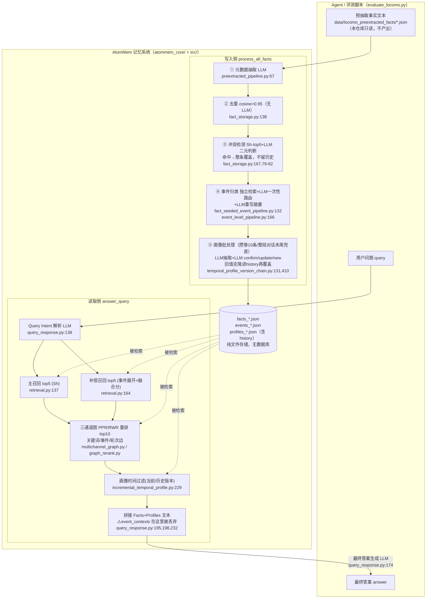

# AtomMem 代码架构

> 读的是 `/Users/guanhongli/Documents/repo/AtomMem`（官方 MINE-USTC/AtomMem，本地已克隆）。
> 术语：**Fact**=一条"原子事实"（一句自包含、第三人称、时间锚定的陈述句）；**Event**=若干 Fact 聚成的"一件事"；**Profile**=某个人的长期稳定属性（带历史版本 H）；**PPR/RWR**=Personalized PageRank / Random Walk with Restart，一种从种子节点出发、按边权重扩散"重要性分数"的图算法。
> **2026-09-05 勘误**：本文已按同目录 `verification.md` 的逐条复核结论修正（共 23 处：5 处事实、17 处行号/锚点、1 处表述限定）。原始未修正版本见 git 历史。

## 1. 一句话机制

代码库的核心其实是**检索侧的三段式召回 + 图重排**，而不是"论文标题党"的 SFT Fact Executor——LoCoMo 跑分入口从磁盘直接读现成的事实文本（`data/locomo_preextracted_facts/*.json`），本仓库里没有任何代码在跑分时真正执行"抽原子事实"这一步；真正被反复执行、且写得最扎实的，是"存的时候查重/查冲突/挂事件/攒够N条批量搞画像"和"查的时候主召回+事件补偿召回出种子、种子喂进关键词/事件/对话轮三通道图做 PPR 扩散重排"这两条流水线。

## 2. 记忆是怎么存进去的

**触发时机**：`process_all_facts`（`atommem_core/preextracted_pipeline.py:197`）按 LoCoMo 对话逐个 session、逐个 turn 遍历，处理每个 turn 自带的 `facts`（字符串数组）。**这些 fact 文本从哪来，这段代码根本不管**——LoCoMo 评测入口 `scripts/evaluate_locomo.py` 里 `run_case()` 直接调用 `memory_pipeline.load_preextracted_facts(str(case["facts_file"]))`，从 `data/locomo_preextracted_facts/conv-*.json` 读现成结果（`atommem_core/preextracted_pipeline.py:49` `load_preextracted_facts`），全程不调用任何"Fact Executor"模型。这些预抽取文件本身只有 `{"source_file":..., "total_sessions":...}` 两个元数据字段（`data/locomo_preextracted_facts/conv-26.json:1-4`），没有任何模型版本/生成脚本记录。

**存的是什么**：不是原文，是已经写成第三人称、时间锚定的自包含句子（例如原文"I went to a LGBTQ support group yesterday" → 存的是"Caroline attended a LGBTQ support group on May 7, 2023, and found it to be a powerful experience."，原文在 `data/locomo_preextracted_facts/conv-26.json` 第 33 行、改写后的 fact 在第 35 行），外加结构化字段 `{fact_id, fact, embedding, people, keywords, time:[event_time, interaction_time], dia_id, event_ids, needs_profile_extraction}`（`atommem_core/preextracted_pipeline.py:126-165` `build_fact_tuple`）。

**存的过程调不调 LLM**（下面的①其实在入库之前就做完了——在 `build_fact_tuple` 里（`atommem_core/preextracted_pipeline.py:147-150` → `extract_fact_metadata`），②③④⑤ 才是 `FactStorageManager.process_new_fact`（`src/fact_storage.py:35-136`，被 `preextracted_pipeline.py:312` 调用）自身的步骤；该函数 docstring(39-44) 自列的五步是"去重 / 冲突检测 / **存储** / 事件归类 / 画像检查"——比下面这张表多一步 `save_facts` 落盘（`fact_storage.py:93-94`）、少一步元数据抽取）：

1. **元数据抽取**——调 1 次 LLM，把 fact 文本解析成 people/keywords/time/needs_profile_extraction（`extract_fact_metadata`, `atommem_core/preextracted_pipeline.py:67-122`，用 `prompts/fact_metadata_extraction_prompt.txt`）。
2. **去重**——**不调 LLM**，纯 embedding 余弦相似度门槛：新 fact 只要和某条已存 fact 相似度 > 0.95 就直接 `IGNORE`（`_is_duplicate`, `src/fact_storage.py:138-165`；阈值 `config.DUPLICATE_THRESHOLD=0.95`，`config.py:59`）。
3. **冲突检测**——先按 people **兼容性**筛候选（`people_sets_compatible`, `src/fact_storage.py:14-16`：只有"双方 people 都非空且完全不相交"才拒，people 为空的一律放行，不是"交集非空才留"），再用 `Sh=α·emb_sim+β·jaccard`（`config.EMBEDDING_WEIGHT_ALPHA=0.7`/`KEYWORD_WEIGHT_BETA=0.3`）排序取相似度>0.6 的 top-5（阈值 0.6 和 top-5 都是硬编码，`fact_storage.py:213`/`:222`；`_detect_conflict`, `src/fact_storage.py:167-226`），喂给 1 次 LLM 做二元冲突判断（`_llm_detect_conflict`, `fact_storage.py:228-273`）。**一旦判定冲突，直接原地覆盖**被冲突那条 fact 的 `fact`/`embedding`/`keywords`/`time` 四个字段（`fact_storage.py:79-82`）——旧文本、旧向量都不保留，也不进任何历史列表。
4. **事件归类**——生产链路实际用的是 `FactSeededEventLevelEventManager`（见下方"我没搞清楚的 #2"），它自己单独跑一次 top-k 相似事实检索（`_retrieve_top_similar_facts`, `atommem_core/fact_seeded_event_pipeline.py:132-155`，用 `config.EVENT_ATTRIBUTION_TOP_K=10`/`EVENT_ATTRIBUTION_EMBEDDING_WEIGHT=0.7`/`KEYWORD_WEIGHT=0.3`），**不复用**第 3 步冲突检测时已经算过的候选和分数；把检索到的 fact 转成"已挂事件"或"独立事实（singleton）"候选，调 1 次 LLM 做一次性路由选择（可多选，`_llm_judge_event_level_attribution`, `atommem_core/event_level_pipeline.py:166-247`，**用内联 system_prompt，不读取** `prompts/event_attribution_prompt.txt`）；选中已有事件就再调 1 次 LLM 重写事件摘要/关键词（`_llm_generate_event_info`, `src/event_manager.py:267-327`，prompt `prompts/event_generation_prompt.txt` 在 315 行被套用；**注意 242-286 落在另一个函数 `_update_event_info`(229-266) 里，不要照那个范围去读**）——而且这次调用是**每个命中事件各一次**（`_update_event_info` 在 `event_level_pipeline.py:47-57` 的循环里被逐个调用），新建事件同样各调一次（`_create_new_event:185` → 198）。
5. **画像批处理**——不是实时写，是"待处理事实攒够 10 条"才触发（`check_and_trigger_batch_extraction`, `src/profile_manager.py:27`，真正的触发判断在 41 行；`config.PROFILE_BATCH_TRIGGER=10`，`config.py:66`）；触发后按人分组，**每个人各调 1 次 LLM** 抽取候选画像句（`_llm_extract_profiles`，在 `atommem_core/incremental_temporal_profile.py:151-153` 的每人循环内，用 `profile_extraction_prompt.txt`——一个 batch 里有 N 个人就是 N 次调用，不是 1 次），再对每条候选跑时序决策（`IncrementalTemporalProfileProcessor.process_candidate`, `atommem_core/incremental_temporal_profile.py:82-107`，内部调用父类 `TemporalProfileBuilder`（类定义见 `atommem_core/temporal_profile_version_chain.py:151`）的方法链）：
   - 检索该用户 top-8 已有画像（`config.PROFILE_TEMPORAL_TOP_K=8`），最高相似度 < 0.55（`config.PROFILE_TEMPORAL_MIN_LLM_SCORE`）→ **不调 LLM**，直接建新画像；
   - 文本完全相同（规范化后逐字比对）→ **不调 LLM**，直接 `confirm`/`update_history`（`_direct_decision`, `temporal_profile_version_chain.py:252`）；
   - 否则调 1 次 LLM 决策 `confirm`/`update_current`/`update_history`/`new`（`profile_temporal_update_prompt.txt`）。
   - `update_current` 时会把**旧的 content 连同其有效期一起克隆进 `history` 列表**再覆盖当前值（`clone_current_to_history`, `temporal_profile_version_chain.py:131`；`_apply_update_current`, `temporal_profile_version_chain.py:410`）——这是全系统**唯一**做"版本保留"而非硬覆盖的模块，和上面第 3 步 Fact 冲突覆盖形成鲜明对比。
   - 整个对话（所有 session）跑完后，`process_all_facts` 末尾统一调 `force_profile_extraction()` 兜底清空剩余不足 10 条的待处理队列（`atommem_core/preextracted_pipeline.py:362`），随后落盘 `facts_*.json`/`events_*.json`/`profiles_*.json`（`IncrementalTemporalProfilePipeline.save_memory_snapshot`, `atommem_core/incremental_temporal_profile.py:324`）。

## 3. 记忆是怎么被用起来的

**触发**：`AtomMemGraphQueryResponder.answer_query`（`scripts/run_atommem_pipeline.py:296`）每次提问触发一次，内部调 `answer_query_with_query_info`（`run_atommem_pipeline.py:312-386`）。

**拿什么去找**：先调 1 次 LLM 解析 query 意图（`_extract_query_intent`, `src/query_response.py:138-172`，用 `query_intent_prompt.txt`）得到 `need_attribute`/`people`/`keywords`/`time`，再对 query 本身编码 embedding。

**一步到位还是多步迭代**：三级，逐级放宽召回范围：

1. **主召回**（Primary）：按 people/time 过滤后，`Sh` 排序取 top-5 事实（`_main_recall_facts`, `src/retrieval.py:137-162`；`config.MAIN_RECALL_TOP_K=5`）。
2. **补偿召回**（Compensatory）：先按 `Sh` 取 top-5 事件（`_retrieve_events`, `src/retrieval.py:241`，取 top-k 在 265 行；`config.EVENT_RECALL_TOP_K=5`），展开这些事件下**还没被主召回覆盖**的成员事实，用融合分 `0.7·事件分+0.3·事实自身分`（`config.COMPENSATION_EVENT_WEIGHT=0.7`）排序取 top-5（`_compensation_recall_facts`, `src/retrieval.py:164`，跳过主召回命中在 197-198、融合分在 230-231、截断在 239）。以上两路合并、去重后截到 `config.GRAPH_MAX_SEED_FACTS=10` 条，作为 "seed_facts"（`run_atommem_pipeline.py:339`）。
3. **图激活重排**（Associative）：以 seed_facts 为种子，在关键词/事件/对话轮次三通道（`MultiChannelFactGraphIndex`/`MultiChannelFactGraphRetriever`, `atommem_core/multichannel_graph.py`）里局部展开子图（仍受 people/time 过滤，`max_hops=2`、`max_local_nodes=180`）。种子分先按"检索分+0.05·排名先验"混合，再做**5 次幂**锐化并归一化，作为 PPR 的重启分布（`SeedOnlyGraphReranker._build_seed_scores`, `atommem_core/graph_rerank.py:83-114`；`config.GRAPH_SEED_SCORE_POWER=5.0`）。三条边的权重公式：关键词边=IDF加权重叠/几何平均归一化（`_keyword_edge_weight`, `multichannel_graph.py:518-530`）、事件边=`1/(事件大小-1)^1.25`（`_event_edge_weight`, `multichannel_graph.py:532-544`）、对话轮边=`exp(-轮次距离/2.0)`（`_turn_edge_weight`, `multichannel_graph.py:546-556`）。多通道 PPR 按节点级"有效通道"动态归一化通道权重后跑迭代（`_run_ppr`, `multichannel_graph.py:426-462`），收敛或跑满 `config.GRAPH_MAX_ITER=20` 后，取分数最高的 `config.GRAPH_FINAL_TOP_K=10` 条作为 `final_facts`（若种子为空则直接退化成第 2 步的 seed_facts）。
4. **画像检索**：若 `need_attribute=True`，按 person 过滤 + `Sh` 排序取 top-5（`config.PROFILE_RECALL_TOP_K=5`），再按 query 携带的时间选中"当前版本"或某个历史版本（`_apply_profile_time_filter`, `atommem_core/incremental_temporal_profile.py:229`）。

**找到之后怎么交给模型**：`_generate_answer`（`src/query_response.py:174-217`）把 `final_facts` 格式化成 `- F5: "..." recorded_date=...`（`query_response.py:246-249`）、profiles 格式化成 `- P3: "..."`（`:228`）——两者都带前导 `- `，按 LoCoMo 题目 category 选一个答题 prompt 模板（`_load_category_prompt`, `query_response.py:46`，三个分支在 53-58 行；44 落在上一个函数 `_load_answer_prompt` 里：category 2=时间推理专用、category 3=开放域常识专用、其余用默认模板），最后调 1 次 LLM（`response_format="text"`）生成最终答案。**注意**：`_generate_answer` 收到的 `event_contexts`（事件摘要）参数在这一步被显式丢弃——`_ = event_contexts, query_info`（`query_response.py:195`）之后又手动传 `event_contexts={}`（`query_response.py:198`）；`_format_facts_for_prompt` 内部同样丢弃这个参数（`query_response.py:232-234`），事件摘要从未真正出现在最终 LLM 提示词里。详见第 6 节冲突点 #1。

## 4. 架构图

图中"记忆系统"框内几乎每一步都在调 LLM（元数据/冲突判断/事件路由/事件摘要/画像抽取/画像决策/查询意图/最终生成，共 8 类调用点），但这些 LLM 调用全部走同一个 `LLMInterface`（`src/llm_interface.py`），和"最终答案生成"用的是**同一个 backbone 模型**（`config.LLM_MODEL`，默认 `gpt-4o-mini`）——代码里没有一个独立的小模型专门负责这些记忆内部判断；唯一设计了独立模型接口的是 Fact Extractor（`config.FACT_EXTRACTOR_*`），但它在 LoCoMo 跑分链路里根本不会被调用。

## 5. 我没搞清楚的

1. `data/locomo_preextracted_facts/*.json` 里的 fact 文本到底是不是用论文里 SFT 过的 Qwen3-14B 模型跑出来的——文件本身只有 `{source_file, total_sessions}` 两个元数据字段，没有模型版本/生成时间/生成脚本的任何记录；仓库里也没有能生成这批文件的脚本调用痕迹（`evaluate_locomo.py`/`run_atommem_pipeline.py` 都只读不写这个目录）。**未验证**。
2. `EventManager` 基类（`src/event_manager.py`）的完整两阶段流程（`_retrieve_similar_facts`→`_llm_judge_clustering`→`_batch_filter_relevant_events`）在最终跑分链路（`IncrementalTemporalProfilePipeline`→`FactSeededEventLevelEventManager`）里完全不会被触发，因为 `process_event_attribution` 被子类整体覆盖（`event_level_pipeline.py:18`）；`prompts/event_attribution_prompt.txt` 因此被加载了却从未被用到。这段基类代码是历史遗留、给消融实验用的分支，还是别的用途，仓库没有任何说明或注释。**未验证**。
3. Table 2（论文）里 "AtomMem-Flat"、"w/o Profile" 两个消融变体，公开仓库里找不到对应的命令行开关或脚本——`run_atommem_pipeline.py` 只有 `--disable-graph`（对应 "w/o Graph"）。这两组数字是用未公开的内部脚本/分支跑出来的，还是通过手动改代码跑的，从这份仓库无法判断。
4. `src/llm_interface.py` 的类文档字符串写"LLM API interface for calling Qwen via DashScope compatible mode"（`src/llm_interface.py:13`），但 `config.py` 默认 `API_BASE` 是 OpenAI、`LLM_MODEL` 默认 `gpt-4o-mini`，和论文 §4.1"re-implemented all baselines using GPT-4o-mini"一致。这行注释是开发过程中的残留，还是作者内部实际跑分时确实切换到了 DashScope/Qwen（`.env` 不在仓库里，无法确认实际使用的模型），**未验证**。
5. `data/split_samples/` 和 `data/locomo_preextracted_facts/` 都只有 10 个 conv 文件，对应 LoCoMo 标准测试集规模，但论文 Table 1 的 "AtomMem" 行 token 数是 21357.06K——这个数字是否含"预抽取"这一步本身消耗的 token（如果预抽取真的用了 Qwen3-14B API），还是只统计仓库代码实际跑的这几步（元数据/冲突/事件/画像/查询/生成），从代码里看只有后者会被 `get_aggregate_llm_statistics()`（`atommem_core/incremental_temporal_profile.py:334`）计入，前者不在统计范围内。**未验证**，需要论文原始实验记录才能确认。

## 6. 与论文的冲突点

### ① SFT Fact Executor：权重不在仓库里；"抽取规则"在三条代码路径里落地程度不一致

仓库不含任何模型权重文件（`find . -iname "*.pt" -o -iname "*.ckpt" -o -iname "*.bin" -o -iname "*.safetensors"` 无结果），`requirements.txt` 里也没有 `torch`/`transformers`/`peft`——七行依赖（`openai`/`httpx`/`fastapi`/`uvicorn`/`numpy`/`sentence-transformers`/`tqdm`）里和模型有关的只有 `openai`（走 API）和 `sentence-transformers`（仅用于 embedding，不用于生成）。也就是说论文 §4.1 描述的"用 LoRA rank 128、单 A100、lr 5e-5 微调 Qwen3-14B"这套训练/推理能力**完全不在这个仓库里**，仓库只提供了训练数据本身（`data/SFT_training_data.json`，4352 条，与论文 §A.1.3 的数字一致——不是 §A.3，§A.3 是 "Details of Associative Graph Retrieval"）——想复现 Fact Executor 得自己拿这份数据去别处微调。

论文 Figure A.1（`literature/papers/Yao-2026-AtomMem-Building-Simple-and-Effective-Memory-System-for-LLM-Agents-via-Atomic-Facts.txt:1189-1207`，正文 Figure 4 caption 复用同一张图）编号的抽取规则是 **5 条大类**（不是 6 条）：①过滤低价值 ②指代消解（代词+相对时间→绝对日期/显式实体，这条内部其实有两个子动作）③改写第三人称+显式归属（如"The user believes..."）④多模态整合（把 `[Image Description]` 当主要信息源融进事实文本）⑤严格 JSON 输出。如果把②拆成"代词"和"时间"两条、⑤拆成"分条输出"和"JSON格式"两条,可以数出 6 条子规则，但正文的一级编号明确是 5 条——这点上任务描述里的"六条"和论文原文编号对不上，这里按实际读到的文本更正。

这 5 条规则在仓库里能**实际运行**的两条代码路径落地程度差别很大：
- **demo 服务器**（`scripts/run_demo_server.py:118-140` `DemoFactExtractor`）的 prompt 和 `data/SFT_training_data.json` 里的 `instruction` 字段**逐字几乎完全一致**（都有"rewrite it as objective third-person facts"整句），忠实覆盖了①②③⑤。
- **公开批处理脚本**（`scripts/run_atommem_pipeline.py:105-166` `FactExtractor`，配 `--extract-facts` 用）的 prompt **完全没提"改写第三人称"**（③整条规则缺失，只写了"Keep each fact objective, complete, and standalone"），也没有 Figure A.1④"把视觉信息当主要信息源融合"的措辞（只是把 `blip_caption`/`query` 文本拼接进上下文，"treat as primary source"这个指令没有）。
- 而**真正用于产出 Table 1 分数的 LoCoMo 评测入口**（`evaluate_locomo.py`）**两条路径都不走**，直接读 `data/locomo_preextracted_facts/`——从这批文件里的措辞看（如"Caroline attended a LGBTQ support group on May 7, 2023..."），实际生成时是遵守了①②③⑤的，但生成它的具体代码本仓库没有保留。

结论：**SFT 权重确认不在 repo 里；5 条规则里"第三人称改写"这条在仓库能跑的两条代码路径中有一条（`run_atommem_pipeline.py`）明确没有实现，只有 demo 路径忠实实现；跑分用的现成数据本身遵守了规则，但产出它的代码不在仓库内、无法验证。**

### ② 事件级上下文（event context）从未进入最终答案生成的 prompt——论文明确写了这是输入，代码明确丢弃了它

这是本次读码发现的最大冲突点，双向证据都很扎实：

- **论文侧**：Appendix Figure 8/A.3（"single-hop/multi-hop/temporal"用）和 Figure 9/A.4（"open-domain"用）两张图的 "Input" 都明确列出四项：`query` / `profiles` / `facts` / **`event_contexts: Dictionary mapping fact_id to event summary (optional)`**。正文 §3.5.3 也写"This context C...ensures that the agent's answer is grounded in specific atomic details, **enriched by event-level context**, and personalized by long-term user attributes"——论文两次（图+正文）明确宣称事件摘要会参与最终生成。
- **代码侧**：`src/query_response.py:174` 的 `_generate_answer` 函数确实接收 `event_contexts` 参数，但第 195 行 `_ = event_contexts, query_info` 直接丢弃，第 198 行调用 `_format_facts_for_prompt(relevant_facts, event_contexts={})` 又手动传空字典；`_format_facts_for_prompt`（第 232-234 行）内部同样丢弃这个参数，格式化出的每条 fact 字符串只有 `fact_id`/`fact`文本/`recorded_date`，没有任何事件摘要。仓库里三份实际使用的答题 prompt 文件（`prompts/answer_generation_prompt.txt`、`_cat2.txt`、`_cat3.txt`）的 Input 说明**都只有 Query / Selected Profiles / Selected Facts 三项，没有 "event_contexts" 这一行**——即代码的 prompt 文件本身就已经把这项从论文版本里删掉了，不是运行时偶然漏传；`_cat3.txt` 第 12 行甚至反过来明令 `Do not use unselected retrieved evidence, event summaries, retrieval scores, keywords, or outside conversation details`，直接禁止用事件摘要。
- 但这三份文件**并不是"逐句和论文 Figure 8/9 几乎一致"**：只有 `answer_generation_prompt.txt`(1-20) 与 Figure 8（txt:1740-1751）近乎逐字；`_cat2.txt`(1-25) 是**论文里完全不存在**的时间推理专用模板（5 条时间表达规则 + 4 条输出规则，含 "the Sunday before 22 May 2023" 这类论文没有的锚定式规定）；`_cat3.txt`(1-35) 与 Figure 9（txt:1757-1778）只是主题相同，5 条 reasoning rules + 4 条 output rules + 2 个 worked example 全是自己写的。顺带牵出一条 code-only 分歧：论文 Figure 8 的 caption（txt:1753-1754）明确说这一个 prompt 就是 "utilized for single-hop, multi-hop, and temporal reasoning tasks"，即论文侧 temporal 与单跳/多跳**共用同一个** prompt，代码却给 cat2 单开了一套。
- 换句话说：`_build_event_contexts`（`run_atommem_pipeline.py:399`）、`LayeredRetriever._retrieve_facts_with_events`（`src/retrieval.py:104-135`）等好几处代码都在认真计算"每条 fact 属于哪个事件、事件摘要是什么"，这份计算结果被塞进返回字典的 `event_contexts` 键，一路传到 `_generate_answer` 门口，然后被两行代码直接扔掉。**"Response Generation: Hierarchical Memory Integration"（论文 §3.5.3 标题）里"hierarchical"的事件那一层，在最终生成这一步实际上是空的。**

### ③ Profile 批处理触发粒度：论文说"每 session 结束"，代码是"整个 conversation 结束 + 攒够 10 条"的混合体

论文 §3.3 原话："During atomic fact extraction, the LLM identifies facts implying potential long-term characteristics and temporarily adds them to a waiting queue. **At the end of a dialogue session**, the system processes these queued candidate facts in a batch."——字面意思是每个 session（LoCoMo 一个 conv 通常有 19-35 个 session）结束都会批处理一次。

代码里真正的"批处理"由两个入口触发：
- `check_and_trigger_batch_extraction`（`src/profile_manager.py:27`，触发判断在 41 行）在**每条新 fact 存入后都会检查**一次，只要待处理队列 ≥ 10 条（`config.PROFILE_BATCH_TRIGGER`）就立刻批处理，这个计数器**跨 session 累积，和 session 边界无关**；
- `force_profile_extraction()`（`atommem_core/preextracted_pipeline.py:362`）只在 `process_all_facts` 处理完**全部 session**（即整个 conversation）之后调用一次，兜底清空不足 10 条的尾巴。

也就是说：如果某个 session 里画像相关的事实密集，可能一个 session 内触发好几次批处理；如果稀疏，可能好几个 session 的量攒在一起才触发一次；而"每个 session 结束都处理一次"这个论文字面描述的触发点，在跑分链路里**根本不存在**。

### ④ Fact Verification：论文框成"一次 LLM 联合产出残差内容+冲突更新"，代码拆成"无 LLM 硬阈值去重"+"LLM 二元冲突判断+整条覆盖"两条路

论文 §3.1.3 把验证写成一个函数：`(c'_new, U) ← LLM(cnew ∥ Cret)`，一次 LLM 调用同时决定"要存的残差新信息"和"冲突更新元组"，强调这样"防冗余+维护全局一致性"。代码里这其实是两条独立、触发条件不同的路径（见第 2 节步骤②③）：去重完全不调 LLM（纯 0.95 阈值硬判），冲突检测调 LLM 但只输出二元 `has_conflict`+`conflict_fact_id`，命中后**不是生成残差合并内容，而是直接拿新 fact 的四个字段整条覆盖旧 fact**（`fact_storage.py:79-82`），旧文本没有任何保留渠道。这一点和论文引言里明确点名反对 A-Mem"unconstrained updates...destruction of original facts"的表述存在方法论张力——虽然 AtomMem 的 fact 层覆盖是有条件触发（LLM 判过冲突）而非 A-Mem 式的自由重写，但结果同样是旧文本不可逆丢失，且没有像 Profile 层的 `history` 那样留痕。

### ⑤ Event 候选生成：论文写"复用 Fact Verification 的 Cret"，代码是重新单独检索

论文 Algorithm 1 第 5-11 行明确写"for all F ∈ Cret"——候选事件/独立事实集合是从 Fact Verification 阶段已经检索出的 `Cret` 里划分出来的，不是重新检索。代码里 `FactSeededEventLevelEventManager._retrieve_top_event_candidates`（`atommem_core/fact_seeded_event_pipeline.py:63-101`）调用自己的 `_retrieve_top_similar_facts`（同文件 132-155 行）独立做一次 top-10 相似事实检索，用的权重（`EVENT_ATTRIBUTION_EMBEDDING_WEIGHT`/`KEYWORD_WEIGHT`）和冲突检测阶段的权重（`EMBEDDING_WEIGHT_ALPHA`/`KEYWORD_WEIGHT_BETA`）在 config 里是两套独立可调的参数，两次检索互不复用、互不共享分数。

### ⑥ 消融变体在代码里没有对应开关

Table 2 的 "AtomMem-Flat" 和 "w/o Profile" 两行没有对应的 CLI 参数或代码分支；仓库只支持 "w/o Graph"（`--disable-graph`）。参见第 5 节"我没搞清楚的 #3"。
