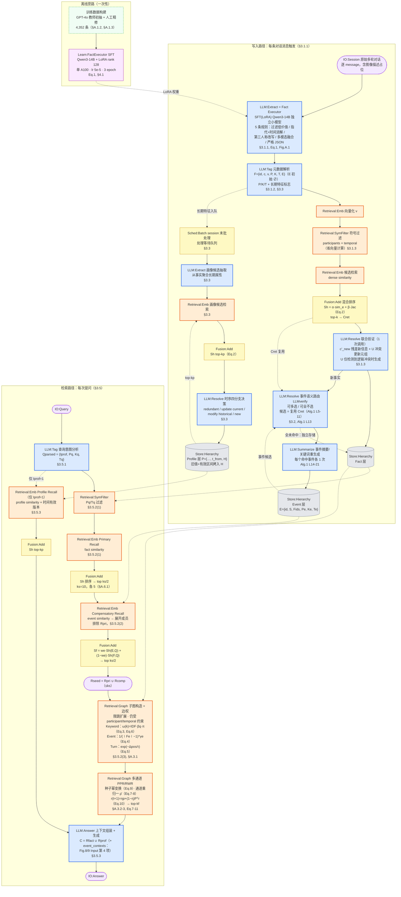

# AtomMem methodology 流程图

> [!note] 来源与口径
> 基于同目录 [[paper-architecture]]、[[code-architecture]]，勘误已按 [[verification]]（124 条断言复核：✓101 / ✗2 / ◐20 / ?1）修正后吸收：
> - **行号修正**：`_main_recall_facts` → retrieval.py:137、`_compensation_recall_facts` → :164、`_retrieve_events` → :241、`_extract_query_intent` → query_response.py:138、`_llm_generate_event_info` → event_manager.py:267-327、`check_and_trigger_batch_extraction` → profile_manager.py:27（触发行 :41）
> - **节号/符号修正**：4,352 条训练样本 = **§A.1.3**（非 §A.3）；种子分布构造 = **Eq.9**（Eq.6=ω(k) 关键词权重、Eq.7-8=多通道转移矩阵）；"top-k2s" 实为 **top ks/2**（§A.6.1：ks=10，主/补偿种子各 5——与代码 5+5=10 精确对齐，D15）
> - **机制表述修正**：cat2 时间推理答题模板是论文里完全不存在的 code-only 模板（C61）；A-Mem 并未被论文"点名批评"，批评句主语是 these methods（P7）；"与 Mem0g/Zep t_invalid 同族"是文档作者自己的跨系统类比、非论文内容（P29）
>
> 词汇表与图例见全项目规范 [[METHODOLOGY-FLOW-SPEC]]。图内 **D#** 编号指 verification.md §5 的论文↔代码分歧表（D1-D16）。

## Paper 视角

Yao et al. 2026, *AtomMem: Building Simple and Effective Memory System for LLM Agents via Atomic Facts*, arXiv:2606.19847（USTC 认知智能全国重点实验室 + 安徽大学）。核心主张：记忆表征质量至上——SFT 专用小模型把对话蒸馏成原子事实，再叠 Event/Profile 两层做可控、非破坏性的增量聚合；检索靠实体/事件/时间三类边的多通道 PPR 扩散。

![[assets/atommem-paper-flow.png]]

### 核验真源



> [!note] 论文侧边界说明
> - 三类关联边**不是持久图**：边权 ω(k) 依赖 query keywords（Eq.6），只能在查询时计算；论文写入侧没有显式的图构建/落库步骤（verification §3.2 注记）。
> - 除 Fact Executor（独立 SFT 小模型）外，论文所有步骤只写 "the LLM"、均未说明模型归属，与最终生成是否同一模型未知（verification P30）。
> - Figure 8/9（Appx.A.3/A.4）的 Input 明确列 `event_contexts` 为第四项（txt:1739/1762），正文 §3.5.3 亦写 "enriched by event-level context"——这一设计在代码侧被整体丢弃（见 Code 视角 DEAD/D5）。

## Code 视角

repo `~/Documents/repo/AtomMem` @ `776f880`（MINE-USTC/AtomMem）。跑分链路的核心是检索侧三段召回 + 图重排；"抽原子事实"一步**不在本仓库执行**（LoCoMo 评测入口直接读预抽取 JSON，evaluate_locomo.py:744）。

![[assets/atommem-code-flow.png]]

### 核验真源



```mermaid
flowchart TB
    classDef llm fill:#dbeafe,stroke:#2563eb,stroke-width:2px
    classDef alg fill:#ffedd5,stroke:#ea580c,stroke-width:2px
    classDef nlp fill:#ecfccb,stroke:#65a30d
    classDef store fill:#e5e7eb,stroke:#6b7280
    classDef io fill:#f3e8ff,stroke:#9333ea
    classDef dead fill:#fee2e2,stroke:#dc2626,stroke-dasharray:5 5
    classDef async fill:#f0fdf4,stroke:#16a34a,stroke-dasharray:4 3
    classDef learn fill:#fae8ff,stroke:#a21caf
    classDef sched fill:#fef9c3,stroke:#ca8a04

    subgraph INGEST["写入路径：process_all_facts 逐 session 逐 turn（preextracted_pipeline.py:197）"]
        direction LR
        PRE(["IO:Session 预抽取事实<br/>data/locomo_preextracted_facts/*.json<br/>外部产物：无生成脚本/模型记录<br/>load_preextracted_facts :49"])
        TAG["LLM:Tag 元数据抽取（1×）<br/>people / keywords / time /<br/>needs_profile_extraction（D10：判定在此步而非抽取步）<br/>preextracted_pipeline.py:67<br/>关键词归一化截 5：fact_seeded_event_pipeline.py:17"]
        VEC["Retrieval:Emb 向量化<br/>all-MiniLM-L6-v2<br/>preextracted_pipeline.py:153"]
        DEDUP["Retrieval:Emb 阈值去重（无 LLM）<br/>cosine>0.95 → IGNORE 整条丢弃<br/>fact_storage.py:138-165"]
        SYM["Retrieval:SymFilter people 兼容筛<br/>temporal 分量 = no-op（D7）<br/>fact_storage.py:189-195"]
        CRET["Retrieval:Emb 冲突候选<br/>dense similarity"]
        CSIM["Fusion:Add 冲突排序<br/>Sh(0.7/0.3) > 0.6 → top-5<br/>fact_storage.py:167-226"]
        CDEC["LLM:Resolve 二元冲突判断（1×）<br/>has_conflict + conflict_fact_id<br/>命中 → 四字段整条硬覆盖 :79-82（无历史留痕）<br/>fact_storage.py:228-273"]
        FS[("Store:Hierarchy Fact 层<br/>facts_*.json")]
        ESIM["Retrieval:Emb 事件候选<br/>独立重跑 top-10（D3：不复用冲突候选）<br/>fact_seeded_event_pipeline.py:132, 63"]
        EFUSE["Fusion:Add<br/>另一套 0.7/0.3 权重"]
        EROUTE["LLM:Resolve 事件归属路由（1×，内联 prompt）<br/>可多选 / 全不选<br/>event_level_pipeline.py:166-258"]
        ESUM["LLM:Summarize 事件摘要/关键词重写<br/>命中重写 + 新建生成各 1×（新建 :185）<br/>event_manager.py:267-327"]
        ES[("Store:Hierarchy Event 层<br/>events_*.json")]
        BATCH["Sched:Batch 攒批触发<br/>每 fact 入库后检查，≥10 触发<br/>计数跨 session 累积（D4）<br/>profile_manager.py:27, 41"]
        FORCE["Sched:Batch conversation 末兜底<br/>force_profile_extraction<br/>preextracted_pipeline.py:362"]
        PAGG["LLM:Extract 画像抽取<br/>按人分组，每人各 1×<br/>incremental_temporal_profile.py:134"]
        PSIM["Retrieval:Emb 画像候选检索<br/>temporal_profile_version_chain.py:229"]
        PFUSE["Fusion:Add<br/>Sh top-8"]
        PDEC["LLM:Resolve 时序决策（0 或 1×）<br/>① top<0.55 直接新建（无 LLM）<br/>② 文本全等直接 confirm（:252，无 LLM）<br/>③ _llm_decide 四分支（:284）"]
        CLONE["版本克隆（非破坏更新，全系统唯一）<br/>clone_current_to_history :131<br/>_apply_update_current :410<br/>批末 _normalize_timelines :495"]
        PS[("Store:Hierarchy Profile 层<br/>profiles_*.json 含 history")]

        PRE --> TAG --> VEC --> DEDUP --> SYM --> CRET --> CSIM --> CDEC --> FS --> ESIM --> EFUSE --> EROUTE --> ESUM --> ES
        FS --> BATCH
        FS --> FORCE
        BATCH --> PAGG
        FORCE --> PAGG
        PAGG --> PSIM --> PFUSE --> PDEC
        PDEC -->|"update_current"| CLONE --> PS
        PDEC -->|"confirm / update_history / new"| PS
    end

    subgraph DEAD["论文宣称但代码中不存在/死代码"]
        direction LR
        D1n["LLM:Extract（Fact Executor SFT 抽取）<br/>跑分链路不执行：无权重、无训练依赖<br/>evaluate_locomo.py:744 直接读预抽取 JSON（D1）"]
        D2n["LLM:Resolve 残差提炼 c'_new<br/>代码只二元冲突判断 + 整条覆盖（D2）"]
        D5n["LLM:Answer event_contexts 注入<br/>_build_event_contexts :399 计算后<br/>:195/:198/:234 三处丢弃<br/>cat3 更明令禁用 event summaries（D5）"]
        D4n["Sched:Batch session 末触发<br/>代码无 session 边界触发点（D4）"]
    end

    subgraph RETRIEVE["检索路径：answer_query 每题一次（run_atommem_pipeline.py:296）"]
        direction LR
        Q(["IO:Query"])
        QP["LLM:Tag 查询意图（1×）<br/>need_attribute / people / keywords / time<br/>query_response.py:138"]
        CFILT["Retrieval:SymFilter<br/>people + time 真过滤<br/>_filter_facts retrieval.py:267"]
        PRI["Retrieval:Emb 主召回<br/>fact similarity<br/>_main_recall_facts retrieval.py:137"]
        PRIF["Fusion:Add<br/>Sh top-5"]
        COMP["Retrieval:Emb 补偿召回<br/>事件 top-5（retrieval.py:241）→ 展开成员<br/>跳过主召回<br/>_compensation_recall_facts retrieval.py:164"]
        COMPF["Fusion:Add<br/>0.7·事件 + 0.3·事实 → top-5"]
        SEED(["Rseed 截断 ≤10<br/>run_atommem_pipeline.py:339"])
        SUBG["Retrieval:Graph 子图 + 三通道边权（查询时算）<br/>2 跳 · ≤180 节点 · 仍过 people/time 过滤<br/>边权 :518/:532/:546 · 邻居上限 30/10/6（D9）<br/>关键词/轮次边人物门（D8，论文无）<br/>multichannel_graph.py:288, 366"]
        PPRG["Retrieval:Graph 多通道 PPR<br/>种子 5 次幂（graph_rerank.py:83-114）<br/>η=0.34 · ≤20 轮 · L1<1e-6 → top-10<br/>multichannel_graph.py:426"]
        PROF["Retrieval:Emb 画像召回（仅 need_attribute）<br/>person 过滤 + profile similarity<br/>retrieval.py:57<br/>时间选当前/历史版本 :229"]
        PROFF["Fusion:Add<br/>Sh top-5"]
        ANS["LLM:Answer（1×，与全部记忆调用同模型）<br/>按 category 三选一模板（cat2 时间推理<br/>= 论文不存在的 code-only 模板，D6）<br/>query_response.py:174, 46"]
        A(["IO:Answer"])

        Q --> QP --> CFILT --> PRI --> PRIF --> COMP --> COMPF --> SEED --> SUBG --> PPRG --> ANS --> A
        QP -.->|"仅 need_attribute"| PROF
        PROF --> PROFF --> ANS
    end

    FS -.-> CFILT
    ES -.-> COMP
    FS -.-> SUBG
    PS -.-> PROF

    class TAG,CDEC,EROUTE,ESUM,PAGG,PDEC,QP,ANS llm
    class VEC,DEDUP,SYM,CRET,ESIM,PSIM,CFILT,PRI,COMP,SUBG,PPRG,PROF alg
    class CSIM,EFUSE,PFUSE,PRIF,COMPF,PROFF,BATCH,FORCE sched
    class FS,ES,PS store
    class PRE,Q,SEED,A io
    class CLONE nlp
    class D1n,D2n,D5n,D4n dead
```

> [!warning] backbone 无分界（verification C46）
> 全仓库 8 类 LLM 调用（metadata_extraction / conflict_detection / event_attribution / event_generation / profile_extraction / profile_temporal_update / query_intent / answer_generation）全部走同一 `LLMInterface`、同一 `config.LLM_MODEL`（默认 gpt-4o-mini，config.py:43）。最终答案生成发生在记忆系统内部代码（query_response.py:174）——代码上**不存在 memory ↔ backbone 分界**，也没有独立小模型负责记忆内部判断（Fact Executor 接口是唯一例外，但跑分链路不调用）。

> [!warning] 仓库自身 bug：Fact Executor 配置永不生效（D14）
> README 教用户配 `ATOMMEM_FACT_EXECUTOR_*`，而 `config.py:49-51` 实际读 `ATOMMEM_FACT_EXTRACTOR_*`（EXECUTOR ≠ EXTRACTOR）——照 README 配置的专用端点会**静默回落**到通用 LLM。

> [!warning] 运行时退化
> - 开启 `--disable-graph`、种子为空或图重排返回空时，`Retrieval:Graph` 被旁路，检索退化为 Primary + Compensatory 产生的 `seed_facts`（run_atommem_pipeline.py:346,356-359）。
> - D14 的环境变量名不匹配会让专用 Fact Executor 端点静默回落到共享 `LLM_MODEL`；LoCoMo 跑分链路本身不调用 Fact Executor，因此该回落不改变当前评测链路的事实抽取步骤。
> - verification 未发现由缺失第三方依赖导致的额外环境退化；不将可选开关或代码 dead path 误报为依赖故障。

> [!note] 其他 code-only 事实
> - 消融开关只有 `--disable-graph`（对应论文 w/o Graph）；AtomMem-Flat / w/o Profile **无可复现路径**（D12）。
> - 种子为空或图返回空时，检索退化直通 seed_facts（run_atommem_pipeline.py:346, 356-359）。
> - 公开脚本 FactExtractor（run_atommem_pipeline.py:105-206）的 prompt 缺 Fig.A.1 规则③"第三人称改写"，仅 demo 路径（run_demo_server.py:131-146）与 SFT instruction 逐字对齐（D13）——但两条路径跑分链路都不走。
> - 写入侧纯文件存储、无数据库（file_storage.py:24-27），所有"检索"实为全量列表线性扫描 + 元数据过滤。

## 新登记 module

| module | 类别 | 理由 |
|---|---|---|
| `Retrieval:SymFilter` | 检索算法·橙 | 符号/元数据预过滤（participants/temporal 线性筛）。AtomMem 论文 §3.1.3 将其明确独立成步（"省向量计算"），verification primitive 体系也单列 P-SYMFILTER；与 `Retrieval:FullScan`（无差别全扫）语义不同——前者是带结构化过滤条件的候选池收缩 |
| `Sched:Batch` | 调度·黄 | 攒批/会话末批处理调度（Profile 批处理触发：论文 session 末 / 代码 ≥10 条 + conversation 末兜底）。区别于 `Sched:Heartbeat` 的周期触发——事件驱动攒批 |
| `Learn:FactExecutor` | 可学习·紫 | SFT 专用抽取小模型（LoRA Qwen3-14B，离线训练旁路）。Learn 类先例：Learn:Decoder（memorydecoder）。paper 图实线（训练配置 §4.1 详实）、code 图整体落 DEAD（D1） |

复用既有词汇：`LLM:Extract`（Fact Executor 推理与 Profile 候选抽取）、`LLM:Tag`（fact 元数据与 query intent 结构化）、`LLM:Resolve`（联合验证、事件归属与时序更新决策）、`LLM:Summarize`、`LLM:Answer`、`Retrieval:Emb`（含 cosine 阈值去重）、`Retrieval:Graph`、`Fusion:Add`（Sh 与 Sf 加权和）、`Store:Hierarchy`（词汇表已登记 atommem）、`IO:Session/Query/Answer`。

## 不确定处

1. **`entity_graph_*.json` 的角色**：`file_storage.py:24-27` 确有该路径（verification C45 ✓），但"邻接表/边权查询时才算"（r7）与这个持久化图文件的关系，三份文档均未说明——是持久化的图骨架、还是遗留产物，未验证。
2. **预抽取 facts 的真实生成者**：`data/locomo_preextracted_facts/*.json` 只有 `{source_file, total_sessions}` 两个元数据字段，无模型版本/生成脚本记录（C48 ✓）；文件措辞符合 Fig.A.1 规则 ①②③⑤，但产出它的代码不在仓库内、是否真用 SFT Qwen3-14B 跑出**无法验证**（这也使论文 Table 1 的 token 统计口径存疑，C52）。
3. **论文 Figure 2 原图未目视核对**：verification P48 已修正"取不到图"的前提（`Figures/main-method.png` 就在仓库里，caption 与论文逐字一致），但本图仍基于正文文字重画，未与原图框线逐一比对；如需严格对齐可后续补目视转录。
4. **实际跑分模型**：代码默认 gpt-4o-mini（config.py:43，与论文 §4.1 一致），但 `llm_interface.py:13` docstring 写 "calling Qwen via DashScope"，`.env` 不在仓库——作者内部是否切到 DashScope/Qwen 无法从代码确认（C51 ✓ 保留为运行时未知）。

## 生图 prompt 素材

### Paper flow

```text
Create a clean horizontal academic methodology diagram titled "AtomMem — Paper Methodology". Use three swimlanes: OFFLINE TRAINING, INGEST, and RETRIEVE. Use only short English labels inside nodes. Canonical colors and shapes: blue rectangles for LLM modules, orange rectangles for Retrieval modules, yellow rectangles for Fusion and Scheduler modules, purple rectangles for Learn modules, gray cylinders for Store modules, and pale-purple rounded rectangles for IO modules. OFFLINE TRAINING: Dataset Build -> Learn:FactExecutor -> LLM:Extract. INGEST: IO:Session -> LLM:Extract -> LLM:Tag -> Retrieval:Emb -> Retrieval:SymFilter -> Fusion:Add -> LLM:Resolve -> Store:Hierarchy Fact. Reuse the candidate set from Fusion:Add in LLM:Resolve event routing -> LLM:Summarize -> Store:Hierarchy Event. From LLM:Tag, branch to Sched:Batch -> LLM:Extract -> Retrieval:Emb -> LLM:Resolve -> Store:Hierarchy Profile. RETRIEVE: IO:Query -> LLM:Tag -> Retrieval:SymFilter -> Retrieval:Emb Primary -> Fusion:Add -> Retrieval:Emb Compensatory -> Fusion:Add -> Retrieval:Graph PPR -> LLM:Answer -> IO:Answer. Feed Fact and Event stores into retrieval; feed Profile store conditionally into LLM:Answer. Add tiny parameter captions only: Qwen3-14B LoRA, Sh alpha/beta, ks/2 + ks/2, three-channel PPR, Eq.1/2/3-11. Keep the layout sparse, precise, left-to-right, white background, no decorative graphics.
```

### Code flow

```text
Create a clean horizontal academic methodology diagram titled "AtomMem — Verified Code Path". Use three swimlanes: INGEST, RETRIEVE, and PAPER-ONLY / DEAD. Use only short English labels inside nodes. Canonical colors and shapes: blue rectangles for LLM modules, orange rectangles for Retrieval modules, yellow rectangles for Fusion and Scheduler modules, gray cylinders for Store modules, pale-purple rounded rectangles for IO modules, and red dashed rectangles for dead modules. INGEST: IO:Session Pre-extracted Facts -> LLM:Tag -> Retrieval:Emb -> Retrieval:Emb Dedup -> Retrieval:SymFilter -> Fusion:Add -> LLM:Resolve Hard Overwrite -> Store:Hierarchy Fact -> Retrieval:Emb Event Candidates -> Fusion:Add -> LLM:Resolve Event Route -> LLM:Summarize -> Store:Hierarchy Event. Branch Fact store to Sched:Batch 10 Facts and Sched:Batch Conversation End -> LLM:Extract Profiles -> Retrieval:Emb -> LLM:Resolve Version Update -> Store:Hierarchy Profile. RETRIEVE: IO:Query -> LLM:Tag -> Retrieval:SymFilter -> Retrieval:Emb Primary 5 -> Fusion:Add -> Retrieval:Emb Compensatory 5 -> Fusion:Add -> Retrieval:Graph PPR Top 10 -> LLM:Answer -> IO:Answer; Profile retrieval is conditional. DEAD lane, all red dashed: LLM:Extract Fact Executor, LLM:Resolve Residual Novelty, Sched:Batch Session End, LLM:Answer Event Context. Add small warning labels: graph bypass falls back to seed facts; Fact Executor env mismatch falls back to shared model. Keep the layout sparse, precise, left-to-right, white background, no decorative graphics.
```
