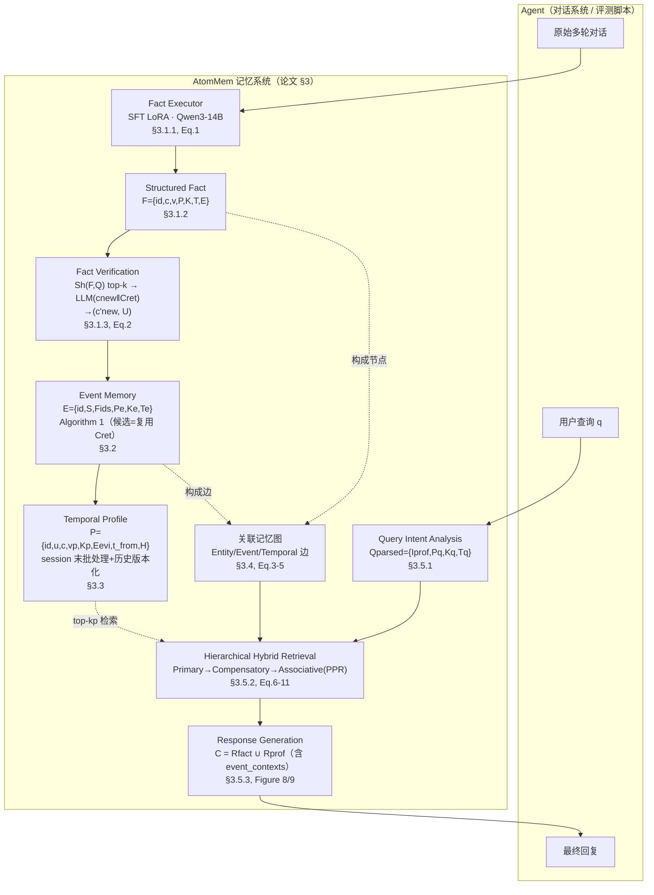

# AtomMem 论文架构

> 读的是 `Yao et al., AtomMem: Building Simple and Effective Memory System for LLM Agents via Atomic Facts`（arXiv:2606.19847，USTC 认知智能全国重点实验室 + 安徽大学）。本文引用的 `§`/`Figure`/`Table`/`Eq`/`Algorithm` 均指论文本身编号；行号指 `/Users/guanhongli/Documents/wafo-base/literature/papers/Yao-2026-AtomMem-...txt`（PDF 转纯文本，页面/图片版式已丢失，仅供定位）。
> 术语：**Fact Executor**=专门做"抽原子事实"的小模型（论文里是 SFT 微调过的 Qwen3-14B）；**Atomic Fact**=一条自包含、第三人称、时间锚定的陈述句；**PPR**=Personalized PageRank，从种子节点出发按边权重扩散重要性分数的图算法。
> **2026-09-05 勘误**：本文已按同目录 `verification.md` 的逐条复核结论修正（共 10 处：1 处事实、4 处行号/锚点、5 处表述限定）。原始未修正版本见 git 历史。

## 1. 一句话机制

论文的核心主张是"**记忆表征质量至上**"（§4.2 原话："memory storage quality is paramount. Sophisticated system orchestration cannot compensate for flawed memory representations"）：先用一个专门 SFT 微调的小模型把嘈杂对话蒸馏成结构化"原子事实"，再在此基础上叠事件、画像两层做**可控、非破坏性**的增量聚合（§1 先在相关工作里列举了 A-Mem 的 "dynamic memory evolution without pre-defined rules"，txt:23-24；随后批评不受约束的 LLM 自由重写会"destruction of original facts"，txt:84-88——但这句批评的主语是泛指的 "these methods"，论文并没有在此处再点名 A-Mem），检索时靠实体/事件/时间三类边的关联图做 PPR 扩散把碎片记忆连起来。

## 2. 记忆是怎么存进去的

**Atomic Fact Extraction（§3.1.1）**——触发时机是每条原始对话消息进来时；存的不是原文也不是摘要，是"自包含的原子事实文本"：
- Fact Executor = **SFT(LoRA) 微调的 Qwen3-14B**，单张 NVIDIA A100，学习率 5e-5，LoRA rank 128，全局 batch size 8，训练 3 epoch（§4.1 "Experimental Details"，txt 行 662-666）。
- 训练数据 D 的构建是两阶段（§A.1.2）：Stage 1 用 **GPT-4o 作教师模型**初抽，系统提示词见 Figure A.1（正文 Figure 4 caption 引用同一张图，txt 行 1189-1207），编号 **5 条**规则：①过滤低价值内容（问候/寒暄/无价值内容一律不抽，无高价值事实就输出空列表）②指代消解（代词 it/they/this/that 和相对时间 yesterday/now/last week 都换成基于元数据/上下文推断出的显式实体和绝对日期）③改写第三人称（第一人称陈述转第三人称，主观内容要显式归属，如"The user believes..."/"Alice expressed frustration regarding..."）④多模态整合（`[Image Description]`/`[Image Keywords]` 存在时把视觉信息当**主要信息源**自然融进事实文本）⑤严格 JSON 数组输出。Stage 2 是人工精修（去幻觉、补指代、去噪、长句拆分，§A.1.2）。
- 训练/测试角色**零重叠**：自建 10 组角色（如 Elena the Chef、Kenji the Novelist）覆盖专业/家庭/兴趣/价值观四大类场景，与 LoCoMo 测试集角色（Caroline、Melanie 等）完全独立（§A.1.1）。最终数据集 **4,352 条**样本（§A.1.3 "Dataset Statistics and Examples"，txt:1162——**不是 §A.3**，§A.3 是 "Details of Associative Graph Retrieval"；Figure A.2 给出一条完整训练样本：把"I got an A..."改写成"Emma got an A on her first psychology exam on the Friday before May 17, 2023."）。
- 数学上，训练目标是最大化 `Σ log Pθ(F|I,C)`（Eq.1），即给定指令 I 和对话上下文 C，让模型输出目标原子事实集合 F 的似然最大。

**Structured Fact Construction（§3.1.2）**——把 Fact Executor 吐出的纯文本包一层结构化元数据，定义 `F = {id, c, v, P, K, T, E}`：`c`=抽取文本，`v`=稠密向量，`P`=参与者（用另一次 LLM 调用从对话里解析），`K`=主题关键词，`T`=时间锚点，`E`=关联事件 id 列表（初始为空）。

**Fact Verification（§3.1.3, Eq.2）**——入库前先查重/查冲突：先按 participants+temporal 元数据做符号过滤（省向量计算），再用统一的混合相似度公式 `Sh(x,y)=α·sim_e(vx,vy)+β·Jac(Kx,Ky)`（Eq.2，α/β 平衡语义密度和关键词重叠）排出 top-k 候选 `Cret`；**关键设计**：接下来是**一次 LLM 调用同时产出两样东西**——`(c'_new, U) ← LLM(cnew ∥ Cret)`：`c'_new` 是相对于 `Cret` 的"残差新信息"（真正要新存的内容），`U` 是一组更新元组（**只有检测到逻辑冲突才生成**）。论文强调这个"joint mechanism"能同时防冗余、维护全局一致性——即验证不是简单的"重复就丢弃"，而是"提炼出真正新增的那部分信息"。

**Episodic Consolidation: Event Memory（§3.2, Algorithm 1）**——把零散事实聚成"一件事"，`E = {id, S, Fids, Pe, Ke, Te}`（S=摘要）。Algorithm 1 完整流程：
1. **候选生成**：**直接复用 Fact Verification 阶段已经检索到的 `Cret`**（不重新检索）——`Cret` 里挂了事件的塞进候选事件集 `Ecand`，没挂的塞进独立事实候选集 `Falone`。
2. **语义路由**：一次 LLM 调用（`LLMverify`）判断新事实该吸收进哪些候选（可多选、也可以都不选）。
3. **状态执行**：命中已有事件就把新事实 id 并入 `Fids`，参与者/时间做集合并，摘要/关键词重新生成（`LLMsummarize`）；命中独立事实就为每个匹配到的独立事实各建一个新事件（新事件同时包含新事实和被匹配的独立事实）；两者都没命中就独立存储（`StoreIndependently`）。

**State Evolution: Temporal Profile（§3.3）**——建模用户长期稳定属性（偏好/习惯/背景），`P = {id, u, c, vp, Kp, Eevi, t_from, H}`（`H`=历史版本列表）。触发机制是 **session 级批处理**（非实时）：抽取阶段 LLM 顺手判断某条事实是否暗示长期特征，命中就丢进等待队列；"**At the end of a dialogue session**"（原文），系统批量处理队列里的候选。对每条候选：检索该用户 top-kp 个已有画像（`Sh(Pnew,Pi)` 排序），LLM 决策该候选是冗余（confirm）、该更新当前画像（update current）、该改某个历史版本（modify a historical version），还是该新建一条。**当前值发生变动时，旧状态连同其有效时间区间一起拷贝进历史 `H`**——论文明确这是"非破坏性更新"。（**下面是本文作者的跨系统类比，不是论文内容**：这套做法与 Mem0g/Zep 的 `t_invalid` 失效标记同族，只是落在 Profile 层而非全局知识图谱层；论文全文没有出现过 Zep / Mem0g / `t_invalid` 任何一个词，这条类比既不能用论文证实也不能用论文证伪。）

## 3. 记忆是怎么被用起来的

**Query Intent Analysis（§3.5.1）**——每次提问触发一次，一次 LLM 调用把用户查询 q 解析成结构化对象 `Qparsed = {Iprof, Pq, Kq, Tq}`：`Iprof∈{0,1}` 是否需要长期属性、`Pq` 涉及参与者、`Kq` 核心意图关键词、`Tq` 相关时间范围。

**Hierarchical Hybrid Retrieval（§3.5.2）**——不是一步到位，是三级递进、逐级放宽召回边界：

1. **Primary Recall**：按 `Pq`/`Tq` 过滤全局事实后，用 `Sh(F,Q)` 排序取 top **ks/2** 组成 `Rpri`（txt 里的 "top-k2s" 是 PDF 转纯文本把下标 `k_s/2` 压平的产物，不是参数名；§A.6.1 明说 "ks = 10, where the main seed and compensation seed are both set to 5"，txt:1537-1538，即这一路实取 5 条）。
2. **Compensatory Recall**：过滤后按 `Sh(E,Q)` 排序取 top 事件，展开这些事件下的成员事实（排除已在 `Rpri` 里的），用融合分 `Sf(F)=we·Sh(E,Q)+(1-we)·Sh(F,Q)` 排序取 top **ks/2**（同上，也是 5 条）组成 `Rcomp`。`Rseed = Rpri ∪ Rcomp`。
3. **Associative Recall**：以 `Rseed` 为种子，在实体/事件/对话轮三类边上限跳数扩展出局部子图（仍受 participant/temporal 约束），跑 **Personalized PageRank/RWR**（Eq.3-5 定义三类边权重；Eq.6 是关键词权重 ω(k)、Eq.7-8 是多通道转移矩阵、**只有 Eq.9 是种子分布构造**，见下面两段）激活分数，取 top-kf 输出最终事实集 `Rfact`。

三类边的权重公式：
- **Entity Edge**（Eq.3）：`w_kw(Fi,Fj) = Σ_{k∈Ki∩Kj} ω(k) / sqrt(Σ_{Ki}ω(k)·Σ_{Kj}ω(k)+ε)`，其中 `ω(k)=IDF(k)·βq(k)·π(k)`（Eq.6，§A.3.1）：`IDF` 是关键词全局逆文档频率，`βq(k)` 在关键词命中 query 时给 boost，`π(k)` 对高频词做非线性衰减（防止停用词式关键词把不相关事实连起来）。
- **Event Edge**（Eq.4）：`w_event(Fi,Fj) = Σ_{e∈Ei∩Ej} 1/(|Fe|-1)^γe`——事件越大，边权重衰减越狠，防止大事件把太多不相关事实连在一起。
- **Temporal Edge**（Eq.5）：`w_turn(Fi,Fj) = exp(-|posi-posj|/τ)`，只连同一 session 内、窗口 W 以内的相邻对话轮。

**多通道转移矩阵**（§A.3.2，Eq.7-8）：三个通道（keyword/event/turn）各自独立归一化成转移矩阵 `Pc`，总矩阵是加权融合 `P_{i,j}=Σ_c ρ̄_{i,c}·(Pc)_{i,j}`；`ρ̄_{i,c}` 是静态先验 `ρc` 按节点 i 的"有效通道集合"`Ci`（即该节点在这个通道下确实有出边）动态重归一化后的结果（Eq.8），避免某节点缺某类边时被稀释。

**种子分布构造与 PPR 迭代**（§A.3.3，Eq.9-11）：种子事实的检索分数先做**幂变换** `p_i = s̃_i^γs / Σ_{Fj∈Rseed} s̃_j^γs`（Eq.9），`γs` 越大、高置信种子的"重启引力"越强；随后标准 RWR 迭代 `r(t+1)=ηp+(1-η)P^T r(t)`（Eq.10），`η` 是重启概率，跑到收敛（`‖r(t+1)-r(t)‖1<εc`）或到最大迭代数为止（Eq.11）；悬挂节点（没有出边）的概率质量按重启分布 `p` 重新分配，防止泄漏。收敛后按 `r(∞)` 排序取 top-kf。

**Profile Augmentation and Response Generation（§3.5.3）**——若 `Iprof=1`：按 `Pq` 过滤全局画像，用 `Sh(Pq,Q)` 排序取 top-kp 组成 `Rprof`；若查询带时间约束，选取该时间点有效的画像版本（当前版本或历史版本）。最后**把 `Rfact` 和 `Rprof` 拼接成上下文 C**，和原始 query 一起喂给 LLM 生成最终回答；论文附录 Figure 8/A.3（单跳/多跳/时间推理用）和 Figure 9/A.4（开放域用）两张回答生成提示词都明确把 **`event_contexts`（fact_id→事件摘要的字典，标注 optional）列为第四项输入**（与 query/profiles/facts 并列），正文 §3.5.3 也写"this multi-source injection mechanism ensures that the agent's answer is grounded in specific atomic details, **enriched by event-level context**, and personalized by long-term user attributes"——即论文的设计里，最终生成这一步是同时看得到事实、画像、事件摘要三样东西的。

## 4. 架构图

图中实线是论文正文明确写出的主流程（构建：Fact→Event→Profile；检索：Intent→三级召回→生成）；虚线是"记忆图由哪些东西构成/参与"这类论文没有画成主流程箭头、但文字里明确说明了归属关系的连接。整个 `ATOMMEM` 框内除了纯符号计算（Sh 相似度、PPR 迭代、边权重公式）外，几乎每一步都显式写了"we employ an LLM"/"the LLM"——论文正文没有明确说这些"the LLM"和最终生成时用的模型是不是同一个（只有 Fact Executor 明确是独立的 SFT 小模型），这是论文本身留下的边界模糊点，见第 6 节。

关于原图：Figure 1（Introduction 的 "Architecture comparison" 示意图，caption txt:92-93）和 Figure 2（"The overall architecture of AtomMem" 总览图，caption txt:228-229）是论文里唯二的整体架构可视化。这两张图**并非取不到**——它们就在官方仓库里：`AtomMem/Figures/intro.png` = Figure 1、`AtomMem/Figures/main-method.png` = Figure 2（README 引用时的 caption 与论文逐字一致），PDF 原件也在 txt 同目录。但上面这张 mermaid 仍是照正文文字重画的，**不是对 Figure 2 原图的转录**，框线/箭头指向/图例细节请以原图为准。

## 5. 我没搞清楚的

1. Figure 3（"Performance sensitivity analysis under varying the memory retrieval parameter k"）、Figure 6（种子数 ks 敏感性）、Figure 7（补偿融合权重 we 敏感性）三张曲线图具体数值只能从正文文字描述里反推大致趋势（如"ks=10 是甜点""we=0.7 是甜点"），曲线的精确读数无法核实。
2. §3.5.3 正文只说"若 `Iprof=1` 则...选取该时间点有效的画像版本"，但"历史版本"的切分粒度、`t_from`/失效时间具体怎么定（比如两条画像更新发生在同一天该怎么处理）没有给出算法或公式，只有§3.3 一句"记录其有效时间区间"的定性描述。
3. Table 5（§A.7）列出的是**检索侧**（Hierarchical Hybrid Retrieval + Graph）的完整超参数（ks/kf/kp/α/β/we/wf/三通道 ρ/η/γs 等），但**构建侧**的几个关键阈值——Fact 去重相似度门槛、Profile 批处理触发的"待处理事实数量"、Profile 决策前的最低相似度门槛、Event 归类检索的 top-k——论文正文和附录都没有给出具体数值，只有定性描述（如"a candidate set"、"session-based batch mechanism"）。这些数字是否存在、取值多少，只能从代码侧核实，论文本身没写。
4. §A.4 报告了 AtomMem 在 LongMemEval 上的补充实验（Table 4，六个类别；其中 SSP 一类只给了 J，F1/BLEU-1 是 "—"，txt:1489/1496，论文在 txt:1428-1434 专门解释了原因），但正文没有说这套实验用的记忆构建/检索流程和 LoCoMo 主实验是否完全一致（同一套超参数、同一套 Fact Executor），只说"we employ GPT-4o-mini as the backbone model and utilize DeepSeek-v4-Pro as the judge model"——是否有 LongMemEval 专属的适配没有交代。

## 6. 论文没写清楚的地方

1. **消融变体的操作定义缺失**：Table 2 的 "AtomMem-FLAT"（"removes the hierarchical memory structure"）、"w/o Profile"（"removes profile memory"）、"w/o Graph"（"removes graph-based associative recall"）三行的定性描述散在三处（Table 2 caption、§4.2 "This simplified version lacks hierarchical event structures and relies solely on retrieving atomic facts"、§4.3 "uses simple flat retrieval without hierarchical structures"），但都停在这一层，没有说清楚具体怎么操作——是构建阶段就不跑 Event/Profile/Graph 相关的 LLM 调用和存储，还是构建阶段照常跑、只是检索阶段不查那部分数据？这直接影响"token 消耗"这类指标该怎么解读（如果构建阶段仍跑了 Profile 抽取的 LLM 调用，"w/o Profile"省下的就只是检索侧的一点点 token，而不是省掉整条 Profile 流水线的成本）。就 AtomMem-Flat 而言，Table 1/2 里 722.75K vs AtomMem 21357.06K 的 token 量级差（txt:629-630）反过来说明它至少不可能是纯检索侧的改动。
2. **除 Fact Extractor 外，其余步骤用的具体 prompt 文本均未给出**：论文附录展示了 Fact Extractor 的系统提示词（Figure A.1/4）、两种回答生成提示词（Figure 8-9/A.3-A.4）、judge 提示词（Figure 10/A.5），但 Structured Fact Construction 的元数据抽取、Fact Verification 的冲突判断、Event 语义路由/摘要生成、Profile 抽取/时序决策、Query Intent Analysis 这几步各自用的 prompt 具体怎么写，正文和附录都没有展示，只有功能性文字描述（"we leverage the LLM to parse..."）。
3. **Fact Verification 输出格式未给出**：`(c'_new, U) ← LLM(cnew ∥ Cret)` 只是一个功能性公式，`U`（更新元组集合）具体的字段结构、LLM 被要求输出的 JSON schema 是什么样子，论文没有像 Fact Extractor 那样给出对应的 prompt/示例。
4. **"kp" 符号在两处指代不同的东西**：§3.3（"AtomMem retrieves the top-kp most relevant existing profiles for the same user u"，构建阶段去重/合并用的比较范围）和 §3.5.3（"The top kp items form the profile context set Rprof"，检索阶段答题用的召回数量）用的是**同一个符号 kp**，但这是构建时刻和检索时刻两个不同阶段、逻辑上没有必然关系的参数，论文没有说明这两处是否共享同一个数值，还是碰巧用了同一个字母。
5. **Temporal Profile 的"update_history"判定逻辑未给出算法**：§3.3 只说"AtomMem copies the previous state into the history H and records its valid time interval **or** updates the corresponding historical version"，但"新信息应该追加成新的历史版本"还是"应该修改某个已有历史版本"这两种情况怎么判定（比如新信息的时间点是否落在某个已有历史区间内），论文没有给出规则或公式。
6. **Fact Executor 在 LoCoMo 主实验里是离线一次性跑完，还是每次评测都重新调用，未交代**：README/仓库暗示是"预抽取一次、复用多次"（见 code-architecture.md 的对应发现），但论文正文和附录都没有明确说这一点，也没有说 Fact Executor 的推理是否计入 Table 1 的 token 统计。
