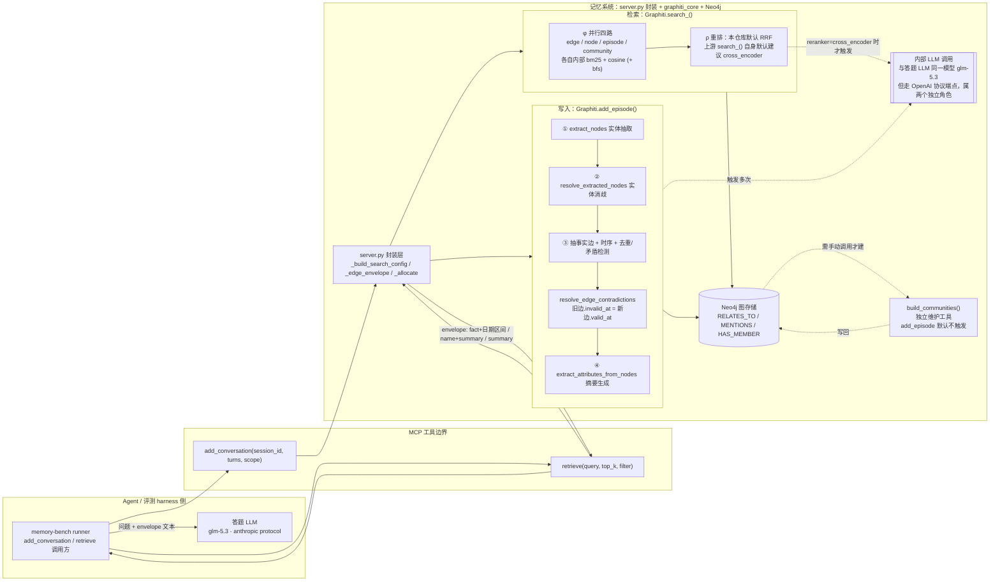

# Zep / Graphiti 代码架构

> 写于 2026-09-04。证据范围：官方开源仓库 `getzep/graphiti`（本地克隆 `/Users/guanhongli/Documents/repo/graphiti`，`git log -1` 显示 HEAD `a6e026f`，`git describe` 为 `mcp-v1.1.0-2-ga6e026f`，`pyproject.toml` 声明 `version = "0.30.1"`）+ 本仓库封装层 `servers/graphiti/server.py`/`servers/graphiti/trace.py` + 实测数据（`runs/graphiti-align-shakeout/`、`runs/zep-full-comm/`、`runs/zep-full-nocomm/`、`.state/graphiti/mcp_trace/`、`.context/memory-bench-r2n3/report-2026-08-30.md`、`report-2026-09-04.md`、`WEEKEND-PLAN.md`）。下文所有裸文件名（如 `graphiti_core/graphiti.py:989`）默认指 `graphiti_core/` 目录下的文件；封装层文件会写全路径或以 `server.py` 明确标注。
>
> **范围提醒**：论文标题是《Zep》，Zep 是商业记忆服务，Graphiti 是驱动它的开源图引擎——不是同一份代码。我们只克隆了 Graphiti（开源部分）。代码里有直接证据表明 Zep 商业后端还有一块不在这个仓库里的东西：`prompts/extract_nodes.py:540` 一条注释写着"This prompt is semantically mirrored in the Go async summary worker at `src/lib/graphsummary/processor.go`"——一个 Go 异步摘要 worker，路径明显不属于这个 Python 仓库。也就是说生产版 Zep 比这个开源仓库更大，本文档的一切结论只对 Graphiti 负责。
>
> 论文发表于 2025-01-20（arXiv:2501.13956v1），本仓库 HEAD 提交于 2026-09-03——中间隔了约 19.5 个月的独立演化。第 6 节会具体点出哪些论文描述已经不是当前代码的样子。

## 1. 一句话机制

Graphiti 用 LLM 把每条输入（episode：一条消息 / 一段文本 / 一个 JSON）拆解成"实体节点"和"事实边"，摞成三层图（原始输入层 → 实体关系层 → 社区摘要层，后端可选 Neo4j / FalkorDB / Kuzu / Neptune），每条事实边挂 4 个时间戳记录"系统何时写入/失效"与"事实何时在现实中成立/不成立"；检索时并行跑 BM25 + 余弦 + 图上广度优先三路候选，经可插拔的重排器排序后，把命中的事实文本、实体摘要、社区摘要拼成一段格式化文本交给调用方——**Graphiti 自己不回答问题，只负责把"证据"整理好**。

## 2. 记忆是怎么存进去的

### 2.1 触发时机

调用方每传入一个 episode（`Graphiti.add_episode()`，`graphiti_core/graphiti.py:980`）触发一次完整写入流程。episode 可以是 message / text / json 三种类型之一。论文和代码都同意"一条 episode 触发一次处理"，但两边对"一条 episode 该装多少内容"的默认假设不同（第 6、7 节展开）。

### 2.2 存的是什么：原文？摘要？图？向量？——三层各不相同

| 层 | 存储对象 | 内容形态 | 证据 |
|---|---|---|---|
| Episode（原始层） | `EpisodicNode` | 原文一字不丢（`content: str`），另存 `source`/`source_description`，`valid_at` 字段其实就是这条 episode 自己的参考时间戳（调用方传入的 `reference_time`） | `graphiti_core/nodes.py:318-332` |
| Semantic Entity（实体关系层） | `EntityNode` + `EntityEdge` | 节点：`name` + `name_embedding`（向量）+ `summary`（**LLM 生成的摘要，不是原文**）；边：`fact`（**LLM 生成的单句事实描述，不是原文**）+ `fact_embedding`（向量）+ **4 个时间戳** | `graphiti_core/nodes.py:499-504`；`graphiti_core/edges.py:49-54`（基类 `created_at`）、`:264-280`（`name`/`fact`/`fact_embedding`/`episodes`/`expired_at`/`valid_at`/`invalid_at`/`reference_time`） |
| Community（社区摘要层） | `CommunityNode` | 一批强连通实体的 map-reduce 式摘要 + 关键词社区名（`name`），**无时间戳字段** | `graphiti_core/nodes.py:687-690` |

**一句话：原文只在 Episode 层保留一份；实体关系层和社区层存的都是 LLM 生成的摘要/事实句，不是原文的压缩或摘录。** 这意味着"回原文找答案"必须经由 episode 反查（`Graphiti.get_nodes_and_edges_by_episode()`），检索管线本身（第 3 节）默认并不会把 episode 内容返回给调用方——第 6 节会说明这是论文自己也承认"留给未来工作"的部分。

四个时间戳的精确定义（`EntityEdge`，都在 `edges.py`）：

- `created_at`（继承自 `Edge` 基类，`graphiti_core/edges.py:54`）—— T′ 轴，系统何时写入这条边
- `expired_at`（`graphiti_core/edges.py:271`）—— T′ 轴，系统何时判定这条边失效
- `valid_at`（`graphiti_core/edges.py:274`）—— T 轴，这条事实在现实中何时开始成立
- `invalid_at`（`graphiti_core/edges.py:277`）—— T 轴，这条事实在现实中何时不再成立
- 外加一个论文"四时间戳"模型里没有、但代码里确实持久化的第五个字段：`reference_time`（`graphiti_core/edges.py:280`，来源 episode 的参考时间戳，不是事实本身的生效/失效时间）

### 2.3 存的过程调不调 LLM：调，而且不止一次

`add_episode()` 内部顺序执行的步骤（均在 `graphiti_core/graphiti.py:1087-1184` 区间内）：

```text
add_episode(episode_body, reference_time, ...)
  │
  ├─ ① 取上下文：查最近 10 条历史 episode（RELEVANT_SCHEMA_LIMIT=10，search_utils.py:64）
  │     作为 previous_episodes（graphiti.py:1087-1090）——注意计量单位是"episode 数"，
  │     不是论文说的"消息数"，是否等价取决于调用方怎么切 episode（见第 7.6 节）
  │
  ├─ ② extract_nodes                              [LLM 调用 #1]
  │     按 episode.source 类型走三选一 prompt：extract_message / extract_json / extract_text
  │     （prompts/extract_nodes.py:83 / :213 / :278）。当前内容 + previous_episodes 一起
  │     喂给 LLM，speaker 自动抽成第一个实体节点。
  │     调用点：graphiti.py:1122
  │
  ├─ ③ resolve_extracted_nodes                    [LLM 调用，按候选实体数量]
  │     每个新抽的实体：先 embedding 做 cosine 找相似节点 + 全文检索找候选，
  │     候选连同 episode 上下文一起丢给 LLM 判断是否为重复实体（prompts/dedupe_nodes.py）；
  │     判重复则合并/改写 name+summary。
  │     调用点：graphiti.py:1131
  │
  ├─ ④ _extract_and_resolve_edges                 [LLM 调用 #2 起]
  │     ├─ 抽事实边（同一事实可在不同实体对间重复抽取，模拟超边）
  │     ├─ 抽时序（用 reference_time 定位相对/绝对时间 → valid_at/invalid_at 候选值）
  │     ├─ 边去重 + 矛盾检测合并成一次 LLM 调用完成：`duplicate_facts`/`contradicted_facts`
  │     │   两个字段一起返回（prompts/dedupe_edges.py:27-29，语义边界见 :57："contradicted_facts
  │     │   可以来自 EXISTING FACTS 或 FACT INVALIDATION CANDIDATES 任一列表"）
  │     └─ resolve_edge_contradictions()（edge_operations.py:538）：找到时序重叠的矛盾边 →
  │         旧边.invalid_at = 新边.valid_at；旧边.expired_at = now（如果还没设过）
  │         （具体赋值在 edge_operations.py:569-570）
  │         反过来，如果矛盾候选边本身比新边更"新"，新边自己会被判定无效
  │         （resolved_edge.invalid_at = candidate.valid_at，edge_operations.py:837-838，
  │         出自 resolve_extracted_edge()，edge_operations.py:623）——
  │         这一步论文只讲了"新边使旧边失效"的单向情形，没提"新边自己也可能一出生就被判无效"
  │     调用点：graphiti.py:1138-1145（`_extract_and_resolve_edges`）
  │     ⚠️ 零候选快速路径：related_edges 和 existing_edges 都为空时仍会走时间戳抽取，
  │       但跳过去重/矛盾判断逻辑（edge_operations.py:653 附近的分支）
  │
  ├─ ⑤ extract_attributes_from_nodes              [LLM 调用，按新增/更新实体数量]
  │     为节点生成/更新摘要与自定义属性：extract_attributes（prompts/extract_nodes.py:383）、
  │     extract_summary（:467）、extract_entity_summaries_from_episodes（:613，
  │     :540 处注释显式承认这份 prompt 与 Zep 闭源 Go worker 语义镜像）
  │     调用点：graphiti.py:1160
  │
  ├─ ⑥ 写库：预先写好的 Cypher（不是 LLM 生成的查询）
  │     调用点：graphiti.py:1170（`_process_episode_data`）；EntityEdge.save()
  │     （edges.py 起 `class EntityEdge` 的 `save` 方法）写入关系类型 `RELATES_TO`；
  │     Episode→Entity 关系类型是 `MENTIONS`（见 `edges.py` 里
  │     `MATCH (n:Episodic)-[e:MENTIONS]->(m:Entity)` 一类 Cypher 字面量）；
  │     Community→Entity 关系类型是 `HAS_MEMBER`（`community_operations.py` 里
  │     `MATCH (c:Community)-[:HAS_MEMBER]->(n:Entity...)`）
  │
  └─ ⑦ 可选：update_communities=True 时才顺带做单步社区更新
        调用点：graphiti.py:1184（判断分支），签名默认值在 graphiti.py:989
        （**默认 False，不执行**）
```

调不调 LLM：调，②④⑤三步都各自触发（②固定 1 次，③④⑤的调用次数随抽出的实体数/边数线性增长）。本仓库自己的封装曾统计过极小 episode（1-3 轮对话、`body_chars` 只有 30-80）下的真实调用数：`llm_calls=3`、`embed_calls=8~12`（`.state/graphiti/mcp_trace/graphiti-20260829.jsonl` 抽样；⚠️ 这是冒烟测试的极小样本，不代表真实 LoCoMo session 规模，见第 5 节）。`WEEKEND-PLAN.md:357` 给出的经验估算是"2 + (1~2)×边数"次 LLM 调用，本次调研没有独立重新推导精确值，按经验估算值处理。

**社区层不是"写入流程"的一部分，是独立操作**：`Graphiti.build_communities()`（`graphiti_core/graphiti.py:1490`）需要调用方显式调用，内部先 `remove_communities()` 清空指定 group 的旧社区，再用 label propagation 重新聚类（`graphiti_core/utils/maintenance/community_operations.py:93`；Neo4j 驱动实际走的是逻辑完全相同的另一份重复实现 `driver/operations/graph_utils.py`，二者均为同步双缓冲、无迭代上限的实现，见第 5 节第二条），对每个簇做 map-reduce 式两两摘要合并（`community_operations.py` 内 `build_community()`/`summarize_pair()`，各触发一次 LLM 调用）。

## 3. 记忆是怎么被用起来的

### 3.1 触发时机与两条入口

调用方传入查询字符串 `α`，触发 `Graphiti.search_()`（进阶，`graphiti_core/graphiti.py:1603`）或 `Graphiti.search()`（基础，`graphiti_core/graphiti.py:1527`，官方 docstring 原话自称 "our basic out-of-the-box search"，`graphiti_core/graphiti.py:1542`）。两者最终都走同一个内部函数 `search()`（`search/search.py:98`），区别在于传入的 `SearchConfig` 不同：

- `search()`：固定用 `EDGE_HYBRID_SEARCH_RRF` 配方（`graphiti_core/search/search_config_recipes.py:111-116`）——**只查边，只用 BM25+cosine 两路，不含 BFS**，返回 `list[EntityEdge]`（不含节点/社区）。调用方不传 `search_filter` 时默认落到空的 `SearchFilters()`（`graphiti_core/graphiti.py:1580`）。
- `search_()`：调用方不传 `config` 时，默认走 `COMBINED_HYBRID_SEARCH_CROSS_ENCODER` 配方（`graphiti_core/search/search_config_recipes.py:81-108`，边 BM25+cosine+BFS 全开、cross-encoder 重排）；`search_filter` 同样默认空 `SearchFilters()`（`graphiti_core/graphiti.py:1625`）。

### 3.2 拿什么去找、找几路

不管走哪条入口，`search()`（`search/search.py:98`）内部用 `semaphore_gather` **并行**跑四类检索——不是论文说的 3 类：`edge_search`（`graphiti_core/search/search.py:253`）、`node_search`（`graphiti_core/search/search.py:464`）、`episode_search`（`graphiti_core/search/search.py:664`）、`community_search`（`graphiti_core/search/search.py:764`）。论文 §3 的形式化定义 `φ: S → Es × Ns × Nc` 只有 3 个分量，代码里其实还有第 4 个分量 `episode_search`（纯 BM25 全文检索，只在 `config.episode_config` 非空时才跑）。

每一类内部（以 `edge_search`，`graphiti_core/search/search.py:253` 为例）：

```text
edge_search(query, query_vector, config, ...)
  │
  ├─ 并行起 1~3 个检索任务（取决于 config.search_methods 配了哪几个，search_config.py:32）：
  │    · bm25   → edge_fulltext_search，走 Neo4j 全文索引（底层 Lucene）
  │    · cosine → edge_similarity_search，按 fact_embedding 做向量距离，
  │                低于 sim_min_score（默认 0.6，search_utils.py:65）的候选被丢弃
  │    · bfs    → edge_bfs_search，以 bfs_origin_node_uuids 为种子做图上广度优先，
  │                默认深度 3 跳（MAX_SEARCH_DEPTH=3，search_utils.py:67）
  │    每路各取 2×limit 个候选（search.py 内写死的 2 * limit）
  │
  ├─ ⚠️ 如果 bfs 配了但调用方没显式给种子节点（bfs_origin_node_uuids=None）：
  │    BFS 会先"冷跑"一次（大概率 0 命中），然后**再跑第二次**（search.py:338，
  │    "expand_bfs" 阶段），这次用 bm25/cosine 那两路已经命中的候选的
  │    source_node_uuid 当种子——即"用这一轮已经找到的东西去扩它自己的邻居"，
  │    不是论文举例的"拿最近几条 episode 当种子"那种用法（第 7.5 节有实测印证）
  │
  └─ 重排（按 config.reranker，枚举定义在 search_config.py:53）：
       rrf              → 纯排名融合，不需要向量也不需要 LLM
       mmr              → 需要重新拉 embedding 算最大边际相关
       episode_mentions → 先 RRF 出候选，再按 edge.episodes 列表长度（提及次数）重排
       node_distance    → 先 RRF，再按到 center_node_uuid 的图距离重排（需调用方提供中心节点）
       cross_encoder    → 先 RRF 出 2×limit 候选，再用 LLM 对每条 fact 文本打相关性分
     只有 cross_encoder 这一种重排会在检索阶段触发 LLM 调用；其余 4 种都是纯算法/图计算。
```

`node_search`（`graphiti_core/search/search.py:464`）逻辑同构，5 种重排全支持（`NodeReranker`，`graphiti_core/search/search_config.py:61`）。`community_search`（`graphiti_core/search/search.py:764`）少一路——**community 没有 BFS 检索**，只有 bm25+cosine 两路（`CommunitySearchMethod` 枚举只定义这两个值，`graphiti_core/search/search_config.py:48`），重排也只支持 rrf/mmr/cross_encoder 三种，**没有 episode_mentions、没有 node_distance**（`CommunityReranker`，`graphiti_core/search/search_config.py:74`）。`episode_search`（`graphiti_core/search/search.py:664`）更少，只有 bm25 一路检索方法、rrf/cross_encoder 两种重排（`EpisodeReranker`，`graphiti_core/search/search_config.py:69`）。论文 §3.2 说"Zep supports [5 种重排]"是笼统说法，没有按对象类型区分适用范围；代码里 5 种重排只对 edge/node 全量适用，community 少 2 种，episode 少 3 种。

### 3.3 一步到位还是多步迭代

**单轮，不迭代**。`f(α) = χ(ρ(φ(α)))` 是一次函数复合，`search()`（`graphiti_core/search/search.py:98`）从进到出就是"并行发四类检索请求 → 各自内部重排 → 直接返回"，没有循环、没有基于结果内容判断"要不要再搜一轮"的分支重试逻辑。

### 3.4 找到之后怎么交给模型

`search_()`/`search()` 返回的是 Python 对象（`EntityEdge`/`EntityNode`/`CommunityNode` 列表 + 各自的重排分数，`SearchResults` 类），**graphiti_core 本身不做"渲染成文本"这一步**——那是调用方的责任。论文 §3 定义的 χ（Constructor）在代码里没有一个统一函数与之对应：调用方必须自己把 `edge.fact`/`edge.valid_at`/`edge.invalid_at`/`node.name`/`node.summary`/`community.summary` 拼进自己的 prompt 模板。也就是说论文的 χ 步骤实际上是**每个接入方各自实现一遍**，不是 Graphiti 引擎内置能力——第 7 节会具体讲我们的封装是怎么实现这一步的。

## 4. 架构图



边界说明：MCP 工具调用是唯一的信息交换口——Agent 侧只知道"传 turns 进去、传 query 进去，拿 envelope 文本回来"，看不到内部经过几次 LLM 调用、图长什么样。**容易被忽略的一点**：图里的"内部 LLM 调用"和"答题 LLM"在我们的评测配置里恰好是同一个底层模型（glm-5.3），但走的是两个独立的调用角色（不同 API 协议端点、不同 prompt、不同职责），不能因为模型名字一样就当成"同一次思考"。

## 5. 我没搞清楚的

- **真实 LoCoMo 规模下一次 `add_episode()` 精确调几次 LLM**：本仓库自己的实测样本（`.state/graphiti/mcp_trace/graphiti-20260829.jsonl`）body 只有 30-80 字符，是冒烟测试量级，不是真实一个 LoCoMo session（约 20 turns、上千 token）的量级；`WEEKEND-PLAN.md:357` 给的"2+(1~2)×边数"是经验估算，本次调研没有对着一次真实规模的 ingest 逐行核对调用图（`node_operations.py`/`attribute_utils.py` 内部具体按什么粒度批量调 LLM，没有逐行读完）。
- **label propagation 在 Neo4j 大图上是否真的会在本仓库当前版本（`a6e026f`）触发不收敛**：逐行比对确认了当前代码（`graphiti_core/utils/maintenance/community_operations.py:93` 起、Neo4j 实际调用路径 `driver/operations/graph_utils.py`）与 memory-bench 此前在 pip 包 `graphiti-core==0.29.3` 上实测触发死循环（4 分钟烧约 1200 万轮，见 `patches/graphiti/community_operations.py` 注释）的版本逻辑完全一致（仍是同步双缓冲、`while True` 无迭代上限），但**没有在本次调研里对着当前这份克隆重新跑一次触发它**，只是静态代码比对，不是重新实测。
- **`resolve_extracted_nodes` 有没有类似 `resolve_extracted_edge` 的"零候选就跳过 LLM"快速路径**：`graphiti_core/utils/maintenance/edge_operations.py:653` 附近明确写了"候选边为空时仍会抽时间戳但跳过去重逻辑"这类特判，但没有把 `node_operations.py` 全文读完去确认节点侧是否有对称优化，不确定"完全没有相似实体的新节点"是否真的能省掉一次 LLM 调用。
- **`saga`/`SagaNode`（`graphiti_core/graphiti.py:980` 附近 `add_episode()` 签名里的 `saga`/`saga_previous_episode_uuid` 参数，配套 `HAS_EPISODE`/`NEXT_EPISODE` 边）具体是干什么的**：这是论文完全没提过的新组织单元，看起来是给 episode 排序分组用的，但没有专门去读它的实现，只确认它存在、我们的封装没用到它。
- **Neo4j Lucene 全文索引对中文/多语种查询的实际召回质量**：论文和代码都假设 BM25/全文检索对英语语料有效（LoCoMo 数据集也是英文），中文场景下默认分词器的表现没有在本次调研范围内验证。

## 6. 与论文的冲突点

> 只收录**读代码能坐实、不是靠猜**的点，尽量说明"论文原话 vs 代码原话"。

1. **论文说的"reflexion 式自我反思"步骤，当前代码里找不到**。论文 §2.2.1 原话："Following initial entity extraction, we employ a reflection technique inspired by reflexion[12] to minimize hallucinations and enhance extraction coverage." 对整个 `graphiti_core`（HEAD `a6e026f`）搜索 `reflexion`/`reflect` 关键词，只命中两处与本功能无关的注释字符串（`graphiti_core/graphiti.py:361`、`models/edges/edge_db_queries.py:197`，都是"reflects"这个动词的其他用法）。可能是这个技术后来被移除、被合并进别的 prompt、或者从未在开源部分实现——三种可能都没法从当前代码单独证实，只能确认"现在找不到"。
2. **论文附录 6.1.1 给的实体抽取 prompt 和当前代码相差很大，不能拿论文附录当作当前系统的真实 prompt**。论文附录的 prompt 只有 6 条简短 guideline（且第 6 条被截断），核心指令是"extract entity nodes ... that are **explicitly or implicitly** mentioned"；当前代码 `extract_message()`（`prompts/extract_nodes.py:83`）是一份长得多的 prompt——列了近 10 类"绝不要抽取"的名单（代词、抽象概念、未加限定的亲属称谓、通用名词等）、6 组带正反例的示例，且反复强调"**explicitly** mentioned"（去掉了"implicitly"）。这更像是发表后 19 个月生产打磨出来的版本，读论文附录不能了解当前系统实际抽取行为的严格程度。
3. **社区子图默认不参与写入循环**。论文 §2.3 把"新实体加入时找邻居社区、加入多数所在社区"描述成随数据流入自然发生的动态扩展；代码里这一步只在调用方显式传 `update_communities=True` 时才执行（默认值 `graphiti_core/graphiti.py:989`，判断分支 `graphiti_core/graphiti.py:1184`），且构建整棵社区树还需要另外单独调用、从未在写入路径里自动出现的 `build_communities()`（`graphiti_core/graphiti.py:1490`）。只读论文容易以为"数据一直在流，社区摘要就会一直在更新"，但代码默认路径下社区图完全不会自动出现。
4. **检索时不排除已失效（`invalid_at`/`expired_at` 已设）的边——但这不是代码违反论文，是论文没规定，代码选了最宽松的默认**。`SearchFilters` 类确实支持按 `expired_at` 过滤（`graphiti_core/search/search_filters.py:65` 字段定义，`:242-271` 构造 Cypher 过滤条件），但 `search()`（`graphiti_core/graphiti.py:1580`）和 `search_()`（`graphiti_core/graphiti.py:1625`）在调用方不传 `search_filter` 时都默认落到空的 `SearchFilters()`——没有任何默认路径会自动把失效边挡在检索结果之外。论文 §3 对 χ 的描述是"把 `tvalid`/`tinvalid` 连同 fact 一起交给模型"，从未讨论检索该不该主动排除已失效事实，所以这属于论文留白、代码选了"全部返回、让下游模型自己看日期判断"这个最宽松的默认，不构成对论文的直接违反。
5. **论文自己对 top-k 的表述前后不一致**：不是代码问题，是论文内部的问题，但会误导复现者。§4 开头统一说"For both experiments [DMR 和 LongMemEval]... we then retrieve the **20** most relevant edges (facts) and entity nodes"；但 §4.2 DMR 段落又单独写"using its search functions to retrieve the top **10** most relevant nodes and edges"。10 还是 20，论文没有解释以哪个为准（顺带一提，代码里 `DEFAULT_SEARCH_LIMIT = 10`，`graphiti_core/search/search_config.py:29`，与 DMR 段落的"10"巧合地一致，但更可能是巧合而非论文真的按这个常数复现）。
6. **基础版 `search()` 的检索面比论文 §3.1 描述的"三路方法"更窄**。`EDGE_HYBRID_SEARCH_RRF` 配方（`graphiti_core/search/search_config_recipes.py:111-116`）只配了 `bm25` + `cosine_similarity` 两个 `search_methods`，**没有 BFS**，而且只查边、不查节点和社区。这与官方 docstring 自称的"basic out-of-the-box search"（`graphiti_core/graphiti.py:1542`）说法一致，但如果只读论文、不区分 `search()` 和 `search_()` 两个方法，容易误以为随手调用 Graphiti 的搜索接口就能拿到论文描述的完整三路混合检索。
7. **社区重排的可选项比论文"支持 5 种"的笼统说法少，episode 检索更少**。`CommunityReranker`（`graphiti_core/search/search_config.py:74`）只定义了 `rrf`/`mmr`/`cross_encoder` 三个值，没有 `episode_mentions`、没有 `node_distance`；`EpisodeReranker`（`graphiti_core/search/search_config.py:69`）更少，只有 `rrf`/`cross_encoder` 两个。论文 §3.2 是按"Zep 支持这 5 种"的口吻整体介绍，没有按 edge/node/community/episode 四种对象类型分别说明适用范围。
8. **代码里长出了论文完全没提过的新概念**：`add_episode()` 签名里的 `saga`/`saga_previous_episode_uuid` 参数（`graphiti_core/graphiti.py:980` 附近），以及配套的 `HAS_EPISODE`/`NEXT_EPISODE` 边类型。这是论文发表后代码自行长出的新组织维度，本仓库封装没有使用它，具体语义未深入调研（见第 5 节）。

## 7. 我们封装层的降级面

以下全部针对 `/Users/guanhongli/Documents/repo/memory-bench/servers/graphiti/server.py`（现状，2026-08-29 论文对齐改造之后的版本），不是论文/graphiti_core 本身的问题。

### 7.1 历史 bug：已修复，交代现状

2026-08-29 之前，封装只接了 `Graphiti.search()`（第 6.6 条讲的"basic"检索），且渲染 envelope 时间戳用的是 `created_at`（入库墙钟）而不是 `valid_at`（事实真实生效时间）——实测 9930 条 envelope 的时间戳年份分布 100% 落在 2026 年（`WEEKEND-PLAN.md:386-389`）。**现状**（当前 `server.py`）已经修复：改用 `search_()` + 显式 `SearchConfig`（`_build_search_config()`），`_edge_envelope()` 显式取 `e.valid_at`，缺失时 `timestamp` 置 `None` 而不回退 `created_at`，并把缺失率写进 `native_notes`（`VALID_AT_MISSING`）。这一条只是为了交代清楚"现在是什么状态"，不是一个仍然存在的问题。

### 7.2 仍未设置 SearchFilters，继承了第 6.4 条的最宽松默认

`_build_search_config()`/`retrieve()` 从未构造或传入 `search_filter` 参数，所以检索结果里失效边和未失效边一视同仁地混在一起——只是现在（修复后）日期区间会被诚实标出（envelope 的 `display_time: "{lo} → {hi}"`），不会像历史 bug 那样把失效事实伪装成"刚发生"。

### 7.3 Reranker 默认 RRF，不是论文最强调的 cross-encoder，且 cross-encoder 分支本身已降级

`MEMBENCH_GRAPHITI_RERANKER` 环境变量默认值 `"rrf"`（`servers/graphiti/server.py:65`），本仓库全部脚本/配置都没有覆盖这个默认值（`grep MEMBENCH_GRAPHITI` 全仓库只在 `server.py`/`trace.py` 自身出现），且已用实测 trace 逐条核实：`runs/graphiti-align-shakeout/mcp_trace/graphiti.jsonl` 的 `init` 事件与逐条 `retrieve` 事件里 `reranker` 字段确凿是 `"reciprocal_rank_fusion"`。代码里确实实现了 cross-encoder 分支（`_make_reranker()`/`TextClassifierReranker`），但因为智谱 GLM 端点不返回 `logprobs`（上游 `OpenAIRerankerClient` 靠 `logit_bias`+`top_logprobs` 取连续分数，这条路走不通），被迫改成"让 LLM 回答 True/False 文本 → 映射成 1.0/0.0 二值分数 → 靠稳定排序保住候选原序"，判别力明显弱于论文用的 BGE-m3 cross-encoder 连续分数（论文 §4.1）。这条降级路径在我们的实际跑分里**从未被启用过**（默认走的是 RRF），是"实现了但没用上"的降级，不是"用上了但效果差"的降级。

### 7.4 Community 子图默认参与检索配置，但长期是空气

`_search_knobs()` 默认 `triple=True`，`_build_search_config()` 因此会把 `CommunitySearchConfig` 塞进查询——但 `add_conversation()` 只调用 `g.add_episode(...)`，从不传 `update_communities=True`，也从不额外调用 `build_communities()`。实测：`runs/graphiti-align-shakeout/mcp_trace/graphiti.jsonl` 里全部 105 次 `retrieve` 调用的 `raw_counts.communities` **无一例外全部是 0**。也就是说论文的"三层子图"架构，在日常 ingest→retrieve 循环里实际只有两层在起作用（episode 层不参与检索、社区层参与检索配置但没有内容可查），真正贡献分数的只有实体关系层。

后续用户单独跑过一轮 community 开/关消融（`runs/zep-full-comm` 手动 `build_communities()` 之后 vs `runs/zep-full-nocomm`）——LoCoMo 1976 题、top_k=20、glm-5.3：开启后 38 题错转对、36 题对转错，净增益 +0.10 个百分点，McNemar 精确检验 p=0.908，与"证据完全不变、只是重跑一遍答题+判分"产生的题级噪声（约 2.5%）同量级，统计上不可区分（数据出自 `research-vault/1-project/26-AgentOS-FanJiaming/08-29-记忆系统文献综述.md`）。也就是说，即使手动把 community 建起来，在这个 benchmark 上也测不出它带来的检索增益。

### 7.5 BFS 从不显式传种子节点，实际是"扩大已命中邻域"而非论文举例的"用最近事件当种子"

`retrieve()` 调 `g.search_(query, config=cfg, group_ids=group_ids)` 时没有传 `bfs_origin_node_uuids`（默认 `None`）。按 3.2 节讲的代码行为，这会导致 BFS 先冷跑一次拿到少量/零命中，再用同一轮 bm25/cosine 已经命中的候选节点自动播种、再跑一次（`graphiti_core/search/search.py:338`）。实测印证：`graphiti-align-shakeout` 的第一条 `retrieve` 事件，`edge.bfs` 通道 `calls=2`，`hits_per_call=[0, 40]`——第一次 0 命中，第二次（自动播种后）40 命中，与代码逻辑完全吻合。论文 §3.1 举的 BFS 最佳用法是"拿最近几条 episode 当种子，把刚提到的实体关系捞进来"，我们这种"自我播种"的用法在语境上更窄：只能扩展 bm25/cosine 已经找到的东西的邻居，找不到 bm25/cosine 本身没命中、但语境上确实相关的新实体。

### 7.6 Episode 粒度选择改变了论文 §2.2.1 描述的实体抽取语境窗口

`add_conversation()` 把整个 session 的所有 turns 拼成一个字符串（`"\n".join(f"{role}: {content}" ...)`）当作**一个** episode 传给 `add_episode()`，而不是逐条 message 各自建一个 episode。论文 §2.1/§2.2.1 描述的语境是"episode = 一条消息"，实体识别时看"当前消息 + 最近 4 条消息"（两个完整对话轮次）；换成"episode = 一整个 session"之后，`add_episode()` 内部"最近 10 条历史 episode"（`RELEVANT_SCHEMA_LIMIT=10`，第 2.3 节）取到的其实是**最近 10 个历史 session**，而不是最近几条消息——实体抽取每次看到的上下文粒度比论文原始设计粗得多（一次看完整段对话 vs 一次只看一两句话）。这不是 bug，是数据接入形状的工程选择（一个 session 一次 API 调用，避免几十次逐条 message 的往返开销），但会实质性改变实体/事实抽取的实际颗粒度和准确性，论文"n=4 消息窗口"这个设计假设在我们的接入方式下不成立。

### 7.7 降级面的下游后果（实测数据，均引自既有 benchmark 报告，本次调研未重新跑分）

LoCoMo 全量 10-conv / 1986 题 / n=3 / top_k=20（`.context/memory-bench-r2n3/report-2026-09-04.md`）：

| arm | multi-hop | temporal | open-domain | single-hop | ALL(cat1-4) |
|---|---|---|---|---|---|
| mem0 | 46.8±0.4 | 76.8±0.6 | 35.4±1.0 | 77.3±0.4 | **69.0±0.2** |
| rag_baseline | 22.2±0.2 | 53.5±0.2 | 25.7±1.6 | 64.4±0.2 | **52.0±0.2** |
| **graphiti** | 32.3±1.1 | 50.4±1.1 | 32.3±1.2 | 48.1±0.1 | **44.7±0.3** |

四臂排序（含 mandol）：mandol(76.4) > mem0(69.0) > rag_baseline(52.0) > graphiti(44.7)。graphiti **落后"5 条 turn 级裸向量检索"的 rag_baseline 7.3 个百分点**，超出两者置信区间和的 4.7 倍，不是抽样噪声。分题型看，graphiti 在需要跨会话关系推理的 multi-hop（+10.0）、open-domain（+6.2）上确实赢 rag_baseline，但 single-hop（−16.3）输得很惨，而 single-hop 占 cat1-4 题量过半，把总分拖垮。

一个可能的机制解释（同样来自既有报告，非本次新分析）：graphiti 在 cat1-4 正常题上的模型主动放弃率（判为"Invalid question"）高达 **34.6%**，远高于 mem0 的 12.7%——图检索拿回的是"实体+关系"三元组式的 fact 句子，原文表述已经在 2.3 节第④步的 LLM 抽取中被改写/丢失，模型拿着问题在这些 fact 句子里对不上号，倾向于直接弃答；`VALID_AT_MISSING`（检索到的边缺 `valid_at`）在 5958 次检索里出现 3465 次（覆盖 58% 的检索请求，按边计缺失率约 6.3%），进一步削弱了"日期区间"这个双时间轴设计本该提供的时间线索。
