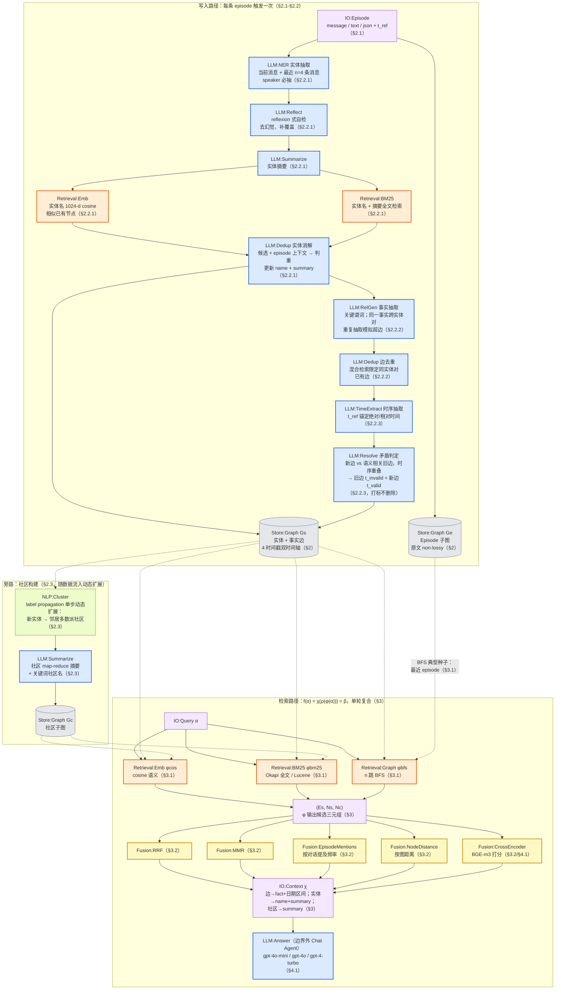

# Zep/Graphiti methodology 流程图

> [!note] 来源与口径
> 基于同目录 [[paper-architecture]]、[[code-architecture]]，勘误已按 [[verification]]（119 条逐项核对：98 ✓ / 4 ✗ / 15 ◐ / 2 ?）吸收进图，关键修正：实体消解与摘要生成的 LLM 调用粒度（C15/C23：批量 0~1 次，非按实体数线性）、默认路径实际使用的 prompt（C22：`extract_summaries_batch`，另两份 prompt 是死代码）、χ 引擎内置函数**存在**（C41：`search_helpers.py:28`，此前文档误判"无对应"）、实体消解只回 name 无 summary（C16/D3）、"单轮 + 一次结果依赖的自动播种 BFS"（C40）。词汇表与图例见全项目规范 `METHODOLOGY-FLOW-SPEC`。

## Paper 视角

Rasmussen et al. 2025, *Zep: A Temporal Knowledge Graph Architecture for Agent Memory*, arXiv:2501.13956v1（2025-01-20）。本地 txt：`/Users/guanhongli/Documents/wafo-base/literature/papers/Rasmussen-2025-Zep-Temporal-Knowledge-Graph-Architecture-for-Agent-Memory.txt`。

![[assets/graphiti-paper-flow.png]]

### 核验真源

图注（论文侧，verification 判定已核对）：

- φ 三路作用于三类对象：语义边搜 `fact` 字段、实体节点搜实体名、社区节点搜社区名（§3.1）；BFS 默认跳数 n 论文未给数值（P48）。
- ρ 五选一：论文未说明实验实际用了哪种重排、是否纳入社区（P42）；cross-encoder 用 BGE-m3（P40），且为本地模型调用而非 LLM（对照 code 侧 C38）。
- 边界：构建图谱的 LLM（实验 gpt-4o-mini）在记忆系统边界**内**；Chat Agent（gpt-4o-mini / gpt-4o / gpt-4-turbo，含 DMR 的 gpt-4-turbo-2024-04-09，P39 修正）在边界**外**，只消费 β。
- `LLM:Reflect` 为论文宣称（§2.2.1），代码侧不存在，见 code 图 DEAD。
- 论文示例 context 模板只有 `<FACTS>`/`<ENTITIES>` 两区块，无 `<COMMUNITIES>`（P38 属实）——与 χ 正式定义（含社区）存在论文内部落差。

## Code 视角

repo `~/Documents/repo/graphiti` @ `a6e026f`（`mcp-v1.1.0-2-ga6e026f`，graphiti-core==0.30.1）+ memory-bench 封装 `servers/graphiti/server.py`（638 行）。

![[assets/graphiti-code-flow.png]]

### 核验真源

```mermaid
flowchart TB
    classDef llm fill:#dbeafe,stroke:#2563eb,stroke-width:2px
    classDef alg fill:#ffedd5,stroke:#ea580c,stroke-width:2px
    classDef nlp fill:#ecfccb,stroke:#65a30d
    classDef fusion fill:#fef9c3,stroke:#ca8a04,stroke-width:2px
    classDef store fill:#e5e7eb,stroke:#6b7280
    classDef io fill:#f3e8ff,stroke:#9333ea
    classDef dead fill:#fee2e2,stroke:#dc2626,stroke-dasharray:5 5

    subgraph INGEST["写入路径：add_conversation → add_episode，每 session 一次（Phase 1-9）"]
        direction LR
        SES["IO:Session<br/>整个 session 拼成 1 个 episode<br/>server.py:417"]:::io
        P1["Phase 1 取上下文<br/>EpisodicNode + 最近 10 条历史 episode<br/>graphiti.py:1087-1110<br/>（实际粒度 = 10 个历史 session，D17）"]:::io
        P2["LLM:NER<br/>extract_message prompt<br/>恰好 1 次调用 node_operations.py:250<br/>graphiti.py:1122（Phase 2）"]:::llm
        P3E["Retrieval:Emb<br/>实体名 cosine 候选<br/>node_operations.py:637（Phase 3）"]:::alg
        P3B["Retrieval:BM25<br/>实体名 + 摘要全文候选<br/>node_operations.py:637（Phase 3）"]:::alg
        P4["LLM:Dedup 实体消解<br/>零候选跳过（:652）→ 确定性消解（无 LLM，:659）<br/>→ 剩余未解析批量 1 次（:681→:552，Phase 4）<br/>只回 name，无 summary（D3，论文称 name+summary）"]:::llm
        P5["LLM:RelGen<br/>extract_edges<br/>edge_operations.py:656（Phase 5）"]:::llm
        P6["LLM:Resolve 边去重 + 矛盾判定<br/>一次调用双输出 duplicate_facts + contradicted_facts<br/>edge_operations.py:726（Phase 6；零候选 0 次，:653）<br/>赋值（纯时序比较）：旧边.invalid_at = 新边.valid_at<br/>（:569-570）；新边自失效（:837-838，D6）"]:::llm
        P7["LLM:TimeExtract<br/>_extract_edge_timestamps<br/>edge_operations.py:812-813<br/>每新边 1 次（Phase 7）"]:::llm
        P8["LLM:Summarize<br/>extract_summaries_batch prompt<br/>prompts/extract_nodes.py:509；30 个/批<br/>短摘要直接拼接不调 LLM（:879-882）<br/>node_operations.py:836-913（Phase 8）"]:::llm
        GE[("Store:Graph Ge<br/>EpisodicNode 原文<br/>nodes.py:318-332")]:::store
        GS[("Store:Graph Gs<br/>EntityEdge：fact + 4+1 时间戳<br/>edges.py:264-280<br/>写库 = 预写 Cypher graphiti.py:1170<br/>RELATES_TO / MENTIONS（Phase 9）")]:::store

        SES --> GE
        SES --> P1 --> P2
        P2 --> P3E & P3B
        P3E & P3B --> P4
        P4 --> P5 --> P6 --> P7 --> P8 --> GS
    end

    subgraph COMMC["旁路：社区层（默认关闭，手动运维工具）"]
        direction LR
        BLD["NLP:Cluster<br/>build_communities = 手动 MCP 工具<br/>server.py:539-549 → graphiti.py:1490<br/>label propagation：同步双缓冲<br/>while True 无迭代上限<br/>community_operations.py:93-104"]:::nlp
        CSUM["LLM:Summarize<br/>map-reduce 两两摘要合并<br/>community_operations.py"]:::llm
        GC[("Store:Graph Gc<br/>CommunityNode nodes.py:687-690<br/>默认从未构建 → 检索恒空")]:::store
        BLD --> CSUM --> GC
    end

    subgraph DEAD["论文宣称但代码中不存在"]
        DR["LLM:Reflect reflexion 自检<br/>grep -i reflexion 全仓库零命中<br/>extract_nodes 单次调用即返回<br/>node_operations.py:244-280"]:::dead
    end

    GS -.->|"update_communities 默认 False<br/>graphiti.py:989/:1184，ingest 从不触发（D4）"| BLD

    subgraph RETRIEVE["检索路径：retrieve → search_()，单轮 + 一次结果依赖的自动播种 BFS（C40）"]
        direction LR
        Q["IO:Query"]:::io
        BM["Retrieval:BM25<br/>Lucene fulltext；edge / node / community<br/>三类并行 search.py:173/253/464/764<br/>（episode 第四路本仓库关闭：server.py:114）"]:::alg
        EM["Retrieval:Emb<br/>cosine，sim_min_score=0.6<br/>search_utils.py:65"]:::alg
        BFS["Retrieval:Graph<br/>BFS 3 跳（仅 edge/node，community 无）<br/>MAX_SEARCH_DEPTH=3 search_utils.py:67<br/>无显式种子 → 自动播种二次 BFS<br/>search.py:332-353"]:::alg
        RRF["Fusion:RRF<br/>默认（server.py:65）<br/>实测 105/105 retrieve 全 RRF"]:::fusion
        CE["Fusion:CrossEncoder<br/>已实现、从未启用：GLM 端点无 logprobs<br/>→ True/False 二值分数 server.py:157-208"]:::fusion
        CTX["IO:Context envelope<br/>L2 封装自实现 χ：_edge_envelope<br/>fact + lo → hi 日期区间 server.py:346/368<br/>valid_at 缺失 → None 不回退（:365）<br/>_allocate 3:1:1 分配 top_k 名额 server.py:387-409"]:::io
        OUT["IO:top-k envelope 列表<br/>（答题 LLM 在边界外自拼 prompt）"]:::io

        Q --> BM & EM & BFS --> RRF --> CTX --> OUT
        CE -.->|"可选分支（从未启用）"| CTX
    end

    GS -.-> BM & EM & BFS
    GC -.-> BM & EM
```

图注（代码侧，与论文的差异已按 verification 修正）：

- **χ 的归属可移动（D19）**：引擎内置 `search_results_to_context_string()`（`search_helpers.py:28`，四区块 `<FACTS>/<ENTITIES>/<EPISODES>/<COMMUNITIES>` 模板，比论文示例多两区块，D8），但 `search_()` 不自动调用（全仓库唯一调用点 `tests/test_graphiti_int.py:77`）；本仓库 χ 由封装层 `_edge_envelope`/`_node_envelope`/`_community_envelope`（`server.py:346/372/380`）自实现。
- **重排适用范围分对象**（D12）：edge/node 各支持 5 种重排；community 只 rrf/mmr/cross_encoder；episode 只 rrf/cross_encoder（`search_config.py:69/74`）。
- code 长出的新组织维度 `saga`/`SagaNode`/`HAS_EPISODE`/`NEXT_EPISODE`（D15，论文无、本仓库未用）未入图。
- 死代码 prompt（`extract_summary` `:467` 零调用点、`extract_entity_summaries_from_episodes` `:613` 无触发路径）不画，属 code 内部死代码而非"论文宣称但代码不存在"。

> [!warning] 环境退化与封装降级（memory-bench 实测，verification W 系列已复核）
> 1. **Reranker 恒 RRF**：`MEMBENCH_GRAPHITI_RERANKER` 默认 rrf（server.py:65），105 次 retrieve 100% reciprocal_rank_fusion（W5/W6）；论文最强调的 cross-encoder 分支因 GLM 端点不返回 logprobs 已降级为 True/False→1.0/0.0 二值分数，且**从未被启用**（W7，"实现了但没用上"型降级）。
> 2. **社区层是空气**：`add_conversation` 既不传 `update_communities=True` 也不调 `build_communities()`，105 次 retrieve 的 `raw_counts.communities` 无一例外全 0（W8/W10）——论文三层子图在日常 ingest→retrieve 循环里实际只有实体关系层在贡献分数。手动构建社区的消融净 +0.10pp、McNemar p=0.908，与重跑噪声不可区分（W11，证据路径不在本机、未复核）。
> 3. **episode 粒度 session 级**：整 session 拼成 1 个 episode（server.py:417），"最近 10 条历史 episode"实际取到最近 10 个 **session**，论文 n=4 消息窗口的抽取语境假设在本接入下不成立（W13/W14，D17）。
> 4. **BFS 自动播种**：从不传显式种子节点，首条 retrieve `edge.bfs hits_per_call=[0, 40]`（node.bfs 同）——冷跑 0 命中后用本轮 bm25/cosine 已命中的节点自播种再跑一次，只扩展已命中邻域，非论文举例的"最近 episode 当种子"（W12，D11）。
> 5. **失效边照常返回**：从不构造 `SearchFilters`，`invalid_at`/`expired_at` 已设的边不排除，只靠 envelope 日期区间让下游模型自行判断（W3，D13；论文对此未规定）。
> 6. `valid_at` 缺失：既有报告称 5958 次检索中 3465 次请求含 `VALID_AT_MISSING`（按边约 6.3%）（W15，证据路径不在本机、未复核）。

## 新登记 module

| module | 类别 | 理由 |
|---|---|---|
| `LLM:Dedup` | LLM 调用·蓝 | LLM 实体/边判重消解（判重→合并）。与 `LLM:Resolve`（词汇表已登记，语义=四操作/矛盾判定/冲突失效）分开：graphiti 同时存在"判重合并"与"矛盾失效"两类 LLM 裁决，同图同名异义会破坏跨图对比 |
| `LLM:TimeExtract` | LLM 调用·蓝 | LLM 时序抽取（用 t_ref 把相对/绝对时间锚定为 valid_at/invalid_at）。时间感知图谱的核心 LLM 步骤，词汇表无时间类 LLM 动词 |
| `LLM:Reflect` | LLM 调用·蓝 | reflexion 式自检：对自身抽取输出复检修补（输入是上一步 LLM 的输出，非新输入）。本系统为 paper-only dead，但该模式在其他记忆系统（A-mem note evolution、self-refine ingest）会复现，值得 canonical 化 |
| `IO:Episode` | IO·淡紫 | episode 输入单元（message/text/json + t_ref），graphiti 特有输入粒度，与 `IO:TurnPair`/`IO:Session` 区分 |
| `IO:Context` | IO·淡紫 | χ 构造器角色：检索结果→格式化上下文字符串 β（fact+日期区间/name+summary）。多系统检索末端的通用角色，跨图对比需要 |
| `Fusion:MMR` | 融合·黄 | 最大边际相关重排（论文 §3.2 五选一之一） |
| `Fusion:EpisodeMentions` | 融合·黄 | 按对话提及频率重排（Zep 自有 graph-based 方法） |
| `Fusion:NodeDistance` | 融合·黄 | 按到中心节点图距离重排（Zep 自有 graph-based 方法） |
| `Fusion:CrossEncoder` | 融合·黄 | cross-encoder 模型打分重排（论文用 BGE-m3 本地模型，非 LLM，故归 Fusion 而非 LLM 类，C38） |

另说明：本图为落实词汇表"Fusion=矩形·黄"，新增了 `fusion` classDef（`fill:#fef9c3,stroke:#ca8a04`）并对所有节点实际应用 `:::class` 着色——mem0 样例图定义了 classDef 但未写 class 应用语句（节点未着色）。建议父会话汇总时统一各图补齐 class 应用，保证跨图颜色真正可比。

## 不确定处

1. **`_extract_edge_timestamps` 的调用粒度**：verification 步骤表标"1 次/新边"（`edge_operations.py:812-813`），但 graphiti 其余步骤均有批量/短路优化（实体消解批量 1 次、摘要 30/批），此处是否真逐边调用未在 verification 中单独核验；若逐边，写入侧 LLM 调用数会随边数线性增长，与整体批量风格不一致，值得上游再确认。
2. **论文 top-k 内部矛盾（P46）**：§4 开头"20"vs §4.2 DMR 段"10"，论文无勘误；code 默认 `DEFAULT_SEARCH_LIMIT=10`（`search_config.py:29`）、本仓库 `max(top_k,20)`（`server.py:64`）——本图按 code 实际标注，不裁决论文哪个数字为真。
3. **χ 三方不一致**：论文示例模板无 `<COMMUNITIES>`（P38）vs 引擎模板四区块（D8）vs 本仓库 envelope 自实现（D19）。本图 code 侧按"本仓库实际"画 χ 在 L2；若其他系统对比时以"引擎能力"为准，χ 位置会移动。
4. **episode 第四路检索（D7）**：论文 φ 三分量 vs 代码四路（`episode_search` 纯 BM25）；本仓库关闭（`server.py:114`），code 图按本仓库实际未画该路，但上游 `search_()` 默认配方含 `episode_config`（C11 限定）——以引擎本体为对象重画时需补。
5. **W11/W15 两条实测数据**（社区消融 McNemar、LoCoMo 四臂分数与 `VALID_AT_MISSING` 率）：证据路径（`research-vault/`、`.context/memory-bench-r2n3/`）不在本机可见范围，verification 标 `?` 无法核实；本文件引用时已逐处标注"未复核"。
