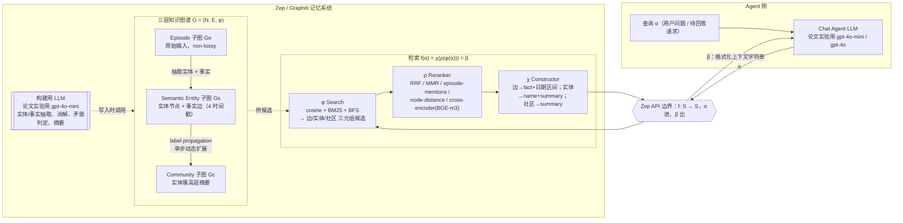

# Zep / Graphiti 论文架构

> 写于 2026-09-04。证据范围：仅论文原文 Rasmussen et al., "Zep: A Temporal Knowledge Graph Architecture for Agent Memory"（arXiv:2501.13956v1，2025-01-20，正文 12 页 + 附录，本地文本 `/Users/guanhongli/Documents/wafo-base/literature/papers/Rasmussen-2025-Zep-Temporal-Knowledge-Graph-Architecture-for-Agent-Memory.txt`，已通读全文）。本文档只回答"论文怎么写"，不读代码；论文↔代码的逐条对照见同目录 `code-architecture.md` 第 6 节。
>
> 论文标题是《Zep》，但正文明确把系统拆成两层讲：**Zep** 是生产级 "memory layer service"，**Graphiti** 是驱动 Zep 的 "temporally-aware knowledge graph engine"（§1）——论文里几乎所有架构细节（三层子图、双时间轴、φρχ 检索）讲的都是 Graphiti 这个引擎，Zep 服务层本身"由什么组成"论文没有展开。

## 1. 一句话机制

Zep 靠内部组件 Graphiti——一个用 LLM 动态构建的时间感知知识图谱——把对话和结构化业务数据都转成图上的实体和事实，每条事实带一段"何时成立"的有效期，新信息通过 LLM 判断矛盾使旧事实失效（而不删除），检索时把查询走一遍"搜索 → 重排 → 格式化"三段式流水线，输出一段可直接喂给下游 LLM 的证据文本（§1；§2 开篇正式定义 "a temporally-aware dynamic knowledge graph G = (N, E, φ)"）。

## 2. 记忆是怎么存进去的

### 2.1 触发时机

图构建始于摄入称为 **Episode** 的原始数据单元（§2.1）。Episode 有三种核心类型：message、text、json；论文的实验只聚焦 message 类型，因为实验对象是对话记忆（§2.1）。每条 message 类型的 episode 携带一个参考时间戳 `t_ref`（消息发送时间），用来把"下周四""两周前""去年夏天"这类相对时间锚定成具体日期（§2.1）。

### 2.2 存的是什么——三层子图，逐层内容不同

论文用一个正式的图定义开篇：`G = (N, E, φ)`，`φ: E → N × N` 是关联函数（incidence function，§2 开头）。图分三层（§2）：

| 子图 | 节点 / 边 | 内容 | 证据 |
|---|---|---|---|
| **Episode 子图** `Ge` | 节点 = episodes（原始数据） | 消息/文本/JSON 原文，论文称之为 "**non-lossy data store**"——原始数据一个字不丢；episodic edges 连接 episode 到它抽出的语义实体 | §2 第一个要点 |
| **Semantic Entity 子图** `Gs` | 实体节点 + 语义边（事实） | 从 episode 抽出并与已有图实体消解合并的实体；实体边表示实体之间抽取出的关系（事实） | §2 第二个要点 |
| **Community 子图** `Gc` | 社区节点 | 强连通实体簇的高层摘要，代表 `Gs` 结构更综合、互联的全局视图；community edges 连接社区到其成员实体 | §2 第三个要点 |

论文把这个三层设计类比人类记忆的双重模型——episodic memory（具体事件）与 semantic memory（概念间关联），并说这个类比启发自心理学文献 [8]；episodic/semantic 两层子图的分离设计直接借鉴 AriGraph [9]；community 层借鉴 GraphRAG [4]（§2 倒数第二段）。

**存的不是原文的压缩，而是分层的不同粒度**：Episode 层原文不丢；Semantic Entity 层是 LLM 抽出的实体和事实（不是原文摘录）；Community 层是更高层的 LLM 摘要。episodic edges 与其对应的语义边之间维护"双向索引"，理论上可以从事实追溯回原始 episode 做引用/引证，反向也可以从 episode 快速取到它抽出的实体和事实——但论文原话明确写"这些连接在本文实验中没有被直接检验，留待未来工作"（§2.1："While these connections are not directly examined in this paper's experiments, they will be explored in future work."）。

### 2.3 存的过程——分实体和事实两条线，都调 LLM

**实体（§2.2.1）**：处理当前消息内容 + 最近 n 条消息（论文取 n=4，即两个完整对话轮次）作为命名实体识别的上下文；说话人自动抽成一个实体。抽取之后，论文说会"采用受 reflexion [12] 启发的自我反思技术来减少幻觉、提升抽取覆盖率"。系统还会从 episode 里抽一个实体摘要，供后续实体消解与检索使用。之后把每个实体名嵌入 1024 维向量空间做 cosine 检索找相似节点，另外单独对已有实体名和摘要做全文检索找候选，两路候选连同 episode 上下文一起交给 LLM 用"实体消解 prompt"判断——如果判定是重复实体，LLM 会生成更新后的名字和摘要。最后写库用**预先定义好的 Cypher 查询**（不是 LLM 生成查询），理由是保证 schema 一致、减少幻觉。

**事实/边（§2.2.2）**：为每个事实抽取其关键谓词；重要的是同一个事实可以在不同实体对之间被抽取多次，用普通边模拟出超边（hyper-edge），从而表达涉及多个实体的复杂事实。抽完生成事实的 embedding，边去重走类似实体消解的流程，但**混合检索被限定在与新边相同的实体对之间已存在的边**——既防止不同实体对间相似边被错误合并，又通过缩小搜索空间大幅降低去重的计算复杂度。

**时序抽取与边失效（§2.2.3，论文自称"与其他知识图谱引擎相比的关键差异化特征"）**：用 `t_ref` 从 episode 语境里抽取事实的时序信息，既能处理绝对时间戳（"Alan Turing was born on June 23, 1912"）也能处理相对时间戳（"I started my new job two weeks ago"）。遵循双时间轴建模，系统在边上维护 4 个时间戳：`t'_created`、`t'_expired` ∈ T′（系统何时创建 / 使某条事实失效），`t_valid`、`t_invalid` ∈ T（事实在现实中何时成立 / 不再成立）。**新边的引入可能使已有边失效**：系统用 LLM 把新边与语义相关的已有边做比较找矛盾；一旦发现时序上重叠的矛盾，就把受影响旧边的 `t_invalid` 设成新边的 `t_valid`——按事务时间轴 T′，Graphiti 始终优先采信新信息。论文强调这套机制既能维护"当前关系状态"又能维护"关系随时间演化的历史记录"。

**社区（§2.3）**：episode 子图和语义子图建立之后，系统通过社区检测构建社区子图。检测方法借鉴 GraphRAG [4] 的思路，但选用 **label propagation 算法 [13] 而非 GraphRAG 用的 Leiden 算法 [14]**，原因是 label propagation 的"动态扩展"更直接——能让系统在新数据不断进入图时，更长时间维持准确的社区表示，推迟"完整刷新"的必要性。动态扩展实现的是 label propagation 单次递归步的逻辑：新实体节点加入图时，系统查看邻居节点所在的社区，把新节点分配到邻居中占多数的那个社区，然后更新对应的社区摘要。论文明确承认：这种动态更新长期下去，产生的社区会逐渐偏离"完整跑一遍 label propagation"该有的样子，因此**定期的社区完整刷新仍然必要**；这套动态更新策略被定性为"显著降低延迟和 LLM 推理成本的实用启发式"，而非追求最优划分的方法。社区节点的摘要通过对成员节点做迭代式 map-reduce 风格摘要生成（沿用 [4] 的方式，但论文强调"检索方法与 GraphRAG 的 map-reduce 方式有本质不同"，检索部分见 §3）。为支持检索，系统还会生成包含关键术语的社区名称，嵌入后存储供 cosine 相似度检索使用。

调不调 LLM：调，而且反复调用——实体抽取（1 次/episode）+ 反思式复检 + 实体消解（按候选数）+ 事实抽取 + 事实去重 + 时序抽取 + 矛盾判定（按边数）+ 社区摘要的两两 map-reduce 合并（按簇大小）。论文没有给出任何一次实验里"平均每个 episode 触发几次 LLM 调用"这类量化数字（第 5 节展开）。

## 3. 记忆是怎么被用起来的

### 3.1 触发时机与整体形式

Zep 检索被形式化为一个函数 `f: S → S`，接受一个查询字符串 `α ∈ S`，输出一段上下文字符串 `β ∈ S`，`β` 里包含节点和边格式化后的数据，供下游 LLM agent 生成准确回答（§3 开头）。`f(α) → β` 被拆成三个步骤，且论文给出显式复合公式：`f(α) = χ(ρ(φ(α))) = β`（§3 末尾）。

### 3.2 拿什么去找——φ (Search)

φ 把候选节点和边找出来：`φ: S → Esn × Nsn × Ncn`，即把查询字符串转成一个**三元组**——语义边列表、实体节点列表、社区节点列表（§3 "Search (φ)" 定义）。三种并行的检索方法（§3.1）：

- **cosine 语义相似度**（`φcos`）
- **Okapi BM25 全文检索**（`φbm25`）——前两者都基于 Neo4j 的 Lucene 实现
- **广度优先搜索 BFS**（`φbfs`）——图 RAG 领域里相对少被研究的方法（例外案例是 AriGraph [9]、Distill-SynthKG [19]）；BFS 在初始搜索结果基础上，把 n 跳以内的额外节点/边纳入进来；`φbfs` 可以接受节点作为参数，典型用法是拿**最近的 episode 当种子**做 BFS，把刚提到的实体和关系一并捞入检索结果

搜索字段随对象类型而变：对语义边 `Es`，搜 `fact` 字段；对实体节点 `Ns`，搜实体名；对社区节点 `Nc`，搜社区名（由社区摘要涉及的关键术语和主题短语构成）——论文特别指出这个"用社区名做关键词式检索"的思路和 LightRAG [17] 的高层关键词检索方法路数相近（各自独立发展出来，论文认为二者结合是未来方向）。三种方法各管一个维度：全文检索找词面相似、cosine 找语义相似、BFS 找"图上距离近 = 对话语境上也相关"的上下文相似（§3.1 末段）。

### 3.3 一步到位还是多步迭代

**单轮复合函数，不是迭代式检索循环**。论文的形式化定义 `f(α) = χ(ρ(φ(α)))` 就是三步顺序执行一次：先找候选（φ），再重排（ρ），再格式化输出（χ）。论文全篇没有描述任何"根据检索结果决定要不要发起下一轮查询"的机制。

### 3.4 找到之后怎么交给模型——ρ (Reranker) 与 χ (Constructor)

**ρ 重排**（§3.2）：初始检索追求召回，重排追求精度。Zep 支持 5 种：

1. **RRF**（Reciprocal Rank Fusion）—— 借用已有方法 [20]
2. **MMR**（Maximal Marginal Relevance）—— 借用已有方法 [21]
3. **episode-mentions**（论文归为 graph-based 方法，Zep 自有）—— 按实体/事实在对话中被提及的频率排序，越常被提到的信息越容易被检索到
4. **node distance**（Zep 自有）—— 按到指定中心节点的图距离重排，把上下文局部化到图上特定区域
5. **cross-encoder**（论文称之为"最精细"，成本最高）—— 用 LLM 通过 cross-attention 对节点/边与查询的相关性打分

**χ 构造**（§3 "Constructor (χ)" 定义）：把 ρ 排好序的节点/边转成文本。规则很具体——对每条 `ei ∈ Es`，χ 返回 `fact` 加上 `tvalid`、`tinvalid` 两个日期字段；对每个 `ni ∈ Ns`，返回 `name` 和 `summary`；对每个 `ni ∈ Nc`，返回 `summary`。论文给出了一份"示例 context 字符串模板"（原文照录）：

```text
FACTS and ENTITIES represent relevant context to the current conversation.
These are the most relevant facts and their valid date ranges. If the fact is
about an event, the event takes place during this time.
format: FACT (Date range: from - to)
<FACTS>
{facts}
</FACTS>
These are the most relevant entities
ENTITY_NAME: entity summary
<ENTITIES>
{entities}
</ENTITIES>
```

——这份模板只有 `<FACTS>` 和 `<ENTITIES>` 两个区块，**没有 `<COMMUNITIES>` 区块**，即便 χ 的正式定义明确包含"对每个社区节点返回 summary"这一条（第 6 节详细展开这处落差）。

## 4. 架构图



边界说明：论文把"构建图谱用的 LLM"（实验里是 gpt-4o-mini）和"最终回答用户问题的 Chat Agent LLM"（实验里是 gpt-4o-mini / gpt-4o）明确分成两个角色——前者活在 Zep API 边界**里面**（属于记忆系统自己的内部机制），后者活在边界**外面**（属于 Agent 侧，只消费 Zep 吐出来的 β 字符串）。检索阶段的重排如果选了 cross-encoder，也会在边界内部触发一次模型调用（论文用的是 BAAI 的 BGE-m3，§4.1），同样不算 Agent 侧的"思考"。

## 5. 我没搞清楚的

以下是论文没写、需要看代码或跑起来才能确定的地方，不用推测填：

- **Table 1-3 的具体分数对应哪一份 `SearchConfig`**：论文只说"retrieve the 20 most relevant edges (facts) and entity nodes using the techniques described in Section 3"（§4），但没有说 DMR 和 LongMemEval 两个实验各自具体用了哪种重排（5 选 1）、BFS 深度设多少跳、是否把 community 也纳入检索——§3.1/§3.2 介绍的是"能力菜单"，不是"这次实验用了菜单里的哪几项"。
- **"reflexion 式自我反思"具体是什么形式**：论文只引用了 reflexion 原论文 [12]，没有给出这一步骤的 prompt 或伪代码，无法从论文本身还原它具体检查什么、怎么触发重新抽取。
- **附录 6.1.1 Entity Extraction 的第 6 条 guideline 内容被截断**："6. DO NOT extract entities mentioned only" 后戛然而止，看起来是源 PDF 转文本时的丢字，这条规则的完整内容在这份文本里无法还原。
- **图构建用 gpt-4o-mini、检索重排/嵌入用 BGE-m3，这个跨模型组合本身贡献多少**：论文 §4.1 交代了选型，但没有做"全用同一模型"或"换掉某一环节"的消融，无法从论文判断这个特定组合是不是效果的关键因素之一。
- **社区"定期完整刷新"的周期是多久、由什么条件触发**：§2.3 只说"periodic community refreshes remain necessary"，没有给出具体的时间间隔、触发条件或判断"漂移是否严重"的准则。

## 6. 论文没写清楚的地方

- **`<COMMUNITIES>` 区块在 context 模板里长什么样，论文没有展示**。§3 对 χ 的正式定义三次提到社区节点（"for each `ni ∈ Nc`, the summary field"），但紧接着给出的"示例 context 字符串模板"原文只有 `<FACTS>` 和 `<ENTITIES>` 两个区块，没有 `<COMMUNITIES>`。这处落差论文没有解释——是因为示例只是"简化演示"，还是社区摘要在实际产品里走另一套模板拼接方式，读者无从判断。
- **§4 实验部分只提到检索"edges (facts) and entity nodes"，完全没提 community 节点是否参与了 Table 1-3 的实验**。χ 的正式定义（§3）明确把社区节点纳入检索输出的三元组之一，但到了 §4 描述具体怎么跑 DMR/LongMemEval 时，行文只字未提社区——"we then retrieve the 20 most relevant edges (facts) and entity nodes"。这句话没有排他性声明（没写"仅"），但也没有正面说包含社区，是否包含无法从论文文本本身判定。
- **DMR 与"两个实验统一方法论"两处对 top-k 的表述互相矛盾**：§4 开头统一说"For both experiments... retrieve the **20** most relevant edges...and entity nodes"；§4.2 DMR 段落又单独写"retrieve the top **10** most relevant nodes and edges"。这是论文内部的不一致，没有任何脚注或勘误说明哪个数字对应 Table 1 的实际结果。
- **检索该不该排除已经失效（`tinvalid` 已设）的事实，论文完全没讨论**。§2.2.3 只说明失效事实"被打上 `tinvalid`、留在图里"，§3 的 χ 也只说"把 `tvalid`/`tinvalid` 连同 fact 一起交给模型"——但一条已经失效的旧事实是否还会被 φ 检索到、如果检索到该不该被 ρ 降权、模型看到两条互相矛盾的事实（一条当前有效一条已失效）该怎么取舍，论文从设计到实验都没有触及，也没有针对这一点做任何消融或案例分析。
- **BFS 的默认跳数 `n` 论文没给具体数字**。§3.1 只说"identifies additional nodes and edges within n-hops"，反复用符号 `n` 指代跳数，但没有给出实验里实际使用的数值，也没有讨论跳数大小对结果的敏感度。
- **五种重排方法"什么场景该用哪种"，论文只描述了各自是什么，没给选择准则**。§3.2 逐一介绍 RRF/MMR/episode-mentions/node-distance/cross-encoder 的机制，但没有一句话讲"延迟敏感场景该选哪个""精度优先场景该选哪个"这类工程取舍建议——五种方法之间也没有互相的效果对比数据。
- **论文用同一个希腊字母 `φ` 表示两个不同概念，容易造成误读**：§2 开头定义图 `G = (N, E, φ)` 里的 `φ: E → N × N` 是"关联函数"（哪条边连哪两个节点），§3 里的 `φ: S → Esn × Nsn × Ncn` 是"Search 检索函数"——二者定义域/值域完全不同，论文没有在符号上做区分（比如加下标），只能靠读者根据上下文自行分辨。
- **论文完全没有报告"图构建"阶段的成本/延迟**。Table 2 只报告了检索阶段的 latency（Zep 3.20s/2.58s vs full-context 31.3s/28.9s），"latency 降低 90%"这个核心卖点只覆盖检索侧；构建一个 episode 平均要调几次 LLM、花多少钱/多少延迟，论文正文和附录都没有给数字。
