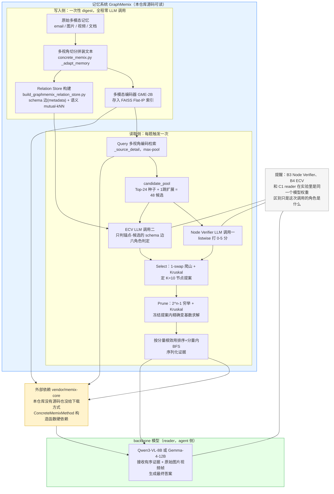

# GraphMemix 代码架构

> 调研对象：`/Users/guanhongli/Documents/repo/graphmemix`（官方 `ligeng0197/graphmemix`，克隆时 `HEAD=d0ea01d`）。
> 本文档只读代码得出结论，证据格式为 `文件:行号`。

## 1. 一句话机制

GraphMemix 不是"算相似度排 top-k"，而是每道题到来时现算一次组合优化：从多视角检索种子出发，沿"同一轮/连续对话轮次/语义近邻"关系扩出一张几十个节点的候选图，用一个 LLM 给每条候选打"这条本身有没有用"的分（node verifier），再用另一个 LLM 只看"锚点—候选"之间已有 schema 关系的那些边判断"接在锚点后面算不算新信息"（ECV，六选一角色），最后用 Kruskal 算法在打好分的图里选出"总收益最大"的一片森林（先 1-swap 爬山定下 K 个节点，再在这 K 个节点范围内穷举子集精确求解），交给 reader 模型生成答案。

**但要先说清楚一件事**：这套"候选图构建 → 验证 → 森林优化"算法本身（`scripts/build_graphmemix_relation_store.py`、`score_graphmemix_verifier.py`、`score_graphmemix_ecv.py`、`evaluate_graphmemix_ecv.py`、`evaluate_graphmemix_exact_pruning.py`）在这个仓库里自包含、可读、可独立验证；但真正把"写入的多模态记忆编码成向量"和"query 时刻多视角检索出种子/把选中证据拼成最终 prompt"这两头粘起来的胶水类 `ConcreteMemixMethod`（`src/mm_memory_bench/methods/concrete_memix.py`），构造函数里硬性要求一个这个仓库没有、README 也没给下载方式的外部私有仓库 `vendor/memix-core`（concrete_memix.py:48-52,268）。也就是说，只读这个仓库能完整验证"选证据"的算法对不对，但没法在本地从零跑通"写入→检索→生成"整条链路。

## 2. 记忆是怎么存进去的

**触发时机**：`run_graphmemix_release.py` 编排的 9 个 stage（checkpoint→priors→relations→node→ecv→select→prune→reader→judge，run_graphmemix_release.py:23）里，第 1 个 `checkpoint`（run_graphmemix_release.py:107-116）对每个 benchmark/backbone 组合一次性把整个 archive 编码完，不是逐条实时写入。

**存的是原文，不是摘要**。`ConcreteMemixMethod._adapt_memory`（concrete_memix.py:397-472）的具体流程：
- 每条原始记忆（email/图片/视频/文档）把 `metadata.derived` 里数据集**自带**的派生字段（短摘要、caption、OCR、地点、tags 等——这些不是 GraphMemix 自己生成的，是数据集发布方处理好随包分发的，concrete_memix.py:420-441）拼成一段文本，连同 `source_id`/`timestamp`/`session_id` 等头信息存进 `record["text"]`；原始图片/视频路径单独存 `image_path`/`video_path`，`content`（原始 asset 引用）整份保留（concrete_memix.py:441-462）。
- 每条记忆切出多个"embedding unit"（对应论文说的"view"）：文本一份、每张图一份、视频每帧一份，可选再切原子文本句子（`media_atomic_limit`，生产配置默认关闭）（concrete_memix.py:453-472）。
- 这些 unit 批量传给多模态编码器（`self.embedder.encode_units`，配置里是 `gme-Qwen2-VL-2B-Instruct`，1536 维），向量存进 FAISS Flat-IP 索引，按 context 分文件落盘为 `state.json` + `index-*.faiss`（`_flush_pending`/`_save_checkpoint`，concrete_memix.py:365-396）。

**调不调 LLM**：不调。整条 ingest 路径（`_ingest`→`_adapt_memory`→`_flush_pending`，concrete_memix.py:337-396）只出现 embedding 调用，没有一次 chat/completion 调用。

**关系图是另一个独立脚本、也在写入侧构建**：`build_graphmemix_relation_store.py`（"relations" stage）不依赖 memix-core：
- **schema 边**：纯读 metadata。同一个 `metadata.native_round_id` → `same_round`；同一个 `session_id` 内按 `sequence` 相邻 → `consecutive_turn`（`explicit_edges`，build_graphmemix_relation_store.py:70-101）。另有一个可选的 `spatiotemporal_event`（同 context 内时间差、距离都在阈值内的两条媒体相连，`spatiotemporal_edges`，build_graphmemix_relation_store.py:152-186），但两个阈值参数默认是 0（函数直接 `return {}`），且 `run_graphmemix_release.py` 的 relations stage 命令（run_graphmemix_release.py:124-129）没有传这两个参数——生产配置下这个通道是关的。
- **语义边**：取每条记忆的"canonical vector"（非 atomic 的第一个 embedding unit；视频取所有帧向量归一化后的均值，`reconstruct_vectors`，build_graphmemix_relation_store.py:209-223），在 FAISS 里做 mutual top-k 近邻（`mutual_neighbors`，build_graphmemix_relation_store.py:225-254；k 由 `--max-semantic-k` 控制，生产配置是 8）。
- 同样不调 LLM，纯向量/metadata 计算。

## 3. 记忆是怎么被用起来的

**触发时机**：每道题触发一次；node→ecv→select→prune→reader 五个子阶段严格按顺序跑，各自把结果落盘成 jsonl 供下一阶段读（run_graphmemix_release.py:141-224）。

**拿什么去找**：
1. **多视角检索定位种子**（"priors" stage，`run_memix_main_track_retrieval.py` 直接调 `ConcreteMemixMethod._source_detail`，concrete_memix.py:558-577）：把 query 的每个视图（文字、每张问题图、视频每帧）分别编码去 FAISS 查 top-k，同一个 `memory_id` 只留各视图里分数最高的那个（`best[memory_id] = max(best.get(memory_id, -inf), score)`，concrete_memix.py:568-577），凑出 200 条（`source_top_k`）候选——这就是论文 Eq.3 的 max-pooling 在代码里的样子。
2. **候选图扩展**（`candidate_pool`，graphmemix_core.py:83-108）：取前 24 条（`source_top_l`）当种子，顺着 relation store 的边（explicit 优先于 semantic，按相似度排序）扩 1 跳，去重后补到 48 条（`candidate_limit`）。

**不是一步到位，是"两次 LLM 打分 + 两阶段确定性求解"**：
- **Node Verifier**（"node" stage，`score_graphmemix_verifier.py`）：一次 listwise 调用，把全部候选（含 modality/date/location/retrieval_score/snippet）打包成一个 JSON 发给 backbone 模型，模型给每条候选打 0-5 分，不返回即算 0 分（score_graphmemix_verifier.py:255-330；`output_schema`见 313 行）。
- **ECV**（"ecv" stage，`score_graphmemix_ecv.py`）：先从候选里按检索序选 10 个（`anchor_count`）当"锚点"（默认 `anchor_mode=atomic`，不看 verifier 分数）；只对"锚点—候选"之间**relation store 里已有 schema 边**的那些 pair（`eligible_anchor_relations`，语义近邻边不参与）打包发给 LLM。模型对每条候选返回：`direct_support`（生产配置里 `--edge-only` 强制置 0，复用 node 阶段的分，score_graphmemix_ecv.py:35-42,552）、`incremental_support`（0-5，"锚点已知的前提下这条新加了多少信息"）、`role`（六选一：`new_fact`/`clarification`/`corroboration`/`redundant`/`conflict`/`irrelevant`，score_graphmemix_ecv.py:30-31,533）。只有正分 + 前三种角色的边会保留参与后面的图（`positive_edges`/`conditioned_adjacency`，evaluate_graphmemix_exact_pruning.py:32-46，evaluate_graphmemix_ecv.py:32-44）。
- **Select：1-swap 爬山 + Kruskal，定下 K 个节点的提案**："select" stage（evaluate_graphmemix_ecv.py，直接 `from probe_graphmemix_pcsf import solve_forest_greedy`，第 16 行）：节点值 = `sigmoid(a·atomic_score + b·verifier_score + c)`（校准系数来自 `configs/release/calibration/shared_dev.json`）；边的"收益" = `root_cost(0.2) − edge_weight(0.1)·(−log(similarity))`。从 Top-10 节点效用起步，每次尝试"换一个选中的出去、换一个没选的进来"，只要严格变好就换，直到没有更好的交换（probe_graphmemix_pcsf.py:196-231）；**但"当前这 K 个节点怎么连边"是精确算的**——候选边按收益从高到低排序，用并查集依次加边、成环就跳过，这是标准 Kruskal 求最大权森林（probe_graphmemix_pcsf.py:203-215），diagnostic 明确标 `"exact": False`（probe_graphmemix_pcsf.py:249，指的是"选哪 K 个节点"这件事不是穷举）。
- **Prune：穷举 + Kruskal 做变基数精修**："prune" stage（evaluate_graphmemix_exact_pruning.py）：在 select 阶段选出的 ≤20 个节点范围内，把 2ⁿ−1 个非空子集**全部**枚举，每个子集精确跑一次 Kruskal 求最大权森林，取目标函数值最高的子集+森林（`exact_subset`，evaluate_graphmemix_exact_pruning.py:50-100；超过 20 个节点会直接抛异常，第 62 行）。这一步是真穷举，但只在"1-swap 已经筛过一遍"的小集合里穷举，不是在全部 48 个候选里穷举。

**找到之后怎么交给模型**：证据按"每个连通分量选效用最高的点当根、按根的效用给分量排序、分量内部宽度优先遍历"的顺序排好（`probe_graphmemix_pcsf.py` 里 `solve_forest`/`solve_forest_greedy` 末尾的 BFS 排序逻辑）；"reader" stage 调 `ConcreteMemixMethod._generate_answer`（concrete_memix.py:759 起，被 `run_memix_answers_from_retrieval.py` 复用）把排好序的证据（原文文字 + 原始图片/视频帧）拼成一个多模态 prompt，发给**同一个** backbone 模型（Qwen3-VL-8B-Instruct 或 Gemma-4-12B）生成最终答案。

## 4. 架构图

图中黄色框是关键：区分"记忆系统"和"agent"的边界不是"调没调 LLM"（Node Verifier / ECV 明明也调 LLM），而是"这次调用是在为选证据打分，还是在做最终回答"；同时提醒读者，本仓库能读到源码并验证的只有 relations/node/ecv/select/prune 五步，checkpoint/priors/reader 三步都要绕经黄色框里那个拿不到源码的外部仓库。

## 5. 我没搞清楚的

- **`vendor/memix-core` 到底是什么、从哪下载**：README 的"Data and Artifacts"给了数据集下载方式（HuggingFace `oking0197/graphmemix-benchmarks`），但完全没提这个私有代码仓库怎么获取。`checkpoint`（build_memix_checkpoints.py:41）、`priors`（run_memix_main_track_retrieval.py 内调用 `ConcreteMemixMethod`）、`reader`（run_memix_answers_from_retrieval.py:136,753,773,792）三个 stage 都会在构造 `ConcreteMemixMethod` 时因为缺这个仓库直接抛 `RuntimeError`（concrete_memix.py:48-52）。
- **`cli.py` 里另一条路径 `graphmemix run --method memix`**（cli.py:385-403,546-559）把候选图构建、验证、选择全部甩给 `self.core.retrieve_one(...)`，即完全委托给 `vendor/memix-core`，算法细节在本仓库完全不可见。不确定这是历史遗留/开发期接口，还是也曾被用来产出过论文数字——README 的复现说明只指向 `run_graphmemix_release.py` 这条 9 阶段脚本流水线。
- **校准系数 a/b/c 的拟合脚本没找到**：只看到拟合结果 `configs/release/calibration/shared_dev.json`（"protocol": "graphmemix-shared-logistic-devfold-1.0"，positives=8491，prevalence=0.135），"按 SHA256 分 5 折、只在 dev fold 用 gold 标签防泄漏"这套流程具体怎么实现的代码没有找到，数字对不对得上是靠反推公式验证的（见第 4 节的一句话机制），不是直接读到拟合脚本确认的。
- **`explicit_similarity=0.99` 是否该按 schema 类型区分**——这条放到第 6 节一起说。

## 6. 与论文的冲突点

1. **（本节最大冲突点，静态代码证据链完整，但未实机跑通验证）ATM-Bench 的 schema 关系类型和论文描述对不上，且按生产配置推演应该是空的。** 论文 Appendix A.1 明确说 ATM-Bench 的"query-independent schema graph"有三种关系：`event_bridge`（媒体间 1 分钟–1 小时、5 公里内，每条记忆最多保留 2 个近邻）、`same_record`（邮件间强引用/事件日期类别/主题相近）、`record_grounding`（邮件到媒体的日期+地点/内容匹配）。全仓库搜索这三个字符串：`record_grounding` 只在单元测试里出现一次，且是被当作"不合法的 ECV 角色"测试用例（tests/test_score_graphmemix_ecv.py:63，用来验证 ECV 六角色校验会把它规整成 `irrelevant`）——这恰好说明作者知道这个词，但从没把它实现成一种 schema 关系类型；`event_bridge`/`same_record` 则完全没有出现在任何代码里。真正的通用 schema 边构建函数 `explicit_edges()`（build_graphmemix_relation_store.py:70-101）只认 `metadata.native_round_id`（→`same_round`）和 `session_id`（→`consecutive_turn`）两个字段；而 `converters/atm.py` 里 email 和 media 两类记忆的 `memory_rows.append(...)`（atm.py:400,461）都没有设置这两个字段——对照 `memeye.py`、`mem_gallery.py`、`h2hmem.py` 三个转换器都显式写了 `session_id`/`native_round_id`，唯独 `atm.py` 没有。按这条代码路径推演，ATM-Bench 走 `explicit_edges()` 会得到 0 条边；再加上能覆盖"时间+距离"逻辑的 `spatiotemporal_edges()`（但没有"每条记忆最多 2 个近邻"的封顶）两个阈值参数默认是 0、`run_graphmemix_release.py` 的 relations stage 命令（run_graphmemix_release.py:124-129）也没传这两个参数，生产配置下这条通道同样是关的。这样推下来，ATM-Bench 实际跑出来的 relation store 里 schema 边应该是空的——但论文 Table 6 明确写了 ATM-Bench 每题平均有 6.23 条 "Fixed Edges"（schema 边），是四个数据集里第二高的，直接对不上。**没有下载数据实跑一遍 relations stage、看 `*.summary.json` 里的 `native_explicit_edges` 数字，我不能 100% 确认**——一个可能的解释是 HuggingFace 上发布的"unified"数据集快照是用一个比当前仓库 HEAD 更早/不同的转换器版本生成的，跟本地能读到的 `converters/atm.py` 源码对不上；但从纯代码审查角度看，这是我找到的最具体、最可验证、也最值得优先去实机确认的一处不一致。
2. **`w_{ai}^{schema}`（论文 Eq.9 的"schema 关系可靠度上限"）在代码里是单个全局常数，不分 schema 类型。** 不管是 `same_round`、`consecutive_turn` 还是 `spatiotemporal_event`，`build_graphmemix_relation_store.py` 都用同一个 `--explicit-similarity`（默认 0.99）赋值；后续 `evaluate_graphmemix_ecv.py`/`evaluate_graphmemix_exact_pruning.py` 实际算边权重时，也是直接拿常数 `0.99` 乘 ECV 归一化增量分（`similarity = 0.99 * (incremental/5.0)**power`），完全没有读取 relation store 里按边区分的 `explicit_similarity` 字段，也没有区分是哪种 schema 关系。这一条置信度不如第 1 条高，论文的带上标记号本身有解释空间，可能只是记号选择而非真的设计分歧，但至少代码没有做到"分类型"。
3. **（确认不是冲突，只是容易被误读，附带说明）** 论文 Appendix A.2 说 node verifier 和 ECV "can therefore execute in parallel"；代码里默认 `anchor_mode=atomic`，ECV 确实不消费 node 阶段打的分数，只共享同一份冻结候选集，这个"并行"指的是两次 LLM 调用互不依赖，不是编排脚本里真的并发调度。`run_graphmemix_release.py` 把它们编排成顺序 stage（run_graphmemix_release.py:141-176，ecv stage 读取 node stage 落盘的候选文件）只是产物缓存/一致性校验的工程选择，不构成对论文说法的否定。
4. **Kruskal 求解器和 ECV 六角色判定本身——核实结论是"真实实现，且和论文高度一致"，不是冲突点，放在这里一并说明**：`probe_graphmemix_pcsf.py:196-231` 的 `forest()` 内部函数、`evaluate_graphmemix_exact_pruning.py:50-100` 的 `exact_subset()`，两处都是标准 Kruskal（按收益排序 + 并查集判环）的真实实现，不是占位符或名不副实的函数名；`score_graphmemix_ecv.py:30-31` 的 `ALL_ROLES` 六个角色字符串、以及 `score_graphmemix_ecv.py:533` prompt 里原样出现的六个角色名，和论文正文"assigns one of six roles: new_fact, clarification, corroboration, redundant, conflict, or irrelevant"逐字对得上。论文 Eq.11-13 的目标函数、超参命名（`root_cost`↔κ、`edge_weight`↔λ）、Appendix A.5 的证据排序规则（"highest-utility node as root...breadth-first...ties resolved by node utility and then by the original retrieval order"）都能在代码里找到几乎逐一对应的实现，这是本次调研里代码与论文吻合度最高的部分。
