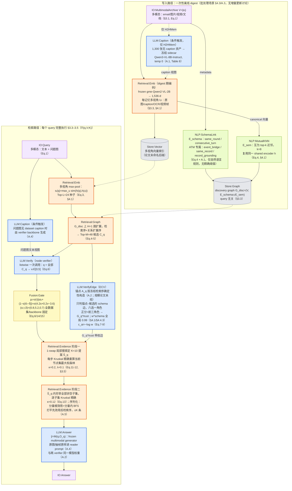
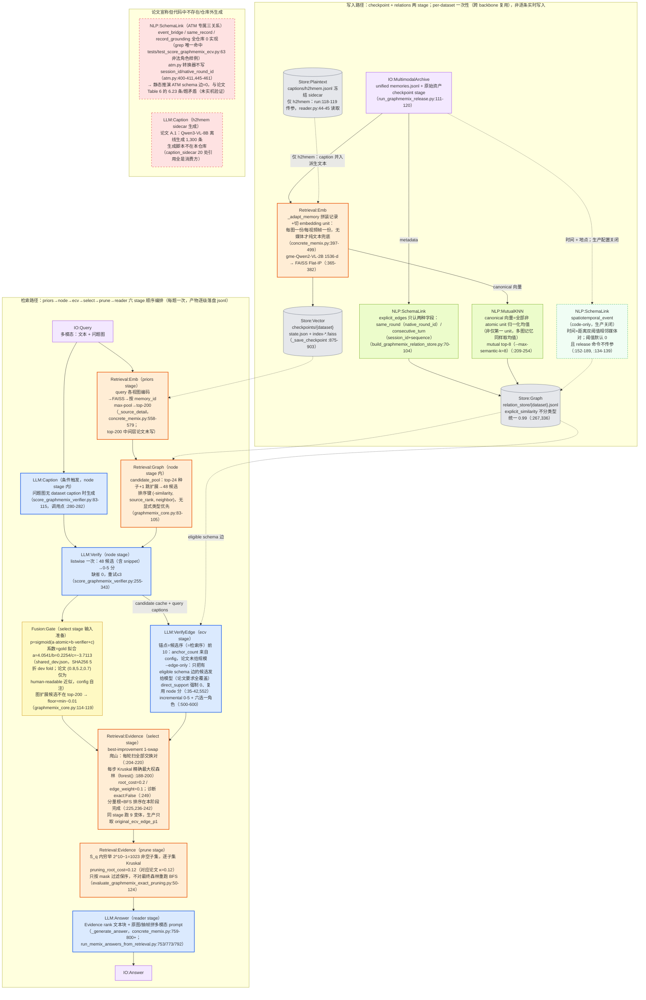

# GraphMemix methodology 流程图

> [!note] 来源与口径
> 基于同目录 [[paper-architecture]] 与 [[code-architecture]]，勘误已按 [[verification]]（2026-09-05 复核，89 条核对：✓59 / ✗5 / ◐24 / ?1）修正并吸收进图，要点包括：Kruskal 精确性名句出自 §1 而非摘要（P3/P25）、写入侧存在 H2HMem LLM caption sidecar（P9）、锚点规模论文未给（P31）、Kruskal 实际实现行号在 `forest()` :188-200（C35）、checkpoint 按 dataset 落盘跨 backbone 复用（C5）、1-swap 为 best-improvement 而非 first-improvement（C34）、prune 实际穷举 2^10−1 且 root_cost=0.12（C37/C38）、ATM 三种 schema 关系代码 0 实现（D1/D2）、vendor/memix-core 硬依赖（复核 §5-A）。词汇表与图例见全项目规范 `METHODOLOGY-FLOW-SPEC`。

## Paper 视角

Li, Wang, Li, Hao & Peng 2026, *GraphMemix: Query-Aware Evidence Forests for Long-Term Multimodal Agent Memory*, arXiv:2608.26983v1（MemoraX AI Research 技术报告）。

系统边界按 Eq.1：`Π`（evidence selector）= GraphMemix 方法本体（下图除 `LLM:Answer` 外的全部）；`M`（frozen multimodal generator）= backbone 侧；LLM-as-judge（gpt-5-mini）= 评测侧，不入图。

![[assets/graphmemix-paper-flow.png]]

### 核验真源



> [!note] 写入侧证据状态（吸收复核 P9/C13）
> 论文对写入着墨很少：§3.1 直接把 V 记为固定集合，未给"原始记录→eᵢ"的算法级描述；ATM 三种 schema 规则仅有自然语言描述。"写入阶段零生成式 LLM"的推断已被 A.1 证伪：H2HMem 的 1,300 张图由 Qwen3-VL-8B 离线生成冻结 caption sidecar（写入侧生成式调用，产物冻结、跨方法共享）。ATM 的 caption/OCR 派生字段则是数据集发布方预生成随包分发的，不算 GraphMemix 自己的写入调用。

> [!note] 求解精度的表述限定（吸收复核 P3/P24/P25）
> "For any fixed node set, its optimal maximum-weight forest is obtained exactly by Kruskal's algorithm" 出自 **§1 Introduction**（摘要通篇无 Kruskal）。精确性只覆盖"给定节点集后怎么连边"这一子问题：选哪些节点是 1-swap 启发式（不保证全局最优）；Eq.13 的穷举也仅在冻结提案 S̄_q（K=10）内部"全局最优"，不在全部 48 个候选上。

> [!note] LLM 调用计数与并行声称（吸收复核 P30/P32/D6）
> 每题固定 3 次调用（node verifier + ECV + reader；实验中三者同一模型权重，A.2），另有条件触发的 query-caption 调用未计入该计数（A.4）。Table 7 消融：Two-Call 61.25 > Joint 59.25（100 题子集），佐证两次验证拆分的设计。论文 §4.1/§4.4.4 无条件断言两 verifier "execute in parallel / no serial dependency"（A.2 为较弱的 "can"）；代码侧实为顺序 stage 编排，见 code 视角。

## Code 视角

repo `~/Documents/repo/graphmemix` @ `d0ea01d`（官方 `ligeng0197/graphmemix`，唯一一次提交）；9-stage release 流水线 `run_graphmemix_release.py`（checkpoint→priors→relations→node→ecv→select→prune→reader→judge，:23）。

![[assets/graphmemix-code-flow.png]]

### 核验真源



> [!warning] 环境退化：vendor/memix-core 硬依赖，全链路不可本地复现（复核 §5-A 专项确认）
> `ConcreteMemixMethod` 构造函数无条件加载外部私有仓库 `vendor/memix-core`（concrete_memix.py:48-52,268；默认路径 :219 且 config 写死），缺失即 RuntimeError；仓库内无 `vendor/`（.gitignore 显式忽略，另忽略 `Memix-core-share-*.tar.gz`），README/docs 无任何获取方式（只给 HF 数据集 `oking0197/graphmemix-benchmarks`）。影响面：checkpoint / priors / reader 三 stage 构造期即抛错——本仓库无法从零跑通"写入→检索→生成"全链路，可完整读码验证的只有 relations/node/ecv/select/prune 五步"选证据"算法（reader 的实际生成逻辑不碰 core，只是被构造函数连坐）。

> [!warning] ATM schema 边冲突（D1，最值得实机验证的一处）
> 静态推演 ATM-Bench schema 边为 0（见 DEAD-D1），而论文 Table 6 记 ATM 每题平均 6.23 条 Fixed Edges（四数据集中第三高，复核 C51 更正"第二高"）。复核确认本机无 data/ 无法实跑 relations stage 验证（? 未决）；可能解释是 HF 发布的 unified 快照由不同版本转换器生成。

> [!note] 编排顺序与并行性分歧（D6）
> 逻辑上 relations（写入侧）先于 priors（检索侧），编排顺序却相反（run_graphmemix_release.py:122-139），系产物依赖所致。ecv stage 必须读 node stage 落盘缓存（--edge-only 之外另有 --candidate-cache 为 required，score_graphmemix_ecv.py:260），且 query-caption 调用只发生在 node stage（:280-282）——论文宣称的"两 verifier 并行"在实现层不成立，实际顺序执行。

## 新登记 module

- `LLM:Caption`：像素→文本 caption 生成（对应复核新造原语 P-CAPTION）。写入侧 H2HMem 冻结 sidecar（A.1）+ 检索侧 query 图 caption（A.4）两处出现。与 `LLM:Extract` 分界：输入是像素不是文本，输出是作为检索视图的自由文本描述，不抽事实/不打标签——这正是本论文与 A-MEM 式"写入期 LLM 摘要"路线的关键计费差异。
- `LLM:Verify`：listwise 节点效用打分（node verifier，0-5 分，融合进 p_i）。与已登记 `LLM:Judge` 分界：检索管线内的 rerank 打分 vs 评测侧判分。
- `LLM:VerifyEdge`：ECV 锚点条件下边级增量验证（对应复核新造原语 P-EDGEVERIFY）：决策单元是 (anchor, candidate) 边，输出带权可信边集 G_q^trust + 六角色门控。与 `LLM:Verify` 分界：边级 vs 节点级；任何"判断新证据相对已有证据是补充还是冗余"的机制都可复用此 module。
- `NLP:SchemaLink`：query 无关的 schema 规则建边（metadata 字段→类型化边），图构建期纯规则算法，无 LLM。
- `NLP:MutualKNN`：mutual top-k 近邻语义建边。与 `Retrieval:Emb` 分界：目的是建边而非取检索候选。
- `IO:MultimodalArchive`：用户多模态记忆档案输入节点（email/图片/视频/文档）。已登记 IO 例子均为会话粒度（TurnPair/Session/Query/Answer），缺档案粒度多模态输入。

复用说明：`Retrieval:Evidence`（词汇表已为 graphmemix 登记）拆成 select/prune 两阶段两个节点；`Retrieval:Emb` 同时用于写入期编码与检索期 max-pool（与 mem0 code 图写入侧批量向量化同用法）；`Store:Plaintext` 复用于 jsonl sidecar；`Fusion:Gate` 为语义扩展复用（见不确定处）。

## 不确定处

- `Fusion:Gate` 的语义在统一规范中已裁决为“门控/分数融合”通用原语：TransMem 用于隐状态门控，GraphMemix 用于 σ(τ[αs+(1−α)ṽ−δ]) 校准融合；不另设校准专名。
- `LLM:Verify` 与 `LLM:Judge` 的边界是自拟的（管线内 rerank vs 评测判分）；若父会话认为应并入 Judge，仅改名不改图结构。
- code-only 且生产关闭的通道（spatiotemporal_event）用了 async 绿虚线而非 dead——dead 语义是"论文有/代码无"，此处方向相反。"代码有/论文无/默认关"的统一画法请裁决。
- D1（ATM schema 边 0 vs Table 6 的 6.23）按"论文有/代码无"画进 DEAD；若实机验证翻案（HF 快照由旧版转换器生成等），DEAD-D1 需改画。
- 无 BM25/稀疏检索通道（复核否定清单：检索侧无 P-SPARSE）——本系统纯 dense + 图扩展，图中不出现 `Retrieval:BM25`；与 mem0 的"BM25 恒空退化通道"不同，这是结构性缺失而非环境退化。
- paper 视角写入侧画了 `Retrieval:Emb` 节点（digest 期编码是 §4.1 明确陈述）；mem0 paper 图写入侧无 Emb 节点。跨系统 paper 图写入侧是否统一画编码节点，请父会话定。
- 格式差异：本图给节点实际应用了 classDef（`:::` 语法），否则词汇表"同 module 同颜色"规则不生效；mem0 样例两图只定义了 classDef 未应用，建议父会话回补。

## 生图 prompt 素材

### Paper flow prompt

```text
Create a rigorous horizontal academic systems diagram for GraphMemix, paper perspective, on a clean white background. Use two left-to-right swimlanes: INGEST on top and RETRIEVE below. Use the shared visual grammar exactly: LLM modules are blue rectangles, Retrieval modules are orange rectangles, NLP modules are green rectangles, Fusion modules are yellow rectangles, stores are gray cylinders, and IO modules are pale-purple rounded rectangles. Keep all labels short, crisp, and in English. Do not include citations, equations, file paths, prose paragraphs, decorative gradients, icons, or a title card.

INGEST nodes and edges: IO:MultimodalArchive branches to Retrieval:Emb and NLP:SchemaLink. A conditional LLM:Caption node for H2HMem feeds Retrieval:Emb with a dashed edge labeled "frozen sidecar". Retrieval:Emb writes Store:Vector and feeds NLP:MutualKNN. NLP:SchemaLink and NLP:MutualKNN both write Store:Graph. Add tiny parameter subtitles only: "1536-d multimodal", "mutual top-8", and "schema + semantic".

RETRIEVE nodes and edges: IO:Query -> Retrieval:Emb -> Retrieval:Graph. IO:Query also branches to conditional LLM:Caption, which feeds LLM:Verify. Retrieval:Graph branches to LLM:Verify and LLM:VerifyEdge. LLM:Verify -> Fusion:Gate -> Retrieval:Evidence (1-swap + Kruskal). LLM:VerifyEdge -> Retrieval:Evidence (1-swap + Kruskal). Then -> Retrieval:Evidence (exact subset + Kruskal) -> LLM:Answer -> IO:Answer. Connect Store:Vector to retrieve-time Retrieval:Emb and Store:Graph to Retrieval:Graph with thin dashed read edges. Add tiny parameter subtitles: "Top-L 24", "H=1 / M=48", "listwise 0-5", "schema edges / six roles", "K=10 / root 0.2", and "root 0.12 / <=K". Visually emphasize the two consecutive Retrieval:Evidence nodes as the query-aware evidence-forest core. Include a compact legend using the canonical module colors and shapes.
```

### Code flow prompt

```text
Create a rigorous horizontal academic systems diagram for GraphMemix, code perspective, on a clean white background. Use three left-to-right swimlanes: INGEST on top, RETRIEVE in the middle, and DEAD / DEGRADED below. Use the shared visual grammar exactly: LLM modules are blue rectangles, Retrieval modules are orange rectangles, NLP modules are green rectangles, Fusion modules are yellow rectangles, stores are gray cylinders, IO modules are pale-purple rounded rectangles, paper-only missing modules are pale-red rectangles with red dashed borders, and disabled optional paths are pale-green rectangles with dashed borders. Keep all labels short, crisp, and in English. Do not include citations, file paths, line numbers, equations, long prose, decorative gradients, icons, or a title card.

INGEST nodes and edges: IO:MultimodalArchive -> Retrieval:Emb -> Store:Vector. Store:Plaintext labeled "H2HMem caption sidecar" feeds Retrieval:Emb with a dashed edge. IO:MultimodalArchive also feeds NLP:SchemaLink; Retrieval:Emb feeds NLP:MutualKNN; both NLP nodes write Store:Graph. Show a dashed disabled NLP:SchemaLink node labeled "spatiotemporal_event (off)", fed by IO:MultimodalArchive and feeding Store:Graph. Tiny subtitles: "per dataset", "FAISS Flat-IP / 1536-d", "same_round + consecutive_turn", "mutual top-8", and "similarity 0.99".

RETRIEVE nodes and edges: IO:Query -> Retrieval:Emb -> Retrieval:Graph -> LLM:Verify. IO:Query also branches to conditional LLM:Caption, which feeds LLM:Verify. LLM:Verify feeds both Fusion:Gate and LLM:VerifyEdge; label the edge to LLM:VerifyEdge "candidate cache + query captions" to make the sequential code dependency explicit. Fusion:Gate -> Retrieval:Evidence (select). LLM:VerifyEdge -> Retrieval:Evidence (select). Then -> Retrieval:Evidence (prune) -> LLM:Answer -> IO:Answer. Store:Vector reads into retrieve-time Retrieval:Emb; Store:Graph reads into Retrieval:Graph and LLM:VerifyEdge. Tiny subtitles: "top-200", "Top-24 + 1-hop = 48", "listwise 0-5", "top-10 anchors / edge-only", "calibrated sigmoid", "best-improvement 1-swap / Kruskal / root 0.2", and "1023 subsets / Kruskal / root 0.12".

DEAD / DEGRADED nodes: a red dashed NLP:SchemaLink labeled "ATM event_bridge / same_record / record_grounding: missing"; a red dashed LLM:Caption labeled "H2HMem sidecar generator: repository-external"; and a prominent warning strip labeled "vendor/memix-core missing: checkpoint, priors, and reader cannot construct". Add a small note that node and edge verification execute sequentially in code. Visually emphasize the select and prune Retrieval:Evidence pair as the query-aware evidence-forest core. Include a compact legend using the canonical module colors and shapes.
```
