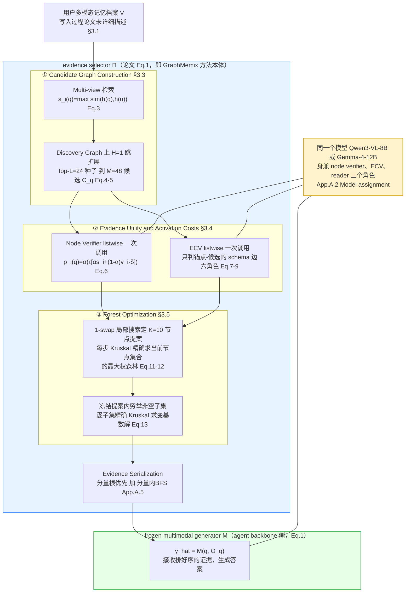

# GraphMemix 论文架构

> 调研对象：Li, G., Wang, Y., Li, D., Hao, J., & Peng, Y. (2026). *GraphMemix: Query-Aware Evidence Forests for Long-Term Multimodal Agent Memory*. arXiv:2608.26983v1（MemoraX AI Research 技术报告）。
> 文中 `Li-2026-GraphMemix-...txt` 指本地纯文本版全文（2661 行），证据格式为"§章节 / Eq.公式号 / Table / Appendix"。

## 1. 一句话机制

把"该给 agent 看哪些记忆"形式化成一个查询到来后才求解的组合优化问题：候选记忆是节点、可能的关联是边，节点的值 = "这条记忆本身对回答问题有多大用"，边的值 = "接在一个已知锚点后面，这条记忆还能补充多少新信息"；在最多选 K 条记忆的预算下，求"节点值总和 − 边的不确定性成本 − 开辟独立证据链的成本"最大的一片森林（Eq.2、Eq.11）。对固定的节点集合，这个最大权森林可以用 Kruskal 算法精确求出（摘要原话），选哪些节点则是一次确定性的 1-swap 局部搜索，再在锚定的候选范围内穷举子集精确求解一次变基数版本（§3.5, Eq.13）。

## 2. 记忆是怎么存进去的

**论文对"写入"这一步着墨很少，大部分要靠间接推断，而不是有一段专门的算法描述：**

- §3.1 把用户历史直接记为已经存在的固定集合 V = {eᵢ}（Eq.1），没有描述 eᵢ 是怎么被产生/写入的过程。
- 能确认"写入做了什么"的地方主要是效率分析部分：§4.3 和 Appendix A.3 说"construct the memory representation for every canonical memory once"（把每条记忆的表示构建一次），配合 Figure 3(a) 把"digest"（消化/写入）和"answer"（回答）分开单独计时——说明写入侧至少包含"给每条记忆生成一个可检索的表示"这一步，但没有给出这一步的算法（怎么切分、怎么编码、要不要调 LLM）。
- 唯一给出的具体信号在 §4.1 "Implementation details"："We use the frozen gme-Qwen2-VL-2B-Instruct encoder to produce 1,536-dimensional multimodal embeddings"——写入侧核心动作是过一个**冻结**的多模态编码器。对比论文在 §1、§2.1 反复批评的 MIRIX/SGM/A-MEM/AUGUSTUS/M2A 等"question-agnostic"路线在写入时要跑 LLM 摘要/建链接，再结合摘要里"avoids substantial lifecycle cost"的措辞，可以合理推断写入阶段没有生成式 LLM 调用——但论文没有哪一句话直接、明确地写"写入时零 LLM 调用"，这是我从多处证据拼出来的推断，不是原文的直接陈述。
- **Query-independent 的关系图**（Eq.4 的 E_schema、E_sem）在逻辑上也是"写入之后、查询之前"就能建好的产物：discovery graph G_disc = (V, E_schema ∪ E_sem) 本身不含 q，只有从它上面取 Top-L 种子、做 H 跳扩展这一步才是 query 相关的（§3.3）。Appendix A.1 按数据集列出了 schema 关系的具体规则：Mem-Gallery/MemEye 用 `same_round`（同一个 native round id）+ `consecutive_turn`（同 session 内位置相邻）；H2HMem 只用 `consecutive_turn`；**ATM-Bench 单独用三种数据集专属规则**——`event_bridge`（媒体间 1 分钟到 1 小时、5 公里以内，每条记忆最多保留 2 个近邻）、`same_record`（邮件间有强引用/同一事件日期类别/主题经归一化后临近）、`record_grounding`（邮件与其提到日期的媒体在地点或内容上也吻合时建立连接）。这几条规则本身在论文里也只是自然语言描述，没有给出可执行的精确阈值定义或伪代码。
- 语义边只在 Eq.4 给了数学定义（互为 top-k 近邻），没有说明用什么编码器算相似度（合理推断复用同一个 gme-Qwen2-VL-2B-Instruct，但论文没有明确重申这一点）。

**存的是原文还是摘要**：摘要和正文的整体论证方向（"native multimodal context"、"recovers low-similarity complementary evidence"，把自己和"question-agnostic compression"路线对立起来）暗示存的是可以原样交还给 reader 的原始多模态内容而不是文字摘要，但论文正文没有一句明确写"每条记忆的原始像素/文字被无损保留、可以在回答阶段原样发给 reader"——这一点是从整体论证方向推出来的，不是原文写死的规则。

## 3. 记忆是怎么被用起来的

**触发时机**：每个问题 q 到来后完整走一遍 §3.3–3.5 的流程。按 Eq.1 的形式化，$\Pi(q, V; K)$ 是以 q 为显式参数的函数，暗示节点验证和 ECV 这两次 LLM 调用至少是逐题触发的；论文没有讨论是否存在跨问题缓存/复用中间结果的机制。

**拿什么去找、怎么一步步收窄**：

1. **Multi-view 检索定位种子**（§3.3, Eq.3）：一条记忆可能有多个"视角" $U_i$（原图、caption、OCR、视频帧），每个视角分别和 query 算相似度，取最大值作为这条记忆的初始分 $s_i(q)=\max_{u\in U_i}\mathrm{sim}(h(q),h(u))$，取 Top-L（L=24）作为种子集合 $R_q^{(L)}$。
2. **候选子图发现**（Eq.4-5）：从种子出发在 discovery graph 上做 H 跳（H=1）可达性扩展，按"检索序 + 关系扩展序"取前 M=48 个组成最终候选集 $C_q$。
3. **直接节点效用**（§3.4, Eq.6）：一个"listwise"的 node verifier 一次性读入 q 和全部 $C_q$，给每条候选打一个直接支持度 $v_i(q)\in[0,5]$；再和检索分融合成 $p_i(q)=\sigma(\tau[\alpha s_i(q)+(1-\alpha)\tilde v_i(q)-\delta])$，其中 $\tilde v_i=v_i/5$。固定超参 $(\alpha,\tau,\delta)=(0.8,5.2,0.7)$（Eq.14），四个数据集、两个 backbone 都不重新调；论文给出的等价数值形式是 $p_i(q)=\sigma(4.2s_i(q)+0.2v_i(q)-3.6)$（Eq.15）。
4. **锚点条件下的关系验证 ECV**（Eq.7-9）：先确定性地从检索结果里选一批"高置信锚点" $A_q$（不用 verifier 分数、不用 ECV 结果、不用 gold，只按冻结的检索序，Appendix A.2 "Anchor-set construction"），只看 schema 关系里连接锚点和候选的那些边 $E_q^{elig}$（语义边不参与 ECV）。一次 listwise 调用里，模型对每条候选选一个"最能解释它增量作用"的锚点，给出增量支持分 $s_{ai}^{inc}(q)\in[0,5]$，并六选一贴上角色标签：`new_fact`（新事实）、`clarification`（澄清）、`corroboration`（佐证）、`redundant`（冗余）、`conflict`（冲突）、`irrelevant`（无关）；只有分数为正且属于前三种角色的边才留下来，构成"可信图" $G_q^{trust}$（Eq.8）。边的可靠度 $w_{ai}(q)=w_{ai}^{schema}\cdot s_{ai}^{inc}(q)/s_{max}$，代价 $c_{ai}(q)=-\log w_{ai}(q)$（Eq.9）。
5. **森林优化**（§3.5, Eq.11-13）：把 Eq.6/9/10 代回 Eq.2，目标变成在 $S\subseteq C_q,\ |S|\le K(=10),\ F\subseteq E_q^{trust}[S]$ 约束下最大化 $\sum p_i(q)-\lambda\sum c_e(q)-\kappa\,m(S,F)$；因为去掉环不会让目标变差，最优 F 一定是森林，$m(S,F)=|S|-|F|$，于是等价成"结构增益" $B_e(q)=\kappa-\lambda c_e(q)$ 的形式（Eq.12）。论文明确说这是**两阶段确定性求解**：第一阶段用 1-swap 局部搜索——从 Top-K 节点效用初始化，每次只换一个选中/未选中节点，每次换完都用 Kruskal 精确重算当前节点集合下的最大权森林，直到没有能再改进的交换为止——先定出一个 K 节点提案 $\bar S_q$；第二阶段在这个冻结提案内部，对所有非空子集精确求解变基数问题（Eq.13），"每个子集用 Kruskal 处理正收益边即可精确得到 $F_S^*$"，结果"在 $\bar S_q$ 的所有非空子集范围内全局最优"——**论文原文明确限定是在 $\bar S_q$（已经过 1-swap 筛选的 K 节点提案）范围内最优，不是在整个候选池 $C_q$（48 个候选）范围内全局最优**，这个限定词在摘要里被省略了，但在 §3.5 正文写得很清楚。

**找到之后怎么交给模型**：Appendix A.5 "Evidence Serialization"——每个连通分量选效用最高的节点当根，按根的效用给各分量排序，分量内部用广度优先遍历展开，"ties are resolved by node utility and then by the original retrieval order"（打平先按节点效用、再按原始检索序）。这样排出来的证据序列"presents a direct anchor before the contextual evidence recovered through its trusted relations"，最多 K 条，交给"frozen multimodal generator M"（Eq.1）生成答案；M 与用来做 node verifier/ECV 的模型在实验里是同一个（Appendix A.2 "Model assignment"：Qwen3-VL 设置下三者都用 `Qwen/Qwen3-VL-8B-Instruct`，Gemma 4 设置下都用 `google/gemma-4-12B-it`）。

Table 7 的消融进一步说明了为什么要把"直接效用"和"锚点条件关系验证"拆成两次调用（"Two-Call"，即论文实际设计）而不是揉进一次调用里做（"Joint"，消融对照组）：在随机抽取的 100 题子集上，Two-Call 的宏平均准确率（61.25）高于 Joint（59.25），佐证了 README 里"Separated evidence verification"这条设计选择的价值。

## 4. 架构图

论文自己在 Eq.1 就给出了这条边界线：$\Pi$（蓝色框，evidence selector，即 GraphMemix 全部方法）负责"选证据"，$M$（绿色框，frozen multimodal generator）负责"读证据生成答案"；论文承认两侧在实验里经常是同一套模型权重（黄色note），边界是"角色"不是"模型身份"。

## 5. 我没搞清楚的

- **写入/digest 阶段的具体算法**：论文从未给出"一条原始多模态记录怎么变成 $e_i$、怎么切分、怎么编码"的算法级描述，只在 §4.1 提了一句用什么编码器、产出多少维向量；Figure 3 只给了写入阶段的总耗时，没有拆解耗时构成（编码占多少、relation store 构建占多少）。
- **ATM-Bench 三种 schema 关系（`event_bridge`/`same_record`/`record_grounding`）的精确判定规则**：Appendix A.1 用自然语言描述了大致标准（时间窗口、距离阈值、"strong reference"、"temporally local normalized subject"等），但没有给出可执行的公式、阈值来源或伪代码，"strong reference"具体指什么、"normalized subject"怎么归一化都没有定义。
- **"execute in parallel"的实现方式**：Appendix A.2 说 node verifier 和 ECV "can therefore execute in parallel"，但没说这是线程池并发、批量请求合并，还是仅仅"逻辑上互不依赖、理论上可以并行"的陈述，没有给出实现层面的并发描述。
- **候选图规模 M=48、锚点数 $|A_q|$=10 这些超参是怎么调出来的**：论文只说"we do not retune these values by benchmark or reader backbone"，没有说明这组固定值最初是怎么选定的（网格搜索？开发集？直觉设定？）。
- **关系图是否支持增量更新**：论文的效率分析统一按"一次性 digest 全部历史 + 依次回答全部问题"的批处理场景计时（§4.3, Appendix A.3），没有讨论新记忆持续到来时，schema/语义关系图要不要、怎么增量维护。

## 6. 论文没写清楚的地方

（与第 5 节有重合，这里补充几条更偏"表述本身容易被误读"，而不是纯信息缺失的点）

- **摘要"For any fixed node set, its optimal maximum-weight forest is obtained exactly by Kruskal's algorithm"这句话单独读容易被理解成"整个森林优化问题被精确求解"**，但要读到 §3.5 才知道"选哪些节点"这件事本身是启发式的（1-swap 局部搜索，不保证全局最优），Kruskal 精确解决的只是"给定节点集合之后怎么连边"这个子问题。这是摘要的表述强度和正文细节之间的落差，不算错误，但容易造成"这套方法整体是精确算法"的第一印象误读。
- **"globally optimal over all nonempty subsets of $\bar S_q$"这句话的"全局最优"范围容易被泛化理解**：字面意思是"在冻结提案 $\bar S_q$ 内部"全局最优，不是在全部候选池 $C_q$（48 个候选）范围内全局最优；论文措辞其实是准确、有限定的，但如果只看摘要或引言，容易把两个"全局"混为一谈。
- **$w_{ai}^{schema}$ 的上标"schema"，是"这个上限专属于 schema 类边"（相对语义边而言），还是"不同 schema 关系类型可能各有不同上限"，论文没有明确区分这两种读法**——Eq.9 的记号留了解释空间，正文和附录都没有专门讨论"`same_round` vs `consecutive_turn` vs `event_bridge` 的可靠度上限是否需要/是否确实不同"这个问题。
