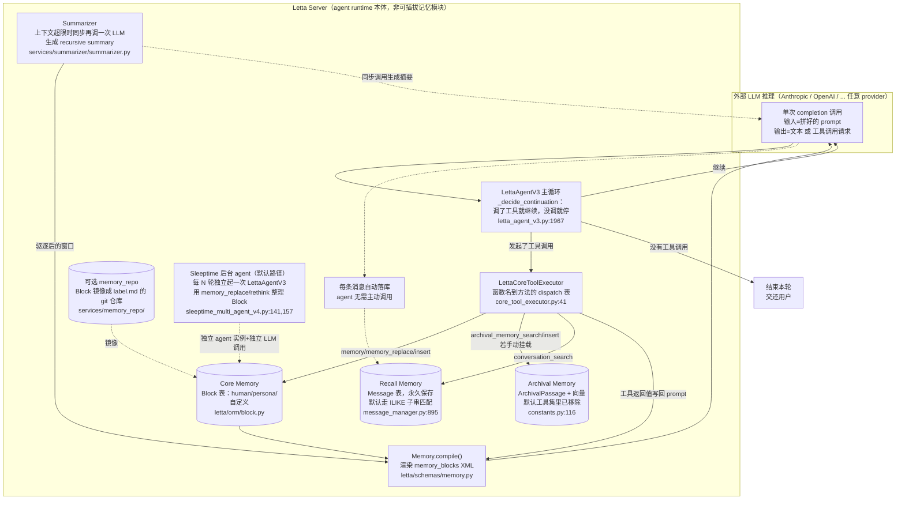

# Letta（MemGPT 产品化）代码架构

> 调研对象：`/Users/guanhongli/Documents/repo/letta`，官方 `letta-ai/letta`。
> **关键前提（先说清楚仓库现状）**：`main` 分支在 2026-08-15 被官方清空为一个"落地页"仓库——
> commit `87fd37aab`「chore: archive the legacy server repository」把整个 Python 服务端源码删除，
> 只留 README/AGENTS.md 等文档，指向新的闭源前端仓库 `letta-ai/letta-code`（当前会话未克隆，
> 无法核查）。**本文档分析的是 `origin/archive` 分支**（README 原文："The retired Letta V1 server
> source is preserved on the `archive` branch for historical reference"）——即被官方明确标注为
> "retired / deprecated / in maintenance mode"的旧服务端（仓库根目录 `AGENTS.md`@archive 分支原文，注意路径在仓库根而非 `letta/` 子目录（`git ls-tree -r origin/archive` 仅根目录下有一个 `AGENTS.md`）：
> "This repository is deprecated...It is in maintenance mode and is no longer where active
> development happens"）。这仍然是本仓库里能拿到的、最接近论文原型的完整实现，但请注意：
> **它本身已经是"退役"状态，而不是当前 Letta 产品的运行代码**。这件事本身就是本次调研第一个重要发现。
>
> **2026-09-05 勘误**：本文已按同目录 `verification.md` 的逐条复核结论修正（共 24 处：8 处事实、8 处行号/锚点、
> 8 处表述限定）。原始未修正版本见 git 历史。

## 1. 一句话机制

Letta（旧称 MemGPT）把"记忆"拆成三层持久化状态（Block 核心记忆 / Passage 归档记忆 / Message 全量历史），
挂在一个有状态的 Agent 进程上；LLM 通过工具调用（function calling）直接读写这些状态，写入即生效、
无需额外流水线，但**默认新建的 Agent 类型（`letta_v1_agent`）已经不再自带归档记忆工具、也不再用论文里
的"心跳"机制串联多步调用**——继续执行的判据从"LLM 主动要求心跳"变成了"LLM 是否发起了工具调用"
（`letta/agents/letta_agent_v3.py:1967-2036`）。

## 2. 记忆是怎么存进去的

Letta 没有单一的"写入"路径，三层记忆各自有不同的触发方式，其中只有一处必然产生额外 LLM 调用：

### 2.1 核心记忆（Core Memory / Block）——始终在 context 里的可编辑文本块

- **触发**：agent 自己在主循环里发起工具调用，是"agent 的一步行动"，不是后台流水线。
- **存的是什么**：不是原文摘要，是 LLM 自己精炼、组织过的自由文本，按 `label`（如 `human`/`persona`
  或自定义路径）分块，每块有独立的字符上限 `CORE_MEMORY_BLOCK_CHAR_LIMIT`
  （`letta/schemas/block.py:20`）。
- **工具演化了三代，同时并存在代码里**：
  - 旧式整段替换：`core_memory_append`（原值后拼接换行+新内容）、`core_memory_replace`
    （**不要求唯一匹配**——只检查 `old_content` 是否在原文里出现过（`core_tool_executor.py:339-340`
    `if old_content not in current_value`），确认存在后用 `current_value.replace(old_content, new_content)`
    一次性替换**所有**出现（`:341`）——`old_content` 在原文里出现两次就会同时改掉两处，唯一性校验
    是下面新式 `memory_replace` 才有的能力）——
    `letta/services/tool_executor/core_tool_executor.py:319-345`（`core_memory_append`/`core_memory_replace` 方法）。
  - 新式 str_replace-editor 风格：`memory_replace`/`memory_insert`，仿 Anthropic
    computer-use 的编辑工具（代码注释直接引用了 anthropic-quickstarts 的 edit.py），要求
    `old_string` 在块内唯一匹配，附带行号提示防止 LLM 把展示用的行号当正文写回
    （`letta/functions/function_sets/base.py` 内 `memory_replace`/`memory_insert` 函数体，
    `letta/services/tool_executor/core_tool_executor.py` 同名方法）。
  - 统一路径式工具 `memory(command="create|str_replace|insert|delete|rename", path="/memories/xxx", ...)`
    ——把每个 Block 当成一个文件路径操作（`letta/functions/function_sets/base.py` 顶部 `memory()` 函数）。
  - `memory_rethink`/`rethink_memory`：大范围重写整块，供"回顾式"整理使用，而非精确编辑
    （同文件）。
- **写入是否调 LLM**：**不调**。这些工具调用本身就是主 LLM 当前这一步的输出，Letta 只是执行
  字符串操作后立刻把新值写回 DB，并**同步**（不等下一轮）重新渲染系统提示词
  （`core_tool_executor.py` 里 `core_memory_append`/`memory_replace` 等方法末尾都调用
  `agent_manager.update_memory_if_changed_async`；该方法只做字符串比较+DB更新+
  `rebuild_system_prompt_async`，`letta/services/agent_manager.py:1747-1795`，全程没有 LLM 调用）。
- **只读保护**：Block 有 `read_only` 字段，写入前会检查，违反则抛 `READ_ONLY_BLOCK_EDIT_ERROR`
  （`core_tool_executor.py`）。
- **新增机制（论文完全没有）：memory_repo 把 Block 镜像成 git 仓库**。
  `Memory` 有 `git_enabled` 字段（`letta/schemas/memory.py`），开启后每个 Block 会被序列化成
  `{label}.md`（YAML frontmatter 存 description/read_only 等元数据：`limit` 字段特意被排除在
  frontmatter 之外，`block_markdown.py` 注释明写 "deprecated for git-base memory"），提交进一个
  per-agent 的 git 仓库——本地默认 `~/.letta/memfs/`，云端版本连一个 memfs HTTP 服务
  （`letta/services/memory_repo/memfs_client_base.py:1-60`，`letta/services/memory_repo/__init__.py`）。
  这给核心记忆加上了版本历史/可回滚能力——**这条路径已经接进了主编辑流程**：`server.py:155-161`
  只要检测到 memfs 配置，就会把 `block_manager` 换成 `GitEnabledBlockManager` 并注入 `AgentManager`；
  主编辑路径（`agent_manager.py:1777` 内调 `block_manager.update_block_async`）会走到
  `block_manager_git.py:188-238`，先 commit git“commits to git first”再同步回 Postgres，逐次编辑
  逐次 commit，门槛是该 agent 带 `git-memory-enabled` tag（`_is_git_enabled_for_agent`）。

### 2.2 归档记忆（Archival Memory / Passage）——向量库，语义检索用

- **触发**：agent 主动调用 `archival_memory_insert(content, tags)`。
- **存的是什么**：原文文本（"self-contained facts or summaries"，工具描述建议存"会议纪要/项目更新/
  对话摘要"而非碎片对话），是否精炼完全取决于 LLM 自觉，代码不做任何摘要处理。
- **过程**：`PassageManager.insert_passage` 先调 embedding 模型把文本转成向量，写一行 `ArchivalPassage`；
  pad 到 `MAX_EMBEDDING_DIM=4096` 这一步**不在 `insert_passage` 本身里**，而是在下游的
  `create_agent_passage_async`/`create_agent_passages_async` 里才做，且只在写入 PostgreSQL/pgvector
  时才 pad（Turbopuffer/Pinecone 不 pad）；tags 同时写入 JSON 列和 `PassageTag` 关联表两份存储；
  写完后**强制**重建一次系统提示词
  （`core_tool_executor.py` 的 `archival_memory_insert` 方法：
  `passage_manager.insert_passage(...)` → `agent_manager.rebuild_system_prompt_async(force=True)`）——
  原因可以坐实：`prompts/prompt_generator.py:26-58 compile_memory_metadata_block` 的入参包含
  `archival_memory_size`（docstring："Number of items in archival memory (long-term storage)"）与
  `archive_tags`，渲染进 `<memory_metadata>` 块——rebuild 就是为了让这两项跟着最新一次归档写入更新。
  这一步会调用 embedding 模型（不是对话用的主 LLM），除此之外没有额外 LLM 调用。
- **可跨 agent 共享**：`ArchivalPassage` 按 `archive_id` 归属一个 `Archive` 对象，`Archive` 通过
  `ArchivesAgents` 关联表可以挂在多个 agent 下——ORM 注释原文："An archive represents a collection
  of archival passages that can be shared between agents"（`letta/orm/archive.py:24-27`）。
  论文里的 archival storage 是单 agent 私有的，这是产品化后新增的能力。
- **⚠️ 默认工具集里没有这两个函数**：见第6节，这是最大的冲突点。

### 2.3 全量历史（Recall Memory / Message）——所有消息永久落库

- **触发**：不需要 agent 决定，每条进出的消息都由系统自动写入 `messages` 表
  （`letta/services/message_manager.py`），无论它是否还留在当前 context 窗口里。
- **存的是什么**：原文，逐条 Message 对象（role/content/tool_calls 等）。**需要分清"上下文驱逐"和
  "物理删除"是两回事**——上下文溢出被驱逐（evict）确实只是把消息从"当前送进 LLM 的窗口"里踢出去，
  DB 行不动，可以被 `conversation_search` 查到；但 Message 表并非"从不物理删除"——
  `message_manager.py` 另外提供三个硬删除入口：单条删除（`:822 delete_message_by_id_async`）、
  按 agent 整体删除（`:1045-1067 delete_all_messages_for_agent_async`，`DELETE` 语句在 `:1060`）、
  按 id 批量删除（`:1094-1121 delete_messages_by_ids_async`，`DELETE` 语句在 `:1119`）——
  这几个是显式调用的管理 API，不会被自动驱逐流程触发。
- **不调 LLM**。纯 DB 写入。

### 2.4 后台"睡眠"整理（论文没有的角色）

`enable_sleeptime=True` 且 agent 已挂 `multi_agent_group` 时，每隔 `sleeptime_agent_frequency` 轮
（server 端默认建组时设为 5，`letta/server/server.py:784`）主循环结束后会**另起一个独立的
`LettaAgentV3` 实例**（"参与者" agent，构造处在 `sleeptime_multi_agent_v4.py:257`），把刚才几条
消息喂给它，让它用 `memory_replace`/`memory_insert`/`memory_rethink`/`memory_finish_edits`
工具去整理 Block（`letta/groups/sleeptime_multi_agent_v4.py:141 bump_turns_counter` 计数，达到频率
就在 `:157` 调 `_issue_background_task`（定义在 `:171`）异步起一个新 run）。**这才是默认路由实际
会走到的文件**——旧版 `letta/groups/sleeptime_multi_agent.py`（v1）同名机制仍在，但它唯一的构造
入口 `groups/helpers.py:15 load_multi_agent` 全仓零调用者，不可达（见第5节）。这是一次**独立的、
用户不可见的 LLM 调用**，和主对话的写入路径完全分开——论文里只有单一 agent loop，没有这种后台
协整理角色。

## 3. 记忆是怎么被用起来的

### 3.1 核心记忆：不用"检索"，直接常驻

每次组织 prompt，`Memory.compile()`（`letta/schemas/memory.py:688`，不是这里曾引用的 `:143`——那行是
`_render_memory_blocks_standard`）把 Block 渲染进 system prompt——**标准/行号模式下**没有"要不要
用/搜不搜得到"的问题，只要没超字符上限就 100% 在场；**但 git-enabled 模式下不是这样**：
`_get_renderable_blocks`（`memory.py:122-130`）明写 "For git-memory-enabled agents, only system/
blocks are rendered"，其余 Block 只会以 `<external>` 文件树形式出现（`_render_memory_blocks_git`，
`memory.py:205-236`），正文不进 context。渲染有三种模式：标准 XML、行号版（仅 Anthropic 模型 + 特定 agent 类型，方便 str_replace
工具精确定位行号）、git-enabled 版（渲染成 `<self>`+`<memory>` 嵌套文件树，路径来自 Block 的
`label`）（`memory.py` 内 `_render_memory_blocks_standard`/`_render_memory_blocks_line_numbered`/
`_render_memory_blocks_git`）。

### 3.2 归档记忆：一次性向量检索，两条后端路径不一样

`archival_memory_search(query, tags, tag_match_mode, top_k, start_datetime, end_datetime)` →
`agent_manager.search_agent_archival_memory_async` → `query_agent_passages_async`
（`letta/services/agent_manager.py:2416-2480`）：

- 配置了 Turbopuffer（云端向量库）时：**真正的混合检索**——向量 + 全文双路召回后融合
  （`search_mode="hybrid"`，返回 `vector_rank`/`fts_rank`/`combined_score`）。
- **默认自托管 Postgres/SQLite 场景**（没配 Turbopuffer，这是大多数自建部署的实际情况）：
  只做**纯向量 cosine-distance 排序**（pgvector `.cosine_distance()` 或 SQLite 自定义函数），
  **没有关键词召回路径**；如果连 embedding 都没配，直接退化成 `text ILIKE '%query%'` 子串匹配
  （`letta/services/helpers/agent_manager_helper.py:1180-1260` `build_agent_passage_query`）。
- 一次调用返回 top_k 条，**不做多步迭代检索**（不像论文 Figure 6/7 展示的"分页继续搜"——那是
  agent 自己连续调用 search 实现的多步行为，检索算法本身单次执行）。
- 结果字符串直接作为工具返回值追加进对话历史，下一轮连同其它上下文一起喂给 LLM，
  **检索过程不调用额外 LLM**。

### 3.3 全量历史：`conversation_search`，默认路径其实是子串匹配

工具文档字符串自称"hybrid search (text + semantic similarity)"
（`letta/functions/function_sets/base.py` 内 `conversation_search` 的 docstring），但实际
dispatch 到的是 `core_tool_executor.py` 的同名方法 → `message_manager.search_messages_async`
（`search_mode="hybrid"` 是默认参数）：

- 配置 Turbopuffer 时：确实是向量+全文 RRF 融合（`letta/services/message_manager.py:1142-1180`）。
- **默认自托管场景**：直接调用 `list_messages()`，`query_text` 走的是
  Postgres `ILIKE '%text%'` 子串匹配 / SQLite `JSON_EXTRACT ... LIKE`
  （`letta/services/message_manager.py:895-980`），**完全没有语义向量参与**——
  工具描述的"semantic similarity"在默认部署下是不成立的。这是代码内部"文档写的比实现的强"的
  典型例子，虽然不是论文-代码冲突，但会直接影响这份文档"记忆系统能力"的准确性，值得记一笔。
- 过滤规则：会跳过所有 `role=tool` 的消息、以及自己调用过 `conversation_search` 的 assistant
  消息，避免递归嵌套（`core_tool_executor.py` conversation_search 方法内的 filter 逻辑）。
- 同样是单次调用、结果直接拼回 context，不调额外 LLM。

### 3.4 上下文超限时的"换页"（对应论文的 queue eviction）

**先要分清"全局默认设置"和"默认建号实际走的路径"不是一回事**——这是这份文档最容易读错的一处。

`SummarizationMode.PARTIAL_EVICT_MESSAGE_BUFFER`（`letta/settings.py:78`，`partial_evict_summarizer_percentage`
默认 0.30）确实是全局默认值，驱逐时**同步**调用一次独立的 LLM 请求生成 recursive summary
（`simple_summary()`，`letta/services/summarizer/summarizer.py:136-203`，"as implemented in the original
MemGPT loop, but using message count instead of token count" 这句注释在 `:145`的 docstring 里，
不在 `settings.py`），插到 system message 之后、剩余消息之前。**但这套 `Summarizer` 类只被
`LettaAgentV2`（`letta_agent_v2.py:124`）和 legacy `letta_agent.py:141` 构造，默认建号真正跑的
`letta_v1_agent` 走的是 `LettaAgentV3`，全文没有一处 `Summarizer(` 调用**——它走的是完全不同的
`compact_messages`（`letta_agent_v3.py:72` 导入 → `:2109` 调用），触发阈值来自
`get_compaction_trigger_threshold`（`:75` 导入 → `:938` 调用，`thresholds.py:27-41`：GPT-5 系列 90%、
其余模型 100% 上下文窗口），摘要模型还可以被 `compact.py:42-131 build_summarizer_llm_config` 换成
比对话模型更便宜的模型。也就是说，本文原来当成"向论文致敬且保持一致"的那条路径，在默认
新建的 agent 上根本走不到。
另一种模式 `STATIC_MESSAGE_BUFFER`（当前非默认）只做固定条数窗口裁剪，摘要交给一个后台
`EphemeralSummaryAgent` 异步生成，不阻塞主循环。

旧循环的触发方式仍保留在代码里：
`letta/agent.py`（同步 Agent 类）在 token 数超过 `memory_warning_threshold * context_window` 时先给
LLM 发一条文字警告（对应论文的 memory pressure warning），真正硬触发是捕获到 provider 抛出的
`ContextWindowExceededError` 后调用 `summarize_messages_inplace()`，最多重试 `max_summarizer_retries`
次（`letta/agent.py:948-1055`）——但这个 `letta/agent.py:Agent` 类本身在当前路由下**无法被实例化**
（见第5节），只是"曾经的设计"。`_rebuild_context_window` 这个方法也不是"新版
letta_agent.py/v2/v3 通用"——它只存在于 `agents/letta_agent.py:1576`（一个既非 legacy 也非默认的
中间版本）与 `voice_agent.py:293`；v2 用的是 `summarize_conversation_history()`
（`letta_agent_v2.py:277/412/1352`），v3（默认路径）用的就是上面提到的 `compact_messages()`，两者都没有
`_rebuild_context_window` 方法。

被驱逐的消息**只是离开 in-context 窗口，DB 里的 Message 行不删**（上下文驱逐本身不做 DB 删除，
Message 表另有独立的硬删除 API，见 2.3 节），之后仍可被 `conversation_search`
捞回——这点和论文的 recall storage 设计一致。

### 3.5 "继续执行"的判据：从心跳变成了"有没有调工具"

默认 Agent 类型 `letta_v1_agent` 用的循环类 `LettaAgentV3._decide_continuation`
（`letta/agents/letta_agent_v3.py:1967-2036`）完全不读取任何心跳类参数——规则只有一条：
**LLM 这一步有没有发起工具调用**：调用了（且不是"终止工具"）就自动继续、立刻发起下一次 LLM 推理；
没调用任何工具就结束本轮、把控制权交还用户。这条规则甚至直接写进了默认系统提示词
（`letta/prompts/system_prompts/letta_v1.py`）："Continue executing and calling tools until the
current task is complete or you need user input. To continue: call another tool. To yield control:
end your response without calling a tool."
对比仍保留在代码里、但不再是默认的旧循环
`letta/agent.py:562-576,834-842` 与 `letta/agents/letta_agent.py:1769,1875-1919`——
它们仍会从工具参数里弹出 `request_heartbeat` 布尔值作为继续与否的基础信号（可被 tool_rules 覆盖）。
详见第6节，这是本次调研里优先级最高的一处论文-代码冲突。

## 4. 架构图

Letta 不是一个可以插拔进别的 agent 里的"记忆模块"——它本身就是完整的、有状态的 agent runtime。
如果一定要画"记忆系统 vs backbone 模型"的边界，唯一真正外部、无状态的部分只有"LLM 推理 API 调用"
本身；主循环、工具执行、三层存储全部在 Letta 服务端进程内部。

## 5. 我没搞清楚的

- **（已确认，原判断有误）memory_repo 的提交时机**：已接入主编辑路径，且是同步逐次提交——
  `server.py:155-161` 检测到 memfs 配置就把 `block_manager` 换成 `GitEnabledBlockManager` 并注入
  `AgentManager`；主编辑路径 `agent_manager.py:1777`（`update_memory_if_changed_async` 内）调的正是
  `block_manager.update_block_async`，其内部 `block_manager_git.py:188-238` 先 commit git 再同步
  Postgres，门槛是该 agent 带 `git-memory-enabled` tag。原文标"未验证"是核查不到位，不是代码本身
  有歧义。
- **（已确认，原判断有误）archival_memory_insert 后为什么要强制 rebuild 系统提示词**：
  `prompts/prompt_generator.py:26-58 compile_memory_metadata_block` 的参数明确包含
  `archival_memory_size`/`archive_tags` 并渲染进 `<memory_metadata>` 块——rebuild 就是为了让这两项
  跟随最新写入更新，原文"没跟到渲染模板"是核查不到位。
- **（已确认，原判断有误）`letta/agent.py`（legacy 同步 Agent 类）在当前 server 路由里根本无法
  实例化**：生产代码里唯一的构造点是 `chat_completions.py:8` 导入、`:51` 调用的
  `server.load_agent(agent_id=..., actor=...)`，但全仓 `git grep "def load_agent"` **零命中**——
  这个 REST 路由本身就是坏的，不存在能跑到 `letta/agent.py:Agent` 的路径。第 3.4/3.5 节里引用它的
  部分只是"曾经的设计"，不是"现在能跑到的代码路径"。
- **`memgpt_v2_agent` 类型走的 `letta_agent_v2.py`（LettaAgentV2，原文误写作
  `letta_agent.py`）具体权重关系**：读到了两者共存（心跳是基础信号，工具规则可以
  override），但没有逐条测试所有组合，心跳到底在多少比例的真实场景里还起作用，需要跑起来才知道。
- **（已确认，原判断有误）Turbopuffer 在自托管默认配置里是否会被启用**：
  `tpuf_client.py:208-210 should_use_tpuf()` 需要同时满足 `settings.use_tpuf`、
  `settings.tpuf_api_key`、`model_settings.openai_api_key` 三者都为真，`:213-215
  should_use_tpuf_for_messages()` 额外要求 `settings.embed_all_messages`——默认全部关闭，
  "没配置时走 SQL 子串匹配"这个 fallback 因此就是默认路径本身，不只是兜底分支。
- **sleeptime 参与者 agent 具体用什么 system prompt / 是否共享同一个 Memory 对象实例**：
  只读了触发逻辑（`sleeptime_multi_agent.py`），没有跟进 `personas/examples/sleeptime_memory_persona.txt`
  与实际 prompt 组装代码，不确定它编辑的 Block 是否与主 agent 完全共享（同一行 DB 记录）还是
  各自维护副本。

## 6. 与论文的冲突点

按影响从大到小排序，**均以代码为准**：

1. **归档记忆（论文的核心机制）在多数默认工具集里被移除，但有一个不减反加的反例**。
   `letta/constants.py:116` 定义 `DEPRECATED_LETTA_TOOLS = ["archival_memory_insert",
   "archival_memory_search"]`；`letta/services/helpers/agent_manager_helper.py:1298-1302` 的
   `calculate_base_tools()` 无论 `is_v2` 真假都会从 `BASE_TOOLS` 里减掉这两个工具；
   `letta/services/agent_manager.py:404-425` 的 `else` 分支（覆盖 `memgpt_agent`"OG"类型本身）确实
   调用这个函数，但**并非所有自动建号分支都会**：`react_agent`/`workflow_agent` 两个分支是
   `pass  # no default tools`（不挂任何默认工具，包括 archival）；更重要的是
   `elif agent_create.enable_sleeptime:`（`:404-405`）排在 `letta_v1_agent` 分支（`:410-413`）
   **之前**，命中时挂的是 `BASE_SLEEPTIME_CHAT_TOOLS = [send_message, conversation_search,
   archival_memory_search]`（`constants.py:133`），既不减 `archival_memory_search`，也不
   discard `send_message`——这是"默认建号一定没有归档工具"这条判断唯一站不住的反例。
   除此之外，默认工具集换成了 `memory_replace`/`memory_insert` 这类核心记忆编辑工具——即
   "删掉外存，只留内存编辑"。
2. **"心跳"驱动的函数链式调用被替换成"有没有调工具"**。论文 §2.4 的核心设计是 LLM 在函数参数里
   显式传 `request_heartbeat=true` 来请求立即再来一轮推理（"function chaining"），这是整篇论文
   实现"多步检索/多跳查询"能力的关键机制（对应 Figure 7/8 的嵌套 KV 检索）。当前默认 Agent 类型
   `letta_v1_agent`（`letta/schemas/agent.py:226` 的 `default_factory`）走的
   `LettaAgentV3._decide_continuation`（`letta/agents/letta_agent_v3.py:1967-2036`）**完全不读任何心跳参数**，
   规则简化成"这步调用了工具就继续，没调用就停"，并且这条规则被直接写进默认系统提示词
   （`letta/prompts/system_prompts/letta_v1.py`）。心跳机制仍然活在旧代码路径里
   （`letta/agent.py`、`letta/agents/letta_agent.py` 的 `_pop_heartbeat`/`_decide_continuation`），
   但已经不是新建 agent 的默认路径。
3. **`send_message` 本身被移除，靠隐式判定替代**。论文里"回复用户"和"操作记忆"都是同等地位的
   函数调用（`send_message` 是众多函数之一）。当前默认 `letta_v1_agent` 建号时会显式
   `tool_names.discard("send_message")`（`letta/services/agent_manager.py:413`，上一行 `:412`
   是注释；但如上条所说，若被 `enable_sleeptime` 分支抢先命中就不会执行到这里），改用
   "纯文字输出=回复用户"
   的隐式判定（`letta/server/server.py:968` `text_is_assistant_message = agent_state.agent_type ==
   AgentType.letta_v1_agent`）。这与论文"回复也是一次函数调用"的设计不同，但和第2点是同一次
   架构简化的两个侧面，不单独计权重。
4. **"回忆检索"（recall memory）在论文里语焉不详，代码里默认是纯子串匹配**。论文只说 recall
   storage "readable via function calls"，没给出检索算法；代码默认自托管路径下
   `conversation_search`（`letta/services/message_manager.py:895-980`）用的是 `ILIKE`/`JSON_EXTRACT LIKE`
   子串匹配，不涉及语义向量——这与其说是"和论文冲突"，不如说是论文本就没约束这一点，但值得记录：
   默认部署下 Letta 的"混合检索"承诺（工具 docstring 原文）名不副实。
5. **归档记忆变成了可跨 agent 共享的资源**（`letta/orm/archive.py:24-27`），论文里 archival storage
   是单 agent 私有概念，完全没有讨论共享语义——这是产品化后的扩展，不算"违背"论文，只是论文没设想到。
6. **新增了论文完全没有的两个子系统**：git 版本化的 memory_repo（§2.1 末尾）、以及"睡眠"后台
   协整理 agent（§2.4）。前者给核心记忆加上版本历史，后者把"记忆整理"从"主 agent 顺手做"变成
   "专职后台角色定期做"——都是论文单 agent、单循环设计里没有的分工。
