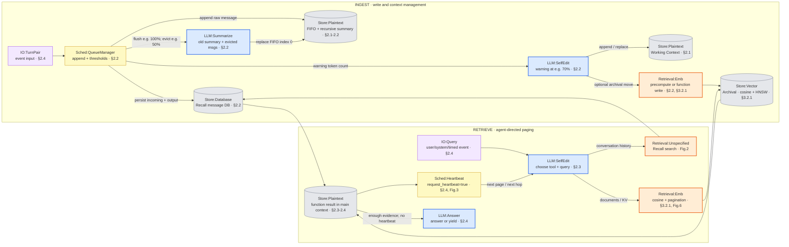
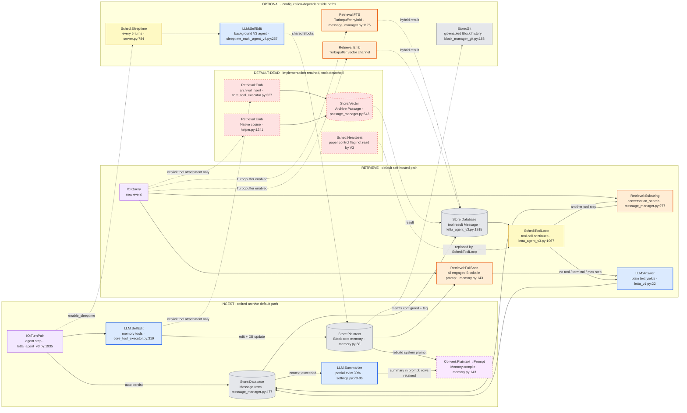

# Letta / MemGPT Methodology Flow

> [!note] 证据范围
> Paper 视角来自 [[paper-architecture]] 所述 arXiv:2310.08560v2；Code 视角来自 [[code-architecture]] 所述 retired Letta V1 `origin/archive@56ba9c25`。逐条勘误与可复核证据见 [[verification]]，冲突时以 verification 为准。Code 图不代表当前 Letta 产品。

> [!warning] 双层交付
> 下方 PNG 是最终可视层预留位，由父会话串行生成；Mermaid 是精确引用与后续重绘的核验真源。本子任务未调用生图模型，也未生成 PNG。

## Paper 视角

![[assets/letta-paper-flow.png]]

### Mermaid 核验真源



### Paper 流程边界

- `Store:Plaintext` 在图中覆盖两种主存文本：定长 Working Context，以及 FIFO 首位的 recursive summary；两者物理位置同属 main context，但写入触发不同。
- `Retrieval:Unspecified` 是有意保留的不确定标签：论文只展示 `recall_storage.search("six flags")`，没有披露 keyword、FTS 或 embedding 算法。
- `LLM:Summarize` 的连线表示论文声明“生成摘要”，不表示已经证实独立模型调用；调用者、prompt、模型均未披露。
- Function result 回灌到 main context，而不是写进只读 System Instructions；这是对原 `paper-architecture.md` Mermaid 的勘误。

## Code 视角

![[assets/letta-code-flow.png]]

### Mermaid 核验真源



> [!warning] 环境与配置退化
> - archive 版 `letta_v1_agent` 默认工具集移除了 `archival_memory_insert/search`，所以红色虚线子图是“代码存在、默认不可达”，不是物理删码。
> - 无 Turbopuffer 时，`conversation_search` 从 docstring 所称 hybrid 退化为 SQL substring；Native archive 有 embedding 才做 cosine，无 embedding 也退化为 substring。
> - `Store:Git` 只在 memfs 已配置且 agent 带 `git-memory-enabled` tag 时生效；否则 Block 只落普通数据库。
> - `Sched:Sleeptime` 默认每 5 轮，但只有 `enable_sleeptime=True` 且创建时有 embedding config 才建立后台 agent。
> - 本图是 retired Letta V1 server 的历史快照，不能用来陈述当前 Letta 产品。

### 论文有、默认代码无（dead）

| 论文模块 | archive 默认状态 | 代码证据 |
|---|---|---|
| `Store:Vector` Archival | 实现保留，但 insert/search 从默认 base tools 移除 | `constants.py:115-116`; `agent_manager_helper.py:1298-1302` |
| `Sched:Heartbeat` | V2 loop 保留；默认 `letta_v1_agent` 的 V3 loop 不读取 heartbeat | `agent_loop.py:20-43`; `letta_agent_v3.py:1967-2036`; `letta_agent_v2.py:1241-1285` |
| function-call `send_message` | 默认移除，纯文本输出直接视为 assistant message | `agent_manager.py:410-418`; `server.py:965-978` |

## 新登记 module

| module | 类别 / 样式 | 理由 |
|---|---|---|
| `Sched:QueueManager` | 调度 / 黄 | 自动 append、warning、flush、eviction 是一个独立调度职责，不能并入 heartbeat |
| `Sched:ToolLoop` | 调度 / 黄 | 默认 V3 的继续条件是“有工具调用”，与显式 heartbeat 形成核心对比 |
| `Sched:Sleeptime` | 调度 / 黄；可选边绿虚线 | 每 N 轮触发独立后台记忆整理 agent |
| `Retrieval:Unspecified` | 检索 / 橙 | 论文 recall search 存在，但算法未披露，不能误标 BM25 或 embedding |
| `Retrieval:Substring` | 检索 / 橙 | SQL ILIKE / JSON LIKE 子串匹配，不等同 BM25 |
| `Retrieval:FTS` | 检索 / 橙 | Turbopuffer 的全文通道；具体打分与融合实现不在 archive 仓内 |
| `Store:Git` | 存储 / 灰；可选边绿虚线 | per-agent git-backed Block 版本历史 |
| `Store:Database` | 存储 / 灰 | 论文只称 message database；archive 可用 PostgreSQL 或 SQLite，不应强标单一引擎 |

## 不确定处

- 论文没有说明 recursive summary 是否使用独立 LLM call、具体 prompt 或模型。
- 论文没有说明 recall storage 的检索算法。
- archive 中 Turbopuffer 客户端的 hybrid 融合算法在外部实现；这里只能确认请求参数 `search_mode="hybrid"`，不能确认是 RRF、加权和或其他方式。
- `archival_memory_insert` 后强制 rebuild system prompt 的直接设计原因没有代码注释；`external_memory_summary` 字段存在，但“为了刷新条目计数”仍不能写成定论。
- legacy `letta/agent.py:Agent` 仍有历史引用，但当前 `AgentLoop` 默认工厂不返回它；是否有旁路 router 可实例化它未做运行时实验。

## 生图 prompt 素材

### Paper flow prompt

```text
Create a clean horizontal academic methodology diagram for “MemGPT — Paper Architecture”. White background, compact two-lane layout, INGEST on top and RETRIEVE below, left-to-right data flow. Use short labels only. Canonical colors: blue rectangles for LLM, orange rectangles for retrieval, yellow rectangles for schedulers, gray cylinders for stores, pale-purple rounded inputs. INGEST nodes: “Turn Pair” → “Queue Manager”; branch to “FIFO + Summary” and “Recall DB”; “70% Warning” → “Self Edit” → “Working Context” or “Embedding” → “Archival Vector”; “100% Flush” → “Recursive Summary” → “FIFO + Summary”. RETRIEVE nodes: “Query” → “Self Edit”; branch to “Recall Search: Unspecified” → “Recall DB” and “Embedding Search” → “Archival Vector”; merge at “Main Context”; then “Heartbeat” loops back to Self Edit for next page or next hop; otherwise → “Answer”. Show tiny parameter tags “70% example”, “100% example”, “50% eviction example”, “cosine + HNSW”, “request_heartbeat=true”. Include a small legend. No citations, no paragraphs, no decorative gradients, no icons.
```

### Code flow prompt

```text
Create a clean horizontal academic methodology diagram for “Letta V1 Archive — Code Architecture”. White background, compact two-lane layout, INGEST on top and RETRIEVE below, plus a narrow OPTIONAL / DEFAULT-DEAD band. Use short labels only. Canonical colors: blue LLM rectangles, orange retrieval rectangles, yellow scheduler rectangles, purple dashed conversion rectangles, gray store cylinders, pale-purple rounded inputs; red dashed nodes mean default-dead; green dashed edges and lane boundaries mean optional while nodes keep their canonical colors. INGEST: “Turn Pair” → “Message DB”; “Self Edit” → “Core Blocks” → “Compile Prompt”; “Message DB” → “Summarize 30%” → “Compile Context”. RETRIEVE: “Query” → “Core Blocks in Prompt”; “Query” → “Substring Search” → “Message DB” → “Tool Result” → “Tool Loop”; Tool Loop loops to retrieval, no tool → “Answer” → “Message DB”. DEFAULT-DEAD: “Archival Insert”, “Archival Vector”, “Archival Search”, and “Heartbeat”, with note “implementation retained, tools detached”; Heartbeat points to Tool Loop with label “replaced”. OPTIONAL: “Git History”, “Sleeptime every 5”, “Background Self Edit”, “Turbopuffer FTS”, “Turbopuffer Vector”. Add a red scope banner: “Retired archive, not current Letta”. Include a small legend. No citations, no paragraphs, no decorative gradients, no icons.
```
