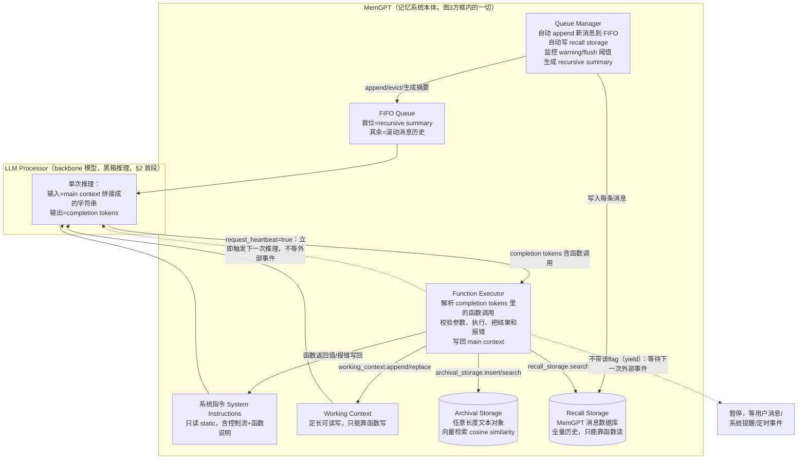

# MemGPT（论文 arXiv:2310.08560）论文架构

> 材料来源：① 原文 PDF——`curl -L https://arxiv.org/pdf/2310.08560` 后 `pdftotext` 提取全文
> （13 页，含 Abstract/§1-5/Appendix §6，arXiv v2, 2024-02-12），本文档所有 `§x.x` 引用均指此
> 版本的章节编号，正文已通读；② vault 他人笔记
> `research-vault/2-fleeting/papers/Packer-2023-MemGPT-Letta-Towards-LLMs-as-Operating-Systems.md`
> （2026-08-18 speed-read，仅在"其他人如何解读"处引用并标注来源，不作为架构事实的主证据）。
> 论文标题是 *MemGPT: Towards LLMs as Operating Systems*，作者 Packer/Wooders/Lin et al.（UC
> Berkeley），发表于 2023 年 10 月（首版）。**这篇论文本身不叫"Letta"**——Letta 是后来的产品化
> 名称，论文全文没有出现过"Letta"这个词（vault 笔记标题把两者并列，是笔记作者自己做的桥接，
> 论文原文并不这样称呼自己）。

## 1. 一句话机制

把 LLM 的固定 context window 类比操作系统的物理内存，让 LLM 通过 function calling 自己在
"主存"（system instructions + working context + FIFO queue）和"外存"（archival storage 向量库 +
recall storage 全历史）之间搬运数据，并用一个"心跳"关键字参数把多次函数调用串成一条不经用户
打断的执行链，从而在有限上下文里制造出"无限上下文"的错觉（Abstract；§1；Figure 3）。

## 2. 记忆是怎么存进去的

论文把"记忆"分两大类：main context（主存，三段：system instructions / working context / FIFO
queue）与 external context（外存，两库：archival storage / recall storage）（§2 首段；Figure 3）。

### 2.1 Working Context（对应产品化后的"核心记忆"）

- **触发**：论文原文只说它是"a fixed-size read/write block of unstructured text, writeable only
  via MemGPT function calls"（§2.1）——即完全由 LLM 自己决定何时调用函数写入，论文没有给出这些
  函数在正文里的确切名字（只在图注的伪代码里出现 `working_context.append(...)`、
  `working_context.replace(...)`，见 Figure 1/2/4）。
- **存的是什么**：不是原文摘录，是 LLM 自己提炼的关键事实/偏好，例子如 `"Birthday is February 7"`、
  `"Boyfriend named James"`（Figure 1）、以及事实更新场景下的 `working_context.replace("Boyfriend
  named James", "Ex-boyfriend named James")`（Figure 4）——论文用这个例子专门展示"信息发生变化时
  agent 主动改写而非追加"。
- **调不调 LLM**：不需要额外调用——这次写入本身就是主 LLM 当前这一步推理的输出（是一次函数调用，
  不是单独触发的第二次模型请求）。

### 2.2 FIFO Queue 与 recursive summary（对应"全量历史"的驱逐/压缩机制）

- **触发**：**不需要 agent 决定**——"Queue Manager"是系统组件，自动把每条新消息（用户消息、
  agent 输出、系统消息）追加进 FIFO queue，并同时写入 recall storage（§2.2:
  "the queue manager appends the incoming messages to the FIFO queue...writes both the incoming
  message and the generated LLM output to recall storage"）。
- **存的是什么**：FIFO queue 里是原始消息；一旦触发驱逐（见第3节的"flush"），被驱逐的消息本身
  移出主存，取而代之的是"a new recursive summary using the existing recursive summary and evicted
  messages"（§2.2）——即摘要是滚动式的：新摘要 = 旧摘要 + 本次被驱逐的消息，而不是每次从零总结。
  这个 recursive summary 被放在 FIFO queue 的**第一个位置**（"The first index in the FIFO queue
  stores a system message containing a recursive summary of messages that have been evicted from
  the queue"，§2.1 末句）。
- **调不调 LLM**：论文没有明确说生成 recursive summary 是否是独立于主对话的一次新 LLM 调用——
  正文只用一句话带过生成动作本身，没有描述调用者、prompt 内容或是否复用同一个 LLM processor。
  标"论文没写清楚"，见第6节。

### 2.3 Archival Storage（对应"归档记忆"）

- **触发**：论文提供两种触发来源，且这两种在正文里从未被同一个实验同时验证过：
  1. **实验设置里是预处理批量导入，不是运行时 agent 自己写入**——文档分析任务里，"we precompute
     embeddings and load them into the database"（§3.2.1），即维基百科文档在对话开始前就已经整体
     embed 好并导入 archival storage，agent 全程只做检索，从未在这个实验里主动调用"写入"函数。
  2. **概念设计上，memory pressure 触发时 agent 可以主动选择搬运目的地**——§2.2 原文："allow the
     LLM to use MemGPT functions to store important information contained in the FIFO queue to
     **working context or archival storage**"——但论文没有给出任何一个把 FIFO 内容写入 archival
     storage（而非 working context）的具体实验或示例（Figure 1 展示的驱逐案例走的是 working
     context 分支）。
- **存的是什么**：Figure 6 的例子里是"a database of Wikipedia documents"，即原文段落文本
  （"arbitrary length text objects"，§2.2），配合 embedding 做向量检索。
- **调不调 LLM**：写入路径本身不调对话用的 LLM（是 embedding 模型 + 数据库写入），但论文对这一步
  在"运行时 agent 自主写入"场景下具体如何触发、频率如何，没有给出实验或示例支撑。

## 3. 记忆是怎么被用起来的

### 3.1 触发：事件驱动，且有一种"系统主动开口提醒"的机制

论文明确把"是否触发 LLM 推理"抽象成"事件"（event）：用户消息、系统消息（如 context 容量警告）、
用户交互提醒（如登录、上传完成）、定时事件（"allowing MemGPT to run 'unprompted' without user
intervention"）都算事件（§2.4）。其中最关键的检索触发场景是 **memory pressure warning**：
prompt tokens 超过"warning token count"（论文举例 70% of context window）时，Queue Manager 主动
插入一条系统消息提醒 LLM 记忆压力逼近，由 LLM 自己决定要不要检索/搬运数据（§2.2）——这是论文里
"用不用记忆"的第一道触发点，性质是"系统提醒，决定权在 LLM"。

### 3.2 拿什么去找：两套存储、检索算法的透明度不对等

- **Archival storage**：明确是 embedding cosine similarity 向量检索，用 PostgreSQL + pgvector
  扩展、HNSW 索引做近似检索（"we use MemGPT's default storage settings which uses PostgreSQL for
  archival memory storage with vector search enabled via the pgvector extension...an HNSW index to
  enable approximate, sub-second query times"，§3.2.1）。检索函数在图注里写作
  `archival_storage.search("nobel physics")`（Figure 6）。
- **Recall storage**：**论文正文完全没有描述检索算法**。唯一的线索是 Figure 2 的图注示例
  `recall_storage.search("six flags")`——传入的是自然语言短语，但这究竟是关键词/全文匹配还是
  embedding 语义检索，论文没有交代（vault 笔记把这类操作笼统称为"混合检索"，但**这是笔记作者的
  概括用语，论文原文没有这个说法**，本文档不采纳这个未经原文证实的定性，列入第6节的空白）。

### 3.3 一步到位还是多步迭代：多步迭代是全篇的核心卖点

论文用一个专门机制解释"多步"如何实现——**function chaining**（§2.4）：函数调用可以带一个特殊
flag（`request_heartbeat=true`），若带了这个 flag，函数执行完毕后**立即**把控制权还给 LLM
processor 做下一轮推理，不等待任何外部事件；若不带这个 flag（"a yield"），则暂停，直到下一次
外部事件触发（用户消息/系统提醒/定时任务）才会继续（§2.4 & Figure 3 图注）。这个机制被用来实现：

- **翻页式检索**：`archival_storage.search("nobel physics", page=2)`（Figure 6）——单次检索结果
  太多时，agent 自己连续发起分页请求。
- **多跳查找**：Nested KV retrieval 任务（§3.2.2）里，agent 需要连续查询
  `831...ea5 → 5b8...4c3 → f37...617` 三层嵌套 key-value，每一跳都是一次独立的
  `archival_storage.search(...)` 调用，靠心跳链在一次"回合"内不经用户打断地连续执行完
  （Figure 7/8）。论文强调"MemGPT with GPT-4...is unaffected with the number of nesting levels"，
  把这个能力直接归因于"accessing the key-value pairs stored in main context repeatedly via
  function queries"（§3.2.2 结尾）。

### 3.4 找到之后怎么交给模型

论文的说法很直接："MemGPT will add the function output to main context"（§2.4）——检索结果（或
任何函数返回值，包括报错信息）被追加进 main context，拼接进下一次要喂给 LLM processor 的
prompt tokens 里（§2.3："The results, including any runtime errors that occur...are then fed back
to the processor by MemGPT. This feedback loop enables the system to learn from its actions and
adjust its behavior accordingly."）。为了防止检索结果本身把 context 撑爆，论文特别提到"our memory
retrieval mechanisms are designed to be cognizant of these token constraints and implement
pagination to prevent retrieval calls from overflowing the context window"（§2.3）——分页不仅是
为了多步检索的功能性需要，也是一种防溢出的保护机制。

### 3.5 上下文超限时的"换页"（queue eviction policy）

Queue Manager 维护两个阈值（§2.2，论文用"e.g."给出示例数值，暗示是默认参数而非硬约束）：

- **warning token count**（示例 70%）：插入系统提醒消息，警告即将驱逐，但暂不动手——把决定权
  交给 LLM（对应第3.1节的事件触发）。
- **flush token count**（示例 100%）：Queue Manager 真正动手驱逐——按示例比例（e.g. 50% of the
  context window）驱逐一批消息，用"the existing recursive summary and evicted messages"生成新的
  recursive summary。被驱逐的消息"immediately"从 LLM 可见范围消失，但"stored indefinitely in
  recall storage and readable via MemGPT function calls"（§2.2）——即驱逐 = 从主存搬到外存，
  不是删除。

## 4. 架构图

论文 Figure 3 本身就是一张清晰的边界图：**LLM Processor 是一个黑箱推理器**，只负责"吃 prompt
tokens、吐 completion tokens"；这条线之外的一切（Queue Manager、Function Executor、Archival/
Recall Storage、以及 main context 三段的组织方式）都属于"MemGPT"这个记忆系统本身。下面按论文
Figure 3 复现这条边界，箭头方向按论文原图的数据流向：

**边界说明**：main context（system instructions + working context + FIFO queue）是双方共享的
"接口区"——由 MemGPT 一侧组装、喂给 LLM Processor 消费；completion tokens 是另一方向的接口——
由 LLM Processor 产出、被 MemGPT 一侧的 Function Executor 消费。LLM Processor 本身不直接接触
Archival/Recall Storage，也不知道"心跳"这件事的存在——心跳完全是 MemGPT 侧（Function Executor）
读取函数参数后决定"要不要再喂一次"的控制逻辑，对 Processor 而言只是"又被调用了一次"。

## 5. 我没搞清楚的

- **函数的确切名字、参数 schema、返回格式**：论文正文和图注只用伪代码风格提到
  `working_context.append/replace`、`archival_storage.search/insert`、`recall_storage.search`，
  附录 §6.1 明确说"The MemGPT prompts have been edited for brevity. For full implementation
  details (including exact prompts) visit https://research.memgpt.ai"——**论文本身承认自己没有
  给全**，需要看代码库或官网才能确认真实函数签名（这也是为什么本任务要求 code 版和 paper 版
  分开写：论文这一层面本来就不完整）。
- **recall storage 的检索算法**：如第3.2节所述，正文和附录都没有交代，只有一个自然语言 query
  的图注示例。
- **recursive summary 的生成细节**：是否是独立于主 LLM processor 的另一次调用、用什么 prompt、
  是否可以配置模型——§2.2 一句话带过，没有更多信息。
- **archival storage 在对话类场景里是否真的会被写入**：DMR 任务的描述是"MemGPT instead has
  access to the full conversation history but must access it via paginated search queries to
  recall memory"（§3.1，"MemGPT utilizes memory to maintain coherence"段）——只提到 recall
  memory，没提到 archival storage 是否也参与了 DMR 实验；§2.2 提到的"驱逐时可选存到 archival
  storage"这条路径在任何实验里都没有被展示为"真的被走过"。
- **warning/flush 具体阈值是否可配置**：论文用"e.g. 70%"/"e.g. 100%"/"e.g. 50%"三处都用举例
  口吻，暗示这是默认参数而非理论最优值或硬性设计，但正文没有给敏感性分析或配置说明。
- **working context 的初始状态从哪来**：DMR/Conversation opener 实验里 agent 的 persona/human
  信息是实验开始前预置进 working context，还是完全靠 agent 在对话过程中自己观察、自己写入——
  论文没有明确交代实验的初始化流程，图1/2/4的示例看起来像是运行时动态写入的展示案例，不代表
  正式评测协议里的初始化方式。

## 6. 论文没写清楚的地方

除了上面第5节列出的具体技术空白外，从整体方法论呈现角度看，论文还有几处更宏观的模糊地带：

- **心跳机制的边界条件没有讨论**：如果 LLM 无限制地连续请求心跳会怎样（死循环/失控成本）？
  论文完全没有讨论安全阀或步数上限，只强调这是"chaining"能力的正面案例（多跳检索），没有讨论
  负面场景。
- **"遗忘"完全缺席**：论文全篇只有"evict"（从主存搬到外存），没有任何真正删除/遗忘旧记忆的
  机制或讨论——working context 满了会被要求"改写"（如 Figure 4 的替换例子），但那是 agent 主动
  精简，不是系统层面的遗忘策略；archival/recall storage 被明确描述为"stored indefinitely"。
  长期运行后存储无限增长这件事，论文没有涉及。
- **单 agent / 单用户假设未被言明为局限**：全篇实验设置都是一个 agent 服务一个用户的对话或一批
  文档，论文没有讨论多 agent 共享记忆、多用户隔离、或并发写入 working context 这类场景，也没有
  把这作为"未来工作"明确列出（§5 Conclusion 提到的未来方向是"其他领域"、"集成不同存储技术"、
  "改进控制流和策略"，比较空泛，没有具体展开到多 agent/多用户场景）。
- **评测规模是否能代表真实长期记忆压力**：MSC 数据集每个多轮对话只有 5 个 session、每个 session
  约十几条消息（§3.1 Dataset 段），相对论文摘要里"extended conversations...spanning weeks,
  months, or even years"的叙事目标（§3.1 首段）规模差距较大，论文没有讨论这个规模差距是否影响
  结论的外推性。
- **归档记忆的"检索出的内容是否需要再筛选/去重"没有讨论**：Figure 5/6 展示的是原始 top-K 结果
  直接拼进 context，论文没有讨论如果 archival storage 里有大量高度相似或过时的条目，
  agent 要如何甄别，只是笼统说"MemGPT actively retrieves documents from its archival storage
  (and can iteratively page through results)"（§3.2.1）。
