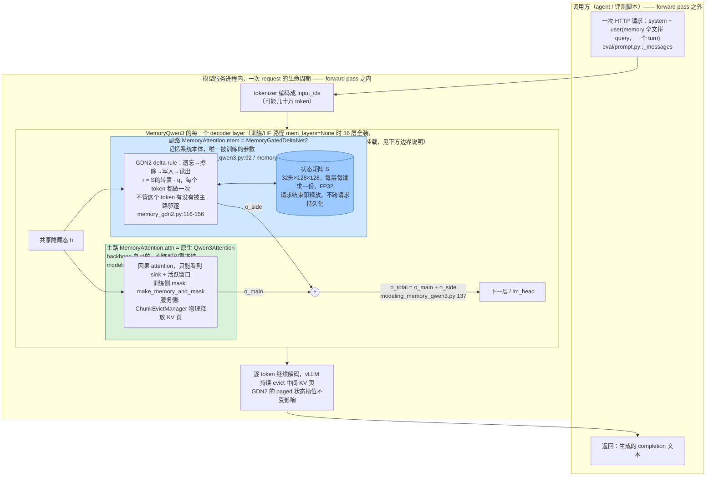

# LiveMem 代码架构

> 读的是 `/Users/guanhongli/Documents/repo/LiveMem`（remote `origin` = `https://github.com/cafeii/LiveMem`，
> 克隆时单一提交 `71a6a8b "Initialize repository"`，作者 `Chen <12011125@mail.sustech.edu.cn>`）。
> 术语在第一次出现处用括号给一句话解释；不确定的地方标「未验证」。
>
> **2026-09-05 勘误**：本文已按同目录 `verification.md` 的逐条复核结论修正（共 12 处：1 处事实、6 处行号/锚点、5 处表述限定）。原始未修正版本见 git 历史。

## 1. 一句话机制

LiveMem 不是外挂的记忆数据库或检索服务，而是直接改造了 LLM 本身：给 Qwen3-4B 每一层
attention（自注意力层）并联一条 GDN2（Gated DeltaNet-2，一种线性递归网络，可以理解成
"没有 softmax、状态大小固定"的注意力变体）侧支路。主路 attention 该丢的 KV（key-value，
attention 用来算相似度和取值的缓存）该丢，副路的状态矩阵一直留着、每个 token 都更新——
模型靠这个状态而不是"回头翻聊天记录"来记住已经被挤出注意力窗口的内容。

证据：`models/modeling_memory_qwen3.py:80`（`class MemoryAttention`，把原生 `Qwen3Attention`
和 GDN2 侧支路包在一起）、`models/modeling_memory_qwen3.py:137`（`o_total = o_main + o_side`，
两路输出直接相加）。

## 2. 记忆是怎么存进去的

- **触发时机**：不是"发生某个特殊事件才存"，而是**每一个 token、每一个装了记忆分支的
  decoder 层，在这一次 forward 里都会更新一次状态**。代码里这叫 Design X（连续扫描）——
  和它对应的还有一个 Design Y（门控读写：只有 token 被判定为"已驱逐"时才写状态，其余
  时候只读不写，`write_mask=is_evicted`），两者共用同一套骨架，靠 `write_mask` 是否为
  `None` 切换。**但实际训练配置、导出脚本、vLLM 推理插件三处独立证据都表明，发布的
  `LiveMem-SFT`/`LiveMem-RL` 用的是 Design X**，即"每个 token 不论死活都持续写入"，
  详见第 6 节。
- **存的是什么**：不是原文文本，不是摘要，也不是向量数据库里的一条条记录，而是**一块
  形状固定的浮点矩阵** `S`（GDN2 的"recurrent state"，可以理解成一个不断被加权更新的
  键值联想表）。默认几何是 32 个 head × 128（key 维度）× 128（value 维度），每一层、
  每一个请求各自维护一份 SSM 状态，用 **FP32** 精度；另外还有一份分页的 `conv_state`，
  dtype 由 vLLM 的 dtype 计算器给出，不是固定 FP32。
  证据：`models/configuration_memory_qwen3.py:28-30`（`mem_num_heads`/`mem_head_dim`
  等字段声明为 `None`）、`:58-64`（无覆盖时解析为等于 backbone 的 32 头、128 维的实际
  逻辑，原引用的 `20-38` 只包含声明，解析逻辑在范围之外）、
  `models/vllm/memory_qwen3/gdn2_side.py:202-209`（`get_state_shape()`：
  `ssm_state_shape = (num_v_heads/tp, head_k_dim, head_v_dim)`，另有独立的 `conv_state`）、
  `:193-200`（`get_state_dtype()` 实际返回的是 `(conv_dtype, torch.float32)` 二元组，
  FP32 只覆盖 SSM 状态）。
- **更新的具体步骤**（GDN2 的 delta-rule，即"用当前输入去修正一个联想记忆矩阵"的更新规则）：
  遗忘（decay gate `g`，逐步衰减旧状态）→ 擦除（erase gate `b`，把和新 key 冲突的旧
  关联抹掉）→ 写入（write gate `w`，把新的 key-value 写进去）→ 读出（`r = Sᵀq`，用当前
  token 的 query 去读状态），四步在同一次矩阵运算里完成。
  证据：`models/memory_gdn2.py:6-9`（文件头注释给出完整数学形式
  `S_t = (I − k_t(b_t·k_t)ᵀ) Diag(exp(g_t)) S_{t-1} + k_t(w_t·v_t)ᵀ`，
  `o_t = q_t·S_t`）、`models/memory_gdn2.py:116-156`（`g/b/w` 三个门的实际计算在 `:116-118`，
  `chunk_gdn2`/`fused_recurrent_gdn2` 两个 kernel 在 `:146-156`，分别用于训练/短序列推理；
  原引用的 `104-138` 行号有偏移）。
- **存的过程调不调 LLM**：不调。这不是"另起一次 LLM 调用做摘要再塞回去"，写状态和生成
  下一个 token 是**同一次 forward、同一次矩阵运算**的一部分，没有额外的模型调用、没有
  额外的 API 往返。
- **参数从哪来**：侧支路的 q/k/v 投影从主干 attention 的对应权重复制初始化，输出投影
  `o_proj` 用**零初始化**（意味着刚接上时整个模型的行为和没装记忆分支的原始 Qwen3
  完全一样，训练过程中才逐渐把这条支路"打开"）。
  证据：`models/modeling_memory_qwen3.py:529-590`（`copy_init_side_branch` 函数；原引用的
  `395-450` 其实是 `MemoryQwen3ForCausalLM.forward` 的函数签名与函数体，不是这个函数）、
  `configuration_memory_qwen3.py:36` 的 `mem_o_proj_zero_init: bool = True`。
- **旁注（未在发布模型里用到，但代码里确实存在）**：`train/sft/data.py` 里有一个
  `SyntheticPackDataset`（合成的关联记忆玩具任务：写入若干 key→value 对，再问多轮
  问题），它会显式生成 `write_mask`（1 对应"写入"的 M 段，0 对应"只读"的 QA 段），
  这是 Design Y 的真实使用样例。但 `train/sft/train_sft.py:186-189` 显示它只在
  `data.kind == "synthetic"/"synthetic_pack"` 时才会被实例化，而两份发布用的训练配置
  (`livemem_sft_stage1.yaml`/`stage2.yaml`) 的 `data.kind` 都是 `mixture`，不会碰到它。

## 3. 记忆是怎么被用起来的

- **触发时机**：和写入一样，**每个 token、每一层都会读一次**，不是"用户提问时才启动一次
  检索"。
- **拿什么去找、怎么找**：当前 token 的 query 向量 `q_t` 直接和状态矩阵做矩阵乘法
  `r_t = Sᵀq_t`（线性注意力式的读出）。**这里没有"把 query 编码成向量 → 算相似度 →
  排序取 top-k"这类检索步骤**，因为压根不存在一个可供检索的候选库——状态本身就是唯一
  的、连续更新的一块矩阵，谈不上"一步到位"还是"多步迭代"这种检索术语，它是**架构内建
  的、伴随每个 token 自动发生的线性代数运算**。
  证据：`models/memory_gdn2.py:167-169`（GDN2 输出经过 `o_norm`/`o_proj` 后返回）。
- **找到之后怎么交给模型**：副支路输出 `o_side`（也就是读出结果，过一层 gated RMSNorm
  和输出投影后）直接和主路 attention 输出 `o_main` 相加，构成该层最终输出，和普通残差流
  一样往下传给下一层。**勘误**：`gated RMSNorm` 本身就是一层由 `g_proj(hidden_states)`
  驱动的 sigmoid 门控（`third_party/flash-linear-attention/fla/layers/gdn2.py:197` 的
  `FusedRMSNormGated`），这层门控已经在读出内部发生了；只是在 `o_side` 与 `o_main`
  **相加这一步**，代码确实没有再加第二重门控或过滤，是直接相加。
  证据：`models/modeling_memory_qwen3.py:115-138`（`MemoryAttention.forward`，函数从 `:115`
  开始，`o_main`/`o_side`/`o_total` 分别在 `:123,131,137`；原引用的 `120-138` 起点有小幅
  偏移）。
- **客户端侧也不用"取记忆"**：评测/使用时，是把**全部历史文本和问题拼在同一个 user
  turn 里一次性发过去**，不像其他 baseline（δ-Mem、Context2LoRA、RAG、Recurrent）需要
  先把"memory 部分"和"query 部分"切开单独处理。
  证据：`eval/prompt.py:1-20`（文件头注释"Memory and query share one user turn, matching
  tokenize_train.py:110"）、`eval/prompt.py` 的 `_messages()` 函数（`f"{mem}{MEM_SEP}{user_text}"`
  拼进一条 user 消息）、`eval/pipeline.py:60`
  （`PREFIX_MODELS = {"delta", "c2l", "rag", "recurrent"}`，**不含 `livemem`**，说明
  只有这四个 baseline 需要客户端侧的 memory/query 切分协议，LiveMem 不需要；原引用的
  `:64` 实际上是另一个集合 `HF_MODELS = {"delta","c2l"}`）。
- **服务端怎么撑住超长输入**：vLLM 插件用 paged KV 管理（"paged"指 KV 缓存按固定大小的
  page 分块管理，可以按块回收），一边处理输入一边把中间的、已经"过期"的 KV 块物理释放
  掉（只保留 attention sink——通常是 system prompt——和最近窗口），GDN2 的状态槽位是
  **单独一块、不受这个释放过程影响**的分页存储。
  证据：`models/vllm/memory_qwen3/evict_manager.py`（`ChunkEvictManager.remove_skipped_blocks`
  释放"中间"块）、`models/vllm/memory_qwen3/gdn2_side.py:51`（`gdn2_paged_compute`，
  从 `ssm_state[state_idx]` 取初始状态、算完再 `scatter` 回去）。
- **不跨请求持久化**：README 明确写"当前 OpenAI-compatible API 不会在两个独立 request
  之间自动复用该 state"，请求结束状态就释放。这意味着 LiveMem 的"记忆"不是传统意义上
  跨会话保留的用户记忆，而是"**单次超长输入内**，突破物理 attention 窗口限制"的机制。
  证据：`README.md`（`### state and truncate` 一节）、
  `models/vllm/memory_qwen3/evict_registry.py:266-275`（`finish_requests` 时 `pop_request`/
  `EVICT_REG.clear()`）。**勘误**：这里释放的是**驱逐记录表**（chunk span 表），不是 GDN2
  状态槽本身；状态槽的实际回收由上游 vLLM 的 mamba/GDN 状态管理器负责，本仓库没有
  对应代码（论文附录 C.3，txt:1712，把这两件事分开写成“scheduler 删 turnover record”和
  “state manager 释放 recurrent slot”两步）。

## 4. 架构图

**边界说明**：外层（`OUT`）是 agent/评测脚本自己的地盘——它只知道"发一条包含全部历史的
消息、收一段回复"，完全不知道、也不需要管理任何记忆细节。真正的"记忆系统"只存在于**服务
进程内、一次 forward pass 内、每一层的副路（`SIDE` 子图）**：绿色的主路（`MAIN`）本质上
就是原版 Qwen3 的 attention，训练时权重冻结，不属于记忆系统；蓝色的副路才是 LiveMem
自己新增、自己训练的部分。两边通过**同一份共享隐藏态 `h`**作为输入、通过**逐元素相加
`o_total = o_main + o_side`**作为输出交换信息——没有第三条通道，也没有主路"查询"副路
这种显式接口。

## 5. 我没搞清楚的

- **Design Y（`write_mask=is_evicted` 门控读写）的定位不明**：代码实现完整
  （`models/modeling_memory_qwen3.py:221`、`memory_gdn2.py:128-138`、`SyntheticPackDataset`），
  但没有出现在任何一份 stage1/stage2/RL 训练配置里，论文正文和附录也完全没提到这个
  设计（详见 paper-architecture.md 第 5 节）。它是被放弃的早期方案、留给未来做消融用的
  预留接口，还是有别的用途——未验证，仓库里找不到直接说明。
- **两套 Config 类默认值互相矛盾，具体后果没有验证**：`models/configuration_memory_qwen3.py:20`
  （训练侧）默认 `memory_design="Y"`，而 `models/vllm/memory_qwen3/configuration_memory_qwen3.py:45`
  （vLLM 服务侧）默认 `memory_design="X"`。如果有人不通过发布的 checkpoint（其 `config.json`
  已经固化了训练时用的 `X`），而是直接调用 `MemoryQwen3ForCausalLM.from_qwen3(...)`
  且不显式传 `memory_design` 参数，就会**默默拿到 Design Y**——因为 `from_qwen3`
  的默认参数（`models/modeling_memory_qwen3.py:460` 附近）同样是 `"Y"`。这是一个潜在的复现坑，
  但没有实际跑一遍去验证会不会真的踩上。
- **勘误**：`evict_registry.py` 里 `MEM_EVICT_MODE` 默认 `"message"`（按 `<|im_start|>`
  边界切块，评测用的 `scripts/serve_livemem.sh` 走的就是这条路径：固定
  `chunk_size=1024`，`token_limit=WINDOW_SIZE`），另一种 `"stride"` 模式给 RL rollout
  用（`scripts/rl/run_grpo_dev.sh:124` 只设 `MEM_EVICT_MODE=stride`），按
  `train/sft/eviction_policy.py` 的 `RULE_TABLE` 自适应选参数。但 `RULE_TABLE` 五行的
  最大 window 只有 **8192**，没有 32768 这一档，chunk 也是 **512**（不是 1024）——
  两条路径的参数**不是**"恰好重合"，而是明确不同（`evict_registry.py:151-152` 里
  stride 模式下环境变量还会覆盖规则表，进一步说明二者本来就没打算重合）。这条还牵出
  一个两份文档都没抓到的论文↔代码分歧：论文附录 C.2（txt:1641-1642, 1683-1685）说
  serving 和 RL recomputation 都用"deterministic fixed-stride chunks"，且 benchmark
  inference 会覆盖为 chunk 1,024/budget 8K 或 32K；但实际评测服务走的是上面说的
  **message 模式**，不是 fixed-stride——只有 RL rollout 才真的是 fixed-stride，论文
  这句话与评测服务的实际行为不完全一致。
- **GDN2 kernel（`chunk_gdn2`/`fused_recurrent_gdn2`）内部数值实现没有细读**：
  只确认了调用方式（`third_party/flash-linear-attention` 是 vendor 进来的分支），
  kernel 内部的具体数值算法、和 fla 上游版本相比有没有改动，没有做单测复核，
  未验证。
- **LoRA 训练路径（`train/sft/lora.py`）用于哪次实验不确定**：代码支持、
  `tools/export_checkpoint.py` 也支持自动识别并折叠 LoRA adapter，论文 Table 3(a)
  的"LoRA side"消融应该用到了它，但仓库里没有一份对应的 yaml 配置文件，只能从
  `train_sft.py` 的 CLI `--set` 覆盖机制推断存在这种用法，没有找到具体复现该消融的
  确切命令。
- **仓库只有一次"Initialize repository"提交（已 squash）**：无法用 `git blame`/`git log`
  比对论文投稿前后代码是否有变动，只能相信当前这个快照就是论文所述的实现。

## 6. 与论文的冲突点

- **最大的一处落差（不算错误，但容易被忽略）**：论文正文只描述了一种写入机制——GDN2
  对每个 token 连续读写、"当 context turnover 发生时不需要额外的写操作"（因为早就写过了，
  见 paper-architecture.md §3.1 引用）。**但代码库里明确存在第二套设计 Design Y（门控
  读写，只有"被驱逐"的 token 才触发写入），论文全文对此只字未提**。好消息是：经三处
  独立证据交叉确认——`train/sft/config/livemem_sft_stage1.yaml:6`、
  `train/sft/config/livemem_sft_stage2.yaml:7`、`tools/export_checkpoint.py:47`
  都显式指定 `memory_design="X"`，`models/vllm/memory_qwen3/gdn2_side.py:14`
  的实现说明也写明"uses continuous scanning without write_mask"——**发布的两个
  checkpoint（LiveMem-SFT / LiveMem-RL）确定用的是 Design X**，和论文正文描述的机制
  一致，不构成"论文与实际部署模型不符"。这一条本质是"代码库里藏了一个论文没交代的
  备选/未采纳分支"，不是"论文说了 A 代码做了 B"。
- **仓库官方性：论文自证，不是"存疑"**。任务交底里提到"论文正文引用的 github 是
  declare-lab/delta-Mem"，容易被误读成"LiveMem 自己的仓库另有其人"；核实后这其实是
  两处不同的链接：
  1. 论文原文通讯作者信息正下方明确写着 **"Code Release: https://github.com/cafeii/LiveMem"**
     ——这是论文自己声明的官方代码仓库，就是本次读的这份代码，不需要外部旁证。
  2. `declare-lab/delta-Mem` 出现在附录 Related Work 部分脚注 3，那里说的是**另一篇论文**
     δ-Mem（Lei et al., 2026）的仓库，LiveMem 论文把它当**对比 baseline** 引用——代码库里
     `eval/delta_server.py` 就是这个 baseline 的适配服务端，附录 D.3
     （"For δ-Mem, we adopt its TSW setting... we choose to strictly follow its code
     behavior"）也专门讨论了怎么公平地跑这个 baseline。两者与 LiveMem 自身仓库的归属
     无关。
  3. 次要旁证（非必要但一致）：本地 git 仓库唯一一次提交的作者邮箱
     `12011125@mail.sustech.edu.cn` 与论文通讯作者 Zhichen Liu 的邮箱
     `liuzc2024@mail.sustech.edu.cn` 同为南方科技大学（SUSTech）域名，与论文作者单位
     "Southern University of Science and Technology" 一致。
  **结论：`cafeii/LiveMem` 就是 LiveMem 论文自己声明的官方实现，不是姊妹项目、也不是误认。**
  唯一没有验证到的是"cafeii 这个 GitHub 账号具体对应哪位署名作者的真实身份"（GitHub
  用户名和论文作者姓名之间没有仓库内文档做显式绑定），但这不影响"官方发布仓库"这个
  结论本身，已列入第 5 节。
- **勘误**：README 的架构描述（`README.md:21` 原文："LiveMem adds a parallel Gated
  DeltaNet-2 (GDN2) recurrent memory branch to every attention layer of a pretrained
  Qwen3 model"，之前引用是压缩转述而非逐字原文）**和代码默认值一致，但只对训练/HF
  路径成立**：`mem_layers=None` → `memory_layer_indices` 覆盖全部层
  （`models/configuration_memory_qwen3.py:75-77`）；vLLM 服务路径压根不读 `mem_layers`
  这个字段（`grep -rn 'mem_layers|memory_layer_indices' models/vllm/` 零命中），
  `vllm/modeling_memory_qwen3.py:92-94` 是无条件每层挂载，效果上碰巧和 README 的
  "every attention layer"一致，但不是通过读这个配置字段实现的。

## 相关

- 核心实现：`models/modeling_memory_qwen3.py`（层级融合）、`models/memory_gdn2.py`
  （GDN2 数学与 write_mask）、`models/configuration_memory_qwen3.py`（几何与设计开关）
- 训练：`train/sft/`（SFT 数据/collator/loop/eviction schedule）、`train/rl/`（GRPO/DAPO、
  reward.py）
- 服务：`models/vllm/memory_qwen3/`（paged KV 驱逐、GDN2 分页状态）、`scripts/serve_livemem.sh`
- 评测：`eval/pipeline.py`、`eval/prompt.py`、`eval/*_server.py`（δ-Mem/RAG/Recurrent/
  Context2LoRA 等对比 baseline 的适配服务端）
