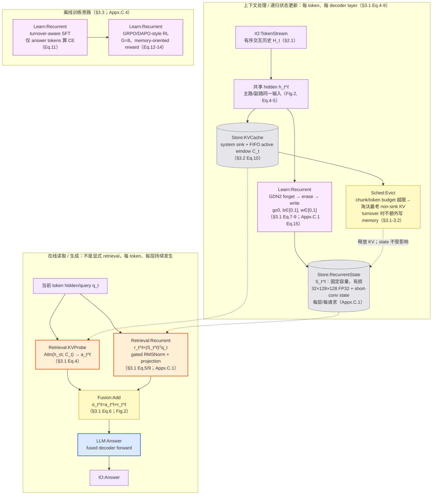
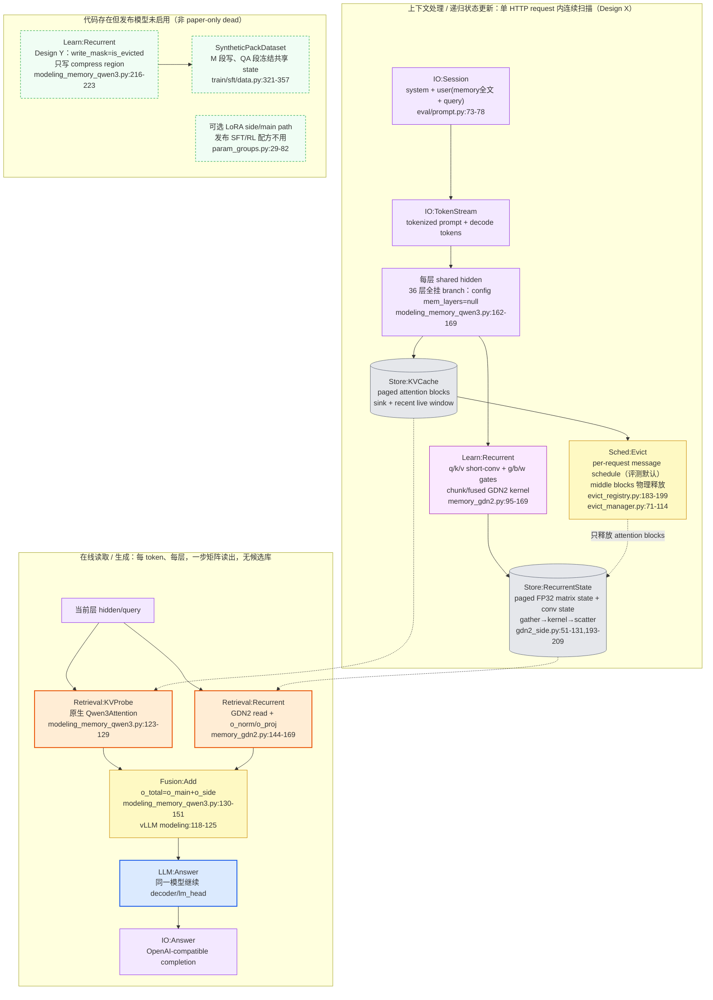

# LiveMem methodology 流程图

> [!note] 来源与口径
> 基于同目录 [[paper-architecture]] 与 [[code-architecture]]，勘误以 [[verification]] 为准（2026-09-05 全量复核 87 条：✓77 / ✗1 / ◐8 / ?1）。本图将传统 INGEST/RETRIEVE 适配为“上下文处理/递归状态更新”与“在线读取/生成”；LiveMem 没有外部 memory API、显式候选库或 top-k 检索。词汇表与图例见 `METHODOLOGY-FLOW-SPEC`。

## Paper 视角

Liu et al. 2026, *LiveMem: Maintaining Memory State Continuity in Long-Running LLM Inference*, arXiv:2608.02515v2。

![[assets/livemem-paper-flow.png]]

> [!info] PNG 状态
> 最终可视图由父会话串行生成；下方 Mermaid 是精确引用与后续重绘的核验真源。

### 核验真源



> [!warning] 论文边界
> `Store:RecurrentState` 是模型内部、请求生命周期内的隐状态，不是跨请求用户记忆。Appendix C.3 明确 generation 完成后释放 recurrent slot；Appendix E.1 说明它是有损压缩，不能可靠复原任意 needle；Appendix E.2 给出 262,144-token positional horizon。

## Code 视角

repo `~/Documents/repo/LiveMem` @ `71a6a8b`；发布 LiveMem-SFT / LiveMem-RL 主路径为 Design X（continuous scan）。

![[assets/livemem-code-flow.png]]

> [!info] PNG 状态
> 最终可视图由父会话串行生成；下方 Mermaid 是精确引用与后续重绘的核验真源。

### 核验真源



> [!warning] 运行模式退化
> `MODE=truncate` 时客户端先删除旧历史，只把 recent suffix 发给模型（`README.md:31-40,129`）；被删内容从未进入 recurrent state，因此该 profile 不检验 state continuity。`MODE=state` 才由 `scripts/serve_livemem.sh:50-57` 打开 `MEM_SERVE_EVICT` / `CHUNK_EVICT`，实现 bounded KV + persistent-within-request state。

> [!warning] 生命周期与证据限定
> 当前 API 不跨独立 request 复用 state（`README.md:40`）。`evict_registry.py:266-275` 只删除 turnover schedule，不是 recurrent slot 回收本身；slot 回收由目标 vLLM 的 inner-state manager 承担，本仓通过 `HasInnerState` contract 接入。流程图因此只声称“请求内状态”，不把 registry 清理误画成 state store 删除。

> [!note] 论文有 / 代码无
> 无。论文核心 Design X 在发布训练、export 与 vLLM 三条路径均实现。相反方向存在 code-only Design Y，已在 `DORMANT` 泳道标出；它不是 `dead`，因为代码可达，但默认发布路径不选择它。

## 新登记 module

- `IO:TokenStream`：单请求内逐 token 到达与处理的输入粒度。LiveMem 的状态更新/读取均由 token 触发，不能用 `IO:TurnPair` 或单纯 `IO:Session` 代替；同类 recurrent / activation-memory 系统可复用。

其余 module 全部复用规范已有词汇：`Learn:Recurrent`、`Store:RecurrentState`、`Store:KVCache`、`Retrieval:Recurrent`、`Retrieval:KVProbe`、`Sched:Evict`、`Fusion:Add`、`LLM:Answer`、`IO:Session`、`IO:Answer`。

## 不确定处

- GDN2 vendor kernel 只核到调用与张量 plumbing，未做 GPU 数值对拍；见 [[verification]] §6。
- Design Y 是早期方案、消融预留还是未来接口，仓库与论文均未说明。
- training-side `MemoryQwen3Config` / `from_qwen3()` 默认 Y，而 vLLM config 默认 X；发布 checkpoint/config 均显式 X。手工复现应读取 checkpoint 的 `config.json`，不能依赖构造器默认值。
- recurrent slot 的精确释放调用点在外部 `vllm==0.19.1` 状态管理器，不在本仓；README 与论文只足以确认生命周期语义。

## 生图 prompt 素材

### Paper flow prompt

```text
Create a clean horizontal academic systems diagram for “LiveMem — Paper Methodology”. Use three swimlanes: (1) CONTEXT PROCESSING / RECURRENT UPDATE, (2) ONLINE READ / GENERATION, and (3) OFFLINE POST-TRAINING. Use short canonical English labels only. In lane 1, show IO:TokenStream feeding a shared per-layer hidden state, branching to Learn:Recurrent (GDN2: Forget → Erase → Write) and Store:RecurrentState (fixed-capacity lossy FP32 state), while the parallel main path feeds Store:KVCache (system sink + FIFO active window) and Sched:Evict (oldest non-sink KV). Draw a dashed note from Sched:Evict to the recurrent state: “KV released; state unaffected; no extra write”. In lane 2, show the current token branching to Retrieval:KVProbe and Retrieval:Recurrent, both entering Fusion:Add, then LLM:Answer and IO:Answer. In lane 3, show turnover-aware SFT followed by GRPO/DAPO-style RL, both labeled Learn:Recurrent. Add a compact legend: blue LLM, orange retrieval, purple learn, gray cylinder store, yellow scheduling/fusion, pale-purple IO. Emphasize “per token, every decoder layer” and “request-local, lossy, no top-k retrieval”. White background, 16:9 landscape, precise typography, thin orthogonal connectors, no decorative imagery, no citations or code line numbers.
```

### Code flow prompt

```text
Create a clean horizontal academic systems diagram for “LiveMem — Code Methodology (release path: Design X)”. Use three swimlanes: (1) REQUEST-LIFECYCLE UPDATE, (2) ONLINE READ / GENERATION, and (3) DORMANT CODE-ONLY OPTIONS. Lane 1: IO:Session (system + memory text + query in one user turn) → IO:TokenStream → shared hidden across all 36 layers. Branch to Learn:Recurrent (q/k/v short-conv, g/b/w gates, continuous GDN2 scan) → Store:RecurrentState (paged FP32 matrix + convolution state, gather/kernel/scatter). Parallel branch: Store:KVCache (paged sink + recent window) → Sched:Evict (per-request message chunks, physical middle-page release). Dashed arrow caption: “attention pages only; recurrent state survives within request”. Lane 2: current hidden branches to Retrieval:KVProbe and Retrieval:Recurrent → Fusion:Add → LLM:Answer → IO:Answer. Lane 3 uses green dashed boxes for Design Y (write_mask=is_evicted), SyntheticPackDataset (write M, freeze QA), and optional LoRA; label the lane “implemented, not selected by released SFT/RL configs”. Add two warning badges: “truncate mode drops old history before model sees it” and “state is released after request; no cross-request persistence”. Use the canonical color legend, gray cylinders for stores, white background, 16:9 landscape, short English labels, orthogonal arrows, no code citations, no red dead nodes because no paper-only module is missing.
```
