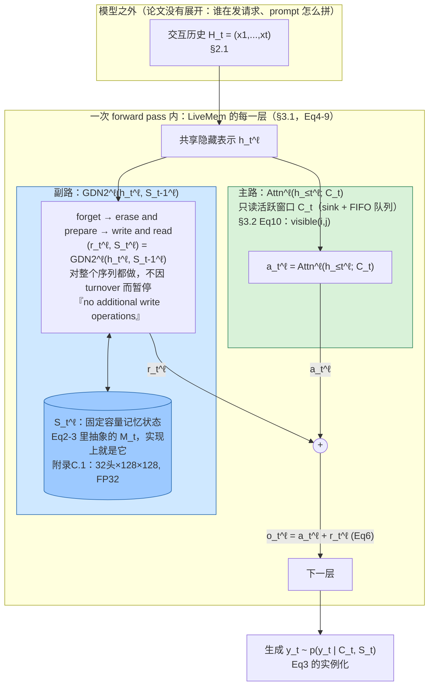

# LiveMem 论文架构

> 读的是 `Liu-etal-2026-LiveMem-Maintaining-Memory-State-Continuity-in-Long-Running-LLM-Inference.txt`
> （arXiv:2608.02515v2，`/Users/guanhongli/Documents/wafo-base/literature/papers/` 下的纯文本转写版）。
> 证据格式为「论文 §章节 / Eq(编号) / Table / Figure」；术语第一次出现给一句话解释；
> 不确定的地方标「未验证」。该 txt 是 PDF 抽取版，双栏排版可能导致抽取顺序与真实阅读顺序
> 不完全一致（例如 References 和 Appendix A 在文本流里顺序有点怪），所以本文档不依赖原始
> 行号做主证据，只用于我自己核对，主证据一律是section/Eq/Table/Figure 编号。

## 1. 一句话机制

论文把"长时间运行的 LLM 助手/agent 迟早会遇到 context turnover（工作上下文被挤爆、旧内容
必须离开注意力窗口）"定义成一个独立问题，提出 **state continuity under context turnover**
（"上下文换血时的状态连续性"）：给预训练好的全注意力 LLM 的每一层挂一条并行的**递归记忆
状态** `M_t`，主路 attention 只保留一个固定大小的活跃窗口（含 system prompt 作为
attention sink，即"永远可见的锚点"），旧内容离开窗口之后，它的信息仍然保留在 `M_t` 里——
论文强调这和"检索式"方法（先把历史存起来，回答问题时再去找相关片段，论文管这类方法叫
reconstructive inference，"重构式推理"）是两种互补但不同的机制。

证据：Abstract；§2 Preliminaries（§2.1 定义 reconstructive inference，§2.2 Eq(2)(3)
定义 `M_{t+1}=U_φ(M_t,X_{t+1})`，`y_t ~ p_{θ,φ}(y_t|C_t,M_t)`）。

## 2. 记忆是怎么存进去的

- **触发时机**：论文原话——"The read and update operations are performed per token to
  ensure real-time memory utilization and updating, **so when context turnover occurs,
  no additional write operations are performed**."（§3.1，紧跟在 Eq(7)-(9) 之后）。
  也就是说**每个 token 处理时就顺带更新了状态**，不是"等它被挤出窗口那一刻才触发写入"，
  真被驱逐时反而"什么都不用额外做"，因为信息早就写进去了。
- **存的是什么**：不是原文，不是摘要，而是 GDN2（Gated DeltaNet-2，论文引用
  Hatamizadeh et al. 2026）维护的一个状态矩阵 `S_t ∈ R^{d_k×d_v}`（省略了层和 head
  下标）。论文管这类状态叫 "memory state"，强调"不要求 `M_t` 能精确重构每一个 token"
  （§2.2 原话："We do not require that Mt be able to reconstruct every token exactly."）
  ——换句话说，这是一个**有损压缩**，不是存档。
- **具体更新步骤**（§3.1，Eq(7)-(9)，附录 C.1 给出等价的单行形式 Eq(15)）：
  1. **forget（遗忘）**：`S̄_t = Diag(exp(g_t))·S_{t-1}`，`g_t≤0` 是对数衰减门；
  2. **erase and prepare（擦除与准备）**：`ρ_t = w_t⊙v_t − S̄_tᵀ(b_t⊙k_t)`，
     `b_t∈[0,1]^{d_k}` 是擦除门；
  3. **write and read（写入与读出）**：`S_t = S̄_t + k_tρ_tᵀ`（写），`r_t = S_tᵀq_t`（读，
     `w_t∈[0,1]^{d_v}` 是写入门）；三者用同一个隐藏表示 `h_t^ℓ` 算出来，和主路 attention
     共享输入。
- **调不调 LLM**：论文没有提"额外调用一次 LLM 来生成摘要或压缩记忆"这种说法——写入是
  backbone 自身前向传播的一部分。Eq(4)-(6) 明确写：`a_t^ℓ=Attn^ℓ(h_≤t^ℓ;C_t)`，
  `(r_t^ℓ,S_t^ℓ)=GDN2^ℓ(h_t^ℓ,S_{t-1}^ℓ)`，`o_t^ℓ=a_t^ℓ+r_t^ℓ`——两条路吃的是同一个
  `h_t^ℓ`，都在同一次层内计算完成。
- **参数初始化**：侧支路的 q/k/v 从主干 attention 对应权重初始化，其余参数（衰减门、
  擦除门、写入门等）独立初始化，**输出投影用零初始化**，使得"整个侧支路刚接上时，模型
  行为等价于原始模型"，训练过程中逐步打开。
  证据：§3.1（"The output projection is initialized with zeros..."）；附录 C.1 补充了
  完整几何参数：Qwen3-4B backbone 有 36 层、32 个 query head、8 个 KV head、head
  维度 128；记忆路径**每一层**都用 32 个 query/key/value head、维度 128，因此每层每个
  请求的状态张量形状是 `32×128×128`，用 **FP32** 存储。
- **触发范围**：论文说"The memory module of LiveMem is attached as a side branch **to
  each attention layer**"（§3.1 开头）——每一层都装，不是只装几层。

## 3. 记忆是怎么被用起来的

- **触发时机**：和写入同步，每个 token、每一层都会算一次读出 `r_t`，不是"提问时才启动
  检索"。
- **拿什么去找**：当前 token 的 query 向量 `q_t`，通过 `r_t = S_tᵀq_t` 这个矩阵乘法直接
  读出（Eq(9) 的后半部分）。
- **一步到位还是多步迭代**：论文根本没有把这个过程描述成"检索"（retrieval）——它反复
  强调这是和"检索式方法"（reconstructive inference，需要显式地把 `C_t` 或其某种表示
  重新找出来）**相对立**的另一条路径（§2.2："This mechanism is complementary to
  external retrieval systems."）。所以"一步到位/多步迭代"这个框架本身不太适用：它既不是
  单次查询，也不是多轮 agentic 检索循环，而是**随 token 数量线性增长的、持续在跑的线性
  代数运算**，序列多长就做多少次。
- **找到之后怎么交给模型**：`o_t^ℓ = a_t^ℓ + r_t^ℓ`（Eq(6)），两路输出在每一层**直接相加**，
  合并后的结果按普通 decoder 层的方式送进下一层。论文没有描述任何"筛选/加权/门控是否
  采纳记忆读出"的显式机制——图 2 的图注也写"Their outputs are combined at every decoder
  layer"，就是简单相加。
- **实验上如何证明这个读出真的被用到了（而不是摆设）**：§4.3 "Does the Recurrent State
  Carry Evicted Evidence?" 专门做了这件事——对比"State"（完整历史都进了记忆状态）和
  "Trunc."（历史直接截断，从零状态开始）两种设置，Table 2 显示多数数据集上 State 优于
  Trunc.；进一步在 LongMemEval 上按"证据是否被完全/部分挤出窗口"分组，Figure 3 显示
  在证据被完全挤出的情况下，LiveMem 比完全无法访问历史的 Qwen3-4B/δ-Mem 高出十个百分点
  以上；Figure 4 显示证据离活跃窗口越远（论文控制了"evidence-to-window distance"，
  以 K token 为单位），准确率有轻微下降趋势但整体保持在可用水平，没有在驱逐边界处
  断崖式归零。
- **单次输入的物理上限**：附录 D.2 提到"LiveMem instead scans up to 256K input tokens
  while maintaining only the stated live KV budget"——记忆状态可以持续更新，但单次输入
  仍然受 backbone 的位置编码上限约束（附录 E.2：RoPE 最大位置 262,144 token）。

## 4. 架构图

**边界说明**：论文的数学框架（§2 Preliminaries）把"记忆系统"和"模型"本来就没有分开
建模——`M_t` 从一开始就被定义成 backbone 自身状态的一部分（Eq(2)(3) 里 `p_{θ,φ}` 的
下标 `θ,φ` 是同一个模型的两组参数）。真正能画出边界的地方，是**一次 forward pass 内部、
每一层里"主路 vs 副路"这条线**：主路 `Attn^ℓ` 是预训练 backbone 自己的计算（图 2 的
"full-attention main path"），副路 `GDN2^ℓ` 是论文新引入、专门训练的"记忆模块"
（图 2 的"recurrent side path"）。forward pass 之外——也就是"谁来发起一次推理请求、
历史 `H_t` 具体怎么拼进 prompt"——论文完全没有建模，这部分留给了部署方（对应
`README.md` 和代码里的评测脚本，不属于论文正文）。

## 5. 我没搞清楚的

- **训练数据配比的确切数字论文没给**：§4.4 Table 3(b) 比较了"Direct mixture / Rebalanced
  mixture / Long warmup + rebalanced"三种课程，正文只说"removed the **majority** of the
  long-text QA data"，没有给出具体去掉的百分比或数据集级别的样本量，读论文推不出确切
  配比（代码里的 yaml 有具体数字，但那是"代码怎么实现"，不代表"论文写清楚了"，所以放在
  这里而不是当成论文已回答的问题）。
- **Table 1 里 Recurrent 方法在 Wiki QA 部分若干格是空的（"-"）**，正文没有解释这是
  "该方法不适用于此任务而跳过"还是"没跑出结果"；附录 D.3 只是笼统描述了 Recurrent
  baseline 的构造方式，没有点名解释这几个具体空格。
- **`in_mem(chunk(i), j)` 的判定细节（chunk 大小、驱逐阈值）在正文 Eq(10) 处没给出具体
  数值**，要翻到附录 C.2 才有 Table 5 的完整 fixed-stride 参数表（这张表用于 RL
  rollout 和 serving 场景）；但 SFT 训练用的长文档语料，附录只说了一句"SFT examples
  use dataset-defined semantic or fixed-token chunks"，具体怎么切（语义边界用什么规则
  判定、固定 token 切分的窗口大小是多少）没有展开，论文正文和附录都没有给出可以照抄
  复现的算法细节。
- **完全没有找到"Design Y / 写门控"这类描述**（对应代码里 `write_mask=is_evicted` 的
  门控读写机制，见 code-architecture.md 第 6 节）。论文自始至终只描述了一种写入机制
  （连续扫描），我不确定这代表"作者认为这只是内部实验，不构成方法的一部分"，还是
  "论文投稿后代码库又往前探索了新方案"，仅凭论文文本无法判断，需要问作者或看后续版本。
- **"活的记忆状态"三个判定标准里第三条怎么量化没有细说**：§2.2 给出"living memory
  state"的三个要求——(i) 在线更新，(ii) 能在 context switch 后存活，(iii) 其中的关键
  信息会影响模型后续行为——前两条都能直接从架构设计上验证，第三条"critical information
  ... influences the model's subsequent behavior"论文用 §4.3 的实验间接支撑，但没有
  给出一个独立于下游任务准确率的、直接的"信息利用度"量化指标，所以这条标准更像是一个
  定性论证目标，而非可独立复现检验的定义。

## 6. 论文没写清楚的地方

- **多轮/多请求之间状态是否复用，论文正文完全没提**。这是最值得强调的一条：论文附录
  C.3 Serving 只讲了**单个 request 内部**的生命周期管理（"When generation finishes,
  the scheduler removes the request's turnover record and the state manager releases
  its recurrent slot."），从未讨论"如果一个 agent 要连续发好几轮请求，状态要不要、
  能不能跨请求延续"这个问题——这恰恰是很多读者看到"state continuity"这个题目后第一反应
  会关心的场景（多轮对话/长期运行 agent 的"记忆"）。README（不算论文正文，是配套代码
  仓库的文档）倒是补了一句"当前 OpenAI-compatible API 不会在两个独立 request 之间自动
  复用该 state"，但论文自己没有对这一点做设计说明或未来展望，读者只看论文会以为
  "state continuity"天然覆盖多轮场景，实际不然。
- **E.1/E.2（Limitations）本身写得很清楚，不算"没写清楚"，特此说明避免误判**：论文自己
  坦承 NIAH（needle-in-a-haystack，"大海捞针"式的精确检索测试）结果显示记忆状态是有损的、
  无法可靠复原任意细粒度的信息（Table 6）；RoPE 262,144 token 的位置编码上限是硬约束，
  状态理论上能一直更新但没做超过 256K 的实验。这两条论文自己交代得很坦率，不是本节该
  收录的"缺口"，列出来只是为了不被后续读者误当作我的新发现。
- **δ-Mem / Context2LoRA 等 baseline 的具体配置理由没有展开**：附录 D.3 提到"For δ-Mem,
  we adopt its **TSW setting**"，但 TSW 具体是什么、为什么选它而不是δ-Mem论文里的其他
  setting，没有解释，需要跳去δ-Mem 原论文（Lei et al. 2026）才能确认；Context2LoRA 的
  `rank=4, alpha=8, lr=5×10⁻⁴` 这组超参数也只是陈述配置，没有给出选择依据或消融支持。
- **RAG baseline 的"chunk 512 token"和"top-1/top-3"切换阈值（20 个 memory document）
  为什么是这两个数字**，附录 D.3 只是直接给出配置，没有解释为何以 20 篇文档为界。

## 相关

- 论文正文：§2 Preliminaries（Eq1-3）、§3 LiveMem（Eq4-14）、§4 Experiments（Table1-3,
  Figure3-4）
- 附录：Appendix A Related Work（含 δ-Mem 脚注 3）、Appendix C Infrastructure and State
  Lifecycle Details（Eq15, Table5）、Appendix D Additional Experimental Details、
  Appendix E Limitations（Table6）
- 与代码的交叉验证见 `code-architecture.md`（同目录）
