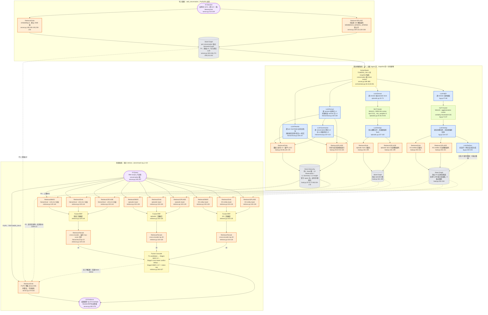

# Mandol methodology 流程图

> [!note] 来源与口径
> 本系统按 [[METHODOLOGY-FLOW-SPEC]] 的特例只画 **Code 视角**，不补 Paper 视角。主真源是同目录 [[ARCHITECTURE]] 的 P1/P2/P3 实测记录，并逐项回查 `server.py`、`towers/orchestrator.py`、`towers/hierarchical.py`、`towers/episodic.py`、`towers/kg.py`、`towers/load.py` 与 `towers/retrieve.py`；本目录没有 `verification.md`，因此冲突时以当前 memory-bench 封装臂代码与已落盘 run 结果为准。主对象不是上游 Mandol 的所有能力，而是 memory-bench 实际执行的封装路径。

## Code 视角

P1/P2/P3 不是三套写入实现，而是同一份 per-conversation 图在不同构建与检索开关下的三个状态：P1 为原始 L0 + 单路 dense，P2 已离线建塔但仍走单路 dense，P3 才启用三塔混合召回与级联剪枝。定稿全量脚本显式设置 `TRITOWER=1`、`SPARSE=1`、`CASCADE_IDS=1`（`scripts/run_mandol_full.sh:27-29`）。

![[assets/mandol-code-flow.png]]

### 核验真源



> [!warning] 环境退化与失败回退
> - `MEMBENCH_MANDOL_TOWERS` 与 `MEMBENCH_MANDOL_TRITOWER` 在 `server.py` 中都默认关闭；不开前者就是 P1，不开后者即使已建塔也仍是 P2 单路 dense（`server.py:112-118,259-281`）。定稿全量脚本才显式打开 P3。
> - `MEMBENCH_MANDOL_SPARSE=0` 会关闭写入期 SPLADE；模型不可用或编码失败时上游只警告并保留 unit，封装用 `attempted/generated/code` 将静默退化显式写入 stats。此时 BM25 + dense 仍可工作，P3 从三路召回退化为两路（`server.py:109-122,329-340`；Mandol `semantic_map.py:1620-1694`）。
> - 构建层缺少 `MEMBENCH_LLM_BASE_URL/API_KEY/MODEL` 时 `TowerLLM` 初始化报错，但 `_build_towers()` 按 conversation 捕获并记录，不阻断其余 conversation 和 snapshot；单次 LLM 失败时，L0 回退带日期原文，L1/L2/episodic/KG 对应产物可缺失，dedup 失败则保留原候选（`towers/llm.py:37-51,79-107,136-147`; `server.py:349-369`）。
> - P3 任一塔异常只丢该塔，其他塔继续；三塔均空时 `server.retrieve()` 回退 base dense。级联剪枝异常时不回退 dense，而是对三塔候选按 score 排序后去重截断（`towers/retrieve.py:268-286,293-327`; `server.py:259-281`）。
> - `MEMBENCH_MANDOL_RERANK=0` 会跳过 cross-encoder；默认开启。CPU 运行把上游硬编码 bf16 改为 float32，属于硬件适配，不改变候选机制（`towers/retrieve.py:45,55-87,119-145`）。

> [!note] 已核实的 code-only 边界
> - P2 的 30,000 条既有 evidence 中 100% 为 L0。图中仍画出 L1/L2，因为它们确实被构建并存入 `Store:Hierarchy`；不能把“存储存在”误写成“P2 dense 已使用”。
> - P3 的 KG 是实体语义检索面，不是图遍历：定稿路径 `topk_graph=0`、`use_entity_relation=False`，且当前封装的关系候选清单漏 `entity_id`，导致关系边零落地。图中因此没有 `Retrieval:Graph`。
> - router 未接入，但上游 GPT-4.1-mini 主结果路由表五类问题全部映射 `_cfg_full()`，在该配置下省略 router 等价于固定全开，不是学习型或按题路由。
> - 检索不做查询期时间排序或衰减；日期只存在于 L0 改写文本和 metadata。Mandol 返回 evidence envelope，由外部 benchmark 答题模型生成答案。

## 新登记 module

| module | 状态 | 类别 | 理由 |
|---|---|---|---|
| `Retrieval:SPLADE` | Mandol 新登记 | 检索算法·橙 | 学习式稀疏检索是 P3 每塔第三路，与词法 `Retrieval:BM25` 和 dense `Retrieval:Emb` 都不可合并；缺失时会形成可观测的三路→两路环境退化 |
| `LLM:Dedup` | Mandol 新登记 | LLM 调用·蓝 | episodic 与 KG 构建都先用 `NLP:Cluster` 形成候选簇，再由 LLM 合并同簇项；这不是规则去重，也不是冲突失效语义的 `LLM:Resolve` |
| `Fusion:Cascade` | Mandol 新登记 | 融合/门控·黄 | 三塔候选统一经过 MAD 离群过滤、跨塔冲突去重、MMR token-budget 打包；三段共同决定最终保留集，不能简化成单独 `Fusion:RRF` 或 `Fusion:MMR` |
| `Retrieval:Rerank` | 已登记 | 检索算法·橙 | cross-encoder 对每塔 RRF 候选二次排序；与 MemOS/PlugMem methodology 文档复用同一模块名 |
| `Sched:Batch` | 已登记 | 调度·黄 | 全量 ingest 完成后由 snapshot 一次性触发建塔；与 A-Mem/AtomMem 的 session-end/攒批触发共享“批处理调度”语义 |
| `IO:Evidence` | 已登记 | 输入/输出·淡紫 | 封装臂返回 evidence envelope，不在 Mandol 内执行 `LLM:Answer`；与 A-Mem code 图复用同一模块名 |

## 不确定处

1. P2 evidence 的“100% L0”是 [[ARCHITECTURE]] 汇总的 30,000 条实测事实，但静态代码只能确认 P2 调用 base 图的 `search_similarity_in_graph()`；L1/L2 是因 space 过滤不可达，还是可达但在这些查询中始终被 L0 排名压过，当前材料没有把两种原因拆开。
2. `towers/retrieve.py:32-42` 保留了上游三塔权重注释（0.34/0.33/0.33），但实际 `tower_retrieve()` 直接拼接三塔 cross-encoder score 后进入 cascade，没有乘这些权重。是因同一 reranker 已使分数可比而有意省略，还是移植遗漏，未记录。
3. 本目录没有 `verification.md`；本轮按要求做静态逐函数核验，并抽查既有 `mandol-p3-full-3conv` / `mandol-full-10conv` evidence 中的 15+30+30 与 cascade 诊断，没有重新执行耗时构建或 benchmark。因此外部模型版本变化后的实际 SPLADE 覆盖率与延迟不在本轮重新测量范围内。

## 生图 prompt 素材

```text
Create one clean horizontal academic systems diagram titled "Mandol — Verified P1 / P2 / P3 Code Path". White background, compact sans-serif typography, thin charcoal arrows, no gradients, no decorative graphics. Use three aligned swimlanes: INGEST, OFFLINE BUILD, and RETRIEVE. Use canonical short labels exactly. Color and shape system: blue rectangles for LLM modules, orange rectangles for Retrieval modules, green rectangles for NLP modules, yellow rectangles for Fusion and Scheduler modules, gray cylinders for Store modules, and pale-purple rounded rectangles for IO modules. INGEST: IO:Session, one MemoryUnit per turn, branches to Retrieval:Emb and optional Retrieval:SPLADE, then Store:Graph "Per-conversation raw L0"; add a small caption "No ingest LLM". OFFLINE BUILD starts at Sched:Batch "snapshot hook, towers on" and branches into three builders. Hierarchical builder: LLM:Rewrite "L0 God Mode" plus LLM:Extract "L1 per session" to LLM:Summarize "L2 per conversation", then Retrieval:Emb plus optional Retrieval:SPLADE into Store:Hierarchy "L0 / L1 / L2". Episodic builder: LLM:Extract -> NLP:Cluster "DBSCAN 0.25" -> LLM:Dedup -> parallel Retrieval:Emb and Retrieval:SPLADE -> Store:Graph "Episodic facts". KG builder: LLM:NER -> NLP:Cluster "Agglomerative 0.85" -> LLM:Dedup -> parallel Retrieval:Emb and Retrieval:SPLADE -> Store:Graph "KG entity surface"; branch LLM:Dedup to LLM:RelGen and attach its dashed output to the KG store with warning "5,208 relations extracted, 0 edges landed". RETRIEVE must show two clearly labeled modes. P1/P2: IO:Query -> Retrieval:Emb "single dense kNN" -> IO:Evidence; annotate P1 "raw L0" and P2 "rewritten corpus, measured evidence 100% L0". P3: run Hierarchical, Episodic, and KG towers in parallel. Inside every tower show Retrieval:BM25, Retrieval:Emb, and Retrieval:SPLADE -> Fusion:RRF -> Retrieval:Rerank. Label output budgets H=15, E=30, KG=30. Merge 75 candidates into Fusion:Cascade with three concise stages: "MAD 3.0", "Cross-tower conflict dedup", and "MMR 0.7 + token cap", then IO:Evidence "dedup top-20". Add a small fallback strip: SPLADE unavailable means BM25 + Emb only; one tower failure keeps the other towers; all towers empty falls back to base dense; cascade failure falls back to score sort. Add tiny boundary captions: no graph traversal, no query-time temporal decay, no answer generation, CPU reranker float32. Keep all flow left-to-right within each lane and keep every label readable.
```
