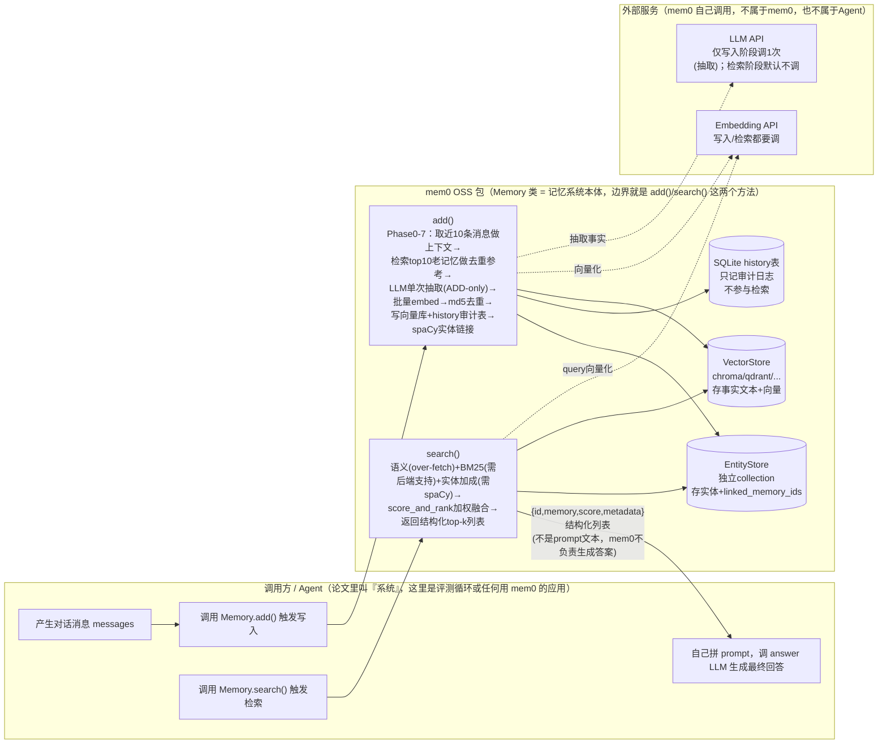

# Mem0 代码架构

> 读的是 `/Users/guanhongli/Documents/repo/mem0`（官方仓库，Git HEAD `dae67f74`，2026-09-04；`pyproject.toml` 声明版本
> `mem0ai==2.0.20`）。核心逻辑集中在 `mem0/memory/main.py`（`Memory` 类，约 3700+ 行）、
> `mem0/configs/prompts.py`（提示词模板）、`mem0/utils/scoring.py`（检索打分）。
> 术语先解释一遍：**embedding（向量化）**＝把一段文字变成一串数字（向量），语义相近的文字向量也相近；
> **BM25**＝一种经典的关键词匹配算法（不看语义，看字面词重叠）；**spaCy**＝一个开源 NLP（自然语言处理）库，
> 这里用来从文本里挑"实体"（人名、地名等专有名词）。

## 1. 一句话机制

mem0 现在（2026-04 起的 "v3 pipeline"）的写入逻辑是"每次调用只用 1 次 LLM，把新消息批量抽成一条条独立的
事实性短句，只增不改、不删"；检索逻辑是"语义向量相似度 + 关键词匹配（BM25）+ 实体关联加分三条通道并行打分，
加权合并出 top-k"。论文里那套"LLM 自己判断 ADD/UPDATE/DELETE/NOOP 四种操作"的更新机制，在当前代码里是
**定义了但零调用点的死代码**；论文里的图记忆 Mem0g，在当前代码里是**整个模块都不存在**（不是弱化，是连
Neo4j/图存储的代码文件都被删掉了）。这两点是本篇最大的发现，详见第 6 节。

## 2. 记忆是怎么存进去的

**触发时机**：调用方调 `Memory.add(messages, user_id=..., ...)`（`mem0/memory/main.py:760`）。这里的
`messages` 可以是任意长度的消息列表——不是论文说的"每来一对新消息就触发一次"，触发粒度完全由调用方决定。
本项目的封装层 `servers/mem0/server.py:509` 的 `add_conversation` 工具把一整个 session 的所有 turns
拼成一个 list，**一次性**传给 `add()`——也就是每个 session 只触发一次写入调用，一次写入只对应一次 LLM 抽取。

**存的是什么**：不是原始对话、不是摘要、也不是"向量"本身，而是 LLM 从这批新消息里"抽取"出来的一条条
自包含事实短句（例如"User 养了一只叫 Max 的狗"），外加这条短句的 embedding（用于以后检索）和一份
`linked_memory_ids`（软链接到相关老记忆的 ID 列表，只是打标签，**不改老记忆内容**）。

**调不调 LLM**：调，且整批 messages 只调 **1 次**（`mem0/memory/main.py:940` 那行注释直接写
`# Phase 2: LLM extraction (single call)`）。完整写入流程分 8 个阶段（Phase 0-7，均在
`_add_to_vector_store`，`mem0/memory/main.py:879`）：

| Phase | 做什么 | 证据 |
|---|---|---|
| 0 上下文收集 | 取该 scope 最近 10 条历史消息（`db.get_last_messages(session_scope, limit=10)`），只用来帮 LLM 消解代词/指代，**不是**论文的"会话摘要 S" | `mem0/memory/main.py:918-920` |
| 1 现有记忆检索 | 把新消息整体做一次 embedding，去向量库里捞 `top_k=10` 条已有记忆，作为"去重/关联参考"喂给 LLM（这不是给用户看的检索结果，是内部去重用的） | `mem0/memory/main.py:923-929` |
| 2 LLM 抽取（唯一一次 LLM 调用） | system prompt 固定用 `ADDITIVE_EXTRACTION_PROMPT`，开头第一句就是 "Your sole operation is ADD"（你唯一的操作是新增）；LLM 返回 JSON 事实列表，每条可带 `linked_memory_ids` | `mem0/memory/main.py:940-953`；`mem0/configs/prompts.py:468,472` |
| 3 批量向量化 | 把抽取出来的事实文本一次性批量 embedding | `mem0/memory/main.py:991` |
| 4-5 CPU 处理 + 去重 | 用 `hashlib.md5(text)` 算哈希，跟已有记忆哈希、本批内哈希比对，重复的直接跳过——跳过就是"什么都不做"，不会触发任何"更新"动作 | `mem0/memory/main.py:1005-1043` |
| 6 批量落盘 | 写入向量库 + SQLite 的 `history` 表（这张表只记审计日志，**不参与检索**）；history 记录的 `event` 字段被硬编码为字符串 `"ADD"` | `mem0/memory/main.py:1045-1075`（`event="ADD"` 在 `mem0/memory/main.py:1070`） |
| 7 实体链接 | 用 spaCy 从每条新事实里抠"实体"（专有名词/引号内容/名词短语），跟已有实体库做语义匹配（阈值 0.95）决定合并还是新建，写进一个独立的 entity 向量库 collection（`entity_store` 是懒加载属性，`mem0/memory/main.py:559-580`） | `mem0/memory/main.py:1086` 起；`mem0/utils/entity_extraction.py` |

**一个容易漏看的细节**：论文 §2.1 描述的"异步会话摘要刷新模块"（给抽取阶段提供 conversation summary S）
在当前代码里连"接口占位但空转"都算不上——`generate_additive_extraction_prompt()` 函数确实支持
`summary=` 参数，提示词模板里也确实有 "## Summary" 这一段（`mem0/configs/prompts.py:496`，函数默认值定义在
`mem0/configs/prompts.py:1016-1024`）；但两个真实调用点（`mem0/memory/main.py:948-953` 同步 / `mem0/memory/main.py:2610-2615` 异步）
**都没有传这个参数**，也没传 `recently_extracted_memories=`（对应 "## Recently Extracted Memories" 段，
`mem0/configs/prompts.py:501`，本该是"session 内近 20 条已抽取记忆的去重参考"）。这两个字段在每一次真实调用里都是默认值
`None`——是提示词模板留了坑位，调用方从来没填过。

**public 的 `.update()` / `.delete()` API**：`Memory` 类上确实有 `update(memory_id, text, ...)`
（`mem0/memory/main.py:1815`）和 `delete(memory_id)`（`mem0/memory/main.py:1869`）方法，但这两个是纯 CRUD（调用方直接给 ID
和新内容，代码直接改/删），**不是论文说的"LLM 判断该不该更新/删除"**，而且 `add()` 的自动抽取流程从不
调用它们——这两个方法只有调用方手动显式调用才会触发。

## 3. 记忆是怎么被用起来的

**触发时机**：调用方调 `Memory.search(query, filters, top_k=20, threshold=0.1, rerank=False, explain=False)`
——这几个数字都是函数签名的默认值（`mem0/memory/main.py:1379-1389`）。

**拿什么去找**（`_search_vector_store`，`mem0/memory/main.py:1628`）：
1. query 原文做一次 embedding（语义检索用）
2. query 经词形还原（lemmatize）后的版本（BM25 关键词检索用）
3. 用 spaCy 从 query 里抽出的实体（实体加成用）

**三条通道设计上并行跑**：
- **语义**：`vector_store.search(...)`，为了给后面的分数融合留余地，一次多捞
  `max(top_k*4, 60)` 条候选（`mem0/memory/main.py:1641`）
- **BM25 关键词**：调 `vector_store.keyword_search(...)`（`mem0/memory/main.py:1646`）。这是个"选配"接口——基类默认
  直接 `return None`（`mem0/vector_stores/base.py:68-80`），只有部分后端（Qdrant/Pinecone/pgvector/
  Elasticsearch/MongoDB/Weaviate/Milvus/OpenSearch 等十几种，已用 grep 核实）覆写了这个方法。
  **chroma 没有覆写**（`vector_stores/chroma.py` 只定义了 `search`，没有 `keyword_search`）——只要用
  chroma 当后端，这条通道恒为空
- **实体加成**：从 query 抽到的实体去 entity 向量库里找匹配（阈值 ≥0.5），命中的实体所关联的记忆会加分
  （`mem0/memory/main.py:1661-1663`；`_compute_entity_boosts` 定义在 `mem0/memory/main.py:1733`）。这一步依赖 spaCy——
  `extract_entities()` 在 spaCy 不可用时直接返回空列表（`entity_extraction.py` 顶部 docstring）

**融合方式**：`score_and_rank()`（`mem0/utils/scoring.py`）做**加法**融合，不是取最大值也不是 RRF
（倒数排名融合）——`combined = (语义分 + BM25分 + 实体加成) / 分母`，分母根据"这次查询里哪些通道真的产出了值"
自适应：只有语义 → 1.0；语义+BM25 → 2.0；语义+BM25+实体 → 2.5；语义+实体（无BM25）→ 1.5。
`threshold` 只卡语义分这一关（`score_and_rank` 里 `if semantic_score < threshold: continue`）——语义分
没过线的候选直接被淘汰，BM25/实体分再高也捞不回来。

**一步到位，不是多步迭代**：一次 `search()` 调用直接返回最终 top-k，中间没有"检索→反思→再检索"的
agentic 循环。

**找到之后怎么交给模型**：mem0 自己**不生成答案**——`search()` 只返回结构化列表
（`{id, memory, score, metadata...}`），"怎么拼进 prompt、喂给哪个模型回答问题"完全是调用方的事，
mem0 库本身不管这一步。retrieve 阶段本身不调 LLM（只调一次 embedding 把 query 向量化），除非
`rerank=True` 且配置了 reranker（`mem0/memory/main.py:1500`，`if rerank and self.reranker`）；
`MemoryConfig.reranker` 默认是 `None`（`mem0/configs/base.py`），所以默认路径下 `rerank=True`
也是空操作。

**本次实测环境的通道状态**（这是环境事实，不是代码结构本身）：memory-bench 的 mem0 主 venv 里
`import spacy` 报 `ModuleNotFoundError`（已用 `.venv/bin/python -c "import spacy"` 实测验证），且没有
安装 `mem0ai[nlp]` 这个可选依赖组（`DEPLOY.md` 的部署矩阵没提这件事）——所以这次评测里实体通道也是关的。
语义+BM25+实体三通道设计，在"chroma 后端 + 未装 spaCy"这个实际组合下，**结构性退化成只剩语义单通道**，
检索侧等价于裸向量 RAG。

## 4. 架构图

**边界说明**：mem0 系统的边界就是 `Memory` 类暴露的 `add()` / `search()`（以及 `update()`/`delete()`/
`get_all()`）几个方法。Agent 侧负责"什么时候存、存什么内容、检索结果怎么拼进最终回答的 prompt"；
mem0 侧只负责"存进去之后怎么组织、查的时候怎么找、怎么打分排序"。mem0 内部还要反过来调外部的 LLM API
（写入阶段抽取用）和 Embedding API（写入、检索都要用）——这两个是 mem0 借用的外部服务，既不算 Agent
的一部分，也不算 mem0 自己的存储/计算，图里单独画了一层。

## 5. 我没搞清楚的

- `_create_procedural_memory`（`memory_type="procedural_memory"` 分支，`main.py` 约 2000 行附近）
  走的是另一套 pipeline，这次没有深入读，不确定它是不是也是 ADD-only、要不要另外调 LLM——**未验证**
- entity collection 的具体隔离粒度：`entity_store` 是按 `VectorStoreFactory.create` 出来的独立
  collection（`mem0/memory/main.py:559-580`），但没有逐行确认它在多 `user_id`/`agent_id`/`run_id` 混用场景下是否
  严格隔离，还是可能跨 scope 互相污染实体匹配——**未验证**
- README 里说的 "Mem0's managed platform, which includes proprietary optimizations not available
  in the open-source SDK"——OSS 和付费 SaaS 平台具体差多少、差在哪几个模块，代码里看不出来，只能确认
  "现在这份 OSS 代码里没有"，不能推断"SaaS 平台里有什么"
- `get_bm25_params()`（`utils/scoring.py`）里 sigmoid 参数分段（3/6/9/15 词对应不同 midpoint/steepness）
  为什么这么取值，代码没有注释说明依据，没找到对应的实验记录或 issue 链接——**未验证是否有 A/B 测试支撑**
- 本文档读的是仓库当前 HEAD（`mem0ai==2.0.20`，2026-09-04），而 memory-bench 实际跑分用的 venv 里装的
  是 PyPI 发布的 `mem0ai==2.0.18`——已用运行时检查确认两者都在同一套 "V3 PHASED BATCH PIPELINE"
  架构上（`grep "V3 PHASED BATCH PIPELINE"` 两个版本都命中，`chroma.py` 两个版本都没有 `keyword_search`），
  核心结论一致，但没有逐行 diff 两个版本，不排除个别参数/措辞有小改动

## 6. 与论文的冲突点

### ① 四操作（ADD/UPDATE/DELETE/NOOP）机制：论文的核心卖点，在代码里是纯死代码

**论文怎么写**（§2.1，p.4，Algorithm 1 / Appendix B，p.21）：抽取出候选事实后，系统检索 top-s
相似记忆，通过 LLM 的 "tool call"（函数调用接口）判定四个操作之一——ADD（新建）/UPDATE（用更丰富信息
替换旧记忆）/DELETE（删除被矛盾的旧记忆）/NOOP（不操作）。这是论文反复强调的设计核心，也是它宣称能维护
"知识库一致性和时序一致性"的机制来源。

**代码怎么实现**：
- `DEFAULT_UPDATE_MEMORY_PROMPT`（`mem0/configs/prompts.py:176`）和 `get_update_memory_messages()`
  （`mem0/configs/prompts.py:406`）确实还定义在文件里，但用 `grep` 搜整个 `mem0/` 包（`*.py`），
  **除了定义处，找不到第二个调用点**——也就是说没有任何代码路径会真正拼出这个"四操作判断"的 prompt
  并发给 LLM
- 真正跑的 `add()` → `_add_to_vector_store()`（`mem0/memory/main.py:879`）走的是 `ADDITIVE_EXTRACTION_PROMPT`
  （`mem0/configs/prompts.py:468`），开头第一句就是 **"Your sole operation is ADD"**（`prompts.py:472`）
- 所有写入历史记录（`history` 表）的 `event` 字段，在全部 9 处赋值点（`mem0/memory/main.py:909, 1070, 1196, 2034,
  2570, 2728, 2854, 3729`，含同步/异步/procedural 各分支）**无一例外硬编码为字符串 `"ADD"`**，代码里
  找不到任何地方会写入 `"UPDATE"`、`"DELETE"` 或 `"NOOP"`

**这不是"退化"，是整条流水线换了架构**：git log 显示 commit `a488e190`（2026-04-14，
"feat(oss): port v3 pipeline with hybrid search, entity extraction, and additive scoring #4805"）
一次性把整个"update 阶段"连根拔掉，改成单次 ADD-only 抽取 + `linked_memory_ids` 软关联（关联不是覆写，
老记忆内容永远不变）。**以代码为准**：当前 OSS 版本没有任何自动的 UPDATE/DELETE 决策；旧记忆永远不会被
自动覆盖或删除，只能靠调用方手动调那两个纯 CRUD 的 `.update()`/`.delete()` API（第 2 节已述），跟论文的
"LLM 现场判断"毫无关系。

### ② Mem0g 图记忆：论文的第二套架构，在代码里整体不存在

**论文怎么写**（§2.2，p.5-7，Figure 3）：记忆存成有向标注图 G=(V,E,L)（节点=实体，边=关系），落地在
Neo4j 上；检索走"双路策略"——entity-centric（先定位 query 里的实体锚点，探索出入边构建子图）+
semantic triplet（把整个 query 编码成向量，跟每条关系三元组的文本编码做匹配）；写入时有 LLM 冲突检测器，
把过时的关系标记 invalid 而不是物理删除，用来支持时序推理。

**代码怎么实现**：
- 在 `mem0/` 整个包里搜 `graph`/`Neo4j`/`Memgraph`/`Kuzu`/`Mem0g`——**没有任何一个匹配**
  （已用文件名 glob `*graph*` 和内容 grep 双重确认）
- `git log` 显示同一批 commit `a488e190` 里，TypeScript SDK 的
  `mem0-ts/src/oss/src/memory/graph_memory.ts`（675 行）、`graphs/tools.ts`（267 行）、
  `graphs/utils.ts`（116 行）、`graphs/configs.ts`（30 行）**被整体删除**
- 仓库自带文档明确写着这是故意为之：`docs/platform/platform-vs-oss.mdx:70`——
  "**Removed**. OSS previously connected external graph stores (Neo4j, Memgraph, Kuzu, Apache AGE);
  that integration was dropped when the v3 pipeline landed."；
  `docs/open-source/configuration.mdx:97`——"Graph memory is not part of OSS in either language:
  it is a built-in Mem0 Platform feature."

**结论**：Mem0g 不是"能力弱化"，是整个模块被从开源仓库里移出，现在是纯付费 Platform 功能。当前 OSS 代码
里唯一残留的"实体"痕迹，是第 3 节说的 spaCy 实体抽取打分加成（`utils/entity_extraction.py`）——这跟
图数据库、关系边、Neo4j 完全是两件事，不能混为一谈。用这份仓库做"Mem0 vs Mem0g"对比是做不到的，因为
Mem0g 在这份代码里根本不存在。

### ③ 检索机制：代码比论文描述得更复杂，但在本项目实际用的组合下又退化回更简单

**论文怎么写**：base Mem0 只说"按语义相似度检索"，没有 BM25/实体加成的描述（那是 Mem0g 才有的
"双路检索"，且那两路也是"语义向量匹配"的两种用法，不是关键词匹配）。

**代码怎么实现**：v3 的检索是显式的三通道加权（语义 + BM25 + 实体，`utils/scoring.py`），比论文描述的
纯语义检索**更复杂**——这个方向是代码比论文"多做了"，不是退化。但对本项目用 chroma 做后端、且评测环境
没装 spaCy 的实际组合（第 3 节已述），三通道结构性退化成只剩语义单通道，效果上跟论文描述的"纯语义
相似度检索"又趋同了——只是趋同的原因是环境限制，不是代码本身只有语义检索。

### ④ 论文的"异步摘要模块"在代码里只剩提示词模板的坑位，从未被填过

**论文怎么写**（§2.1，p.3）：抽取阶段的 prompt 由会话摘要 S（一个独立的异步模块周期性刷新）+ 最近 m 条
消息 + 新消息对拼成，S 提供"全局主题理解"。

**代码怎么实现**：`ADDITIVE_EXTRACTION_PROMPT` 的模板里确实还留着 "## Summary" 段
（`mem0/configs/prompts.py:496`），`generate_additive_extraction_prompt()` 函数签名也确实支持
`summary=` 参数（`mem0/configs/prompts.py:1016`）；但两个真实调用点（`mem0/memory/main.py:948-953` / `mem0/memory/main.py:2610-2615`）
都没有传这个参数——已用 grep 确认整个 `main.py` 里没有第三处会传 `summary=` 给这个函数。这个字段在每一次
真实调用里都是默认值 `None`。异步摘要刷新模块在代码里连"接口占位但空转"都算不上，是提示词模板留了坑位，
调用方从来没填过。

---

## 附：我们封装层的降级面（对照 `servers/mem0/server.py`）

以上 1-6 节说的都是上游 `repo/mem0` 本身的架构。本项目 `servers/mem0/server.py` 这层封装在此基础上
又做了几处**明确的降级/取舍**，和上面的机制对照如下：

- **写入粒度进一步收窄**：`add_conversation`（`servers/mem0/server.py:509`）把一个 session 的**全部** turns 一次性
  拼进 `messages` 列表传给 `_mem().add()`——不管这个 session 有多少轮对话，只触发**一次** `add()` 调用，
  也就是只触发第 2 节说的那"唯一一次 LLM 抽取"一次。这比论文的"每对新消息触发一次"粒度更粗，也比 mem0
  库本身"调用方可以任意分批调 add()"这个灵活度更收窄——是封装层自己选的评测协议（整段 session 灌完再
  评测检索），不是 mem0 库的限制
- **图记忆能力边界**：因为上游 OSS 包里完全没有图记忆代码（第 6 节 ②），封装层没有做任何 graph 相关
  调用——评测里的"mem0"只能是纯 Mem0（无图），跟 Mem0g 完全无关。这是能力边界，不是封装层的选择
- **三通道状态显式探测**：封装层在启动期做 `_probe_channels()`（`server.py` 内），用"是否覆写
  `keyword_search`"+"spaCy 与 `en_core_web_sm` 是否可用"+"entity collection 是否已建库"三个信号，
  把 BM25/实体两条通道的可用性钉死并写进 trace，而不是任其默默退化——这是对第 3 节"三通道结构性退化"
  这件事做了显式暴露
- **检索参数全部显式传参**：`_search_params()`（`server.py` 内）把 `top_k`/`threshold`/`rerank`/
  `explain` 全部显式传给 `search()`，不吃包默认值（第 3 节列的 `top_k=20, threshold=0.1, rerank=False`
  等默认值就是封装层拿来当"锚点"用的），并把"这次实际生效的参数"写进 `native_notes`/trace，便于事后审查
- **手动打点 token 用量**：因为 `mem0/llms/openai.py:83`（`return response.choices[0].message.content`）
  只返回内容、丢弃 `usage` 字段，封装层在 OpenAI client 的 `chat.completions.create` 上打了个
  monkeypatch 来拦截 `response.usage`，绕开 mem0 库本身"不暴露内部 LLM 用量"的限制
- **`reset()` 有一处已知修复**：封装层注释标注"P1 修复（2026-08-19 核查）"——`reset()` 必须以
  `_drop_memory()`（弃实例 + 清 chroma 进程级缓存）收尾，否则残留的 `Memory` 实例会持有指向已删除目录的
  悬挂句柄，后续 `add()` 会静默失败（数据库只读错误，但对外表现为"成功"）——这是封装层自己踩坑后加的
  防御，不是上游 mem0 库文档里提到的已知问题

以上均为封装层针对上游能力边界/默认行为做的**工程封装决策**，不改变上游 `repo/mem0` 本身第 1-6 节
描述的机制。
