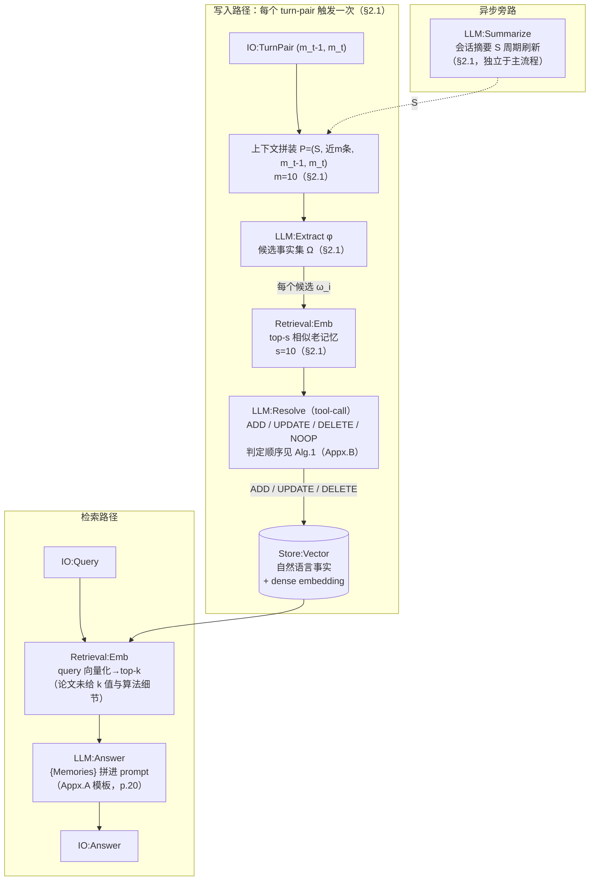
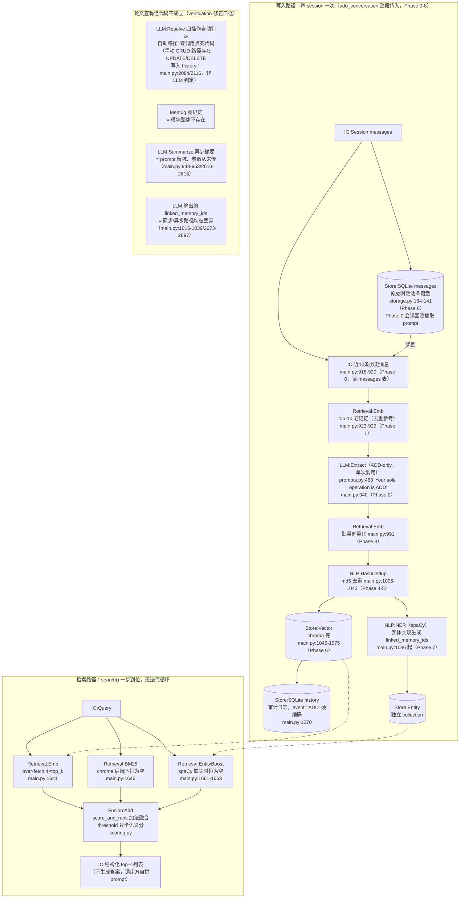

# Mem0 methodology 流程图

> [!note] 来源与口径
> 基于同目录 [[paper-architecture]] 与 [[code-architecture]]（勘误已按 [[verification]] 复核结论修正：Phase 8 补齐、linked_memory_ids 真实来源、paper 页码偏移）。词汇表与图例见全项目规范 `METHODOLOGY-FLOW-SPEC`。

## Paper 视角

Chhikara et al. 2025, *Mem0: Building Production-Ready AI Agents with Scalable Long-Term Memory*, arXiv:2504.19413（ECAI 2025）。

![[assets/mem0-paper-flow.png]]

### 核验真源

Mem0g 变体（论文 §2.2，图略差异见下）：写入侧 `LLM:NER`（实体抽取）+ `LLM:RelGen`（关系生成）→ 三元组落 `Store:Graph`（Neo4j，实现细节 p.6）；节点匹配走 `Retrieval:Emb`（阈值 t）；冲突由 `LLM:Resolve` 判定后**标 invalid 而非物理删除**（p.6）。检索为双路：entity-centric + semantic triplet（p.6）。

## Code 视角

repo `~/Documents/repo/mem0` @ `dae67f74`（mem0ai==2.0.20）。

![[assets/mem0-code-flow.png]]

### 核验真源

> [!warning] 环境退化事实（memory-bench 实测）
> chroma 后端（无 BM25 通道）+ venv 未装 spaCy（无实体通道）→ 三通道设计实际退化为**纯语义单通道**，检索侧等价于裸向量 RAG。

## 新登记 module

- `Retrieval:EntityBoost`：query 实体命中加分通道（mem0 特有的第三检索通道，非独立检索器，归 Retrieval 类）
- `IO:TurnPair` / `IO:Session`：写入触发粒度的输入节点（区分论文 turn-pair 触发 vs 代码 session 触发）

## 不确定处

无（mem0 为样例系统，verification.md 已全量核对 46+61 条断言）。
