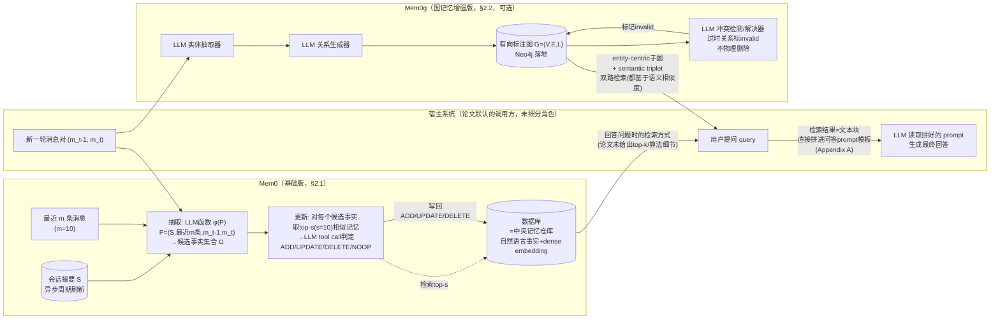

# Mem0 论文架构

> 读的是 `Chhikara-2025-Mem0-Production-Ready-Agents-Scalable-Long-Term-Memory.txt`
> （即 arXiv:2504.19413v1，2025-04-28，23 页；另有"后发表于 ECAI 2025"一说，但 txt 全文搜 `ecai` 无命中，
> 属论文之外的信息，此处只能存疑）。本篇**只谈论文写了什么**，不掺代码
> 事实——论文与当前上游代码的差异见 `code-architecture.md` 第 6 节。
> 术语先解释一下：**LLM tool call（函数调用）**＝让大模型不止吐一段文字，还能按预先定义好的"函数签名"
> 吐出结构化的调用意图（这里是"选四个操作之一"）；**dense embedding（密集向量）**＝把文字变成一串数字，
> 语义相近的文字数字也相近；**LLM-as-a-Judge**＝用另一个更强的 LLM 当裁判，给答案打 CORRECT/WRONG。
> **2026-09-05 勘误**：本文已按同目录 `verification.md` 的逐条复核结论修正（共 14 处：3 处事实、7 处行号/锚点、4 处表述限定）。原始未修正版本见 git 历史。

## 1. 一句话机制

论文提出两套架构：**Mem0**（基础版）——"抽取+更新"两阶段流水线，靠 LLM 自己判断
ADD/UPDATE/DELETE/NOOP 四种操作，维护一份用自然语言写成的事实记忆库；**Mem0g**（图记忆增强版）——在
Mem0 之上加一层图记忆（实体做节点、关系做边，落在 Neo4j 上），支持更复杂的关系推理。论文的核心卖点不是
刷分（虽然确实刷了），而是"用远少于 full-context 的 token 和延迟，换到接近甚至部分超过 full-context
的效果"——摘要原文："Mem0 attains a 91% lower p95 latency and saves more than 90% token cost"（摘要，
p.1）。

## 2. 记忆是怎么存进去的

### 2.1 基础版 Mem0：抽取（extraction）+ 更新（update）两阶段

**触发时机**：每来一对新消息 (m_{t-1}, m_t)（通常是一问一答的一轮）就触发一次抽取——论文称之为
"增量处理范式"（incremental processing paradigm），强调"能在持续进行的对话里无缝运作"（§2.1，p.3）。
这是逐 turn-pair 触发，不是攒一大段对话再批量处理。

**抽取阶段**：
- 输入的 prompt P = (S, {m_{t-m}, ..., m_{t-2}}, m_{t-1}, m_t)，由两个互补的上下文来源拼成
  （§2.1，p.4——§2.1 这一节从 p.3 起，但公式本身落在 p.4）：
  1. **会话摘要 S**——代表整段对话历史语义内容的摘要，从数据库读出。论文特别说明这个摘要由一个
     **独立的、异步的摘要生成模块**周期性刷新，"这个组件独立于主处理流程运作，确保记忆抽取始终能用上
     最新的上下文信息，同时不引入处理延迟"（§2.1，p.3-4——句子起于 p.3，这段引文落在 p.4）
  2. **最近 m 条消息** {m_{t-m}, ..., m_{t-2}}——补充摘要里可能没收进去的"细粒度时序上下文"，m 是超参数
- 抽取函数 φ 由 LLM 实现，φ(P) 从这对新消息里产出候选事实集合 Ω = {ω1, ω2, ..., ωn}（§2.1，p.3-4）
- **调不调 LLM**：调，φ 本身就是一次 LLM 调用
- 实验设置：m=10（最近消息条数），LLM 统一用 GPT-4o-mini（§2.1 末段，p.5）

**更新阶段**（论文反复强调的设计核心）：对 Ω 里每一个候选事实 ω_i：
1. 先从数据库检索 **top-s 个语义最相似的已有记忆**（用向量 embedding 检索）（§2.1，p.4）；实验里
   s=10 这个数值另在 §2.1 末段（p.5）给出——两个事实分居两页
2. 把候选事实 + 这 s 条老记忆一起交给 LLM，通过一个称为 **"tool call"（函数调用接口）** 的机制，让 LLM
   直接判定该执行四个操作中的哪一个（§2.1，p.4，原文）：

   > "The LLM itself determines which of four distinct operations to execute: **ADD** for creation
   > of new memories when no semantically equivalent memory exists; **UPDATE** for augmentation of
   > existing memories with complementary information; **DELETE** for removal of memories
   > contradicted by new information; and **NOOP** when the candidate fact requires no modification
   > to the knowledge base."

3. 论文特别强调"不用单独**使用**一个分类器，直接靠 LLM 的推理能力现场判断"（原文是 "Rather than
   using a separate classifier"，说的是"使用"，"训练"是中译时加进去的；§2.1，p.4）
4. Algorithm 1（Appendix B，p.21）给了完整伪代码：`ClassifyOperation(f, M)` 的判断顺序是——
   ①不语义相似 → ADD；②语义相似且矛盾（Contradicts）→ DELETE；③语义相似且补充信息
   （Augments）→ UPDATE；④否则 → NOOP。伪代码里 `SemanticallySimilar`/`Contradicts`/`Augments`
   都是抽象函数名，没有展开成具体实现

**存的是什么**：自然语言事实陈述（不是原始对话，也不是图），用密集向量索引以支持更新阶段的相似度检索
（§2.1 末段，p.5："The vector database employs dense embeddings to facilitate efficient similarity
search during the update phase."）。

**规模数据**（§4.5，p.14）：Mem0 每段对话平均只占约 **7k tokens** 的记忆存储；作为对比，把整段对话原文
直接塞进模型（不做任何记忆抽象）平均约 **26k tokens**（"amounts to roughly 26k tokens on average"）。

### 2.2 增强版 Mem0g：图记忆的写入

**结构定义**（§2.2，p.5）：记忆存成一个有向标注图 G = (V, E, L)：
- 节点 V = 实体（例如 Alice、San_Francisco）
- 边 E = 实体间的关系（例如 lives_in）
- 标签 L = 给节点分配语义类型（例如 Alice→Person，San_Francisco→City）

每个实体节点包含三部分：实体类型分类、捕捉语义含义的 embedding 向量、含创建时间戳的元数据。关系结构为
三元组 (v_s, r, v_d)（源节点、关系标签、目标节点）。

**写入的两阶段抽取管线**（§2.2，p.5-6）：
1. **实体抽取器**（LLM）：从输入文本里识别实体集合及其类型——人、地点、物品、概念、事件、属性等
2. **关系生成器**（LLM）：分析已抽取的实体及其上下文，判断每一对实体之间是否存在有意义的关系，
   有就打上标签（例如 lives_in、prefers、owns、happened_on）

**写入新关系三元组时**（§2.2，p.6）：
- 对源节点和目标节点分别计算 embedding，去找语义相似度超过阈值 t 的已有节点——可能新建两个节点、
  新建一个复用一个、或者两个节点都复用
- **冲突检测机制**：新信息到来时，用一个 **LLM 冲突检测/解决器（update resolver）**判断哪些已有关系
  已经过时，把它们**标记为 invalid（无效），而不是物理删除**，"以支持时序推理"（原文
  "marking them as invalid rather than physically removing them to enable temporal reasoning"，
  §2.2，p.6）

**实现细节**（§2.2，p.6）：图数据库用 **Neo4j**；实体抽取器和更新模块都用 **GPT-4o-mini**（带
function calling 能力）。

**规模数据**（§4.5，p.14）：Mem0g 的记忆存储约 **14k tokens**/对话，约是 Mem0 的两倍（"因为引入了图记忆，
包含节点和对应的关系"）。作为对比对象，论文提到 Zep 的图记忆消耗超过 600k tokens/对话（是 Mem0g 的
40+ 倍），归因于 Zep 在每个节点都缓存完整摘要、又在边上存事实，导致大量冗余。

## 3. 记忆是怎么被用起来的

### 3.1 基础版 Mem0

论文对"查询时怎么检索"没有单独给一个像 Mem0g 那样详细的小节（对比：Mem0g 有专门一段描述"双路检索"，
见 3.2）。能确认的信息分散在三处：

- **更新阶段用到的检索**（这是写入流程内部的检索，§2.1，p.4；s=10 这个数值在 p.5）：对每个候选事实，
  "检索 top-s 个语义最相似的已有记忆"，s=10。这是为了给 LLM 判断 ADD/UPDATE/DELETE/NOOP 用的，**不是**回答用户
  问题时的检索
- **回答问题时的检索**：论文没有单独给出这一步的 top-k 数值或算法细节；能间接确认的是 Appendix A
  （p.19）的"Results Generation (Mem0)"提示词模板——上面写着 "Memories for user {speaker_1_user_id}:
  {speaker_1_memories}"，说明**检索已经在模板之外完成**，检索结果作为已经就位的文本块直接注入到这个
  问答提示词里，供 LLM 一次性阅读作答；模板本身没有透露这些 `{speaker_1_memories}` 是怎么检索出来、
  取了多少条
- **§4.4（p.13）里的一句自评**："our selective memory retrieval mechanism ... dynamically identifies
  and retrieves only the most salient information rather than fixed-size chunks"——只说明检索是
  "按显著性选择性地取"而不是"定长切块"，仍然没有给出算法细节

**用什么方式检索到答案**：从抽取/更新阶段的描述可以合理推断（论文没有反复重申，但这是论文里唯一提到的
索引机制）是"按语义相似度做向量检索"——摘要里的措辞是 "dynamically extracting, consolidating, and
retrieving salient information"，引言里换了一套动词："dynamically captures, organizes, and retrieves
salient information"（两处并不是同一句话），都只在描述整体机制，没有给出回答问题时检索的 top-k 参数、
是否有阈值、是不是多步迭代。**一步到位还是多步迭代**：论文全文没有描述任何"检索→反思→再检索"的循环，
问答提示词模板（Appendix A，p.19）显示的是一次性把检索结果整体注入 prompt 让 LLM 直接作答，看起来是
一步到位，但论文没有明确排除多步的可能性。

**找到之后怎么交给模型**：Appendix A 的问答提示词模板（p.19）显示，检索到的记忆被拼进一个结构化模板：

> "Memories for user {speaker_1_user_id}: {speaker_1_memories}"
> "Memories for user {speaker_2_user_id}: {speaker_2_memories}"

模板还要求 LLM 按步骤思考（"Think step by step"）：先看时间戳、找证据、处理相对时间表达式再回答，
答案要求"少于 5-6 个词"（这一条就写在 Mem0 自己的 Results Generation 模板里；论文并没有说它源自 LOCOMO
评测协议，§3.1 也没有任何答案长度约定——"这是评测协议要求、不是 Mem0 的通用行为"是我的推断，论文无据）。

### 3.2 增强版 Mem0g：双路检索

**这一段论文写得最详细**（§2.2，p.6——双路检索这一整段都在 p.6，不跨 p.7）。Mem0g 的检索是"双路策略"
（dual-approach strategy）：

1. **entity-centric（实体中心）**：先识别 query 里的关键实体，用语义相似度在知识图谱里定位对应的
   锚点节点，然后系统性地探索这些锚点节点的**出边和入边**，构建一个包含相关上下文的子图
2. **semantic triplet（语义三元组）**：把整个 query 编码成一个密集向量，去跟图里每一条关系三元组的
   文本编码做匹配，计算细粒度相似度分数，只保留超过一个可配置相关性阈值的三元组，按相似度降序排列

**这两条路都依赖语义相似度**（不是纯粹的图遍历/图算法）——这一点论文没有直说，是从两条路各自的描述里
读出来的：entity-centric 那条"leverages semantic similarity to locate corresponding nodes"，
semantic triplet 那条"encoding the entire query as a dense embedding vector"。论文给双路的总结句是
"This dual retrieval mechanism enables Mem0g to handle both targeted entity-focused questions and
broader conceptual queries with equal effectiveness"（§2.2，p.6），但这一句只讲覆盖面，并没有陈述
"两路都依赖语义相似度"。

**问答阶段**：Appendix A 给出的 "Results Generation (Mem0g)" 模板（p.20——这一整框都在 p.20）在 Mem0
模板基础上多加了 "Relations for user {speaker_1_user_id}: {speaker_1_graph_memories}" 这一段，
并多一条思考步骤——
"Analyze the knowledge graph relations to understand the user's knowledge context"。即：图关系跟
自然语言记忆一样，也是**以文本形式直接拼进 prompt**，不是让 LLM 自己去"查图数据库"或做图上的多步遍历。

## 4. 架构图

**边界说明**：论文对"记忆系统"和"宿主系统/Agent"之间的边界几乎没有专门讨论——整篇论文的叙述视角是
"Mem0 这套记忆架构"本身，没有像系统论文那样明确画出"这部分是 Agent 该做的、这部分是记忆模块该做的"。
唯一能确认边界的地方是 Appendix A 的问答提示词模板：检索到的记忆（或图关系）是以**现成文本块**的形式
注入 prompt，说明"检索"和"生成最终回答"在论文的评测协议里是两个独立步骤——但论文没有说这个边界在
生产部署里是不是也这么切，也没有说"记忆系统"作为一个独立服务对外暴露的接口是什么样子（比如有没有类似
"add / search" 这样的 API）。这一点跟很多系统论文不同——本论文更像是在描述一套"抽取-更新-检索"的
**机制**，而不是一套有清晰模块边界的"系统"。

## 5. 我没搞清楚的

- 回答问题时的检索 top-k 数值：论文对 RAG baseline 明确给出 k∈{1,2}（§3.3，p.8），对 Mem0g 给出了
  "超过可配置相关性阈值"这种描述，但**对基础版 Mem0 在回答问题时到底检索多少条记忆，论文正文没有给出
  具体数字**——只在更新阶段给了 s=10（那是写入时用的，不是查询时用的）。这不是我读漏了，是通篇搜索
  "retriev"相关段落后确认论文确实没写这个数字
- Algorithm 1（Appendix B）里的 `SemanticallySimilar`、`Contradicts`、`Augments` 三个判断函数，
  论文只给了函数名和一句话作用说明，没有展开成"具体怎么判断"（比如相似度阈值是多少、"矛盾"和"补充"
  在 LLM tool call 里具体是怎么定义/区分的提示词原文）——**只能看伪代码，看不到真正喂给 LLM 的
  tool call schema 长什么样**
- 抽取阶段（φ）和更新阶段的 LLM tool call，Appendix A 只给了**四个**提示词模板（"LLM 裁判""结果生成
  (Mem0)""结果生成 (Mem0g)""OpenAI 基线"——其中 Mem0g 那一框第 3.2 节已单独引过），
  **没有印出抽取 prompt 和更新判断 prompt 的实际文本**——这两个论文里反复强调的核心机制，
  具体提示词长什么样，本论文没有公开
- Mem0g 的"可配置相关性阈值"具体数值（多少算"超过阈值"）、节点匹配的相似度阈值 t 具体取值——论文只说
  "阈值 t"、"可配置阈值"，没给出实验里实际用的数字
- 图 2（Figure 2，架构总览图）和图 3（Figure 3，Mem0g 架构图）是示意图，本次只读到图片说明文字
  （caption）和周边正文，没有单独解析图片本身的视觉细节（箭头方向、模块分组等）——如果图片里有文字
  之外的额外信息，这次没有覆盖到

## 6. 论文没写清楚的地方

- **抽取的触发频率与"消息对"的边界如何界定**：论文说"每来一对新消息 (m_{t-1}, m_t) 就触发一次抽取"，
  但没有说清楚这一对消息具体怎么切分——是严格的"一问一答"，还是允许同一角色连续发多条消息合并成一个
  m_t？会话刚开始只有一条消息时怎么处理（没有 m_{t-1}）？这些边界情况论文没有讨论
- **异步摘要模块的具体机制**：论文说有一个"独立的异步摘要生成模块周期性刷新会话摘要"，但没有说"周期"
  是多久、摘要本身用什么 prompt 生成、摘要会不会跟着对话变长而变长、摘要生成失败/滞后时抽取阶段怎么办
- **s=10 相似记忆里如果同时出现多个"应该 UPDATE"或多个"应该 DELETE"的候选，怎么处理**：Algorithm 1
  的 `FindRelatedMemory`/`FindContradictedMemory` 隐含"只找一个"，但如果 top-10 里有两条老记忆都跟
  候选事实相关（一条该更新、一条该删除），伪代码没有说怎么排优先级，或者要不要同时执行多个操作
- **UPDATE 时"用更丰富信息替换"具体怎么替换**：Algorithm 1 第 11-12 行写"若
  `InformationContent(f) > InformationContent(mi)` 则替换"，但 `InformationContent()` 这个信息量
  比较函数完全没有展开——是字数、是 LLM 自己判断、还是有具体量化指标，论文没写
  （如果是 LLM 判断，那这个"比较"步骤本身有没有单独的 prompt，也没写）
  - **NOOP 判定和"ADD"判定的边界**：`ClassifyOperation` 伪代码第一步是"若不语义相似 → ADD"，
  最后一步是"否则 → NOOP"——中间没有覆盖"语义相似但既不矛盾也不补充信息"这种情况具体长什么样的例子，
  只给了抽象判断逻辑，没有具体案例
- **实验里 A-Mem 一行数据标了星号（A-Mem\*）说明是作者自己重跑的结果**（Table 1 脚注，p.9：
  "A-Mem\* represents results from our re-run of A-Mem to generate LLM-as-a-Judge scores by setting
  temperature as 0"），但论文没有说明其他基线（LangMem、Zep、OpenAI 等）是不是也全部由作者本地重跑，
  还是部分直接引用了对方发布的数字——这会影响"同口径对比"的可信度，论文没有逐个说清楚每个基线的复现方式
- **LLM-as-a-Judge 的"10 次独立运行取均值±标准差"具体是对谁独立运行**：是判官模型的输出有随机性所以
  跑 10 次，还是被测系统本身（Mem0/Mem0g）的抽取-检索流程也跑了 10 次全流程重新生成答案再让裁判判一次——
  论文只说"conducted 10 independent runs for each method on the entire dataset"（§3.2，p.7），
  这两种理解对应的成本和方差来源完全不同，论文没有说清楚是哪一种
