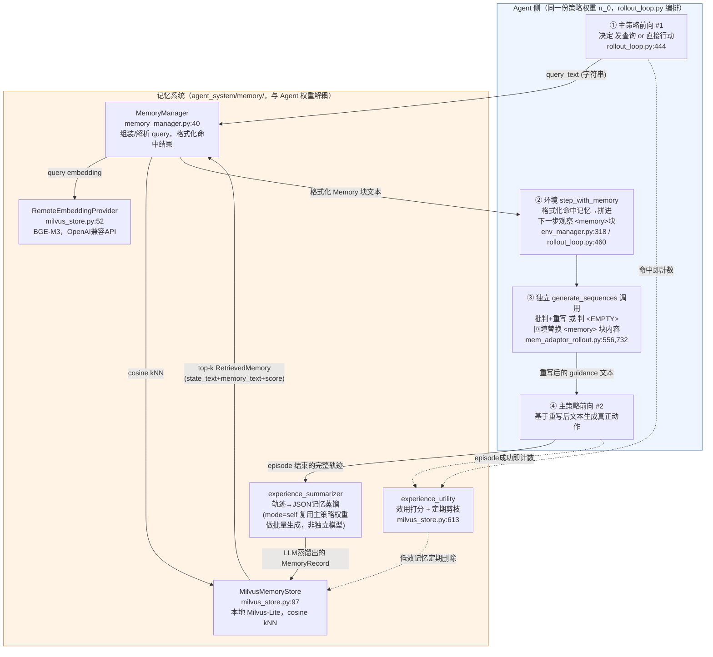

# MemHarness 代码架构

> 调研对象：`/Users/guanhongli/Documents/repo/MemHarness`（官方 KnowledgeXLab/MemHarness，克隆时 HEAD=31329e8）。
> 核心目录：`agent_system/memory/`（存储/检索/摘要/效用引擎）、`agent_system/multi_turn_rollout/`（rollout 主循环）、
> `agent_system/environments/`（env 与 memory 系统的粘合层）、`agent_system/reward_manager/`（format reward）、
> `verl/trainer/config/ppo_trainer.yaml`（全部默认参数）。
> 本文档只读源码写出，不采信 README 的表述作为结论依据（有出入处见第 6 节）。

## 1. 一句话机制

MemHarness 的"记忆系统"是一个本地 Milvus-Lite 向量库 + LLM 蒸馏摘要器 + 效用打分剪枝器（都在 `agent_system/memory/`），
它只负责"存"和"粗召回"；真正让论文标题成立的"批判+重构"这一步，是 agent 侧的策略权重在检索命中之后、
真正生成动作之前，**额外插入的一次独立批量 `generate_sequences` 前向调用**（`agent_system/memory/mem_adaptor_rollout.py:556` 的
`maybe_apply_memory_adaptor`），它把刚取回的原始记忆文本原地重写或整体丢弃，回填进下一步的观察文本，
之后策略才做第三次（对该 episode 而言）前向生成真正的环境动作。三件事——决定要不要查、重写记忆、生成动作——
在工程上是三次互相独立、各自 tokenize/detokenize 的模型调用，不是一次生成内部的多阶段输出。

## 2. 记忆是怎么存进去的

**触发时机**：只在训练态（`is_train=True`）的 rollout 收集完一整批 episode 之后写回，验证/测试轨迹不写回，
避免评测任务泄漏进训练用的记忆库（`agent_system/multi_turn_rollout/rollout_loop.py:604-605` 的
`if is_train: envs.maybe_write_rollout_memories(...)`，该函数在 `agent_system/environments/base.py:211-214` 直接转发给
`MemoryManager.maybe_write_rollout_memories`，其实现在 `agent_system/memory/memory_manager.py:458`）。
默认配置 `write_back: False`（`verl/trainer/config/ppo_trainer.yaml:414`），两个训练脚本
`run_scripts/train_alfworld.sh` / `train_webshop.sh` 都显式把 `MEMORY_WRITE_BACK=True` 传成
`env.memory.write_back`，即论文实验实际是开着写回的。

**存的是什么**：不是原始 trajectory 文本，也不是图/结构化状态，是策略自己用 LLM 从完整轨迹里蒸馏出的
**"situation + memory" 两段自然语言**（compact schema 的系统提示词见
`agent_system/memory/experience_summarizer.py:96` 起的 `DEFAULT_COMPACT_JSON_SYSTEM_PROMPT`，
用户模板见 `experience_summarizer.py:107` 起的 `DEFAULT_COMPACT_JSON_TRAJECTORY_USER_PROMPT_TEMPLATE`）。落库的一条记录（`MemoryRecord`，字段定义在
`agent_system/memory/types.py:12-29`）同时保留 `state_text`（历史情境，对应蒸馏出的 situation，
取不到时用占位符 `MEMORY_STATE_UNAVAILABLE_PLACEHOLDER`，`types.py:9`）、`action_text`、
`memory_text`（可复用原则）、`reward`/`success`（该轨迹的结局）以及一个初始效用分。

**存的过程调不调 LLM**：调用。默认 `experience_summarizer.mode=self`：复用**同一份 actor rollout 权重**，
把待蒸馏轨迹批量喂给 `actor_rollout_wg.generate_sequences` 生成 JSON（`experience_summarizer.py:785` 的
`_summarize_batch_self`）；也支持 `mode=teacher`，走独立的 OpenAI 兼容 HTTP API 做蒸馏
（`experience_summarizer.py:659` 的 `_summarize_batch_teacher`），两个训练脚本用的都是 `self`。
JSON 解析失败会在 `parse_max_attempts`（默认 3）次内重试同一条轨迹
（`experience_summarizer.py:1154` `maybe_summarize_and_write_experiences` 内的 while 循环）。

**采样与去重（不是来者不拒）**：
- 一次 rollout 只对 `grpo_summarize_keep_fraction`（默认 0.5，`ppo_trainer.yaml:427`，与论文 Appendix A.3
  "retain only 50% of the trajectories" 一致）比例的轨迹做蒸馏，且优先按成功/失败**均衡**采样
  （`experience_summarizer.py:490` `_select_env_indices_balanced_success_fail`，配额不够时按 GRPO group 补齐随机样本）。
- 写入前做最近邻探测去重：若新记录 `memory_text` 向量与库内已有条目余弦相似度 ≥
  `memory_text_insert_dedupe_similarity_threshold`（基础默认 0.85，`ppo_trainer.yaml:488`），直接跳过插入
  （`agent_system/memory/milvus_store.py:296-317` `_neighbor_has_similar_memory_text` + `add_records` 内的判断逻辑，
  `add_records` 定义于 `milvus_store.py:320`）。`train_alfworld.sh` 把这项显式设为 `null`（关闭），
  `train_webshop.sh` 未覆盖、维持默认 0.85（开启）——即两个 benchmark 用的不是同一套去重策略。

**存储后端**：本地单文件 Milvus-Lite（`agent_system/memory/milvus_store.py:97` `MilvusMemoryStore`，
`db_path` 是进程本地磁盘文件），18 个标量/向量字段的 flat schema
（`milvus_store.py:785` `_create_collection`），向量字段用 `FLAT` 索引 + `COSINE` 度量。
Embedding 由远端 OpenAI 兼容接口提供（`milvus_store.py:52` `RemoteEmbeddingProvider`，默认模型
`bge_m3`、维度 1024，`ppo_trainer.yaml:475-476`），本地进程不跑 embedding 模型本身。
每条新记录的初始效用分是 Laplace 平滑先验 `(0+1)/(0+2)=0.5`
（`agent_system/memory/experience_utility.py:14` `compute_utility_score`、:30 `initial_utility_metadata`）。

## 3. 记忆是怎么被用起来的

**触发时机**：`env.memory.retrieval_mode` 基础默认是 `fixed`（每次观察都无条件检索一次，
`ppo_trainer.yaml:389`），但两个训练脚本都显式覆盖成 `agentic`（`train_alfworld.sh` / `train_webshop.sh` 内
`RETRIEVAL_MODE="agentic"`），即论文实验用的是"策略自己决定要不要查"。agentic 模式下，策略在某一步的响应里
输出 `<memory_retrieve>查询文本</memory_retrieve>`（真实生效的标签常量见 `ppo_trainer.yaml:517-518`），
由 `MemoryManager.extract_query`（`agent_system/memory/memory_manager.py:389`）用正则抽出；这一步**不算环境动作**，
下一步的观察里才会带着取回的记忆——AlfWorld 侧实现见 `agent_system/environments/env_manager.py:318` 的
`AlfWorldEnvironmentManager.step_with_memory`（WebShop 的同名方法在同文件 `env_manager.py:734` 前后，
逻辑一致）。默认 `count_query_as_step: True`（`ppo_trainer.yaml:465`），这一步仍会计入该 episode 的
`max_steps` 预算。

**拿什么去找**：把策略自己写的 query 文本送去 embedding，与库内 `retrieve_key` 指定字段
（默认 `memory_text`，`ppo_trainer.yaml:478`）的历史向量做纯 cosine 相似度检索
（`milvus_store.py:383` `retrieve`），没有关键词/BM25 混合，也没有二次 rerank 模型。默认检索宽度
`top_k=3`（`ppo_trainer.yaml:480`），命中项按 `min_score`（默认 0.0）过滤，若配了
`memory_text_retrieval_dedupe_similarity_threshold`（基础默认 0.85，`ppo_trainer.yaml:486`）还会在候选池里
对 `memory_text` 向量做贪心去重后再截断到 `top_k`（`milvus_store.py` `retrieve` 内的去重分支，算法实现在
`agent_system/memory/memory_text_dedupe.py` 的 `dedupe_indices_by_embedding_similarity`）。检索默认**不**限定
只查成功轨迹（`only_successful: False`，`ppo_trainer.yaml:482`；`milvus_store.py:410` 的
`search_kwargs["filter"] = "success == true"` 只有该开关为真才会生效）。

**一步到位还是多步迭代**：**三次相互独立的模型前向**，不是一次生成里连续吐出"检索决定→重构→动作"。

1. 主策略（`actor_rollout_wg`）第一次前向，决定这一步是发 `<memory_retrieve>` 查询还是直接
   `<action>`（`agent_system/multi_turn_rollout/rollout_loop.py:444` `actor_rollout_wg.generate_sequences(batch_input_padded)`）。
2. 若触发了检索，环境把命中的记忆格式化成 `"--- Memory k ---\nSituation: ...\nPrinciple: ..."` 块
   （`memory_manager.py:535` `_format_memory_prompt`），拼进下一步观察文本的 `<memory>...</memory>` 标签
   （`agent_system/environments/base.py:217` 的 `_append_external_memory`）。这一步产出发生在
   `rollout_loop.py:460` 的 `envs.step_with_memory(...)` 内部，**尚未调用策略**。
3. 若 `mem_adaptor.enable=true`（两个训练脚本都显式开着，`train_alfworld.sh:255`），在主策略真正看到这个新观察
   之前，会先跑一次**独立的、批量的** `generate_sequences` 调用（`rollout_loop.py:552`
   `maybe_apply_memory_adaptor(...)` → `mem_adaptor_rollout.py:732` `out_pad = wg.generate_sequences(dp_pad)`），
   专门做"批判 + 重写"：把 `<memory>` 块内容原地替换成重写后的 guidance，或判定为不适用时输出
   `<EMPTY>`、整块删掉换成兜底提示语（`mem_adaptor_rollout.py:494` `_patch_one_obs_text`，
   触发条件 `on_memory_only`——只有真的检索到东西才会跑这一步，见 `mem_adaptor_rollout.py:192`
   `_should_run_adaptor_for_index`）。这次调用默认**是否复用主策略权重**由
   `mem_adaptor.use_actor_rollout_wg` 决定，两个训练脚本都设为 `True`（`train_alfworld.sh:256`），
   同时 `train_memory_adaptor=false`（`train_alfworld.sh:257`）表示不单独训练它——即论文实验里
   "重构" 用的确实是同一份权重，但只是众多可配置项里被选中的一种（详见第 6 节）。
4. 主策略对这个"已经被重写过"的观察做第二次真正的决策前向，生成可执行动作。

检索宽度 `top_k=3`，但送进重构 prompt 的默认只取最相关的 `retrieval_top_k=1` 条（`ppo_trainer.yaml:557`），
即便检索到 3 条，也只有第一条会被拿去做批判重写。

**效用反馈闭环**：每次某条记忆被检索命中，`utility_use_count` +1；所在轨迹后续判定成功，
`utility_succ_count` +1（`agent_system/memory/experience_utility.py:39` 的 `collect_memory_ids_from_info_list`
与 `experience_utility.py:59` 的 `episode_success_from_batch`，由 `memory_manager.py:254` 的
`_apply_retrieval_utility_updates` / `memory_manager.py:279` 的 `_apply_episode_utility_updates` 触发写回）；效用分低于
`prune_score_threshold`（默认 0.3）且用满 `min_uses_before_prune`（默认 3）次的记忆会被定期物理删除
（`milvus_store.py:613` `prune_low_utility_memories`）。

## 4. 架构图

**边界说明**：物理文件位置和概念边界不完全重合——`mem_adaptor_rollout.py` / `mem_adaptor_training.py`
两个文件放在 `agent_system/memory/` 目录下，但它们做的事（用策略权重批判+重写、可选独立 GRPO 训练一个
"重构模型"）属于 **Agent 决策链路的一环**，不是存储/检索引擎本身；上图把它们画在 Agent 侧框内，是按"谁在用
policy 权重做推理/训练"划分，而非按代码所在目录划分。真正意义上"记忆系统自己的"部分只有：向量库
（Milvus-Lite）、embedding 客户端、检索/去重逻辑、蒸馏摘要器的 prompt 与解析逻辑、效用打分与剪枝——
这些不依赖策略权重本身即可独立运作（embedding 服务和 teacher 蒸馏都是外部 API）。

## 5. 我没搞清楚的

- **outcome reward 的 0/10 具体赋值点未验证**：`agent_system/reward_manager/episode.py` 只是消费已经算好的
  `episode_rewards`（来自 `data_item.non_tensor_batch["episode_rewards"]`），真正把"成功=10、失败=0"写进
  `episode_rewards` 的地方在 ALFWorld/WebShop 各自的 env 包装代码里（`env_manager.py:318` 附近调用的
  `self._compute_reward(info, ...)`，来自 `agent_system/environments/env_package/alfworld/envs.py` 的
  `compute_reward`），我没有深入这层确认数值是否硬编码为 10，只在论文 §3.4/A.1 里读到过这个说法（未验证，但与
  reward_model.format_reward 配置的 `weight_outcome=1.0`、`weight_format=0.1` 是吻合的量级关系）。
- **`mem_adaptor.enable=false`（未开重构）时 `retrieval_mode=fixed` 路径是否等价于论文 Table 2 的
  "RL + Raw Memory" / "w/o reconstruction" 消融行**：代码上这条路径确实是纯 replay（`MemoryManager.build_memory_message`
  直接把 `_format_memory_prompt` 结果拼进观察，不经过 adaptor），但仓库里没有找到与该消融行一一对应的独立脚本，
  只能推断是靠改 CLI 参数临时跑的，没有直接证据核实两者严格对应。
- **Milvus-Lite 在多进程/多 Ray worker 并发写入时的一致性未验证**：仓库内没搜到锁/事务相关代码，训练时多个 rollout worker 是否会写入同一个 `milvus_memory.db` 文件而产生竞态，未验证。
- **`MemHarness/agent_system/local_service.py`、`memory_fastapi.py`、`remote_slurm_launcher.py`**
  三个文件本次未深入读（HTTP/Slurm 部署相关，与"记忆的存/取机制"本身关系不大），只看了文件名和被
  `memory_store.py` 引用的方式（`RemoteHTTPMemoryStore` 走 HTTP backend），细节未核实。

## 6. 与论文的冲突点

1. **检索标签词序相反**：论文里出现该标签的所有位置——正文 §3.4"with `<retrieve_memory>` block"、
   Appendix A.2"valid `<retrieve_memory>...</retrieve_memory>` blocks"、Figure 5/6（ALFWorld/WebShop 系统提示词）
   "wrapped by `<retrieve_memory>` and `</retrieve_memory>` tags"、Figure 9（轨迹摘要提示词）
   "Do not copy raw `<think>`, `<action>`, or `<retrieve_memory>` text"——统一写的是 `<retrieve_memory>`。
   但代码里唯一真正生效、且被训练时的正则解析/格式奖励/摘要提示词共同使用的常量是
   `retrieval_query_open_tag: "<memory_retrieve>"` / `close_tag: "</memory_retrieve>"`
   （`ppo_trainer.yaml:517-518`），这个词序在 `agent_system/memory/prompt_defaults.py`、
   `experience_summarizer.py:96` 起的 `DEFAULT_COMPACT_JSON_SYSTEM_PROMPT`里，第 `104` 行写的也是
   "`Do not copy raw <think>, <action>, or <memory_retrieve> text.`"）、`mem_adaptor_rollout.py` 里判定"模型是否又吐出了协议标签"的正则
   （`r"<\s*(?:redacted_thinking|action|memory_retrieve|memory)\b"`）中全部一致。
   **以代码为准**：真实训练/评测时模型要输出、代码要解析的标签是 `<memory_retrieve>`，
   论文所有 Figure 和正文写反了词序。

2. **"unified policy" 是训练脚本选的一种配置，不是代码唯一实现**：论文 §3.2 明确写
   "Both stages share the unified policy πθ"，通篇没有提及其他可能性。但代码里
   `mem_adaptor.use_actor_rollout_wg` 基础默认值是 `false`（`ppo_trainer.yaml:556`，注释写
   "false -> second Role on mem_adaptor_pool"），配上 `train_memory_adaptor: true` 就会启动一个
   **独立的、单独用 GRPO 训练的 MemAdaptor 模型**（整份 `agent_system/memory/mem_adaptor_training.py`
   都是为这条路径写的：独立 WorkerGroup、独立 KL 锚点、独立奖励塑形）。只是论文对应的两个训练脚本
   （`train_alfworld.sh:256-257`、`train_webshop.sh` 同款参数）都手动把 `use_actor_rollout_wg` 覆盖成 `True`
   且关掉 `train_memory_adaptor`，实验结果才真正落回"同一份权重"。即论文强调的"unified"设计只是代码提供的
   配置空间里被选中的一支，代码本身把"重构"设计成了一个可插拔、可与主策略解耦训练的独立模块，这一点论文未提。

3. **"critique→reconstruct→act"在工程上是拆开的多次前向，不是单次生成的连续输出**：论文 Eq.(4)(6)
   形式上已经写成两个采样步骤（`gt~πθ(xrecon)` 和 `at~πθ(T,ht,g̃t)`），但摘要与正文反复用
   "a unified policy model critiques the retrieved experience ... reconstructs it ... and only then acts"
   这种连续动作的语言，容易让读者以为是一次前向内部的多阶段隐藏输出（类似一次生成里先输出批判再输出动作）。
   代码里这确实是两次完全解耦的 `generate_sequences` 调用（`mem_adaptor_rollout.py:732` 重构一次，
   `rollout_loop.py:444` 的下一轮循环再单独一次生成动作），中间经过完整的 detokenize→拼接观察文本→
   重新 tokenize，各自有独立的 prompt/KV cache，且重构这一次调用默认**不算作**该 episode 的
   `env.max_steps` 步数消耗（它发生在两次真正的环境交互 step 之间）。论文没有在方法部分明确这是
   "两次独立采样" 还是 "一次前向内部输出两段"，只有公式暗示了拆分，容易被正文语言误导。
