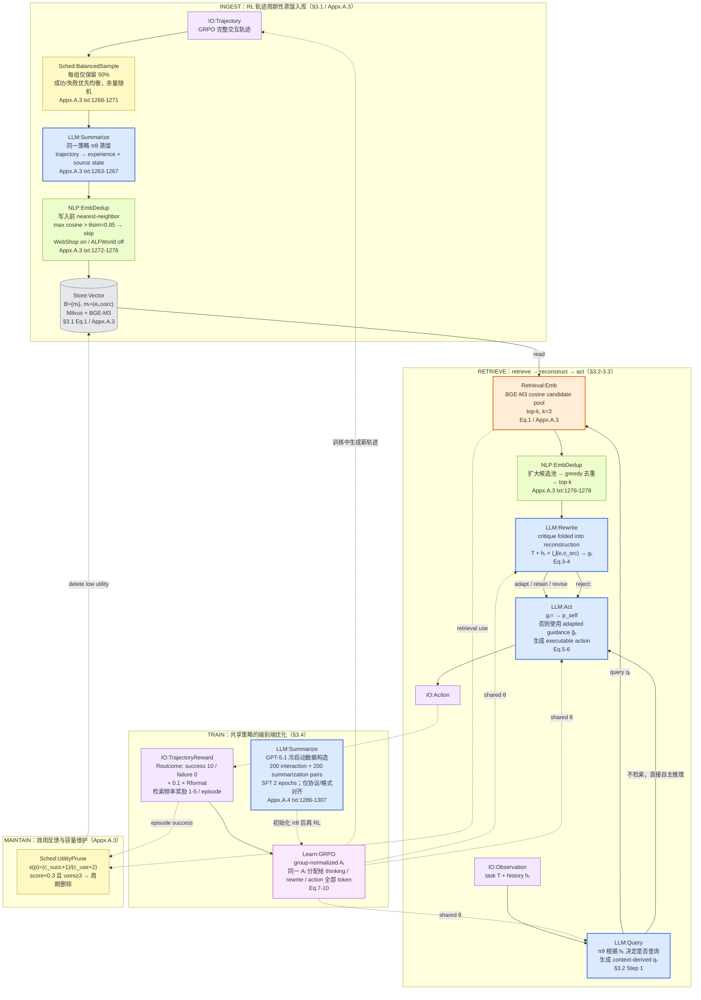
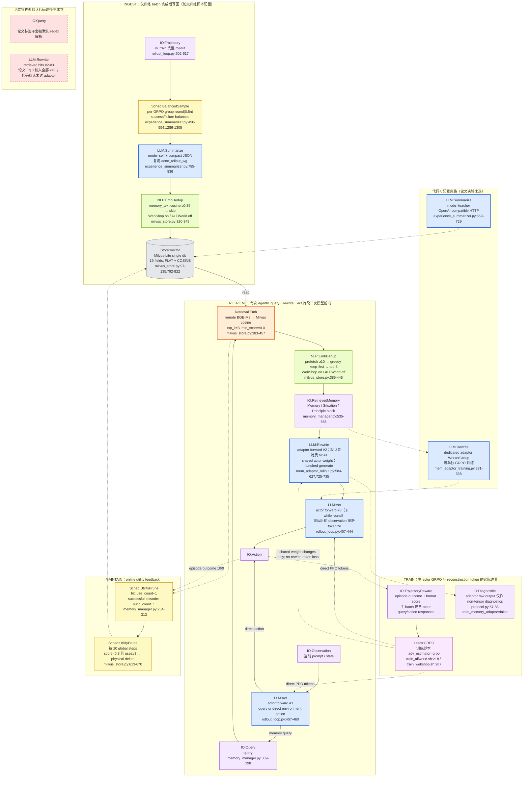

# MemHarness methodology 流程图

> [!note] 来源与采信顺序
> 基于同目录 [[paper-architecture]] 与 [[code-architecture]]，并已吸收 [[verification]]（2026-09-05，论文 39 条 + 代码 59 条逐条核验）的全部修正。凡 architecture 与 verification 冲突，以 verification 为准。关键勘误：冷启动 SFT 前置、agentic/“at each step”表述张力、generic LLM 明确是 zero-shot、summarizer 基础默认 `none`、Milvus 为 19 字段、零命中 fallback 仍可能触发 adaptor，以及论文实验代码未把 reconstruction completion token 直接纳入主 actor GRPO。统一词汇表见 `METHODOLOGY-FLOW-SPEC`。

## Paper 视角

Wu et al. 2026, *MemHarness: Memory Is Reconstructed, Not Replayed*, arXiv:2607.28272v1。

![[assets/memharness-paper-flow.png]]

### 核验真源



> [!warning] 论文内部张力
> §3.2 与 Fig.5/6 prompt 都是 agentic 条件触发：策略认为需要时才生成 query（txt:186-188,1365-1369,1417-1421）；Appendix A.3 却写 top-k experiences are retrieved “at each step”（txt:1260-1262）。上图按方法主链画 `LLM:Query` 条件门，不能把 Appendix 这句提升为明确的 fixed 模式。

> [!note] 论文侧边界
> 记忆 bank（显式、可追踪）与策略内 state-conditioned reconstruction（参数化、共享 `θ`）通过 `q_t`/`E_t` 文本对象交换信息。critique 没有独立输出节点：论文明确说它 folded into reconstruction（txt:181-185），唯一可观察结果是 adapted `g_t` 或 `<EMPTY>`。

## Code 视角

repo `~/Documents/repo/MemHarness` @ `31329e8`。主图画的是 `run_scripts/train_alfworld.sh` / `train_webshop.sh` 对应论文实验的**生效配置**，不是 `ppo_trainer.yaml` 的开箱默认。

![[assets/memharness-code-flow.png]]

### 核验真源



> [!warning] 开箱配置退化
> `ppo_trainer.yaml` 默认 `memory.enabled=false`、`write_back=false`、`experience_summarizer.mode=none`、`mem_adaptor.enable=false`，同时 `retrieval_mode=fixed`（`:387-419,553-557`）。因此直接使用基础配置时整套论文方法基本关闭；必须由两份训练脚本覆盖成 memory/writeback/adaptor on、summarizer self、retrieval agentic，才得到主图路径。

> [!warning] benchmark 分叉与无检索通道
> ALFWorld 脚本同时关闭写入与检索 `NLP:EmbDedup`（`train_alfworld.sh:134-136`）；WebShop 沿用 0.85。记忆子系统只有 dense cosine 路径，**没有 `Retrieval:BM25`，也没有 reranker**；WebShop 商品搜索引擎虽使用同类稀疏排序算法，但与记忆 bank 无连接。

> [!warning] no-hit 退化行为
> `schedule=on_memory_only` 名称会误导：零命中时 `MemoryManager` 注入 `empty_retrieval_message`，其文本非空，adaptor 仍会创建 `s_old="" / p_old=""` 的 job 并调用 `LLM:Rewrite`（`memory_manager.py:431-440`；`mem_adaptor_rollout.py:634-645`）。这与论文 Eq.5 直接进入 `p_self` fallback 的抽象不完全一致。

> [!warning] Reconstruction token 未直接进入论文实验的 GRPO loss
> 两训练脚本都设置 `train_memory_adaptor=false`。adaptor completion 只经 `write_mem_adaptor_step_non_tensor_batch` 写成诊断字段（`protocol.py:67-88`），主 actor 的 PPO batch 仍由每个环境 round 原始 `responses` 聚合（`rollout_loop.py:300-332,570-575`）。因此共享 actor 权重成立，但论文 Eq.7-10 所说的 reconstruction token 与 action token 同享 `A_i` 在这条代码路径上没有直接实现；`LLM:Rewrite` 只会间接受主 actor 参数更新影响。

> [!note] 调用次数口径
> “三次前向”只适用于一次成功触发的 query→rewrite→act **片段**：主 actor 先生成 query，adaptor 独立生成 guidance，下一轮主 actor 再生成 action。一个 episode 可包含多个普通 action 和多次检索，不是固定总共三次模型调用。写回阶段另有一次或多次 `LLM:Summarize` batch 调用与失败重试。

## 新登记 module

| module | 类别 | 理由 |
|---|---|---|
| `IO:Trajectory` | IO | 完整 episode/rollout 轨迹是 MemHarness 写回与 GRPO 的共同输入粒度；区别于已登记的 turn-pair/session。 |
| `IO:Observation` | IO | 交互环境的当前观察与历史窗口输入；MemHarness 是否检索由这一粒度触发。 |
| `IO:Action` | IO | 输出是环境可执行 action，不是自然语言 answer；避免把 agent-control 系统画成问答系统。 |
| `IO:TrajectoryReward` | IO | episode 级 outcome+format reward，直接驱动 GRPO 的共享 token credit。 |
| `IO:RetrievedMemory` | IO | 检索结果在代码中被格式化成 Memory/Situation/Principle 文本块，是 store 与 adaptor 的显式交换对象。 |
| `IO:Diagnostics` | IO | 不参与模型 loss 的运行诊断字段；本系统用于明确区分 adaptor raw output 与可训练 response tensor。 |
| `LLM:Query` | LLM | 同一策略主动生成 memory query；不是 embedding retrieval 本身，也不是规则 scheduler。 |
| `LLM:Act` | LLM | 策略生成环境 action；与 `LLM:Answer` 区分，便于跨交互式 agent benchmark 对齐。 |
| `NLP:EmbDedup` | NLP | 对 memory_text embedding 做阈值/greedy 去重；不同于 `NLP:HashDedup` 的精确哈希，也不同于 `Retrieval:Emb` 的相关性召回。 |
| `Sched:BalancedSample` | Sched | 在 GRPO group 内按成功/失败分层保留 50% 写回候选，属于入库调度而非抽取。 |
| `Sched:UtilityPrune` | Sched | 根据使用/成功计数的 Laplace 效用定期物理删除，区别于窗口型 `Sched:Evict`。 |
| `Learn:GRPO` | Learn | 论文定义的 group-normalized trajectory advantage 优化模块；paper 图覆盖 query/rewrite/action，code 图按实际 tensor 边界区分直接训练与共享权重的间接影响。 |

已直接复用：`LLM:Summarize`、`LLM:Rewrite`、`Retrieval:Emb`、`Store:Vector`。

## 不确定处

1. **Table 2 raw-memory 消融的精确配置**：静态代码能证明关闭 adaptor 会保留原始 memory block，但仓库没有消融专用命令或日志，无法确认 “RL + Raw Memory / w/o reconstruction” 是否只改 `mem_adaptor.enable`。
2. **Milvus-Lite 多 worker 一致性**：仓库 memory 代码未见显式跨进程 lock；是否由 Milvus-Lite 内部完整处理并发写/utility update，需要压力实验或上游保证。
3. **论文 agentic vs at-each-step**：§3.2 与 Appendix A.3 原文不完全对齐，上图按正文控制流画，未强行消解。
4. **generic LLM reconstruction 输入模板**：zero-shot 已明确，但 prompt、上下文截断和是否接收全部 top-3 未披露。
5. **no-hit adaptor 是否属于作者有意设计**：代码行为明确存在，但缺注释/实验说明，不能判断是预期 fallback refinement 还是控制流遗漏。

## 生图 prompt 素材

### Paper flow prompt

```text
Create a clean horizontal academic systems diagram for “MemHarness — Paper Methodology”. Use a white background, thin charcoal connectors, compact sans-serif labels, no gradients, no decorative artwork, and four aligned swimlanes: INGEST, RETRIEVE, TRAIN, MAINTAIN. Use canonical module labels exactly. Color code: LLM modules blue rectangles, retrieval algorithms orange rectangles, NLP modules green rectangles, schedulers yellow rectangles, stores gray cylinders, learning modules purple rectangles, IO modules pale-purple rounded rectangles. INGEST: IO:Trajectory → Sched:BalancedSample (retain 50%, balanced success/failure) → LLM:Summarize (shared policy) → NLP:EmbDedup (cosine >0.85; WebShop on, ALFWorld off) → Store:Vector (Milvus, BGE-M3, experience + source state). RETRIEVE: IO:Observation → LLM:Query (agentic gate) → Retrieval:Emb (cosine top-3) → NLP:EmbDedup → LLM:Rewrite (critique folded into reconstruction) → LLM:Act → IO:Action; also show the no-query direct path and <EMPTY> → self-reason fallback. TRAIN: IO:TrajectoryReward → Learn:GRPO, with dashed shared-parameter arrows to LLM:Query, LLM:Rewrite, and LLM:Act; add a small LLM:Summarize cold-start SFT node. MAINTAIN: retrieval use and episode success → Sched:UtilityPrune → Store:Vector. Keep citations as tiny secondary labels only: §3.1, §3.2, Eq.1, Eq.3–6, Eq.7–10, Appx.A.3–A.4.
```

### Code flow prompt

```text
Create a matching horizontal academic systems diagram for “MemHarness — Code Methodology”, same exact visual system as the paper diagram: white background, five swimlanes, compact typography, canonical labels, blue LLM rectangles, orange retrieval rectangles, green NLP rectangles, yellow scheduler rectangles, gray store cylinders, purple learning rectangles, pale-purple rounded IO nodes, red dashed dead nodes. Main configuration is the two paper training scripts, not base defaults. INGEST: IO:Trajectory (train only) → Sched:BalancedSample (round 0.5 per GRPO group) → LLM:Summarize (self mode, actor rollout worker, compact JSON) → NLP:EmbDedup (WebShop on, ALFWorld off) → Store:Vector (single Milvus-Lite DB, 19 fields, FLAT/COSINE). RETRIEVE: IO:Observation → LLM:Act forward #1; branch direct to IO:Action or emit IO:Query <memory_retrieve>; then Retrieval:Emb (remote BGE-M3, top-3) → NLP:EmbDedup → IO:RetrievedMemory block → LLM:Rewrite forward #2 (shared actor, only hit #1) → LLM:Act forward #3 in next loop → IO:Action. TRAIN: IO:TrajectoryReward → Learn:GRPO, with direct-token arrows only to the two LLM:Act nodes and a dashed “shared weight only, no rewrite-token loss” arrow to LLM:Rewrite; show adaptor raw output as IO:Diagnostics only because train_memory_adaptor=false. MAINTAIN: hit/use and episode success counters → Sched:UtilityPrune every 20 global steps → Store:Vector. Add a red dashed PAPER-ONLY box containing IO:Query <retrieve_memory> and LLM:Rewrite hits #2–#3. Add a concise warning strip: base config disables memory, writeback, summarizer, and adaptor; no Retrieval:BM25 or reranker; no-hit fallback text can still trigger adaptor. Use tiny code citations such as rollout_loop.py:444/552/602, protocol.py:67, ray_trainer.py:1888, milvus_store.py:383/792, experience_summarizer.py:490/785, mem_adaptor_rollout.py:634/732.
```
