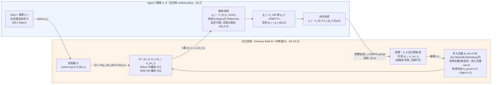

# MemHarness 论文架构

> 调研对象：`Wu, R. et al. "MemHarness: Memory Is Reconstructed, Not Replayed." arXiv:2607.28272`
>（全文见 `/Users/guanhongli/Documents/wafo-base/literature/papers/Wu-2026-MemHarness.txt`）。
> 本文档只依据论文正文与 Appendix 的文字/公式/图表写出，不采信代码实现；与代码有出入处见
> 同目录 `code-architecture.md` 第 6 节，本文件第 6 节只列"论文自己没写清楚的地方"。

## 1. 一句话机制

人类回忆是"重构的"而非"复现的"（§1 引用认知科学 [11]）：MemHarness 让同一个策略模型 πθ 在
"取回历史经验"和"生成当前动作"之间显式插入一次"批判并重写"，把抽象、过时的历史经验改写成
贴合当前状态的 guidance（或判定不适用后回退到自主推理），这个批判/重写能力没有人工标注，
完全靠 GRPO 端到端优化任务成功率隐式学会（摘要；§3.2；§3.4）。

## 2. 记忆是怎么存进去的

**论文对记忆库的定义**：memory bank `B = {mi}_{i=1}^N`，每条 `mi = (ei, osrc_i)` 是一个二元组——
`ei` 是抽象出的策略/经验（natural-language experience），`osrc_i` 是它的来源观察（source observation），
用于重构阶段比较"历史状态 vs 当前状态"（§3.1，Eq.1 前的定义段）。存的**不是**原始轨迹全文，
也不是图像/结构化状态，是策略自己蒸馏出的自然语言经验 + 其来源状态两段文本。

**什么时候触发存入**：§3.1 原文"The agent maintains a memory bank B ... by **periodically** distilling
collected trajectories into natural-language experiences"——只说"periodically"（周期性），没有给出
具体周期（多少训练步一次、每个 rollout batch 一次，还是别的粒度，未写明，见第 5 节）。
§4.1"Memory Configuration"补充："The experiential memory bank is initialized as empty and progressively
populated **during RL training** with memory principles summarized by the policy from its own interaction
trajectories"——即记忆库从空开始，随训练在线增长，不是提前人工构建好的静态库。

**存的过程调不调 LLM**：调。Appendix A.3"Memory Initialization"："the policy model πθ distills successful
and failed trajectories into concise natural-language principles paired with its source interaction state
`osrc_i`, which are then inserted into B"——即蒸馏用的正是同一个正在训练的策略模型 πθ 自己，
不是外部独立的摘要模型。

**采样策略（不是所有轨迹都存）**：Appendix A.3："To ensure the efficiency of the pipeline, we retain only
50% of the trajectories generated during the GRPO process for distillation. Specifically, we prioritize a
balanced retention of successful and failed trajectories; when such a balance cannot be achieved, the
remaining quota is filled by randomly sampling from the leftover trajectories." ——即只保留一半轨迹用于蒸馏，
优先保证成功/失败均衡，配额不够时随机补齐。

**去重与剪枝（Appendix A.3"Deduplication and Pruning"），三阶段**：
1. **写入时去重（Write-time deduplication）**："before inserting a new memory entry, we perform an
   embedding-based nearest-neighbor probe; if its maximum cosine similarity to any existing entry exceeds
   the threshold `θsim`（default 0.85）, the insertion is skipped." 论文明确写"In practice, we enable it for
   WebShop and disable it for ALFWorld"——两个 benchmark 用的去重策略不同。
2. **检索时去重（Retrieval-time deduplication）**："we first retrieve a larger candidate pool from bank,
   then apply greedy embedding-based deduplication before truncating to the top-k results"。
3. **容量与质量维护**：借鉴 EvolveR（[27]）式 Laplace 平滑效用分
   `s(p) = (c_succ(p) + 1) / (c_use(p) + 2)`，定期剪枝分数低于 `θprune`（默认 0.3）且已被检索满
   `min_uses_before_prune`（默认 3）次的条目。

**向量化与后端**：用 BGE-M3（[34]）编码存入条目（§4.1："We use BGE-M3 as the embedding model to encode
both the retrieval query qt and the stored entries"），后端是 Milvus 向量数据库（[37]，Appendix A.3：
"we implement the memory store B as a vector database using Milvus for efficient similarity search"）。

## 3. 记忆是怎么被用起来的

**什么时候触发**：§3.2 Step 1（Retrieval）："At step t, the agent **decides whether to query** the
experiential memory bank B based on `ht`. If triggered, retrieval returns relevant experiences `Et`,
which are reconstructed rather than directly added to the action context." ——论文里检索触发的方式只描述了
一种：由 agent 自己根据当前历史窗口 `ht` 决定是否查询，通篇没有出现"每一步都强制检索"这类替代模式的讨论
（是否存在这种模式、论文实验是否用过，未写明，见第 5 节）。

**拿什么去找**：Eq.1 `Et = R(qt, B), |Et| = k`——用"a context-derived query `qt`"检索，检索器 `R` 返回
top-k 条经验。§4.1 补充具体数值："we retrieve the top-3 most relevant principles"（k=3），用 BGE-M3
编码 query 和库内条目，按余弦相似度（Appendix A.3 "based on cosine similarity"）。

**一步到位还是多步迭代**：论文把"记忆引导决策"形式化为五阶段（§1）：
`观察 → 检索 → 批判(critique) → 重构(reconstruction) → 动作`，但落到具体 pipeline（§3.2）时明确收缩成
**三阶段**："its inference pipeline comprises three stages: retrieval, contextual memory reconstruction,
and action generation. These three stages instantiate the five-stage formulation in Section 1: the history
window `ht` serves as the environment observation, **and memory critique is folded into the reconstruction
stage**。"——即"批判"没有被实现为一个独立可观测的步骤，而是被合并进"重构"这一步内部。

数学上是两次采样，都由同一个 policy 完成（Eq.2/4/6）：

```
xrecon = T ⊕ ht ⊕ ⋃_{i=1..k} (et,i, osrc_t,i)      (Eq.3, 拼接任务描述+历史窗口+k条"经验,来源状态"对)
gt      ~ πθ(· | xrecon)                            (Eq.4, 第一次采样：批判并重构，输出guidance)
g̃t      = pself  若 gt = <EMPTY>；否则 = gt          (Eq.5, 若判定不适用则回退到自主推理指令)
at      ~ πθ(· | T, ht, g̃t)                         (Eq.6, 第二次采样：基于重构后guidance生成可执行动作)
```

§3.2 原文明确点出这是"共享同一策略"而非两个模型："MemHarness thus separates reconstruction from action
generation **while implementing both with a unified policy**。"

**找到之后怎么交给模型**：不是把 `Et` 原始文本直接拼进动作生成的 prompt——而是先喂给同一个 policy
做 Eq.3-4 的重构，产出 `gt`（或 `<EMPTY>`），再把处理过的 `g̃t` 连同任务描述 `T`、历史窗口 `ht` 一起喂给
同一个 policy 生成动作（Eq.6）。§3.3 用一句话概括了这个设计的目的："By comparing each source observation
with the current context represented by `ht`, the policy identifies state shifts and retains, revises or
rejects the retrieved experience to produce context-specific guidance。"

**训练信号**：`gt` 没有 ground-truth 标注，论文把它当作**隐变量**（latent reasoning process），
不单独监督，只用 episode 级别的任务奖励做端到端 GRPO 优化（§3.3 末句；§3.4）。
奖励 `R(τi) = Routcome + 0.1 × Rformat`（§3.4"Reward Design"），`Routcome` 是稀疏结局奖励
（成功 10，失败 0），`Rformat ∈ [0,1]` 按三项标准加权（是否恰好一段合法 `<think>`+`<action>`、
记忆检索频率是否合理、是否严格英文输出），轨迹级别的组归一化优势 `Ai`（Eq.7）被同等分配给该轨迹里
"思考、重构、动作生成"的**所有 token**（§3.4"The trajectory-level advantage Ai is assigned to all tokens
in τi, providing shared credit to thinking process, reconstruction and action generation."）——
即重构这一步和真正的动作生成，在 GRPO 更新时拿到的是同一个轨迹级别的优势值，没有分别计算的信用分配。

## 4. 架构图



**边界说明**：论文自己划的边界很清楚——"显式、可检视的记忆库"（explicit, attributable memories，§1）
是一侧，"参数化的状态相关重构"（parameterizing their state-conditioned critique and reconstruction within
a single policy，§2.2）是另一侧，两者靠 `qt`（查询）与 `Et`（取回的经验+来源状态对）这两个文本对象
交换信息。论文没有讨论重构这一步在工程上是否需要单独一次模型调用、是否和动作生成共享一次前向——
这些属于实现细节，方法部分只用采样记号（`~`）表示了两次独立分布采样。

## 5. 我没搞清楚的

- **格式奖励"三个标准"与实际列出四条准则数字对不上**：正文 §3.4 说"The format score `Rformat` ∈ [0,1]
  equally weights **three criteria**: (1) exactly one valid `<think>` and `<action>` block per step,
  (2) appropriate memory retrieval frequency ... (1 to 5 times per episode), and (3) strict English output."
  这里其实是三条。但 Appendix A.2 复述时写成"The format score equally weights three criteria:
  (1) each step contains exactly one valid block followed by one valid `<action>...</action>` block,
  (2) memory is retrieved through valid `<retrieve_memory>...</retrieve_memory>` blocks between one and
  five times per episode, (3) thinking contents are including by one valid `<think>...</think>` block
  and **(4)** all generated content is strictly in English."——同一句话先说"three criteria"，
  后面却编号列到 (4)，且 (1) 疑似脱字（"exactly one valid block followed by"，block 前少了修饰语，
  读起来像是想说"think block"）、(3) 又单独重复了一遍 think block 的要求。两处对同一个奖励的
  criteria 数量描述不一致，本次调研判断这是论文自身的编辑/排版遗留问题，但只依据论文文本无法确定
  "三"和"四"哪个是作者的本意（未验证）。
- **检索频率"1 到 5 次每 episode"是硬约束还是仅为奖励塑形的鼓励项**：这个数字只出现在 §3.4/A.2
  的 format reward 设计段落里，作为"格式奖励要不要给分"的判据之一；论文在 §3.2 描述检索机制本身
  （Step 1、Eq.1）时完全没有提到任何频率上下限，也没说超出这个范围时检索请求会不会被拒绝执行，
  还是仍然正常执行只是不给格式分。两者关系未写清楚。
- **"批判(critique)"阶段是否有可观测的独立产物**：五阶段模型（§1）把 critique 和 reconstruction
  列为两个独立阶段，但 §3.2 说 pipeline 里"memory critique is folded into the reconstruction stage"，
  之后全文（包括 Eq.3-5、§3.3、§4.5 的行为分析）都只讨论 `gt`/`g̃t` 这一个输出，没有给出"批判"本身的
  中间表示或判定量（比如一个显式的"接受/拒绝"标量或文本字段）——读者只能从最终 `gt` 是否等于 `<EMPTY>`
  这一个二元结果反推"批判"发生过，但论文没有明确说这是不是"批判"这一子阶段唯一可观测的痕迹。
- **Table 2"– generic LLM reconstruction"消融的具体实现未说明**：正文只写"Replacing MemHarness's
  internal reconstruction module with a generic instruction-tuned LLM (Qwen2.5-7B-Instruct)"，
  没有说这个替代重构用的是什么 prompt、是否 zero-shot、是否与原策略共享上下文窗口/历史信息，
  无法仅凭论文复现这一行对照实验。
- **记忆蒸馏"periodically"的具体周期未给出数值**：§3.1 和 Appendix A.3 两处都只用"periodically"
  描述蒸馏发生的频率，没有像其他超参数（learning rate、group size、θsim、θprune 等）一样给出具体数字，
  是每个 GRPO rollout batch 结束后一次，还是别的粒度，论文没写。
- **Table 4(a) 的"Random source"消融如何构造未细说**：只写"replacing `osrc` with a mismatched state
  from a random memory"，没说这个"random memory"是从同一个 memory bank 里均匀随机采样，还是有其他约束
  （比如排除与当前任务相关的条目）；Table 4(b) 的 counterfactual probe 在 Appendix B 有详细的生成
  prompt（Figure 10/11）和流程说明，但（a）（b）两组消融所用的探针/样本是否是同一批数据、能否互相印证，
  论文没有明确关联。

## 6. 论文没写清楚的地方

（与第 5 节合并陈述：主要是格式奖励的"三/四条标准"数字不一致、检索频率约束的硬/软性质不明、
"批判"阶段有无独立可观测产物未说明、消融行"generic LLM reconstruction"和"random source"的具体构造
细节缺失、记忆蒸馏的触发周期未给出数值——五处均已在第 5 节逐条列出对应的论文原文与章节定位，
不再重复罗列。这些缺口都是"论文文本本身没写"，不是与代码实现冲突（代码侧对照见
`code-architecture.md` 第 6 节）。)
