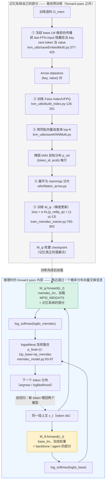

# Memory Decoder at Scale 代码架构

> 调研对象：`/Users/guanhongli/Documents/repo/MemoryDecoder-at-Scale`（官方 LUMIA-Group 仓库，克隆时 HEAD=`bbbbee85`）。
> 术语先说清楚：本仓库里的"memory"不是向量库/笔记库，而是**另一个独立训练出来的 Transformer 语言模型**（下文记作 `M_ψ`，代码里叫 memdec / memory model）。"backbone"/"base LM"是被冻结、不再训练的主干模型（下文记作 `M_θ`）。

## 1. 一句话机制

Memory Decoder 不做运行时检索：它离线训练一个和主干规模相当的独立 Transformer 解码器 `M_ψ`，用 KL 散度让它模仿一个提前算好的 kNN 检索分布（外加正常的下一词预测损失）；推理时 `M_ψ` 和冻结的主干模型 `M_θ` 各自对同一段上文做一次前向传播，把两边输出的下一词概率分布按固定权重线性插值。**"记忆"被蒸馏进了另一份模型权重里，不是存在数据库或向量库里。**

## 2. 记忆是怎么存进去的

这里的"存"完全发生在**训练/继续预训练阶段**，是一次性批处理流水线（不是运行时事件驱动），分 5 步。全程没有调用任何"生成式"LLM 能力——语言模型在这里只被当作**特征提取器**（纯前向传播取隐藏状态）或被当作**被训练的对象**（梯度下降），没有 prompt/生成调用。

**① 建立非参数化 kNN 数据库（datastore）**
- 触发：`scripts/data/save_knn_pipeline.sh` Step 1/3，实际跑 `train_base.py --save_knnlm_dstore`（`scripts/data/save_knn_pipeline.sh:76-88`）
- 存的是什么：对语料每个 token 位置，用**冻结**的 base LM 做一次前向传播，抓取该位置"最后一个 Transformer block 的 FFN（前馈层）输入"这个隐藏向量当 key（float16），下一个真实 token id 当 value。key 类型固定为 `KEY_TYPE.last_ffn_input`（`knn_utils/saveEmbedMulti.py:37`），对 qwen2/qwen3/llama 系列固定读 `model.base_model.layers[-1].mlp` 的输入（`knn_utils/saveEmbedMulti.py:257-284` `model_layer_to_capture` 字典）
- 怎么抓取：不是常规函数调用，是 monkey-patch `model.forward` + 注册 forward hook（`knn_utils/saveEmbedMulti.py:377-415` `KNNSaverMulti.break_into`），用 `ActivationCapturer`（`knn_utils/saveEmbedMulti.py:483`）挂在目标层上，`post_forward_hook`（`knn_utils/saveEmbedMulti.py:419`）里调 `_save_step_data`（`knn_utils/saveEmbedMulti.py:334`）把 key/val 流式写成 Arrow 文件（schema: `keys=float16 list, vals=int32`，`knn_utils/saveEmbedMulti.py:296-312`）

**② 建 Faiss 索引**
- `knn_utils/build_index.py:126` `build_index()`：从①的 Arrow 里抽样（默认最多 100 万条）训练一个 `faiss.IndexIVFPQ`，粗量化器是 `IndexFlatL2`（`knn_utils/build_index.py:177-178`），然后把全部向量顺序 `add_with_ids` 进去（`knn_utils/build_index.py:198`）
- 默认参数：`ncentroids=4096`，`code_size` 脚本默认 64（`scripts/data/save_knn_pipeline.sh:47`）/ CLI 默认 32（`build_index.py`）
- **没有分片、没有 OPQ 降维、没有 HNSW 路由**——单机单索引（见第 6 节冲突点 1）

**③ 用同一批向量做"自查询"，生成 kNN 目标分布**
- `knn_utils/saveKNNMulti.py::KNNSearchMulti.process()`：把①的向量再当 query，去②的索引里搜 top-K（默认 1024，见 `saveKNNMulti.py` argparse 默认）最近邻，`--ignore_first True`（`scripts/data/save_knn_pipeline.sh:158`）丢掉和自己完全重合的最近邻
- 距离转 softmax 概率（`knns_to_probs`, `knn_utils/saveKNNMulti.py:143-153`），再只保留概率 > 阈值（CLI `--threshold`，默认 **0**，见下文冲突点 3）的 token，按概率降序存成新 Arrow（`id_cnt/token_id/prob/label` 四列，`sparsify_distribution`, `knn_utils/saveKNNMulti.py:155-177`）

**④ 展平成训练可读的内存映射分片**
- `utils/flatten_arrow.py`：把③的稀疏 Arrow 转成 `offset.npy / flatten_token_id.npy / flatten_prob.npy / label.npy / shape.json` 的 memmap 分片格式，供训练时随机访问

**⑤ 真正"写入记忆"的一步：训练 `M_ψ`**
- `train_memdec_trainer.py::MemDecTrainer.compute_loss`（L765-802）调 `utils/cal_loss.py::kl_loss_token_memdec_sparse`（`utils/cal_loss.py:47-98`）：
  `total_loss = alpha * kl_loss + (1 - alpha) * ce_loss`（`utils/cal_loss.py:98`），其中 `kl_loss` 是 `Σ p_ret·(log p_ret − log p_ψ)`（`utils/cal_loss.py:94-97`，即 KL(kNN 目标分布 ‖ M_ψ 输出分布)），`ce_loss` 是对真实 next-token 的标准交叉熵（`utils/cal_loss.py:77`）
- `alpha` 默认 0.5（`train_memdec_trainer.py:139` `MemDecArguments.alpha`），经 `memdec_alpha` 传入 `MemDecTrainer`（`train_memdec_trainer.py:701`, `:1213-1224` 附近实例化）
- `M_ψ` 是一个普通 `AutoModelForCausalLM`，从 `model_args.model_name_or_path` 指向的**已有 checkpoint** 继续训练（不是从零初始化，除非显式传 `--from_scratch`）
- 存的不是一条条可读的"记忆条目"：是分布式弥散进 transformer 权重里的统计规律，不可读、不能单独增删查某一条记忆

证据：见上方逐条 `文件:行号`（另见 `scripts/data/save_knn_pipeline.sh`、`scripts/train/train_domain_memdec.sh` 两条 shell 编排脚本，串起①-⑤的调用顺序）

## 3. 记忆是怎么被用起来的

触发：推理/评测阶段，**每一次 next-token 前向传播**（token 级触发，自回归生成时每吐一个字都会走一遍，不是"每次提问"这种粗粒度触发）。

拿什么去找：**完全不检索**。核心是一个融合类 `MemoryDecoder`，代码里有两份彼此独立、逻辑几乎相同的实现：
- `eval/lm-evaluation-harness/lm_eval/models/memdec_model.py:25-97`（供 general/knowledge/FinEval 评测用）
- `eval/opencompass/opencompass/models/memdec.py:22-`（供 BioInst/LawBench 评测用）

以 lm-evaluation-harness 版为例，`forward()`（`eval/lm-evaluation-harness/lm_eval/models/memdec_model.py:64-97`）：
1. 把同一个 `input_ids` 分别喂给 `self.base_lm` 和 `self.memdec_lm` 两个独立模型，各自做一次独立前向传播，各自维护自己的 KV cache（`past_key_values` / `memdec_past_key_values`）
2. 两边各自 `log_softmax` 得到词表分布（`eval/lm-evaluation-harness/lm_eval/models/memdec_model.py:93-94`）
3. 用 `torch.logaddexp` 做加权融合（`eval/lm-evaluation-harness/lm_eval/models/memdec_model.py:95-97`）：
   `logp_joint = logaddexp(logp_base + log(1-λ), logp_memdec + log(λ))`，等价于概率空间的线性插值 `p_final=(1-λ)·p_base + λ·p_memdec`

一步到位还是多步迭代：**一步到位**，没有"检索→重排→再检索"的多轮逻辑。自回归生成（`generate()`，`memdec_model.py` 约 105-171 行）是逐 token 循环，但每个 token 只做一次两模型前向 + 一次融合；只支持贪心解码（`do_sample=True` 会直接报错）。

找到之后怎么交给模型：不存在"交给"这个动作——融合后的分布本身就是最终输出分布，直接 argmax 或用于 `loglikelihood` 打分。

λ（记忆权重）从哪来：`eval/lm-evaluation-harness/lm_eval/models/hf_memdec.py::HFMemDec`（`eval/lm-evaluation-harness/lm_eval/models/hf_memdec.py:90-91` 通过 `@register_model("hf-memdec", "memdec")` 注册进 lm-eval）——可手动指定 `lmbda`，也可以 `lmbda="auto"`（默认，`eval/lm-evaluation-harness/lm_eval/models/hf_memdec.py:114-133`），按 base 模型规模 + memory 模型规模 + 任务名去查一张 288 条组合的 JSON 表（`eval/lm-evaluation-harness/lm_eval/models/memorydecoder_defaults.py::resolve_default_lambda`）。opencompass 一侧（BioInst/LawBench）没有这套 auto 机制，只用固定值（环境变量 `LMBDA`，默认 0.3，`eval/opencompass/configs/eval_bioinst_memdec.py:45`）。

证据：见上方逐条 `文件:行号`

## 4. 架构图

边界说明：虚线框 ONLINE 内部才是一次真正的 "forward pass"；`M_θ` 那一路（黄色）完全是 backbone/agent 的责任，`M_ψ` 那一路（绿色）是记忆系统的责任。**两边只通过两个概率分布向量的加权和交换信息**——没有文本、没有向量检索、没有 embedding 传递，接口极窄。OFFLINE 部分（灰色）在推理时完全不存在，agent 侧永远看不到 datastore/Faiss 索引/kNN 分布这些中间产物，它们只是生产 `M_ψ` 权重的"出厂工序"。

## 5. 我没搞清楚的

- `train_base.py` 里的 `KNNWrapperMulti`（经典 kNN-LM 式在线检索插值，`train_base.py:353`）在当前仓库的 `eval/` 目录下从未被调用，只存在于 `train_base.py --knn` 分支。README 致谢称 datastore 工具和 `train_base.py` "adapted from" 原始 MemoryDecoder 仓库——不确定这段代码是"特意留着复现 vanilla kNN-LM baseline 用"还是纯历史遗留死代码，没找到调用它的脚本或文档说明。标**未验证**。
- `train_memdec_trainer.py` 的 `MODEL_PATH`（初始化 `M_ψ` 的 checkpoint）完全由用户在 shell 脚本里手填，代码本身不校验"是否与 backbone 同规模/同 family"。是否有额外的内部校验脚本未公开，不确定。
- 论文提到 domain memory 训练前要先对 Qwen3-4B-Base 做一轮该领域语料的继续预训练（CPT），但 `scripts/` 目录下没有找到对应的 CPT 训练脚本（`preprocess_text.sh` 只是通用文本预处理，不是模型训练）。这一步可能不在开源范围内，未验证。
- `saveKNNMulti.py` 的稀疏化阈值 `--threshold` CLI 默认是 **0**（即理论上不丢弃任何非零项），`save_knn_pipeline.sh` 也没有覆盖这个参数。不确定实际产出 checkpoint 时用的是不是非零阈值，标**未验证**（这也是第 6 节冲突点 3 的一部分）。
- 没有找到任何名为 "memory bank" 的数据结构、注册表或服务化代码；只看到每次评测手动传一个 `--memdec_path` / `knn_model_path` 参数。是否存在未公开的多记忆切换机制，不确定。

## 6. 与论文的冲突点

1. **最大冲突：分布式 Faiss pipeline 论文有，开源代码没有。** 论文明确描述了一条应对 207B token 级别数据库、避免 O(N²) 构造成本的分布式流水线（OPQ 压缩 4096→256 维、HNSW 量化器学 IVF 分片、按质心区间切成多个 `IndexIVFPQ` 分片、路由+并行 GPU 局部检索+writer 合并）。但开源代码 `knn_utils/build_index.py:126-201` 只实现了单机、不分片的一个 `faiss.IndexIVFPQ`（quantizer=`IndexFlatL2`，无 OPQ、无 HNSW）；`knn_utils/saveKNNMulti.py::_load_faiss_index` 里每个进程都 `faiss.read_index` 加载**同一份完整索引**的拷贝到自己的 GPU（数据并行，不是索引分片/模型并行）。**以代码为准**：当前公开代码只能构建 README Quick Start 描述的"domain 规模"数据库，无法直接复现论文旗舰级 207B-token 通用记忆数据库所需要的分布式工程——这部分要么没开源，要么在未公开的内部代码库里。
2. **术语撞车：代码里的 "alpha" 在两处含义完全不同，分别对应论文里两个不同的希腊字母。** `train_memdec_trainer.py:139` 的 `MemDecArguments.alpha`（默认 0.5，训练损失里 KL 和 CE 的权重）对应的其实是论文的 **β**；而 `eval/lm-evaluation-harness` 里的 `lmbda`/`λ`（推理时插值权重）才对应论文的 **α**。也就是说代码变量名的"alpha"≠ 论文符号的"α"，读代码时如果直接按变量名对应论文公式会把训练阶段和推理阶段两个完全不同的超参数搞混。
3. **kNN 目标分布的稀疏化阈值，代码默认值可能和论文的"压缩比"对不上。** 代码 `saveKNNMulti.py` 的 `--threshold` 默认 0（不丢弃任何非零项），且编排脚本没有覆盖它；如果实际跑的时候确实没传非零阈值，产出的分布就不是论文里说的"只保留概率 > ε 的稀疏分布"。这处到底是脚本/文档遗漏还是训练时另有配置，未验证，但按当前公开代码字面读，默认配置下这一步不做真正的稀疏化。
4. **BioInst/LawBench（opencompass）的 λ 选取机制和 lm-evaluation-harness 不统一，论文正文没有提到这种评测框架间的差异。** lm-eval 一侧默认 `lmbda="auto"`，按 288 组合表查值；opencompass 一侧只有一个写死默认值 0.3（可用环境变量覆盖）。两套评测代码"记忆权重怎么定"这件事的工程实现并不一致，但论文叙述层面把所有评测结果放在同一套方法描述下，没有区分。
5. **Key 的精确定义，代码比论文更具体（不算矛盾，但论文文字不足以反推代码选择）。** 代码固定用 `KEY_TYPE.last_ffn_input`——最后一个 transformer block 的 FFN（前馈层）**输入**（即注意力子层输出之后、MLP 之前的残差流），这是原始 kNN-LM（Khandelwal et al. 2019）论文里验证过效果最好的取法之一。读代码才知道具体是哪个子层的哪个位置。
