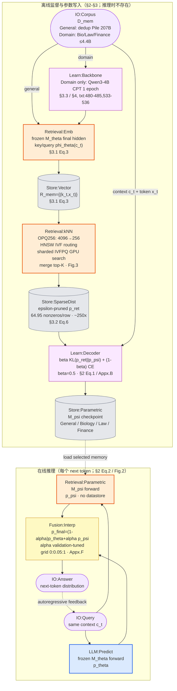

# Memory Decoder at Scale methodology 流程图

> [!note] 来源与口径
> 基于同目录 [[paper-architecture]] 与 [[code-architecture]]，所有机制、数字和代码锚点已按 [[verification]] 的 75 条断言复核结果修正。参数化记忆不适合硬套“写入/检索”二分，本图按**离线监督与训练 / 在线前向与融合**组织。正文预留最终 PNG；Mermaid 是可 diff、可追溯的核验真源。勘误以 [[verification]] 为准，统一词汇见 [[METHODOLOGY-FLOW-SPEC]]。

## Paper 视角

Wei et al. 2026, *Memory Decoder at Scale: A Pretrained, Parametric Long-Term Memory*, arXiv:2607.27919。核心路径是把 non-parametric kNN retrieval 蒸馏到独立 decoder 权重中：检索只参与离线监督构造，在线推理没有 datastore lookup。

![[assets/memorydecoder-paper-flow.png]]

### 核验真源



> [!note] Paper 侧边界
> - `Retrieval:kNN` 与 `Store:SparseDist` 只存在于 memory pretraining 工厂流程；在线 `Retrieval:Parametric` 是 decoder 前向，不是外部 nearest-neighbor search。
> - 论文的 “memory bank” 只表示选择已训练的 domain-memory checkpoint（§5.3, txt:803-805），未定义 registry/service。
> - Table 9 的 run 级 GPU 数为 64 / 64 / 256（Mem-1.4B / 2.8B / 6.9B），不是所有规模都使用 256 张 GPU。

## Code 视角

repo `~/Documents/repo/MemoryDecoder-at-Scale` @ `bbbfee85`。公开代码实现小规模/领域 target 构造、稀疏训练和在线插值；论文 207B-token 分布式 Faiss 主路径未开源。

![[assets/memorydecoder-code-flow.png]]

### 核验真源



```mermaid
flowchart TB
    classDef llm fill:#dbeafe,stroke:#2563eb,stroke-width:2px
    classDef alg fill:#ffedd5,stroke:#ea580c,stroke-width:2px
    classDef nlp fill:#ecfccb,stroke:#65a30d
    classDef store fill:#e5e7eb,stroke:#6b7280
    classDef io fill:#f3e8ff,stroke:#9333ea
    classDef dead fill:#fee2e2,stroke:#dc2626,stroke-dasharray:5 5
    classDef async fill:#f0fdf4,stroke:#16a34a,stroke-dasharray:4 3
    classDef learn fill:#fae8ff,stroke:#a21caf
    classDef sched fill:#fef9c3,stroke:#ca8a04

    subgraph OFFLINE["离线监督与参数写入（公开代码实路径）"]
        direction LR
        CORPUS(["IO:Corpus<br/>processed DatasetDict<br/>input_ids + labels + dstore_range<br/>README:131-145"])
        EMB["Retrieval:Emb<br/>last block MLP input<br/>shifted next-token value<br/>saveEmbedMulti.py:257-285,334-370"]
        ARROW[("Store:Vector<br/>Arrow keys(float16)+vals(int32)<br/>saveEmbedMulti.py:319-332")]
        BUILD["Retrieval:kNN<br/>build full IndexIVFPQ<br/>IndexFlatL2 · centroids=4096<br/>code_size=64 in launcher<br/>build_index.py:177-200"]
        INDEX[("Store:Vector<br/>single full Faiss index<br/>replicated per process")]
        SEARCH["Retrieval:kNN<br/>self-query top-K=1024<br/>temperature=16 · nprobe=32<br/>ignore first<br/>save_knn_pipeline.sh:145-159"]
        SDIST[("Store:SparseDist<br/>Arrow token_id/prob lists<br/>threshold=0 default<br/>saveKNNMulti.py:143-178")]
        MMAP[("Store:SparseDist<br/>offset/token/prob/label memmaps<br/>flatten_arrow.py:70-180")]
        TRAIN["Learn:Decoder<br/>code alpha=0.5 = paper beta<br/>sparse KL + CE<br/>cal_loss.py:47-99"]
        PARAM[("Store:Parametric<br/>M_psi checkpoint")]

        CORPUS --> EMB --> ARROW --> BUILD --> INDEX --> SEARCH --> SDIST --> MMAP --> TRAIN --> PARAM
        ARROW -->|"same keys as queries"| SEARCH
        CORPUS -->|"dstore_range aligns rows"| TRAIN
    end

    subgraph DEAD["论文宣称但公开代码不存在 / 不可复现"]
        direction LR
        D1["Retrieval:kNN<br/>OPQ256 compression<br/>HNSW routing<br/>centroid-range IVFPQ shards<br/>writer merge"]
        D2["Learn:Backbone<br/>Qwen3-4B domain CPT launcher<br/>paper pre-step; script absent"]
        D3["Store:Parametric<br/>memory-bank registry/service<br/>only explicit checkpoint paths"]
    end

    subgraph ONLINE["在线推理（无 Faiss / datastore）"]
        direction LR
        Q(["IO:Query<br/>same input_ids"])
        BASE["LLM:Predict<br/>base_lm forward<br/>own KV cache<br/>memdec_model.py:73-79"]
        MEM["Retrieval:Parametric<br/>memdec_lm forward<br/>own KV cache<br/>memdec_model.py:80-86"]
        FUSE["Fusion:Interp<br/>log_softmax + weighted logaddexp<br/>memdec_model.py:88-98"]
        OUT(["IO:Answer<br/>argmax / loglikelihood"])

        Q --> BASE --> FUSE --> OUT
        Q --> MEM --> FUSE
        PARAM -.->|"memdec_path"| MEM
        OUT -.->|"next token"| Q
    end

    class BASE llm
    class EMB,BUILD,SEARCH,MEM alg
    class TRAIN learn
    class ARROW,INDEX,SDIST,MMAP,PARAM store
    class CORPUS,Q,OUT io
    class FUSE sched
    class D1,D2,D3 dead
```

> [!warning] 默认退化与运行约束
> - `saveKNNMulti.py` CLI 默认 `threshold=0`，launcher 也不覆盖：输出仍是 K-induced sparse support，但**不会执行论文 Eq.6 的 ε 概率剪枝**。
> - 每个进程读取同一完整 Faiss index（`saveKNNMulti.py:60-61,92-109`），这是 query data parallel，不是论文的 index sharding。
> - `_load_faiss_index()` 在无 GPU/关闭 GPU 时仍返回只在 GPU 分支定义的 `gpu_index`，CPU fallback 会因未绑定局部变量失败（`saveKNNMulti.py:92-109`）。
> - lm-eval 使用 task-aware 288-entry `lmbda=auto` registry；OpenCompass 的 BioInst/LawBench 默认固定 `LMBDA=0.3`，两套评测默认不一致。

> [!note] Code-only 可达但非主流程
> `KNNWrapperMulti` 是经典在线 kNN-LM 插值器，仅由 `train_base.py --knn` 分支可达（`train_base.py:352-361`）；仓内没有 launcher 或正式评测路径调用，README 也未把它列入 Memory Decoder 在线推理方法链，因此不画进主图。

## 新登记 module

| module | 类别 | 理由 |
|---|---|---|
| `IO:Corpus` | 输入输出·淡紫 | 参数化记忆的起点是离线训练语料，不是对话 session/turn；避免把 corpus 误标为 `IO:Session` |
| `Retrieval:kNN` | 检索算法·橙 | 显式 non-parametric nearest-neighbor target construction；与在线 `Retrieval:Parametric` 必须区分 |
| `Store:SparseDist` | 存储·灰 | 持久化 sparse `p_ret` 监督（Arrow/mmap），既不是长期向量库，也不是最终参数记忆 |
| `LLM:Predict` | LLM·蓝 | 冻结 backbone 的 next-token distribution 前向；不是 `LLM:Answer`，也不是检索模块 |
| `Learn:Backbone` | 可学习·紫 | domain datastore 构造前的一轮 backbone CPT；与真正写入 parametric memory 的 `Learn:Decoder` 不同 |

复用既有 module：`Retrieval:Emb`、`Retrieval:Parametric`、`Fusion:Interp`、`Learn:Decoder`、`Store:Vector`、`Store:Parametric`、`IO:Query`、`IO:Answer`。

## 不确定处

1. 论文没有给 kNN `K`、temperature `τ`、ε、ANN shard 数/centroid 数、HNSW M/efSearch 或 OPQ 训练样本量；代码默认值不能倒推为论文 207B run 的参数。
2. released kNN target 是否用非零 threshold 无法从仓库判断；需直接统计公开 Arrow artifact 的 `id_cnt` 才能裁决。
3. 论文的 memory bank 是概念性 checkpoint 集合还是实际 registry/service 未说明，开源代码只有显式 path。
4. 跨词表实验只给“replace embedding/head + continue training”；公开 trainer 有 tokenizer/resize/reinit 原语，但没有 OLMo transfer 的完整 launcher、初始化策略与可复现实验配置。
5. lm-eval 的 288-entry auto registry 元数据称其来自 audited report，且部分值是 retained near-optimal point；它不应被误画成论文统一的在线自适应 gate。

## 生图 prompt 素材

### Paper flow

```text
Create a clean horizontal academic methodology diagram titled "Memory Decoder at Scale — Paper Methodology". Use two swimlanes: OFFLINE SUPERVISION AND TRAINING on top, ONLINE INFERENCE below. White background, restrained scientific style, no decorative illustrations. Use only short English labels inside nodes. Canonical styling: blue rectangles for LLM modules, orange rectangles for Retrieval modules, purple rectangles for Learn modules, gray cylinders for Store modules, pale-purple rounded rectangles for IO modules, and yellow rectangles for Fusion modules. OFFLINE: IO:Corpus branches through optional Learn:Backbone Domain CPT, then Retrieval:Emb Final Hidden -> Store:Vector KV Datastore -> Retrieval:kNN with OPQ256, HNSW Routing, Sharded IVFPQ, Parallel GPU Search, Top-K Merge -> Store:SparseDist epsilon-pruned targets -> Learn:Decoder beta=0.5 KL+CE -> Store:Parametric. Also feed context and next-token labels from IO:Corpus into Learn:Decoder. ONLINE: IO:Query Same Context branches to LLM:Predict Frozen Backbone and Retrieval:Parametric Memory Forward; both feed Fusion:Interp alpha grid 0:0.05:1 -> IO:Answer Next-Token Distribution. Connect Store:Parametric to Retrieval:Parametric with a dashed load edge. Emphasize "No Online Retrieval" near the online lane. Keep all arrows left-to-right and all labels fully legible.
```

### Code flow

```text
Create a clean horizontal academic methodology diagram titled "Memory Decoder at Scale — Verified Code Path". Use three swimlanes: OFFLINE CODE PATH, ONLINE INFERENCE, and PAPER-ONLY / DEAD. White background, restrained scientific style, no decorative graphics. Use only short English labels. Canonical styling: blue rectangles for LLM modules, orange rectangles for Retrieval modules, purple rectangles for Learn modules, gray cylinders for Store modules, pale-purple rounded rectangles for IO modules, yellow rectangles for Fusion modules, and red dashed rectangles for dead modules. OFFLINE CODE PATH: IO:Corpus -> Retrieval:Emb Last-FFN Input -> Store:Vector Arrow KV -> Retrieval:kNN Build Full IVFPQ with FlatL2, 4096 Centroids, Code Size 64 -> Store:Vector Full Faiss Index -> Retrieval:kNN Self-Query K=1024, Temp=16, nprobe=32, Ignore First -> Store:SparseDist Arrow -> Store:SparseDist Memmap -> Learn:Decoder code alpha=0.5 equals paper beta -> Store:Parametric. ONLINE: IO:Query branches to LLM:Predict Base Forward and Retrieval:Parametric Memory Forward, each with its own KV cache -> Fusion:Interp Weighted LogAddExp -> IO:Answer. PAPER-ONLY / DEAD, all red dashed: Retrieval:kNN OPQ256 plus HNSW plus Sharded IVFPQ plus Writer Merge; Learn:Backbone Qwen3-4B CPT Launcher; Store:Parametric Memory-Bank Registry. Add compact warning captions: threshold=0 disables epsilon pruning; full index replicated per process; CPU fallback broken; lm-eval auto lambda differs from OpenCompass 0.3. Keep arrows left-to-right and text fully legible.
```
