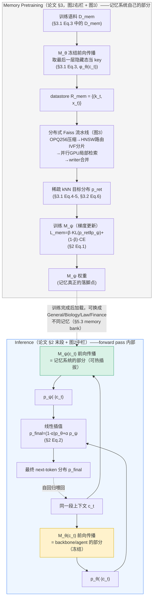

# Memory Decoder at Scale 论文架构

> 调研对象：Wei, R., Cao, J., Wang, J., Zhang, J., Guo, Q., Zhou, B., & Lin, Z. (2026). *Memory Decoder at Scale: A Pretrained, Parametric Long-Term Memory*. arXiv:2607.27919。
> 全文：`/Users/guanhongli/Documents/wafo-base/literature/papers/Wei-2026-Memory-Decoder-at-Scale.txt`（本文档所有 §/Eq./Figure/Table 编号均对应该文件的正文结构）。
> 术语先说清楚：`M_θ` = 冻结的主干语言模型（backbone）；`M_ψ` = 独立训练的参数化"记忆"模型，本质上也是一个 Transformer 解码器，只是训练目标不同；`p_ret` = 离线检索得到的 kNN 目标分布（训练监督信号，不是推理时的东西）。
>
> **2026-09-05 勘误**：本文已按同目录 `verification.md` 的逐条复核结论修正（共 8 处：2 处事实、2 处行号/锚点、4 处表述限定）。原始未修正版本见 git 历史。

## 1. 一句话机制

论文的核心主张是**把"检索"这件事从推理阶段搬到训练阶段**：用一个独立训练的 Transformer 解码器 `M_ψ`（§5.1 的匹配设置里规模与主干相当，但这不是硬性要求——§5.2 把同一批记忆配到 410M-12B 各种规模的 backbone 上，论文的头条结论恰恰是"不必规模相当"，410M backbone + 6.9B memory 就超过了 12B 规模的模型，txt:779-788），离线学习模仿一个 kNN 检索器的输出分布（蒸馏），训练完成后推理时只需要 `M_ψ` 自己做一次前向传播，和冻结主干模型的输出分布做线性插值即可，全程不需要外部数据库或最近邻搜索（§2 原文："Retrieval is used only to construct offline supervision for memory pretraining."）。

## 2. 记忆是怎么存进去的

触发：只在**记忆模型预训练/继续预训练之前**发生一次性的离线构造，不是运行时/每次对话触发。分两个阶段。

**阶段 A：离线构造"检索监督信号"（构建 kNN 目标分布，这一步本身不训练 `M_ψ`）**

- 存的是什么：对训练语料 `D_mem` 里的每个位置 `t`，把冻结的 `M_θ` 在该位置"最后一层的隐藏状态"`φ_θ(c_t)` 当作 key，该位置的下一个真实 token `x_t` 当作 value，组成 datastore `R_mem = {(k_t, x_t)}`（§3.1 Eq.3）
- 查询时用同一批语料每个位置的隐藏状态当 query，从 `R_mem` 检索 K 个最近邻，按距离做温度为 τ 的 softmax 加权投票，得到该位置的 kNN 目标分布 `p_ret(·|c_t)`（§3.1 Eq.4-5）。检索时**丢弃与 query 完全重合（key=query）的最近邻**，避免平凡自检索（§3.1 原文明确写此设计）
- 大规模工程（论文最强调的贡献，§3.1 + Figure 3）：在 207B token 规模的去重 Pile 上，一个语料有 N 个 token 就要建 N 个 key、发起 N 次查询，是 O(N²) 级别的构造+检索成本，且每个 key 是 Pythia-6.9B 最后一层的 4096 维隐藏态，标准 Faiss 流水线不可行。论文设计了一条分布式流水线（Figure 3 三步）：
  1. 训练一个 OPQ256（Optimized Product Quantization）变换，把每个 4096 维 key 压缩成 256 维检索向量
  2. 在压缩空间上学一个 IVF 划分，用 IndexHNSW 作量化器负责分配向量和给 query 路由到质心；每个分片存一段连续质心区间对应的向量，做成一个独立的 `IndexIVFPQ`
  3. 检索时先用 HNSW 量化器找出 query 命中的质心和对应分片，把 query 按分片分组；各分片在自己的 GPU 上独立做局部 `IndexIVFPQ` 搜索（不跨分片随机访问）；writer worker 收集各分片结果，按 query id 合并候选，取最终 top-K 近邻，把 `p_ret` 缓存为稀疏形式
- 调不调 LLM：不调用任何"生成式"能力。用语言模型抽取隐藏态是纯前向传播（当特征提取器用）；检索过程是经典的最近邻搜索算法，不涉及 LLM 推理
- 稀疏存储（§3.2 Eq.6）：`p_ret` 本质上非常稀疏——论文汇报在 Pile 上每行平均只保留 64.95 个非零 token（相对 50,304 大小的词表），对比稠密存储压缩比约 250×。只保留概率大于阈值 ε 的 token id + 概率，用 offset 数组标记每行边界，存储复杂度从 O(N·|V|) 降到 O(N+M)
- 分布式流式加载：预处理阶段把对齐的分布行区间挂在每条打包好的语言模型样本上；训练时分布式 worker 用存好的 offset + 只读内存映射数组，直接从对应分片读所需的连续切片，同一套 batching/collator 接口既能喂标准语言模型标签，也能喂稀疏 `p_ret` 三元组（§3.2）

**阶段 B：真正"写入"参数——训练 `M_ψ`**

- 损失函数（§2 Eq.1）：
  `L_mem = β·D_KL(p_ret(·|c_t) ‖ p_ψ(·|c_t)) + (1-β)·(-log p_ψ(x_t|c_t))`
  KL 项让 `M_ψ` 模仿检索分布；下一词预测项（CE）防止 `M_ψ` 偏离真实语料分布太远。`β∈[0,1]` 控制检索监督的权重
- `M_ψ` 是一个完整的 Transformer 解码器，和 `M_θ` 用同一套 tokenizer 和输出词表（§2 原文明确要求），**不读取检索到的原文本身作为输入**——只根据原始上下文 `c_t` 直接预测 `p_ψ(·|c_t)`
- 通用记忆（general memory）：初始化自对应规模的 Pythia checkpoint（1.4B/2.8B/6.9B，与 backbone 规模对应），在去重 Pile（207B tokens）上训练 300B tokens（约 1.5 epoch）；§4 正文写"256 张 NVIDIA A800 80GB + Megatron-LM"，但附录 Table 9 按 1.4B/2.8B/6.9B 三档记忆实际给出的 GPU 数是 **64/64/256**（txt:2147/2165/2183），并非三档统一用 256 张，论文正文与附录本身在这一点上不一致；AdamW（β1=0.9, β2=0.95, weight decay 0.01），余弦衰减到峰值 10%，2000 步 warmup（§4 Implementation Details）
- 域记忆（domain memory，§3.3）：架构、目标、稀疏训练流水线与通用记忆完全一致；先用 Qwen3-4B-Base 对该领域语料做一轮 continued pretraining，再用 CPT 后的模型构造该领域的 kNN 分布；记忆本体初始化自 Qwen3-1.7B-Base，训练预算=一次 Qwen3-8B-Base CPT epoch 的算力；应用于生物、法律、金融三个领域语料（最多 4.4B tokens）
- 存的不是一条条可读的"记忆条目"：是分布式弥散进 `M_ψ` transformer 权重里的统计规律，读不出、也不能单独增删某一条

证据：§2（Eq.1）、§3.1（Eq.3-5，Figure 3）、§3.2（Eq.6）、§3.3、§4 Implementation Details

## 3. 记忆是怎么被用起来的

触发：推理阶段，**每一次 next-token 预测**（§2 原文："At inference, `M_θ` and `M_ψ` process the same context in parallel."）。

拿什么去找：**完全不做检索**——"Retrieval is used only to construct offline supervision for memory pretraining"（§2 原文直接明示）。推理时 `M_ψ` 直接对当前上下文 `c_t` 做一次前向传播，输出 `p_ψ(·|c_t)`；不接触任何检索到的原文，不查任何数据库。

一步到位还是多步迭代：**一步到位**。`M_θ` 和 `M_ψ` 并行处理同一段上文（Figure 2 中间 "Inference" 栏画的是 Base Model 与 General/Law/Biology 等多个 Memory 并列排布，但全图只有一处 "ACTIVE" 标签，标在被选中的那一个 Memory 上方，Base Model 本身没有 ACTIVE 标；PDF 第 2 页 `pdftotext -layout` 交叉核对，全文唯一一处 "ACTIVE" 字样在 txt:104），各自输出下一词分布后直接按公式插值：
`p_final(y|c_t) = (1-α)·p_θ(y|c_t) + α·p_ψ(y|c_t)`，`y∈V`（§2 Eq.2）
没有"先检索候选、再重排、再生成"的多轮结构——这正是与 RAG/kNN-LM 的关键区别（**§1 Introduction** 明确写道："Both [RAG, kNN-LM] require external retrieval during inference"，txt:216，本文没有；这句引文不在 §7 Related Work，§7 对 RAG/kNN-LM 的对比用的是另一套措辞，txt:1729、txt:1742-1748）。

找到之后怎么交给模型：不存在"交给"这个动作——插值后的分布本身就是最终输出分布，直接用来做下一个 token 的采样/评分。当有验证集时，`α` 在验证集上调好后固定用于测试（§4 Implementation Details 末句："When validation data is available, the interpolation coefficient α is tuned on the validation split and then fixed for test evaluation."）。

**记忆的"保真度"如何（§6.7 Memory Fidelity to Retrieval Supervision）**：论文专门测过 `M_ψ` 实际输出的 `p_ψ` 和它训练时要模仿的目标 `p_ret` 有多接近——在 1,024 个 BioInst 域训练样本上：
- Top token 众数一致率 86.62%
- Pearson r = 0.9174（`p_ret` 众数对应 token 上，两个分布的概率值相关性）
- 平均 KL = 0.1820，平均 TV（全变差距离）= 0.0823

论文的解读是：`M_ψ` 学到的是 `p_ret` 的**结构**（概率分配），不只是众数选择，但不是 100% 精确复刻；残差误差主要出现在 `p_ret` 本身比较分散（不确定性高）的样本上（§6.7）。这意味着推理时的 `p_ψ` 是对离线检索行为的一个**近似**，不是检索结果的精确重现——这是理解"记忆被用起来"效果上限的关键限定。

架构上的额外说明（§7 Related Work 对比）：`M_ψ` 一旦训练完，同一份 backbone 可以配不同的记忆（通用/生物/法律/金融），"Switching domains only requires activating the corresponding domain memory from the memory bank at inference, while the backbone remains frozen"（§5.3）——即"记忆"和"推理能力"在推理时是两个可独立替换的模块，通过插值这一个窄接口耦合。

证据：§2（含 Eq.2）、§4 Implementation Details、§5.3、§6.7（Table 7，Figure 8-9）、§7 Related Work

## 4. 架构图

边界说明：INFER 虚线框内部才是论文定义的一次推理（一次 forward）；`M_θ` 这一路（黄色）是 backbone/agent 该管的事，`M_ψ` 这一路（绿色）是记忆系统该管的事。**两边只通过各自的下一词概率分布交换信息**，插值系数 α 是唯一的"接口参数"——论文没有描述任何文本、向量或 embedding 在两者间传递。MEMPRE 灰色部分只在训练/继续预训练时发生一次，推理时完全不存在，agent 侧感知不到 datastore、Faiss 索引这些中间产物。

## 5. 我没搞清楚的

这里列的是**读了正文之后仍然理解不清、需要额外信息才能判断**的地方（和第 6 节"确定缺失的规格说明"不同）：

- **本文 §2 "Preliminary: Memory Decoder" 明确是对前作 Cao et al. (2026, NeurIPS) 机制的复述**，我没有读那篇前作本身。本文档第 6 节列的一些"没写清楚"的东西（比如 β 默认值、`M_ψ` 除参数量外是否在结构上与 `M_θ` 有其他差异）有可能其实写在前作里、本篇省略重复——不确定这些缺口是"整个方向都没定下来"还是"本篇省略，前作已有"，需要读前作才能分清。
- **"同词表"假设（§2）与跨词表迁移实验（做法"换 embedding + LM head"实际写在 §4 Implementation Details，txt:536-538；§5.4，txt:807-816，只报告结果，锚点略有偏差）如何在同一套推理逻辑里共存，我没有从正文里理解清楚**：插值公式 (2) 写的是 `y∈V`，但同词表场景和跨词表场景里 `V` 显然不是同一个集合；两边词表大小、token id 对应关系不同时，公式本身怎么改写、是否需要额外的对齐步骤，正文没有解释，我也无法单靠 §2、§5.4 的文字反推出实现层面的答案。
- **§6.7 报告的"记忆保真度"（众数一致 86.62%、平均 KL 0.182、TV 0.082）在作者眼中算好还是一般**，正文没有给参照基准（比如随机基线、更小规模记忆模型，或者"完全没蒸馏"的对照数字）。我不确定这组数字该解读为"蒸馏效果足够好"还是"仍有明显残余差距"，§6.7 正文的措辞（"strong correspondence"）是作者自己的定性判断，我没有独立的量化参照来复核。
- **§9 提到"联合/分阶段训练 backbone 和 memory 可能提升整合但会伤害跨 backbone 迁移"**，这是作者的推测性陈述（原文措辞"could weaken cross-backbone transfer"），没有任何初步实验或数据支持这个判断。本文档不把它当作已验证结论看待，只当作作者本人对未来风险的一句猜测。

## 6. 论文没写清楚的地方

以下是通读正文（Abstract、§1-§9）后确认**属于具体参数/机制规格缺失**的地方，不是我理解力不够，是正文确实没给出这些数字或流程细节：

- **α（推理插值权重）具体怎么在验证集上调？** 论文说"tuned on the validation split and then fixed"（§4）；候选值范围其实附录给出了——附录 F（txt:2970-2976）明确是 α∈{0.00, 0.05, …, 1.00} 的网格（Figure 11 caption txt:3211："all 21 coefficients at intervals of 0.05"），Table 15 还逐任务列出了实际选定的 α 值。正文和附录都没有给出的只是**具体的搜索/选择算法和优化目标**（是不是就是网格搜索验证集准确率、优化的具体指标是什么，没写）。
- **β（训练损失里 KL 与 CE 的权重）默认取值是多少？** Eq.1 定义了 β 的作用；正文通读没找到具体数值，但**附录给出了**——附录 B Table 9 的 "Memory loss weight" 一行，通用记忆三档（1.4B/2.8B/6.9B）全部是 **0.5**（txt:2145/2163/2181），Table 10 域记忆同样是 0.5（txt:2225/2240/2255），与代码里 `alpha` 参数默认值 0.5 完全一致；§6.5 "Memory Training Objective" 做的确实是"attached CPT vs attached memory"模块对比消融，不是 β 取值消融，跟这个数值本身无关。
- **分布式 Faiss 流水线的具体规模参数**：分成多少个分片（S=？）、每个分片多少质心、HNSW 的构建/搜索超参（如 M、efSearch）、OPQ256 的训练样本量——Figure 3 只给了流程结构，正文没有给出这些具体数字（可能在附录，本次阅读未定位到）。
- **kNN 检索的具体超参数值**：K（近邻个数）和 τ（softmax 温度）在 Eq.4-5 里只以符号出现，正文没有给出这两个符号对应的实际数值。
- **"memory bank"（§5.3）的工程形态**：是一个可以按名字查表切换的服务/注册表，还是只是"训练好几份 checkpoint、评测时手动选一份加载"的口语化说法？论文没有描述其实现细节。
- **构造 datastore 阶段"跑一遍 base 模型做前向传播"本身的算力成本**，相对于"检索"环节的成本，论文没有单独核算——§9 Limitations 只笼统提"indexing and retrieval overhead"，没有给出两者的成本分解或具体数字。

证据：以上结论均来自"通读正文后未找到"，对应检索关键词（"final layer"、"feed-forward"、"A800"、"Megatron"、"memory bank"等）已在正文全文范围内核查；本节原先预留的"若存在于未读附录，请以附录原文为准更正"这次确实命中了两处——附录 F 给出了 α 的候选值范围，附录 B Table 9/10 给出了 β=0.5，均已在上文对应条目改正；其余各条（Faiss 分片参数、K/τ 数值、memory bank 工程形态、datastore 构造成本）经附录复核仍确认缺失，结论不变。
