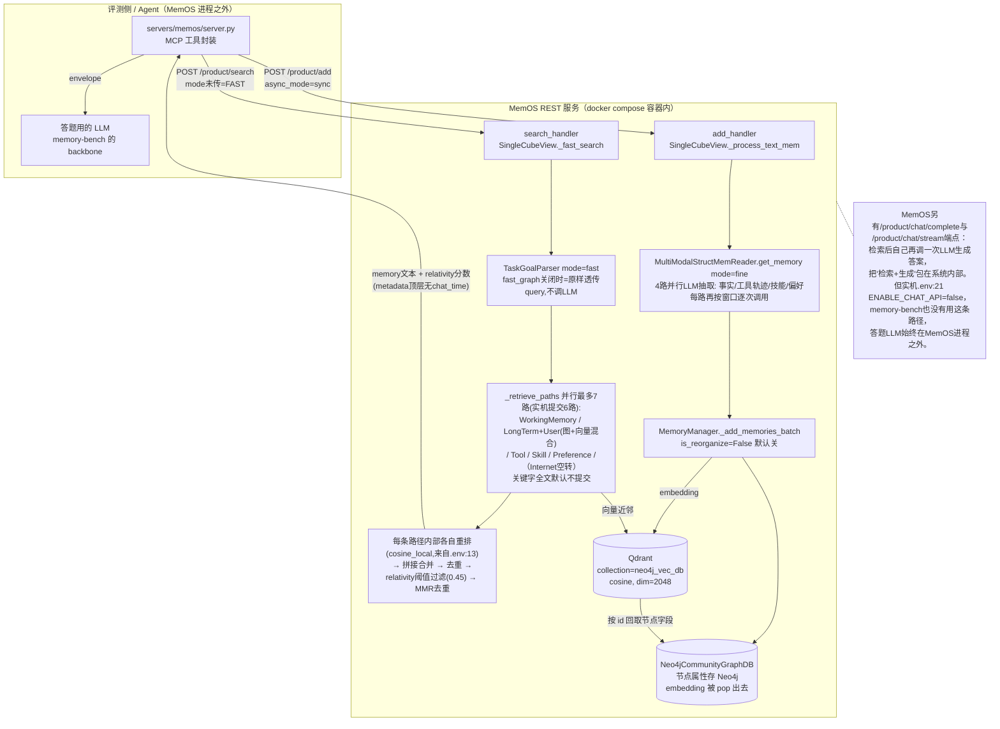

# MemOS 代码架构

> 调研范围：`memory-bench` 通过 `servers/memos/server.py` 实际调用的路径——`/product/add`（`async_mode="sync"`）与
> `/product/search`（`mode` 未传，走默认 `FAST`）。MemOS 是一个体量很大的仓库（`product` API 下还有 chat、feedback、
> suggestion、多 cube 组合等大量本次评测没碰到的功能），本文档**只保证覆盖 memory-bench 实际打到的这条链路**，不是整个
> MemOS 代码库的地图。
>
> 下文文件路径均相对于 MemOS 仓库根目录 `/Users/guanhongli/Documents/repo/MemOS/`。
> 术语第一次出现时给一句话解释；不确定的地方标「未验证」，不用推测填。
> **2026-09-05 勘误**：本文已按同目录 `verification.md` 的逐条复核结论修正（共 35 处：10 处事实、12 处行号/锚点、
> 13 处表述限定）。原始未修正版本见 git 历史。

## 1. 一句话机制

写入时用**多次** LLM 调用把整段对话窗口"翻译"成几条独立的事实陈述——fine 模式下是事实/工具轨迹/技能/偏好**四路
并行抽取**，每一路内部还要按窗口逐次调用（见第 2 节）；抽出来的记忆项，**节点属性写进 Neo4j**（一种图数据库，把
数据存成"节点+关系"而不是表），**向量则被单独摘出来写进 Qdrant**（一个专门存向量的数据库）；检索时默认不调 LLM，
而是拿查询向量去 Qdrant 做近邻检索、回 Neo4j 取节点字段、再用余弦相似度重排、按阈值过滤，把命中的事实原文连同
分数一起原样返回给调用方——论文强调的"三种记忆统一调度、五态生命周期"在这条路径上都没有对应实现（细节见第 6 节）。

## 2. 记忆是怎么存进去的

**触发**：`server.py` 的 `add_conversation` 每个 session 调一次 `POST /product/add`，显式传 `async_mode="sync"`（即等
MemOS 处理完再返回，不走后台队列）。

**入口链路**（证据）：
- `src/memos/api/routers/server_router.py:128` `add_memories`（:127 是路由装饰器）→ 真正的转发在 :134
  `AddHandler.handle_add_memories`
- → `add_handler.py:130-142` 构造 `SingleCubeView`（因为 memory-bench 每次只传一个 `writable_cube_ids`）→
  `src/memos/multi_mem_cube/single_cube.py:56-84` `add_memories`（`def` 在 :59）→
  `src/memos/multi_mem_cube/single_cube.py:662` `_process_text_mem`
- 抽取模式判定：`src/memos/multi_mem_cube/single_cube.py:64` `sync_mode = add_req.async_mode or self._get_sync_mode()`（wrapper 传的是
  `"sync"`）；`src/memos/multi_mem_cube/single_cube.py:687-689`：sync 模式下 `extract_mode = "fast" if add_req.mode == "fast" else "fine"`——
  wrapper **没有**传 `mode` 字段（`APIADDRequest.mode` 默认 `None`），所以实际走的是 `"fine"`（细粒度抽取）分支，
  不是名字听起来更快的 `"fast"`。

**存的是什么、调不调 LLM**——先把类认清楚：实机 `MemOS/.env` **没有设** `MEM_READER_BACKEND`，而代码默认值是
`"multimodal_struct"`（`src/memos/api/config.py:657`），经 `src/memos/mem_reader/factory.py:22` 造出来的是
**`MultiModalStructMemReader`**，不是 `SimpleStructMemReader`（只有 `docker/.env.example-full:104` 那份示例配置
才设 `simple_struct`）。前者继承后者（`src/memos/mem_reader/multi_modal_struct.py`），但**覆写了
`get_scene_data_info`、`_read_memory`、`_get_llm_response` 三个关键方法**——所以下面凡是标 `simple_struct.py`
的行号，都要看清楚它在实机路径上到底还生不生效。

1. **切窗口**：`SimpleStructMemReader` 是**两层**窗口——先 `get_scene_data_info` 按"≤10 条消息 / 重叠 2 条"切
   （`src/memos/mem_reader/simple_struct.py:857-866`），再 `_iter_chat_windows`（`src/memos/mem_reader/simple_struct.py:315`）
   按 token 切。**实机走的 `MultiModalStructMemReader` 把第一层拿掉了**：它的 `get_scene_data_info` 是直通
   （`src/memos/mem_reader/multi_modal_struct.py:1257-1270`，函数体里还留着 `TODO: split messages` 的注释），
   token 层的滑窗聚合改由 `_concat_multi_modal_memories`（`src/memos/mem_reader/multi_modal_struct.py:194-196`）
   做。两条路径的 token 参数是同一套：`chat_window_max_tokens=1024`
   （`src/memos/mem_reader/simple_struct.py:207`）、窗口间重叠 `overlap=200` token；每条消息带 `role:` 和
   `[chat_time]` 前缀拼成一段纯文本（`src/memos/mem_reader/simple_struct.py:327-332`）。
2. **抽取**：fine 模式下不是一次 LLM 调用，而是 **4 路并行抽取**
   （`src/memos/mem_reader/multi_modal_struct.py:1020-1049`）：①`_process_string_fine`(:615) 抽事实、
   ②`_process_tool_trajectory_fine`(:900) 抽工具轨迹、③`process_skill_memory_fine` 抽技能、
   ④`process_preference_fine` 抽偏好；每一路内部还要**按窗口/按条目逐个调 LLM**（如 :629）。所以
   **"写入路径上只有一次必经的 LLM 调用"是错的**——即便退回 `SimpleStructMemReader`，fine 分支也是"每个窗口各调
   一次"（`src/memos/mem_reader/simple_struct.py:407-408`），实机则是 4 路 × 每路多次。这也顺带解释了检索侧为什么
   默认要顺带查 Tool/Skill/Preference 三种记忆（第 3 节）：它们在写入时是真的被造出来的。
   抽事实那一路用 `SIMPLE_STRUCT_MEM_READER_PROMPT`（中/英按语言自动切换）拼 prompt 调 `self.llm.generate`
   （基类实现在 `src/memos/mem_reader/simple_struct.py:274` `_get_llm_response`，实机由子类覆写），要求模型返回
   JSON：`{"memory list": [{"key":..., "memory_type":..., "value":..., "tags":[...]}, ...], "summary": "..."}`。
   `src/memos/mem_reader/simple_struct.py:295-302` 有一条明确注释：这个 JSON 的 key 必须是带空格的字符串
   `"memory list"`，写错会导致 `/product/add` 返回 200 但图里一条记忆都没存（历史 bug #1355 的教训）。
3. 每条 `memory list` 项 → `_make_memory_item`（`src/memos/mem_reader/simple_struct.py:220`，这个方法子类**没有**
   覆写，实机仍然生效）：
   - `memory` 字段存的是 **LLM 输出的 `value`**，不是原始对话原文；
   - `metadata.embedding = self.embedder.embed([value])[0]`（`src/memos/mem_reader/simple_struct.py:247`）——**向量化的对象是 LLM
     改写后的事实句，不是原文**；
   - `metadata.sources` 存该窗口的原始消息列表（role/content/chat_time），供溯源用——原文没丢，但不参与检索用的向量；
   - `metadata.background` = 该窗口 LLM 输出的 `"summary"`；
   - `metadata.memory_type` 取 `LongTermMemory` 或 `UserMemory`（LLM 自己判断，代码里做了"长期记忆"→`LongTermMemory`、
     "用户记忆"→`UserMemory` 的中文兜底替换，`src/memos/mem_reader/simple_struct.py:411-415`）；
   - `confidence=0.99`、`type_="fact"` 都是硬编码默认值（`src/memos/mem_reader/simple_struct.py:230` 附近的函数签名默认参数，
     `_process_chat_data` 的 fine 分支没有覆盖它们）。
4. 可选的额外 LLM 调用：环境变量 `SIMPLE_STRUCT_ADD_FILTER=true` 时才会跑 `filter_hallucination_in_memories`
   ——注意它是**按 group 一次 listwise 调用**、把整组 `memory_list` 一起丢给 LLM 判定保留哪些
   （`src/memos/mem_reader/simple_struct.py:603-658`、:721-724），不是逐条问；**默认是 `false`**，memory-bench
   的 docker 部署没有设置这个变量，即默认不跑。

**写库**（`src/memos/memories/textual/tree_text_memory/organize/manager.py`）：
- `src/memos/multi_mem_cube/single_cube.py:734` `naive_mem_cube.text_mem.add(mem_group, ...)` → `tree.py:103-114` `TreeTextMemory.add` 直接
  转发给 `self.memory_manager.add(memories, mode=self.mode)`（`tree.py:114`）
- `src/memos/memories/textual/tree_text_memory/organize/manager.py:138` `_add_memories_batch`（默认走这条批量路径）：每条记忆变成一个 Neo4j 图节点，
  `graph_store.add_nodes_batch(...)` 批量写入，`metadata` 里带着上一步算好的向量。
- **WorkingMemory 镜像节点是死代码**：`src/memos/memories/textual/tree_text_memory/organize/manager.py:169` 确实算出了一份 `memory_type` 强制改写成 `WorkingMemory` 的
  `working_metadata`，但 `src/memos/memories/textual/tree_text_memory/organize/manager.py:239-240` 明确写着注释「`TODO: working id is same with item.id, need to fix,
  currently stop adding WorkingMemories here.`」——这份数据算出来之后**从未被提交写库**。也就是说代码里定义的
  `WorkingMemory`（短期记忆层，配额 20 条，`tree.py:83` `"WorkingMemory": 20`）这一档，在当前批量写入路径下形同虚设。
- **图结构自动整理默认关闭**：`src/memos/memories/textual/tree_text_memory/organize/manager.py:243-244` 只有 `self.is_reorganize == True` 时才会把新节点 ID 塞进队列交给
  `GraphStructureReorganizer` 做异步的合并/去重/冲突检测（这部分对应论文说的记忆"演化"）。而
  `configs/memory.py:175,270` 两处 `reorganize` 字段的默认值都是 `False`；`component_init.py:223`
  从环境变量 `MOS_ENABLE_REORGANIZE` 读取（`src/memos/api/config.py:1234,1314` 里默认字符串是 `"false"`），docker 部署的
  `.env.example` 没有设置这个变量——即 **memory-bench 实际跑的这套部署，写入之后不会有任何 LLM 驱动的图重组织/合并/
  去重**，每条记忆写进去之后就是独立的一个图节点，不会再被"演化"。

**存储后端**：`docker-compose.yml` 起了 Neo4j 5.26.6 和 Qdrant v1.15.3 两个容器（`docker/docker-compose.yml:28-53`），
产品部署实际构造的是 `SimpleTreeTextMemory`（`component_init.py:229`），其 `graph_db` **不是基类 `Neo4jGraphDB`，
而是子类 `Neo4jCommunityGraphDB`**（`graph_dbs/factory.py:16`；`api/handlers/config_builders.py:47-49` 默认
`neo4j-community`；实机 `MemOS/.env:14` `NEO4J_BACKEND=neo4j-community`）。这个差别很关键，因为**两个类把向量放在
完全不同的地方**：
- 写入时 `Neo4jCommunityGraphDB` 把 `embedding` 从 metadata 里 **pop 出来**（`graph_dbs/neo4j_community.py:151`
  `embedding = metadata.pop("embedding", None)`），组成 `VecDBItem`（:155-165）后
  `self.vec_db.add(vec_items)` 写进 **Qdrant**（:194）；留在 Neo4j 节点上的是不含向量的那部分属性。
- 检索时 `search_by_embedding`（`graph_dbs/neo4j_community.py:293`）走的是 `self.vec_db.search(...)`（:360），
  也就是 **Qdrant 的近邻检索**，拿到 id 之后再回 Neo4j 取节点字段。
- 这套 vec_db 的配置写死在 `api/config.py:769-796` `get_neo4j_community_config`：`backend="qdrant"`、
  `collection_name="neo4j_vec_db"`、`distance_metric="cosine"`，host/port 取 `QDRANT_HOST`/`QDRANT_PORT`
  （由 `docker/docker-compose.yml:19-20` 注入），维度取 `EMBEDDING_DIMENSION`（实机 `.env:12` 是 2048）。
  **所以 Qdrant 不是"另一套没用上的实现"，它就是这条主链路的向量索引**（本文档上一版把它列为"未验证"，见第 5 节）。

`graph_dbs/neo4j.py:952` 的 `CALL db.index.vector.queryNodes('memory_vector_index', $top_k, $embedding)` 这行代码
确实存在，但它属于基类 `Neo4jGraphDB`，只有 `NEO4J_BACKEND=neo4j`（企业版路径）才会走到；而且即使走基类，带过滤
条件的查询也不走 ANN 索引，而是全表算 `vector.similarity.cosine`（`graph_dbs/neo4j.py:940-947`）。

## 3. 记忆是怎么被用起来的

**触发**：`server.py` 的 `retrieve` 调 `POST /product/search`，没有传 `mode`，`APISearchRequest.mode` 默认
`SearchMode.FAST`（`product_models.py` 中 `mode: SearchMode = Field(SearchMode.FAST, ...)`）。

**拿什么去找**：`single_cube.py` `_search_text` 按 `search_mode == FAST` 分支进 `_fast_search` →
`search/search_service.py` `search_text_memories` → `text_mem.search(mode="fast", ...)` → `tree.py:157`
`TreeTextMemory.search` 创建 `Searcher`（实际类是 `AdvancedSearcher`，`tree.py` 顶部把它 `import ... as Searcher`
起了别名）并调用其 `search()`（`searcher.py:191`）。

- **查询理解这一步默认不调 LLM**：`searcher.py:338` `self.task_goal_parser.parse(..., mode=mode, ...)` 把
  `mode="fast"` 原样传给 `TaskGoalParser.parse`（`task_goal_parser.py:30-51`）。`mode="fast"` 分支走 `_parse_fast`
  （`def` 在 `task_goal_parser.py:55`）：只有当 `use_fast_graph=True` 时才会用 jieba 分词；否则（默认）直接
  `return ParsedTaskGoal(memories=[task_description], rephrased_query=task_description, ...)`——原样透传，
  `task_goal_parser.py:73-83`。而 `use_fast_graph` 来自 `search_strategy.get("fast_graph", False)`
  （`searcher.py:74`），部署配置里 `"fast_graph": bool(os.getenv("FAST_GRAPH", "false") == "true")`
  （`src/memos/api/config.py:1242`），docker 部署未设置该变量 → 默认 `False`。**结论：FAST 模式下查询理解不调 LLM，只是原样透传
  query 文本**。关键词/稀疏检索同样默认关闭，但要分清这里其实是**两个**开关：真正决定"关键字全文这条路径提不提交"
  的是 `use_fulltext`（`searcher.py:429`），来源是 `"fulltext"`（`src/memos/api/config.py:1245`，读环境变量
  `FULLTEXT_CALL`）；而 `"bm25": bool(os.getenv("BM25_CALL","false")=="true")`（`src/memos/api/config.py:1243`）
  控制的是要不要把 `EnhancedBM25` 检索器注入 `GraphMemoryRetriever`（`tree.py:59-61` / `simple_tree.py:52-56`）。
  两个环境变量实机都没设 → 都是 `False`，"关键词检索默认不启用"这个结论不变，只是归因要落到 `fulltext` 上。真正调
  LLM 的是**写入**侧（第 2 节），不是检索侧——这一点容易和直觉反过来。
- **一步到位还是多步迭代**：单步查询，但内部"广度并行"——`searcher.py:355` 起的 `_retrieve_paths` 用线程池
  （`ContextThreadPoolExecutor(max_workers=5)`，`searcher.py:383`）同时发起最多 7 条独立检索路径：WorkingMemory
  （Path A）、LongTermMemory+UserMemory（Path B，`GraphMemoryRetriever` 做"图检索+向量检索"的混合召回，
  `src/memos/memories/textual/tree_text_memory/retrieve/recall.py:94-98` 的 docstring 自述，`def retrieve` 在
  :81）、Internet（wrapper **根本没有传** `internet_search` 字段——`APISearchRequest.internet_search` 自己的默认值
  就是 `False`（`product_models.py:492-493`），经 `search_service.py:84` 转成 `manual_close_internet=True`，效果
  是这条路径空转）、关键字全文（默认关，见上，实机**不提交**这条）、ToolSchemaMemory/ToolTrajectoryMemory
  （`APISearchRequest.search_tool_memory` 默认 `True`）、SkillMemory（`include_skill_memory` 默认 `True`）、
  PreferenceMemory（`include_preference` 默认 `True`）——即最多 7 条、实机实际提交 6 条。也就是说 memory-bench 每次
  调 `retrieve`，哪怕语义上只是想查"用户提到过的某件事"，MemOS 默认也会顺带把工具记忆、技能记忆、偏好记忆各查一
  遍（而且这三类记忆在写入侧确实被造了出来，见第 2 节的 4 路抽取）——这些默认值不是 wrapper 设的，
  是 `APISearchRequest` 自己的默认值（`product_models.py`）。
- **找到之后怎么处理**（不经过任何 LLM）：顺序是**先重排、后合并**，不是先合并再重排——`_maybe_rerank`
  （`def` 在 `searcher.py:80`，`self.reranker.rerank(...)` 在 :91）是在**每条路径内部各调一次**的（例如 Path B
  的收尾在 `searcher.py:817`），各路结果随后才在 `_retrieve_paths` 里简单拼接合并（`searcher.py:496-498`，既没有
  RRF 也没有加权）→ `_deduplicate_results`（`searcher.py:1149`，按 `item.memory` 文本去重，同文本取分数更高的）→
  `_sort_and_trim`（`searcher.py:1158`，按分数排序截断 `top_k`，把最终分数写回
  `metadata.relativity`，:1185）→ 回到 `search_handler.py:254` `_apply_relativity_threshold`（丢弃
  `relativity < 0.45` 的结果——`0.45` 是 `APISearchRequest.relativity` 的默认值，wrapper 显式把它当参数传了一遍，见
  第 7 节）→ `dedup="mmr"`（`APISearchRequest.dedup` 默认值）再做一次 MMR（最大边际相关性，一种"既要相关又要不重复"
  的去重排序）→ `formatters_handler.py:44` `format_memory_item` 把 `TextualMemoryItem` 序列化成响应 JSON。
- **reranker 到底从哪来**（这处上一版写错了，且直接影响可复现性）：产品路径构造的是 `SimpleTreeTextMemory`，它的
  `__init__` **根本不调用** `TreeTextMemory.__init__`，而是直接 `self.reranker = reranker`
  （`memories/textual/simple_tree.py:28-58`）——所以 `tree.py:63-73` 那段"没显式配置 reranker 时默认
  `backend: "cosine_local"`、`level_weights: {"topic":1.0,"concept":1.0,"fact":1.0}`（`tree.py:66,68`）"在这条
  路径上是**死代码**。真正生效的 reranker 由 `component_init.py:207` 从 `APIConfig.get_reranker_config()` 造，而
  那里的**代码默认是 `http_bge`**（一个 HTTP cross-encoder 重排服务，`src/memos/api/config.py:562-575`），只有当
  `MOS_RERANKER_BACKEND` 不是 `http_bge*` 时才落到 `cosine_local` 分支（`src/memos/api/config.py:576-583`，
  `level_weights` 的生效值在 :580）。本次评测"用余弦本地重排"的结论**成立，但只是因为实机 `MemOS/.env:13` 恰好设
  了 `MOS_RERANKER_BACKEND=cosine_local`**——换一份 `.env` 这条链路就变成 HTTP cross-encoder 重排，复现时必须连
  `.env` 一起对齐。
- **两处此前漏述的候选放大 / 二次排序**：`search_handler.py:90-92` 在 `dedup="mmr"` 时先把 `top_k` **放大 3 倍**
  再去检索（代码写的是 `top_k * 3`，同一行的注释却写着 `5x`，注释与代码自相矛盾）；阈值过滤 + MMR 之后
  `search_handler.py:119-125` 还会再调一次 `rerank_knowledge_mem`（→ `formatters_handler.py:169-209`），不过那个
  函数体里写着 `# rerank set unuse`，实际只按 `relativity` 排序，且本 arm 没有 `RawFileMemory`，近似空转。
- **交给谁**：`/product/search` 直接把命中记忆（`memory` 文本原样 + `metadata`，含 `relativity` 分数；**注意
  metadata 顶层并没有 `chat_time` 字段，对话时间只藏在 `metadata.sources[].chat_time` 里**，见第 7 节）返回给
  调用方——这里调用方就是 `server.py`，由它自己包成 memory-bench 的 envelope 格式
  （`memory_id`/`text`/`score`/`timestamp`/`raw_format="memos_text"`），塞进 benchmark 的答题上下文。MemOS
  自己另有 `/product/chat/complete`（`server_router.py:270`）和 `/product/chat/stream`（:284）两个端点（请求体
  `ChatRequest` 在 `product_models.py:136`；并没有裸的 `/product/chat` 路由），会在检索后**再调一次 LLM** 生成
  最终回答——但 memory-bench 的 wrapper 完全没有用它，而且实机 `MemOS/.env:21` `ENABLE_CHAT_API=false`、
  `component_init.py:178` 因此连 chat_llms 都不构造；答题的 LLM 是评测框架自己的，在 MemOS 进程之外。

**一个文档字符串与实际代码不一致的地方**：`searcher.py:212-213` 的 docstring 写着检索流水线是
`"User query -> TaskGoalParser -> GraphMemoryRetriever -> MemoryReranker -> MemoryReasoner -> Final output"`；
`tree.py:179-180`（`TreeTextMemory.search` 的 docstring）里的那份还**多一段 `MemoryPathResolver`**
（`TaskGoalParser -> MemoryPathResolver -> GraphMemoryRetriever -> ...`）——两份 docstring 彼此就不一致。而
`MemoryReasoner` 只在 `searcher.py:69` `self.reasoner = MemoryReasoner(dispatcher_llm)` 被实例化一次，
全仓库搜索不到第二处 `self.reasoner.` 的调用——这一步在当前代码里是从未被执行的死代码，文档字符串没跟上代码演进。

## 4. 架构图

**边界说明**：图中 `HARNESS` 框内是 memory-bench 自己的代码（`server.py` 是本次评测专门写的适配层，不是 MemOS
自带的东西）；`MEMOS` 框内是 MemOS 仓库里的代码，两者只通过 HTTP JSON 交换信息（写：turns 文本；读：query 文本
→ memory 文本+分数）。MemOS 的 `Activation Memory`、`Parameter Memory` 两个类在这套部署里根本没被实例化（见第 6
节第 3 条），所以图里没有画——产品 REST API 实际上只是一套"文本记忆"服务，不是论文描述的三态统一系统。

## 5. 我没搞清楚的

- **`mem_scheduler` 收到 `ADD_TASK_LABEL` 后台任务后具体做什么**：`single_cube.py` 里 sync 模式写完之后仍会调
  `_schedule_memory_tasks` 提交一条 `ADD_TASK_LABEL` 消息（`mem_scheduler/schemas/task_schemas.py:33`），
  `task_schedule_modules/registry.py:52` 把它路由到 `self.add` 处理器，但没有继续往下读该处理器的具体实现，不确定
  这一步除了记账/统计之外是否还有别的副作用。
- **`GraphMemoryRetriever.retrieve()`（`recall.py`）内部"图检索"和"向量检索"具体怎么融合/加权**：只读了函数签名和
  docstring（"Run graph-based lookup from dispatch plan... Run vector similarity search... Merge and return
  combined result set"，`recall.py:94-98`），没有把 500+ 行实现读完。现在已知"向量检索"那一半落到
  `Neo4jCommunityGraphDB.search_by_embedding`（`graph_dbs/neo4j_community.py:293`）→ `self.vec_db.search`（:360）
  即 Qdrant（见第 2 节），但两路结果的合并/加权逻辑仍然未验证。
- **`async_mode="async"`（生产默认值，memory-bench 没用）下的完整链路**：`src/memos/multi_mem_cube/single_cube.py:686-687` 显示 async 模式
  会强制 `extract_mode="fast"`（跳过 LLM 抽取，直接把窗口原文当记忆存），后续处理转给 `mem_scheduler` 异步跑——这条
  路径本文没有继续往下追。

**已结案**（下面两条原本列在本节，经逐条复核已经能给出确定结论，保留在这里是为了说明结论是怎么变的）：

- **Qdrant 在这套 docker-compose 部署里到底服务于哪个子系统**——就是这条主链路的向量索引，不是"另一套没被实例化的
  记忆实现"。`Neo4jCommunityGraphDB` 写入时把 `embedding` pop 出来写进 Qdrant
  （`graph_dbs/neo4j_community.py:151-165,194`），检索时 `search_by_embedding` 走 `self.vec_db.search`（:360），
  配置在 `api/config.py:769-796`（collection `neo4j_vec_db`、cosine、维度取 `EMBEDDING_DIMENSION`）。详见第 2 节
  "存储后端"。
- **"topic/concept/fact" 三层结构在当前写入路径下是否真的被构建**——**没有，而且相关配置本身也是死的**。写入时
  `type_` 硬编码成 `"fact"`（`src/memos/mem_reader/simple_struct.py:229`，见第 2 节），全仓库没有写
  `"topic"`/`"concept"` 类型节点的路径；`src/memos/memories/textual/tree_text_memory/organize/manager.py:459`
  `_ensure_structure_path` 在**生产代码里确实没有任何调用点**（只有 `tests/memories/textual/test_tree_manager.py:124,132`
  两处测试在调它），可以认定为生产路径上的死代码。更进一步：`CosineLocalReranker` 的 `level_field` 是
  `"background"`（`reranker/cosine_local.py:56`），而 `background` 里存的是 LLM 给的 summary 文本（第 2 节），
  永远匹配不上 `level_weights` 的三个 key，所以 `{"topic":1.0,"concept":1.0,"fact":1.0}` 这组权重**恒取默认值
  1.0**（`reranker/cosine_local.py:88-90`）——三层结构不但没建，权重配置也形同虚设。（顺带：这组权重的生效值也
  不在 `tree.py:68`，而在 `api/config.py:580`，见第 3 节。）

## 6. 与论文的冲突点

1. **最大冲突——论文的"操作系统模块"命名体系在代码里基本不存在**：论文 §5.1–§5.5、Table 2、Figure 7/8 反复出现的
   `MemOperator`、`MemLifecycle`、`MemGovernance`、`MemVault`、`MemStore`、`MemLoader`、`MemDumper`、`MemDecoder`、
   `MemBlock` 这些模块名，在当前代码库（`src/memos/**/*.py`）里**全文搜索不到任何一个同名的类定义**。不过"只在一句
   docstring 里出现过一次"这个说法要收回：这些名字以**字符串**形式在两处残留——`tree.py:179` 那句过时 docstring 里的
   `MemoryPathResolver`（代码里从未实现、从未调用，见第 3 节），以及**产品系统提示词**
   `templates/mos_prompts.py:112`（英文版）与 `:222`（中文版），那里明写着
   `MemCube, MemScheduler, MemLifecycle, and MemGovernance`，并连带写了一套五态生命周期
   `Generated → Activated → Merged → Archived → Frozen`（:110 / :217）。换句话说，论文那套命名是作为**喂给 LLM 的
   提示词文案**活下来的，不是作为代码结构。代码实际用的是完全不同的一套模块划分：`mem_reader/`、`mem_scheduler/`、
   `mem_cube/`、`multi_mem_cube/`、`graph_dbs/`、`search/`、`tree_text_memory/{organize,retrieve}/`。
2. **`MemScheduler` 语义漂移**：论文 §5.4.2 说 MemScheduler 是"根据任务语义动态决定用 Plaintext/Activation/
   Parameter 哪种记忆类型、并做跨类型迁移"的中枢调度器。代码里 `mem_scheduler/` 实际是一个任务队列/异步 worker
   系统——`mem_scheduler/schemas/task_schemas.py:31-41`（全仓库只有这一个 `task_schemas.py`，此前误写成
   `task_schedule_modules/schemas/` 下的同名文件）定义的任务标签是 `ADD_TASK_LABEL`、
   `MEM_READ_TASK_LABEL`、`MEM_ORGANIZE_TASK_LABEL`、`MEM_DREAM_TASK_LABEL`、`MEM_UPDATE_TASK_LABEL`、
   `MEM_ARCHIVE_TASK_LABEL`、`MEM_FEEDBACK_TASK_LABEL` 等，职责是把 add/search 之后的收尾工作丢进后台队列异步处理，
   不涉及论文说的"三种记忆类型间调度"逻辑（附注：`MEM_ARCHIVE_TASK_LABEL` 虽然定义了，却不在
   `mem_scheduler/task_schedule_modules/registry.py:48-58` 的 dispatch map 里，即定义了但没有处理器）。
3. **三种记忆并没有真的"统一"——本次评测打到的 MemOS 100% 只是文本记忆子系统**：论文反复强调 MemCube 统一调度
   Plaintext/Activation/Parameter 三类记忆（摘要、§4.1、Figure 6、§5.4.2）。但产品 REST API 构造 `NaiveMemCube`
   时明确写死 `act_mem=None, para_mem=None`（`api/handlers/component_init.py:246-248`）——`Activation Memory` 和
   `Parameter Memory` 对应的类在代码里存在（`memories/activation/`、`memories/parametric/`），但在这条部署路径上
   从未被实例化。论文说的"高频 plaintext 提炼成 activation/parameter""跨类型迁移"，在这套产品部署里没有发生的
   可能性（因为另外两种记忆压根不存在）。
4. **`memory_type` 分类体系和论文的三分类不在一个层级**：论文的三类是系统级的 Plaintext/Activation/Parameter；
   代码里 `TreeNodeTextualMemoryMetadata.memory_type`（`memories/textual/item.py:178`）的取值是
   `WorkingMemory`/`LongTermMemory`/`UserMemory`/`OuterMemory`/`ToolSchemaMemory`/`ToolTrajectoryMemory`/
   `RawFileMemory`/`SkillMemory`/`PreferenceMemory`/`Context`——这十个值全部只是论文所谓"Plaintext Memory"内部的
   子分类，论文完全没写到这一层细分。
5. **生命周期状态对不上**：论文自己前后就不一致（§5.2 说 5 态 Generated/Activated/Merged/Archived/Expired，§5.4.3
   说 4 态、少了 Expired，详见 `paper-architecture.md` 第 6 节）。代码里 `TextualMemoryMetadata.status`
   （`memories/textual/item.py:109`）的取值是 `activated`/`resolving`/`archived`/`deleted`——和论文两个版本的状态
   命名都不一致。这里要分开说：`Expired` 作为生命周期状态在代码里确实完全不存在（全仓库只有 `TimeoutExpired`、
   `Expired API key` 这类无关命中）；但 `Generated`/`Merged` **以字符串形式存在于产品提示词**
   `templates/mos_prompts.py:110,112` 里——而且那份提示词写的是
   `Generated → Activated → Merged → Archived → Frozen`，第五态是 `Frozen` 而不是 `Expired`，等于**第三个版本**的
   状态机（论文 §5.4.3 本身也另外提过 `Frozen`）。结论仍然成立：状态机在论文里有两三个版本，在代码的 `status` 枚举
   里一个都没落实。
6. **`MemCube` 元数据字段对不上**：论文 Figure 6 给的示例 JSON 字段是
   `created`/`last_used`/`source`/`model`/`usage`/`priority`/`expires`/`access`/`tags`/`embedding_fp`/
   `storage_mode`。代码实际的 `TreeNodeTextualMemoryMetadata`/`TextualMemoryMetadata`
   （`memories/textual/item.py:94,175`）字段是
   `user_id`/`session_id`/`status`/`is_fast`/`evolve_to`/`version`/`history`/`working_binding`/`type`/`key`/
   `confidence`/`source`/`tags`/`visibility`/`updated_at`/`info` +（tree 子类）`memory_type`/`sources`/
   `embedding`/`created_at`/`usage`/`background`/`file_ids`——**严格同名的只有 `source`、`tags`、`usage` 三个**
   （论文写的是 `created`、代码是 `created_at`，只能算近似对应），
   `priority`/`expires`/`access`/`embedding_fp`/`storage_mode` 在代码里都找不到对应实现。
7. **检索路径论文没写到的复杂度**：论文说检索是"topic-concept-fact 三层任务分解 + `MemoryPathResolver`"
   （§5.4.1）。代码里检索时其实是并行发起最多 7 条独立路径（WorkingMemory/LongTerm+User/Internet/关键字/
   Tool/Skill/Preference，见第 3 节），根本没有"topic-concept-fact 三层查询分解"的实现，`MemoryPathResolver`
   这个名字只在 `tree.py:179` 那一句过时的 docstring 里出现过（论文的其他模块名另有一处提示词残留，见本节第 1 条）。
8. **单轮闭环 vs 拆分成两个独立接口**：论文 Figure 8 画的是"用户一句话进来 → 同时完成抽取新记忆＋检索旧记忆＋
   生成回复"的单一闭环（例子里 "My dog needs help!" 一句话同时触发语义解析出新记忆、也触发检索出旧记忆）。代码把
   这拆成两个独立、互不感知的 REST 端点（`/product/add` 写、`/product/search` 读），memory-bench 的 wrapper 正是
   按"先写后读两阶段"分别调用的——论文图里那种"读写同时发生在一次交互里"的画法，和这条实际路径不符（MemOS 另有
   `/product/chat/complete`、`/product/chat/stream` 两个端点更接近论文画的闭环，但实机
   `ENABLE_CHAT_API=false`、评测也没有走它，见第 4 节）。

## 7.（附）server.py 封装对照

`server.py` 本身是 memory-bench 为这次评测写的适配层，不是 MemOS 自带代码，但它对 MemOS 原始行为做了几处不能忽略
的改写/兜底，直接影响"我们测到的到底是不是 MemOS 的默认行为"：

- **强制同步 + 细粒度抽取**：`server.py` 显式传 `async_mode: "sync"`，而 `APIADDRequest.async_mode` 的默认值其实是
  `"async"`（`product_models.py`）。这意味着 memory-bench 测的是"fine"抽取路径（4 路并行抽取、每路再按窗口逐次调
  LLM，见第 2 节），而 MemOS 开箱默认（不传这个字段）跑的是异步 + fast（不调 LLM，直接存窗口原文）——两者的记忆
  质量和延迟特征都不同。
- **`relativity` 从"隐式生效"改成"显式传参+可观测"**：`server.py` 注释里写明，MemOS 服务端默认阈值 0.45
  （对应 `product_models.py` 里 `APISearchRequest.relativity` 的默认值，`search_handler.py:105-108` 的截断逻辑），
  实测中（`runs/locomo-r1`）有 78 题因为全部候选都低于阈值而返回 0 条证据。`server.py` 的做法是把这个阈值当作
  显式参数传下去（而不是依赖服务端隐式默认），并在 `native_notes` 里报告 `RETURNED`/`TRUNCATED_BELOW_TOP_K` 等
  截断信息，让"检索到 0 条"这件事在评测结果里可见，而不是静默发生。
- **`score` 字段读取修复**：`server.py` 注释指出 MemOS 把相关性分数写在 `metadata.relativity`
  （对应 `memories/textual/item.py` 的 `SearchedTreeNodeTextualMemoryMetadata.relativity` 字段，写回该字段的
  `_sort_and_trim` 在 `memories/textual/tree_text_memory/retrieve/searcher.py:1158`，具体那行是 :1185——注意它
  **不在** `search_handler.py` 里，`search_handler.py` 只负责阈值过滤和 MMR），顶层没有 `score` 字段；旧版
  wrapper 代码读 `mem["score"]` 会恒为 `None`。现在的实现是 `meta.get("relativity")` 优先、`mem.get("score")` 兜底。
- **时间戳字段选择——这处"修复"实际上没有生效**：`server.py:143` 优先取 `metadata.chat_time`（对话发生时间）、
  取不到才回落 `created_at`（入库墙钟时间），注释里提到旧代码恒传 `None` 会让时序类题目拿不到时间锚点。但
  **`chat_time` 根本不是记忆 metadata 的字段**——它只存在于 `metadata.sources[].chat_time`
  （`memories/textual/item.py:40`）。写入链路（`simple_struct.py:344-352` 与 `_make_memory_item` :238-256）从不
  把它提升到 metadata 顶层，`formatters_handler.py:44-73` 序列化时也不补，所以 `meta.get("chat_time")` **恒为
  `None`，时间戳永远回落到 `created_at`**。再往前一步：`server.py:77` 本身也没有往 turns 里塞 `chat_time`，
  `get_scene_data_info` 只能填空串（`simple_struct.py:852`）。要真正拿到对话时间，得从 `metadata.sources` 里取。
- **快照/恢复不支持**：`server.py` 的 `snapshot`/`restore` 直接返回 `SNAPSHOT_UNSUPPORTED`，原因是 Neo4j+Qdrant
  双存储卷没有做卷级快照，重灌数据库是当前的兜底方案。
