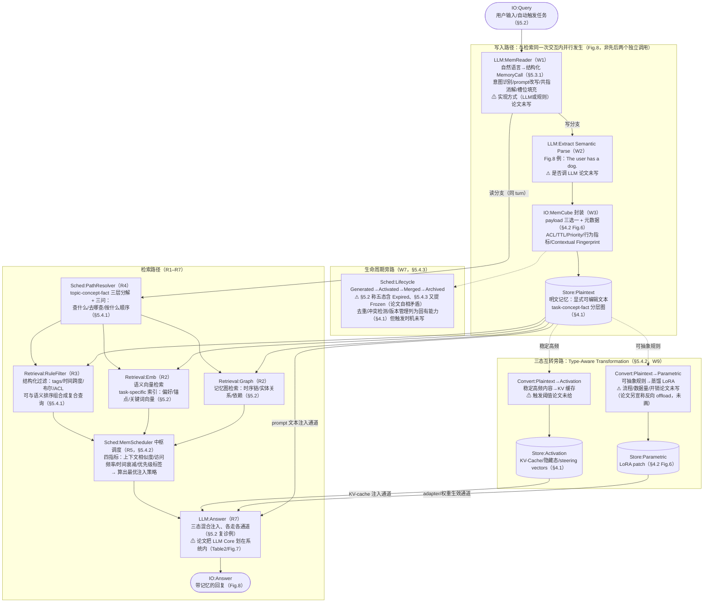

# MemOS methodology 流程图

> [!note] 资料来源与采信顺序
> 本图基于同目录 [paper-architecture.md](paper-architecture.md) 与 [code-architecture.md](code-architecture.md)，并已吸收 [verification.md](verification.md)（2026-09-05 复核，148 条逐条核对）的全部修正。**凡 architecture 文档与 verification 冲突处，一律以 verification 为准**，关键修正如右：
> ① 写入侧 reader 实为 `MultiModalStructMemReader`（`api/config.py:657` 默认，.env 未覆写），fine 模式跑 **4 路并行 LLM 抽取**（事实/工具轨迹/技能/偏好）——原架构文档按 `SimpleStructMemReader` 单次调用描述是结构性错误（C15/C2/C20）；
> ② 存储是 `Neo4jCommunityGraphDB` 双栈：节点属性进 Neo4j、**向量被 pop 出来送进 Qdrant**（`neo4j_community.py:151→155-165→194`），检索不走 Neo4j 原生向量索引（C47/C48）；
> ③ reranker 由 `.env:13 MOS_RERANKER_BACKEND=cosine_local` 指定（代码默认 `http_bge`，换 .env 即变 HTTP cross-encoder，C68）；
> ④ 论文章节锚点已按复核修正（如 task-specific 索引+记忆图在 §5.2 而非 §5.4.1，P18）。
> 图中 W#/R# 编号对应 verification.md 第 3/4 节步骤清单，[分歧D#] 对应其第 5 节分歧表。

## Paper 视角

> 论文：Li et al., *MemOS: A Memory OS for AI System*, arXiv:2507.03724v4（§3.2 / §4 / §5）。

![[assets/memos-paper-flow.png]]

### 核验真源



> [!note] 图中省略的部分
> - **基础设施层（§5.5）**：MemGovernance（三元权限模型/TTL/审计/水印）、MemVault（多命名空间，经 MemoryAdapter 统一 vector/graph/relational 后端）、MemStore（跨 Agent 发布订阅）——代码侧对应物见 Code 视角 DEAD 区 DD7 与分歧表 D13/D14。
> - **行为反馈（R8）**：命中记忆的 frequency/recency 回写 MemCube 元数据、驱动 caching priority（§4.2）。
> - **论文边界**：Table 2/Fig.7 把三类记忆与 LLM Core 全归 MemOS 内部（txt:685-686 说 LLM Core 是调度**手段**而非被调度对象，但 Fig.7 确实把 LLM 画在 MemOS 框内，P29）——与 memory-bench"记忆系统=外置 REST 服务、答题 LLM 在进程外"的范式方向相反。

## Code 视角

> repo `/Users/guanhongli/Documents/repo/MemOS` @ `8553242`（2026-08-18）；实机生效配置 `MemOS/.env`（memory-bench 部署）。覆盖链路：`/product/add`（async_mode=sync）与 `/product/search`（mode 未传→FAST）。

![[assets/memos-code-flow.png]]

### 核验真源



```mermaid
flowchart TB
    classDef llm fill:#dbeafe,stroke:#2563eb,stroke-width:2px
    classDef alg fill:#ffedd5,stroke:#ea580c,stroke-width:2px
    classDef nlp fill:#ecfccb,stroke:#65a30d
    classDef sched fill:#fef9c3,stroke:#ca8a04
    classDef store fill:#e5e7eb,stroke:#6b7280
    classDef io fill:#f3e8ff,stroke:#9333ea
    classDef dead fill:#fee2e2,stroke:#dc2626,stroke-dasharray:5 5
    classDef async fill:#f0fdf4,stroke:#16a34a,stroke-dasharray:4 3

    subgraph INGEST["写入路径：POST /product/add（每 session 一次整段提交，async_mode=sync → extract_mode=fine）"]
        direction LR
        M["IO:Session（W0）<br/>整段 turns 一次提交 server.py:69-79<br/>⚠ 论文为每 turn，粒度不同（分歧D10）"]
        IN["add 入口（W1）<br/>server_router.py:128 → single_cube.py:662 _process_text_mem<br/>extract_mode=fine（single_cube.py:686-689）"]
        RDR["MultiModalStructMemReader（W2-W4）<br/>api/config.py:657 默认（.env 未设 MEM_READER_BACKEND）<br/>scene 直通 :1257-1270 + token 滑窗 1024/overlap 200 :194-196"]
        EXT4["LLM:Extract ×4 路并行（W5，fine）<br/>multi_modal_struct.py:1020-1049<br/>①事实 string（每窗口 1 次 LLM :615）②工具轨迹 :900<br/>③技能 ④偏好——写入侧是多路 LLM，非单次调用"]
        MK["_make_memory_item（W6）simple_struct.py:220-256<br/>memory=LLM value（非原文）；sources=原始消息；background=summary<br/>type=fact 硬编码；confidence=0.99；status=activated"]
        EMB["Retrieval:Emb<br/>向量化对象=LLM 改写后的事实句<br/>simple_struct.py:247"]
        WB["_add_memories_batch（W7）<br/>manager.py:138（batch_size=5，≤8 线程）"]
        G[("Store:Graph = Neo4j<br/>节点属性<br/>（.env:14 neo4j-community）")]
        V[("Store:Vector = Qdrant<br/>向量从 metadata pop 出→Qdrant<br/>neo4j_community.py:151→155-165→194<br/>collection neo4j_vec_db｜cosine｜dim=2048")]
        FILTER["LLM:Judge 幻觉过滤（W6b）<br/>filter_hallucination_in_memories（listwise）<br/>SIMPLE_STRUCT_ADD_FILTER 默认 false 不跑<br/>simple_struct.py:709-734"]
        M --> IN --> RDR --> EXT4 --> MK --> EMB --> WB
        WB --> G
        WB --> V
        MK -.->|"默认关"| FILTER
    end

    subgraph ASYNC["异步旁路"]
        TQ["Sched:TaskQueue（W9）<br/>mem_scheduler 任务队列（≠论文中枢调度）<br/>ADD_TASK_LABEL single_cube.py:762→549-561<br/>registry.py:52（记账，副作用未追踪）"]
        UH["_update_usage_history（R10）<br/>usage 回写图库 searcher.py:187,1343<br/>⚠ 只写不用，不参与打分（分歧D16）"]
    end

    WB -.-> TQ

    subgraph RETRIEVE["检索路径：POST /product/search（mode 未传→FAST，全程零 LLM）"]
        direction LR
        Q["IO:Query（R0）<br/>server.py:101-160 显式 top_k / relativity=0.45"]
        TG["IO:Query 直通（R3）<br/>TaskGoalParser._parse_fast task_goal_parser.py:73-81<br/>FAST_GRAPH 默认 false：不调 LLM、query 原样透传<br/>= paper 图 LLM:MemReader 槽位的退化"]
        QE["Retrieval:Emb 查询向量（R4）<br/>searcher.py:349-351"]
        P6["6 路并行检索（R5/R5b）_retrieve_paths searcher.py:355（max_workers=5）<br/>B｜LongTerm+User :733（主路径：GraphMemoryRetriever recall.py:81<br/>图查询+Qdrant 向量；user_name/status/session 过滤）<br/>Tool :894｜Skill :989｜Preference :1043<br/>（与写入侧 4 路抽取同源的三路）<br/>A｜Working :505 恒空｜Internet :856 空转｜fulltext 不提交"]
        RR["Retrieval:Rerank（R6，每路内部各一次 searcher.py:80-96）<br/>CosineLocalReranker cosine_local.py:63-100<br/>.env:13 指定（代码默认 http_bge）<br/>⚠ level_weights 恒 1.0（level_field=background）"]
        FC["Fusion:Concat（R7）<br/>6 路 concat，无 RRF/无加权<br/>searcher.py:496-498"]
        TD["NLP:TextDedup + 分桶排序截断（R8/R9）<br/>searcher.py:1149（文本去重）+ :1158,1185<br/>按 memory_type 分桶各自 top_k，分数写回 relativity"]
        MM["Fusion:MMR（R11/R12）<br/>relativity<0.45 丢弃（search_handler.py:254，空桶=0 条）<br/>→ MMR 从 top_k×3 候选选回 top_k<br/>（:90-92 放大，注释误写 5x；:113-115）"]
        OUT(["IO:结构化 top-k（R13/R14）<br/>memory 文本+relativity+created_at<br/>formatters_handler.py:44｜不生成答案，答题 LLM 在 MemOS 进程外"])
        Q -->|"top_k←×3 :90-92"| TG --> QE --> P6 --> RR --> FC --> TD --> MM --> OUT
    end

    subgraph DEAD["论文宣称但本部署不存在/未启用"]
        DD1["Store:Activation / Store:Parametric<br/>+ Convert 三态互转 [分歧D1]<br/>act_mem=None, para_mem=None<br/>component_init.py:245-249（类存在不实例化）"]
        DD2["Sched:MemScheduler 三态中枢调度 [分歧D3]<br/>mem_scheduler 实为任务队列（语义漂移）<br/>task_schemas.py:31-41"]
        DD3["Sched:PathResolver（topic-concept-fact）[分歧D7]<br/>ParsedTaskGoal 无三层结构 retrieval_mid_structs.py:4-16<br/>MemoryPathResolver 仅 tree.py:179 过时 docstring"]
        DD4["Retrieval:BM25 / fulltext 关键词路径<br/>EnhancedBM25 注入开关 tree.py:59-61<br/>BM25_CALL / FULLTEXT_CALL 默认 false api/config.py:1243,1245"]
        DD5["GraphStructureReorganizer 合并/去重/冲突/建边 [分歧D12]<br/>实现存在默认关：component_init.py:223<br/>+ api/config.py:1234（.env 未设 MOS_ENABLE_REORGANIZE）"]
        DD6["MemoryReasoner 死代码<br/>searcher.py:69 实例化后全仓库无调用"]
        DD7["OS 模块命名体系 [分歧D2]<br/>MemOperator/MemLifecycle/MemGovernance/MemVault/MemStore/<br/>MemLoader/MemDumper/MemDecoder/MemBlock：零类定义<br/>仅 mos_prompts.py:112,222 提示词文案提及"]
    end

    G -.-> P6
    V -.-> P6

    class DD1,DD2,DD3,DD4,DD5,DD6,DD7 dead
    class TQ,UH async
```

> [!warning] 实机环境（MemOS/.env，memory-bench 部署）
> 生效：`NEO4J_BACKEND=neo4j-community`（向量出 Neo4j 进 Qdrant）、`MOS_RERANKER_BACKEND=cosine_local`（代码默认 `http_bge`，**换 .env 即变 HTTP cross-encoder**，C68）、`EMBEDDING_DIMENSION=2048`、`ENABLE_CHAT_API=false`（更接近论文 Fig.8 闭环的 `/product/chat/complete|stream` 不可用，生成永远在 MemOS 进程外，C76/分歧D15）。
> 未设（全部默认关）：`MEM_READER_BACKEND`（→ 默认 multimodal_struct）、`MOS_ENABLE_REORGANIZE`、`FAST_GRAPH`、`BM25_CALL`、`FULLTEXT_CALL`、`SIMPLE_STRUCT_ADD_FILTER`——图重组织/BM25/fulltext/幻觉过滤在本部署全部不发生。

> [!warning] memory-bench 适配层（servers/memos/server.py）改写
> ① **强制 async_mode=sync**：MemOS 开箱默认是 async+fast（不调 LLM、直接存窗口原文，C100），评测测的是非默认的 sync+fine 路径；② **relativity=0.45 显式传参**：locomo-r1 实测 1986 题中 78 题因全部候选低于阈值返回 0 条证据（C102 独立复现）；③ score 读 `metadata.relativity`（顶层无 score 字段）；④ **timestamp 修复实际未生效**：metadata 顶层无 `chat_time`（只存在于 `sources[]` 内），`server.py:143` 恒回落 `created_at` 入库墙钟（C106）；⑤ snapshot/restore 不支持（SNAPSHOT_UNSUPPORTED）。

## 新登记 module

| module | 类别 | 理由 |
|---|---|---|
| `LLM:MemReader` | LLM | 论文接口层组件（§5.3.1），承担意图识别/prompt 改写/共指消解/槽位填充；语义属 LLM 调用类，但论文未写实现方式——按父任务建议统一用 LLM 前缀以便跨系统对齐 MemReader 类组件，图内均带 ⚠ 注记 |
| `IO:MemCube` | IO | 论文核心封装单元（payload 三选一+元数据，§4.2 Fig.6），词表无对应类别，暂归 IO（数据容器） |
| `Convert:Plaintext→Parametric` | Convert | 词汇表已有 `Convert:<A>→<B>` 格式及 `Convert:Plaintext→Activation` 例子；Parametric 方向为同格式新实例（论文宣称双向互转含反向 offload，图只画主方向） |
| `Retrieval:RuleFilter` | Retrieval | 结构化规则过滤（tags/时间跨度/布尔/ACL，§5.4.1），词表无对应；区别于 BM25 等稀疏检索 |
| `Sched:PathResolver` | Sched | 论文 MemoryPathResolver（§5.4.1）：回答"查什么/去哪查/按什么顺序"的路由组件，归调度类 |
| `Sched:Lifecycle` | Sched | 论文 MemLifecycle（§5.4.3）状态机，归调度类 |
| `Retrieval:Rerank` | Retrieval | 检索后重排（cosine_local 余弦重排）；rerank 是多系统通用环节，建议进词表统一 |
| `Fusion:Concat` | Fusion | 多路结果纯拼接（无 RRF/无加权，searcher.py:496-498），区别于 `Fusion:Add`/`Fusion:RRF` |
| `Fusion:MMR` | Fusion | MMR 去重排序（top_k×3 放大后选回 top_k） |
| `NLP:TextDedup` | NLP | 检索结果按 memory 文本去重（searcher.py:1149），区别于写入侧 `NLP:HashDedup` |
| `Sched:TaskQueue` | Sched | 代码侧 mem_scheduler 实际语义（异步任务队列，task_schemas.py:31-41）；与论文 `Sched:MemScheduler` 分开命名以如实反映语义漂移（分歧D3） |

已直接使用词表既有项：`Sched:MemScheduler`、`Store:Plaintext`/`Store:Activation`/`Store:Parametric`、`Convert:Plaintext→Activation`、`Retrieval:Emb`、`Retrieval:BM25`、`Retrieval:Graph`、`Store:Graph`、`Store:Vector`、`LLM:Extract`、`LLM:Answer`、`LLM:Judge`、`IO:Query`、`IO:Answer`、`IO:Session`。

## 不确定处

1. **MemReader / Semantic Parse 是否调 LLM**：论文全文未写（无伪代码/算法块，P12）；paper 图按父任务建议用 LLM: 前缀+⚠ 注记处理，非断言。
2. **mem_scheduler 收到 ADD_TASK_LABEL 后的具体副作用**：只追踪到 registry.py:52 路由到 `self.add` 处理器，未继续读实现（verification W9）；图中 Sched:TaskQueue 标"记账，副作用未追踪"。
3. **GraphMemoryRetriever 内部融合逻辑**：图查询与向量检索两路结果的合并/加权未读 500+ 行实现（docstring 自述"Merge and return combined result set"）；图中 Path B 仅标双路召回。
4. **async_mode=async（开箱默认）完整链路未追踪**：强制 extract_mode=fast 跳过 LLM 抽取、转 mem_scheduler 异步处理（single_cube.py:686-687）——即 memory-bench 测的 sync+fine 并非 MemOS 出厂行为。
5. **rerank 所读候选 embedding 的来源链路**：verification 复核了 cosine_local.py:63-100 读 `metadata.embedding`，但向量写入时被 pop 进 Qdrant（neo4j_community.py:151），检索路径上何时/是否完整回填该字段未逐行验证。
6. **论文自身矛盾**（已按 verification 采信并在图内注明，非本文档缺口）：生命周期五态（§5.2）vs 四态（§5.4.3）+ Frozen（txt:1481-1484）；task–concept–fact（§4.1）vs topic–concept–fact（§5.4.1）；Fig.7 与 Fig.8 子模块不对齐（P38：Fig.8 实际画了 Memory Pipeline 与 Memory API，仅缺 LogQuery）。

## 生图 prompt 素材

### Paper flow prompt

```text
Create a wide academic systems flowchart for MemOS in the approved Mem0 visual style. White background; two horizontal lanes; LLM blue rectangles, Retrieval orange rectangles, Schedule yellow rectangles, stores gray cylinders, IO purple pills, Convert purple dashed boxes. IO:Query enters LLM:MemReader, then splits. INGEST lane: LLM:Extract -> IO:MemCube -> Store:Plaintext, with dashed branches Convert:Plaintext→Activation -> Store:Activation and Convert:Plaintext→Parametric -> Store:Parametric; add Sched:Lifecycle as a side box. RETRIEVE lane: Sched:PathResolver fans to Retrieval:RuleFilter, Retrieval:Emb, Retrieval:Graph; converge into Sched:MemScheduler -> LLM:Answer -> IO:Answer. Draw Store:Plaintext into retrieval, Store:Activation into Answer as KV channel, Store:Parametric into Answer as adapter channel. Short English labels only; include canonical legend; no citations or decoration.
```

### Code flow prompt

```text
Create a wide academic systems flowchart for MemOS code in the approved Mem0 visual style. INGEST lane: IO:Session -> MultiModalStructMemReader -> LLM:Extract ×4 -> memory item -> Retrieval:Emb -> Store:Graph (Neo4j) and Store:Vector (Qdrant). RETRIEVE lane: IO:Query -> IO:Query passthrough -> Retrieval:Emb -> parallel paths Retrieval:Graph+Vector, Tool, Skill, Preference, Working(empty), Internet(empty) -> Retrieval:Rerank (cosine) -> Fusion:Concat -> NLP:TextDedup -> Fusion:MMR (threshold 0.45) -> IO:Structured top-k. Add a red dashed PAPER-ONLY / DISABLED panel: Store:Activation, Store:Parametric, Convert three-state memory, Sched:MemScheduler, Sched:PathResolver, Retrieval:BM25, graph reorganization, OS-named classes. LLM blue, Retrieval orange, Fusion/Schedule yellow, NLP green, stores gray cylinders, IO purple pills, dead red dashed. Short English labels only; canonical legend; no citations or decoration.
```
