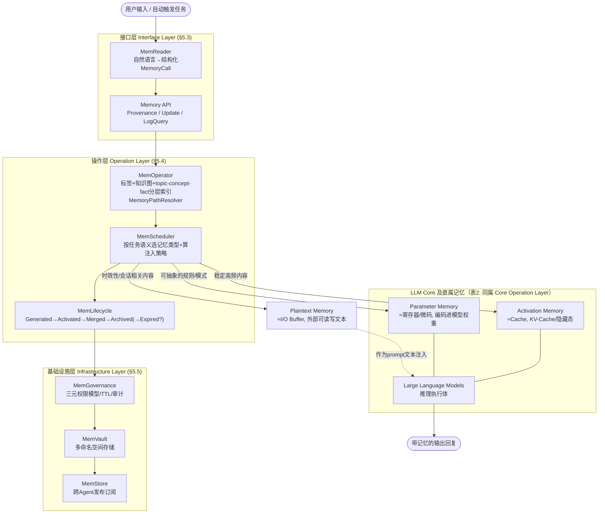

# MemOS 论文架构

> 论文：Li et al., *MemOS: A Memory OS for AI System*, arXiv:2507.03724v4（本地文本：
> `/Users/guanhongli/Documents/wafo-base/literature/papers/Li-2025-MemOS-A-Memory-OS-for-AI-System.txt`）。
> 本文档只覆盖论文里定义"记忆怎么存、怎么用"的架构性章节（§3.2、§4、§5），不涉及 §6/§7 的 benchmark 分数。
> 术语第一次出现时给一句话解释；论文原文引用用中文转述并标章节号，不确定/论文没写的地方明确标出，不用推测填。
> **2026-09-05 勘误**：本文已按同目录 `verification.md` 的逐条复核结论修正（共 9 处：0 处事实、4 处行号/锚点、
> 5 处表述限定）。原始未修正版本见 git 历史。

## 1. 一句话机制

论文把 LLM 的记忆资源类比成传统操作系统要管理的硬件资源（§3.2），提出一个统一封装单元 **MemCube**（§4.2），把三种
性质完全不同的记忆——外部可读写的文本记忆（Plaintext Memory）、推理过程中的 KV-Cache 等中间状态（Activation
Memory）、模型权重里编码的知识（Parameter Memory）——都包成同一种"元数据 + 载荷"结构，再靠一个三层架构（接口层/
操作层/基础设施层，§5.1）和中枢调度器 **MemScheduler**（§5.4.2），让这三种记忆可以互相转化、按需调度、全生命周期
可追溯。

## 2. 记忆是怎么存进去的

**触发**：论文没有给出类似"REST 端点"这样具体的触发方式，最接近的描述是 §5.2（配图 Figure 8）画的一条单一执行
闭环——"系统执行由用户交互或自动触发的任务启动"（§5.2 开篇）。Figure 8 举的例子里，用户说了一句"My dog needs
help!"，图中同时画出 "Semantic Parse: The user has a dog." 生成一个新的 `MemoryCube (extracted)`，和检索出一条
已有的 `MemoryCube (retrieved)`（"To raise a dog, you need to prepare a comfortable…"）——**在论文的图示里，"写入
新记忆"和"检索旧记忆"是同一次交互内同时发生的两件事，而不是先后两个独立调用**。

**存的是什么**：MemCube 的 Memory Payload 三选一（§4.2，Figure 6 给了示例 JSON）：
- Plaintext：`{"type": "explicit", "format": "text", "content": "You are a helpful assistant in climate
  policy."}`——显式、可编辑、可独立存储的文本知识。
- Activation：`{"type": "activation", "format": "tensor", "injection_layer": 12, "value": "[tensor]"}`——某一层的
  张量（KV-Cache/隐藏态一类的中间状态）。
- Parametric：`{"type": "parametric", "format": "lora_patch", "module": "mlp.6.down_proj", "value":
  "[low-rank-delta]"}`——LoRA 一类的低秩权重增量。

具体存成哪一种，由 §5.4.2 描述的 MemScheduler"Type-Aware Transformation"逻辑决定：稳定且高频访问的内容转成
Activation Memory 做 KV 缓存；可抽象的规则/模式蒸馏成 Parameter Memory；时效性强、会话相关的内容留作 Plaintext
Memory，以原始文本形式注入 prompt。

**存的过程调不调 LLM**：**论文没写**——不是"未验证"，是论文全文没有给出算法级细节（没有伪代码，没有"调用 LLM 生成
JSON"这类具体描述）。唯一能确定"这一步涉及语言理解"的地方是 §5.3.1：MemReader"将自然语言输入转成结构化
`MemoryCall`"，§5.3.1 自己举的例子是 "Remind me what the doctor said about my medication during last year's
hospitalization"（另一个常被引用的例子 "Summarize my meeting notes from last month" 出自 **§5.1**，不是
§5.3.1），MemReader 从中抽出时间范围、记忆类型、输出目标——但论文没有说这一步是调用 LLM，还是走规则/实体识别
（NER）。需要补一句的是：§5.3.1 **确实列出了 MemReader 的能力清单**——intent 识别之外还有 prompt rewriting、
coreference resolution（指代消解）、dialogue memory slot filling 三项，所以"论文对 MemReader 只字未提实现"这个
说法过头了，准确的说法是"能力写了、机制没写"。§4.1 提到 Plaintext Memory"支持冲突检测、去重、
版本管理"，同样没写这些操作靠不靠 LLM、在什么时机触发。

**证据**：§4.1（Types of Memory）、§4.2（MemCube，Figure 6）、§5.2（Execution Path，"Prompt Input and Memory API
Packaging"段，Figure 8）、§5.3.1（MemReader）。

## 3. 记忆是怎么被用起来的

**触发**：紧接在"写入"之后的同一个闭环（§5.2，Figure 8）。这里的"分几段"论文自己就有两套说法：§5.2 正文自述是
四段（input parsing → memory scheduling → state management → storage archiving），但同一节实际排了**五个**小
标题——Prompt Input and Memory API Packaging → Memory Retrieval and Organization → Memory Scheduling and
Activation → Lifecycle Modeling and State Transitions → Storage Archiving and Access Governance。下面按后四个
小标题（即"写入"动作之后的部分）展开。

**拿什么去找**：操作层的 **MemOperator**（§5.4.1）用 MemReader 解析出的意图/上下文做语义匹配，构建
"task-specific 索引（用户偏好、锚点、关键词向量）和记忆图（时序链、实体关系、依赖）"来筛候选（**这段被引的文字
出自 §5.2 的 "Memory Retrieval and Organization" 段，不是 §5.4.1**——§5.4.1 的四个子标题是 Multi-perspective
Memory Structuring / Hybrid Retrieval and Dynamic Dispatch / Pipeline Coupling and Caching Strategy /
Task-Aligned Memory Routing）。检索机制被描述成"混合"的：
- 结构化检索：基于标签、时间跨度、布尔条件、访问控制策略的规则过滤；
- 语义检索：基于向量相似度的 embedding 检索；
两者可以组合成复合查询（如"标签过滤+语义排序"）。

§5.4.1 还专门提出一个 **Task-Aligned Memory Routing** 机制：用户输入被拆解成 "topic–concept–fact" 三层任务模式
（原文用词，注意 §4.1 另一处用的是"task–concept–fact"，两处措辞不一致，见第 6 节），由一个叫
**MemoryPathResolver** 的组件回答三个问题——查什么、去哪查、按什么顺序查。

**一步到位还是多步迭代**：论文没有明确说明这是单步检索还是"检索不够再检索一次"的多轮迭代。§5.4.1/§5.2 描述的都是
"一次检索 → 一次调度"的线性流程，没有提到失败重试或反馈式扩展检索。

**找到之后怎么交给模型**：这是论文和常见 RAG（检索增强生成：把检索到的文本直接拼进 prompt）最不一样的地方——不是
简单地把命中内容拼进上下文。§5.2"Memory Scheduling and Activation"段描述：**MemScheduler** 用"上下文相似度、访问
频率、时间衰减、优先级标签"算出"最优注入策略"，把候选记忆按类型分别注入——论文给的例子是一次复诊场景里，系统同时
注入最近问诊摘要（作为 Activation Memory）、诊断模板（作为 Parameter Memory）、生活建议（作为 Plaintext
Memory）。也就是说**三种记忆可以在同一次回复里混合使用、各走各的注入通道**（KV 缓存注入 / 模型权重或 adapter 生效
/ 文本注入 prompt），而不是统一转成文本塞进上下文。

**证据**：§5.2（Execution Path，"Memory Retrieval and Organization"段、"Memory Scheduling and Activation"段，
Figure 8）、§5.4.1（MemOperator，"Hybrid Retrieval and Dynamic Dispatch"段、"Task-Aligned Memory Routing"段）、
§5.4.2（MemScheduler，"Type-Aware Transformation and Loading Mechanism"段）。

## 4. 架构图

**边界说明**：论文没有把"记忆系统"和"agent/backbone 模型"画成两个用 API 分隔的独立进程。相反，Table 2（§3.2）把
Parameter Memory、Activation Memory 和 Plaintext Memory 一起归入"Core Operation Layer"，分别类比成 CPU 的
寄存器/微码、Cache、I/O 缓冲区。这里要给一个限定：§3.2 原句是"MemOS **通过** LLM Core 和 MemScheduler 协同调度
推理与记忆块"——严格读，LLM Core 是调度的**手段**而不是**被调度的对象**；但 Figure 7 确实把
`Large Language Models` 画在 `MemOS` 框**内**，所以**"论文的 OS 隐喻把 LLM Core 圈进了 MemOS 的边界之内"这个
方向仍然成立**，只是它是从图示读出来的，不是 §3.2 那句话直接说的。Parameter/Activation 两种记忆在概念上就"长在"
模型内部（权重、推理时的中间状态），只有 Plaintext Memory 是清晰意义上的"外部系统"。这和 memory-bench 实际测试的
"记忆系统作为独立 REST 服务、agent 是外部调用方"的范式（见 `code-architecture.md` 第 4 节）在概念层面并不一样：
论文构想的边界更像"操作系统与它管理的进程"，而不是"外置工具与调用它的客户端"。

## 5. 我没搞清楚的

- **MemReader 从自然语言到结构化 `MemoryCall` 具体怎么实现**（LLM？规则？NER？）——**机制**论文全文没写；但
  **能力清单是写了的**：§5.3.1 明确列出 intent 识别、prompt rewriting、coreference resolution、dialogue memory
  slot filling 四项，只是没说每一项各自靠什么实现，见第 2 节。
- **"写入"这个动作从未脱离"一次问答闭环"被单独描述过**——如果没有用户提问（比如后台批量导入文档），MemCube 具体
  怎么生成、走什么流程，论文没有给出单独的算法描述。
- **Activation Memory 怎么从"这次对话产生的 KV"变成"可以被下次调度复用的持久 MemCube"**——§4.1 给的是定性说法
  （"以 KV-Cache 为核心结构"，"高频 KV 模式被缓存成低延迟的 instant memory paths"，也可表现为 steering
  vectors 或 semantic templates）；真正没给的是**格式与触发机制**：跨 session 怎么持久化、什么条件下复用，论文没写。
- **Parameter Memory"蒸馏成 LoRA/adapter"具体在什么时候触发、需要多少数据、训练开销多大**——论文只说"可以"这样做
  （§4.1、§5.4.2），没有给出触发条件、流程或伪代码。
- **MemGovernance 的"三元权限模型"（用户身份/记忆对象/调用上下文）具体判定逻辑是什么**——是一套访问控制列表规则，
  还是需要跑一次模型判断？论文（§5.5.1）只描述了效果（"仅医生可访问患者诊断记录"一类的例子），没给判定机制。
- **生命周期状态机的触发条件没有量化**——论文举的都是定性例子（"if frequently accessed" → Activated 这句出自
  **§5.2**，"no longer accessed for a prolonged period" → Archived 这句才在 §5.4.3），没有给出"多久算频繁"
  "多久算长期未访问"之类的阈值。

## 6. 论文没写清楚的地方

1. **生命周期状态数量前后不一致**：§5.2 正文说"Each memory item transitions through five states—Generated,
   Activated, Merged, Archived, and Expired"（五态）；§5.4.3 又说"cycling through four key states: Generated,
   Activated, Merged, and Archived"（四态，少了 Expired）。这是论文自身两处描述的直接矛盾，不是我们读漏了。
2. **"topic–concept–fact" 三层任务分解的措辞前后不一致**：§4.1 说 MemOS"manages plaintext memory in a
   hierarchical graph structure organized by **task–concept–fact** paths"；§5.4.1 说"User inputs are decomposed
   into a **topic–concept–fact** structure"。"task" 和 "topic" 只差一个词，但论文两处都在描述同一个"三层"机制，
   没有说明这是笔误还是两个不同的概念。
3. **Figure 7（静态三层架构图）和 Figure 8（动态执行流程图）没有严格一一对应**：Figure 7 列出的接口层子模块包括
   Memory API/Pipeline、Memory Log Query（API）等（§5.3.3、§5.3.2）。这里要收窄一点说法：**Figure 8 里其实画了
   `Memory Pipeline` 和 `Memory API`**，真正没出现在 Figure 8 里的只有 LogQuery API；但即便是画出来的那两个，
   Figure 8 也没有标明它们对应执行流程中的哪一步，两张图能否拼成同一套无歧义的调用序列，论文没有讲清楚。
4. **"三种记忆统一调度"的量化收益没有给出**：MemScheduler 的"Cross-Type Conversion and Migration"（§5.4.2）
   说得比较宏观（"频繁被跨 session 调用的 plain memory 可能被提升为 Activation Memory"），但没有给出触发这个迁移
   的具体量化指标，§6 的实验部分是端到端 benchmark 分数（LoCoMo、LongMemEval 等），没有针对"跨类型迁移"这个机制
   单独做消融实验来验证它本身的收益。
5. **MemCube 维护三态统一的额外开销没有讨论**：把一段内容同时准备成 Plaintext、（可能转的）Activation、（可能
   蒸馏的）Parameter 三种形态，理论上会有额外的存储和计算成本，论文没有量化讨论这部分开销——§6.5/§7 的延迟实验
   （Table 8，Figure 10）测的是"KV 注入本身相对于全量 prefill 的 TTFT 加速"，衡量的是 Activation Memory 这一种
   形态的收益，不是"同时维护三态统一"这个架构选择本身的代价。
