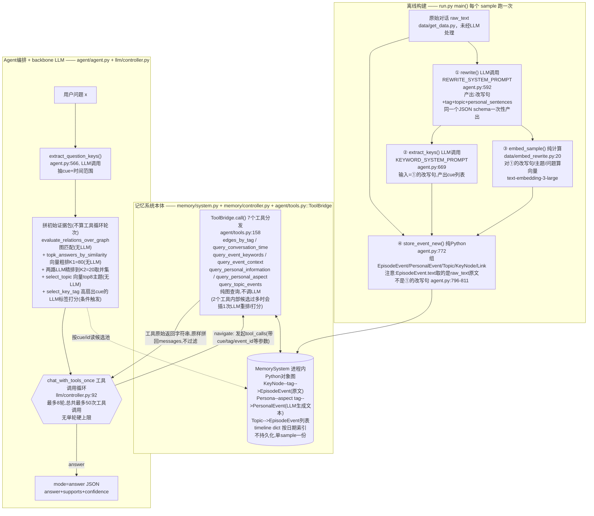

# MRAgent 代码架构

> 读的是 `/Users/guanhongli/Documents/repo/MRAgent`（commit `7441506`，单提交仓库，无 tag/无 CHANGELOG）。
> 只读了 `run.py` / `agent/` / `memory/` / `llm/` / `prompts/` / `common/` / `data/get_data.py` / `data/embed_rewrite.py`，
> 没进 `data/dataset_*.json`、`.venv`、`__pycache__`，也没有实际跑起来（无 API key，只静态读代码）。
> 全部结论都能在下面对应的 `文件:行号` 位置核实。

## 1. 一句话机制

MRAgent 把一段长对话离线预处理成一张纯 Python 内存对象图（关键词 KeyNode—标签 Tag—内容 EpisodeEvent/PersonalEvent/Topic，进程内、单次 run 只服务一个对话样本、不持久化），回答问题时先用「图关键词匹配 + 向量粗排 + 两路 LLM 精排」拼出一份初始证据包，再把这份证据包交给一个最多 8 轮的 LLM 工具调用循环，让模型自己决定要不要继续在图上翻页（查标签、查上下文、查人物侧写、查主题）直到吐出最终答案。

## 2. 记忆是怎么存进去的

**触发时机**：不是逐轮写入。`run.py:184-205`（`main()`）里，对 `conversation_list` 里的每一个 sample（一整段长对话，包含多个 session），依次跑完 rewrite → keyword → embedding → store 四步，一次性把整段对话灌进图里；图对象 `MemorySystem()` 在 `run.py` 主循环里对每个 sample 重新 `new` 一次（不是从上一个 sample 继续累积），也不跨进程持久化——重启程序会从磁盘缓存的中间 JSON/pkl 文件重新组图，而不是恢复内存状态。

**存的是什么 / 调不调 LLM**（按管线顺序）：

1. **rewrite（LLM 调用 1/2，per-session）**——`agent/agent.py:592`(`rewrite`) 经 `agent/agent.py:623`(`rewrite_sample`)/`agent/agent.py:657`(`rewrite_sentence`) 调用，prompt 是 `REWRITE_SYSTEM_PROMPT`（`prompts/prompts.py:18-67`）。**一次 LLM 调用**在同一个 JSON schema 里同时产出四样东西：代词消解后的改写句（`sentence[].text`）、每句一个的短标签（`sentence[].tag`）、至少 10 个主题（`topics{}`）、人物相关的语义事实（`personal_sentences[]`）。结果落盘缓存到 `data/<ds>/rewrite_<model>/<sample_id>_rewrite.json`，文件已存在则跳过重算（`run.py:182-185`）。
2. **keyword extraction（LLM 调用 2/2，per-session）**——`agent/agent.py:669`(`extract_keys`) 经 `agent/agent.py:712`(`extract_keyword`)/`agent/agent.py:665`(`extract_keyword_sample`) 调用，prompt 是 `KEYWORD_SYSTEM_PROMPT`（`prompts/prompts.py:69-99`），输入是第1步产出的**改写句**（`agent/agent.py:737-743` 显式丢弃 tag/origin/topic/time，只留 `{id, text}` 喂给这一步，避免 LLM 抄现成标签）。产出每句的 cue 关键词列表，缓存到 `keyword_<model>/*_keyword.json`。
3. **embedding（纯计算，非 LLM 推理）**——`data/embed_rewrite.py:20`(`embed_sample`) 读第1步的改写句文本 + 主题文本，批量调 `text-embedding-3-large`（`llm/embeddings.py:34-36`，经 OpenRouter 代理，3072维，L2归一化，`llm/rag_utils.py:10-26`），缓存到 `embedding/gpt_<model>/*_embedding.pkl`。**问题的 embedding 也在这一步一次性算完**（`data/embed_rewrite.py:12`(`embed_question`)），不是问答时现算。
4. **组图（纯 Python，不调 LLM）**——`agent/agent.py:864`(`store_raw_text`) 把原始对话文本 `raw_text`（来自 `data/get_data.py`，未经任何 LLM 处理）和第3步的向量灌进 `MemorySystem`；`agent/agent.py:748`(`store_keyword`)→`agent/agent.py:772`(`store_event_new`) 读第1、2步的缓存文件，为每句改写句建一个 `EpisodeEvent`（`memory/system.py:78-96`），为每条人物事实建一个 `PersonalEvent`（挂在 `Persona` 桶下，`memory/system.py:45-76`），为每个主题建一个 `Topic`（`memory/system.py:38-43`），为每个 cue 建一个 `KeyNode` 并用 `Link` 连到对应 episode（`memory/system.py:16-36, 99-105`）。**说话人会被强制补进这句话的 cue 列表**，哪怕 LLM 没抽到（`agent/agent.py:847-848`：`if speaker not in ks: ks.append(speaker)`）。

**关键细节（容易看漏）**：`EpisodeEvent.text` 存的不是第1步 LLM 改写后的句子，而是重新按 `origin`（`dia_id`）去 `raw_text` 里查出来的**原始对话行**（`agent/agent.py:796-803`：`embedding = self.memory.embeddings[id]` 取的是改写句的向量，但紧接着 `text = self.memory.raw_text[prefix].get(origin)` 把 `text` 覆盖成原文；`agent/agent.py:811` 用这个 `text` 建 `EpisodeEvent`）。也就是说：**改写句只活在向量空间里（决定谁和谁相似），图里真正存的、后续所有工具和检索路径实际展示给回答模型的内容，是未经代词消解的原始对话原文**。Topic 和 PersonalEvent 则没有这个替换——它们的文本就是 LLM 直接生成的内容（`agent/agent.py:778, 821`；`agent/agent.py:779-829`）。这条不是"论文没提到的实现细节"，而是直接关系到"图里存的到底是什么文本"的核心事实，第6节详细展开。

## 3. 记忆是怎么被用起来的

**触发时机**：每个问题一次，同一个 sample 下的所有问题用 10 个线程并发跑（`run.py:31`(`get_question`)，`ThreadPoolExecutor(max_workers=10)`），每个线程各自 new 一份 `LLM`/`MemoryController`/`Agent`，但共享同一个只读的 `memory_system`。

**拿什么去找**（`agent/agent.py:450`(`answer_question`) 主流程）：

1. 先用 LLM 抽问题的 cue + 时间范围（`agent/agent.py:566`(`extract_question_keys`)，`QUESTION_KEY_SYSTEM_PROMPT`，`prompts/prompts.py:206-218`）。
2. 图匹配（**不用向量**，纯文本归一化 + 子集/Jaccard 相似度匹配 `KeyNode`，`memory/controller.py:214`(`match_query_key_to_graph_keys`)），拿到 `evaluate_relations_over_graph`（`memory/controller.py:263`）返回的 `full_matches`/`partial_matches` 候选事件池。
3. **有明确时间** → 走 `timeline` dict 的日期索引快速通道（`memory/system.py:137-146`；locomo 阈值 `TIME_EVENT_LIMIT=50`，判定在 `agent/agent.py:69`，属于 `agent/agent.py:64`(`answer_question_with_time`)；LM 阈值用的是 `K2=20`，判定在 `agent/agent.py:117`，属于 `agent/agent.py:111`(`answer_question_with_time_lm`)，两个数据集用了不同阈值常量，是否有意为之未在注释里说明）；候选够少直接给，太多则退回第4步的图匹配结果按时间过滤。
4. **没时间 / 时间通道没查到东西** → 候选数 > `K1=80` 就用 embedding 点积做粗排（`common/utils.py::topk_answers_by_similarity`，`agent/agent.py:497`），dedup 之后候选数 > `K2=20` 再触发**两路不同的 LLM 精排**：`select_finegrained_sentence`（`agent/agent.py:244`，prompt=`ANSWER_SORT_PROMPT2`/`prompts/prompts.py:112-117`，让模型直接挑 ≤20 个相关 id）和 `select_finegrained_sentence_sort`（`agent/agent.py:309`，prompt=`ANSWER_SORT_PROMPT`/`prompts/prompts.py:104-110`，让模型给每条打 0-1 分再取前 `K2`），**两次结果取并集去重**（`agent/agent.py:524-534`）。
5. 另开一路**独立的**向量检索：`select_topic`（`agent/agent.py:236`）用问题向量在全部主题向量里取 top `TOPIC_K=8`，和第4步的证据完全不合并、并列塞进最终上下文。
6. 对问题里覆盖标签数 > `TAG_MAX=15` 的 cue，`select_key_tag`（`agent/agent.py:392`）再触发一次 LLM 给标签相关性打分（prompt=`EVENT_KEYWORDS_SYSTEM_PROMPT`，`prompts/prompts.py:6-16`），分数 ≥0.7 的标签直接把该 cue-tag 组合下的原文预取进 `key_tag_sentences`——**这一步在工具循环开始前，就已经替模型执行了一次等价于 `edges_by_tag` 工具调用的操作**。

**一步到位还是多步迭代**：上面 1-6 步全部只是在拼**一份初始证据包**（`ans_input = {question, key_sentences, keys_candidates, key_tag_sentences, similar_topic}`，`agent/agent.py:539-548`），不是答案本身，这部分本身不算论文意义上的"多轮"。拼完之后才进入真正的多步循环——`_chat_with_tools`（`agent/agent.py:30`）调 `LLM.chat_with_tools_once`（`llm/controller.py:92`），**最多 8 轮**（`MAX_ROUNDS=8`，`common/config.py:66`；到第 8 轮会强制把 system prompt 换成只能回答的 `ANSWER_SYSTEM_PROMPT_FINAL`，`llm/controller.py:140-143`），**总共最多 50 次工具调用**（`MAX_TOOL_CALLS=50`，`common/config.py:67`，是跨全部轮次的全局预算，代码里没找到"单轮最多 N 次"的硬编码上限，`llm/controller.py:187-189` 只在总数超预算时整体截断）。模型每轮从两种模式二选一：`"mode":"answer"` 直接给答案并 `break`（`llm/controller.py:178-181`），或者发起 `tool_calls` 进入 `navigate`。7 个工具（`TOOLS` 列表定义在 `agent/tools.py:4-155`，里面还有一个被注释掉的第8个工具 `score_event_relevance`未启用）全部是纯 Python 图查询、不调 LLM，由 `ToolBridge.call()` 分发（`agent/tools.py:158-193`）；其中 2 个工具内部在候选过多时会**临时插一次 LLM**：`event_by_tag` 候选 > `RERANK_LIMIT=20` 用 embedding 重排（`memory/controller.py:29-47`），`query_event_keywords_single` 遇到某个 cue 标签数 > `TAG_MAX` 且该 cue 未被问过时用 LLM 打分选 `TAG_LIMIT=10` 个（`memory/controller.py:54-96`）。

**找到之后怎么交给模型**：所有工具返回结果**原样**拼回 `messages` 数组（`_append_if_list` 定义于 `llm/controller.py:114`，调用于 `llm/controller.py:223`），代码里没有一个独立的"路由/剪枝"函数去过滤已经拿到的证据——模型每一轮都能看到此前全部原始工具输出，是否"剪枝"完全体现在模型自己选择下一步查什么、要不要收尾，不是代码删掉了什么。收尾要么是模型自己吐出 `{"mode":"answer",...}` 的 JSON（判断逻辑在 `llm/controller.py:178-181`），要么被第 8 轮的强制 prompt 逼着只能回答。最终 `memory.get_support_origin()`（`memory/system.py:372-376`）把证据 id 映射回 `dia_id` 用于评测。

## 4. 架构图

**边界说明**：`memory/system.py`（图数据结构+7个查询方法）+ `memory/controller.py`（图匹配/重排辅助）+ `agent/tools.py::ToolBridge`（工具分发）是"记忆系统自己的"——纯存储与按结构化条件（cue/tag/event_id/topic_id/person）取数据，本身不做语义判断。`agent/agent.py`（问题理解、初始证据包拼装、多轮编排）+ `llm/controller.py`（裸 chat/tool-calling 封装）+ `prompts/`（全部 prompt 文本）是"agent/backbone 模型"侧——两边通过两类接口交换信息：①启动时 Agent 把拼好的 `ans_input`（question + 候选证据 + candidates）作为一条 user message 喂给 LLM；②工具循环里 LLM 发起 `tool_calls`（JSON 参数，如 `{tag, key, note}`），`ToolBridge` 执行后把结果字符串包成 `role:"tool"` message 传回。图本身从不主动推送数据，也不知道"当前在第几轮/为什么被查"。

## 5. 我没搞清楚的

- 没有实际跑通 pipeline（无 API key，只静态读代码），所以论文 Table 3 的 118k token / 586s 这类量级是否真的对应这套代码的默认配置，没法用代码验证，只能确认代码结构上支持"轻量构建+多轮检索"这个方向。
- `REWRITE_SYSTEM_PROMPT` 要求"derive at least ten concrete topics overall"，但 `prompts/schema.py::check_rewrite_json` 只校验 `sentence[]` 数组本身的字段格式，没看到对 `topics` 数量下限的硬校验（`prompts/schema.py` 全文读过，`SCHEMA["properties"]["topics"]` 只写了 `"type":"object"`）——短对话是否真的总能凑够 10 个主题、凑不够时是否触发 3 次重试（重试机制本身在 `agent/agent.py:602-618`，但只在 JSON schema 校验失败时触发，主题数量不足并不会导致 schema 校验失败），没跑无法验证。
- `config.py` 里 locomo 用 `TIME_EVENT_LIMIT=50` 而 LM 用 `K2=20` 作为"稠密时间快速通道"的判定阈值（`agent/agent.py:69` vs `agent/agent.py:117`），两个数据集为什么用不同的常量，代码注释没解释，猜测是经验调参但没有验证。
- 只对 `agent/` `memory/` `llm/` `prompts/` `common/` `data/get_data.py` `data/embed_rewrite.py` 做了针对性 grep + 通读，没有逐行读完 `eval/`（judge.py/evaluation.py，评测口径与本次任务无关，按硬要求5"避免盲目全量扫描"跳过）。
- LM 分支 `--lm_batch > 1`（多 session 合并成一次 rewrite 调用）时的鲁棒 reader 逻辑（`agent/agent.py` 里标了 `[LM]`/`[batch>1]` 的分支）只读了代码没跑过对应数据，边界情况（比如合并批次里的 id 冲突处理）是否真的如注释所说工作，未验证。

## 6. 与论文的冲突点

1. **【最大冲突】图里存的"事件内容"不是论文描述的改写文本，而是原始对话原文。** 论文 §B.1 / Eq.18 写的是「`{e_i} ← R_LLM(T)`，先改写消解代词、把 cue 变显式，再把处理后的文本切成 episodic units `{e_i}`」，字面意思是 episode 单元 = 改写后的文本。但代码里 `EpisodeEvent.text` 明确是重新按 `origin` 去 `raw_text` 查回来的**原始对话行**，改写句只用来算 embedding（决定谁和谁相似）和抽标签/主题/关键词的输入，改写句本身在建图那一刻就被丢弃、从不出现在任何工具返回结果或最终喂给回答 LLM 的上下文里（`agent/agent.py:796-811`）。也就是说"代词消解让 cue 显式"这个论文强调的设计意图，实际上只体现在向量层面，回答模型看到的原文仍然是"他/她/这个"没被替换的版本。这一条我信度最高（三处交叉验证：`ee.get("text")` 从未被读取、`embed_sample` 明确读的是改写句、`EpisodeEvent` 构造时 `text` 变量被原文覆盖）。
2. **论文 Algorithm 1 的 `Z^(0) ← ActiveSetInit(C, G)` 读起来像一步简单的"cue 匹配图拿初始候选"，代码在进入工具循环前实际做了 5-6 种机制**：图匹配（无 LLM）→ embedding 粗排到 `K1=80`（无 LLM）→ 两种不同 prompt 的 LLM 精排到 `K2=20` 再取并集 → 独立的 embedding 主题 top-8 → 条件触发的 LLM 标签打分预取证据（第3节步骤1-6）。论文的数学形式化里没有任何一处提到"两路 LLM 精排取并集"或"embedding 粗排+LLM 精排两段式"，Table 3 的 token/runtime 统计口径是否包含这部分开销论文也没写清楚（这条同时也记进第5节，因为需要跑代码或问作者才能确认统计口径）。
3. **论文 Eq.11-12 把"候选生成 `Z̃^(t+1)`"和"路由剪枝 `Z^(t+1)=f_route(...)`"表述为两个独立步骤**（先执行遍历算子拿候选，再由 LLM 评估语义关联、剪掉不相关的，只把筛过的部分并入 `H^(t+1)`）。代码里没有找到对应的独立剪枝函数——工具调用返回的结果**全部**原样追加进 `messages`（`llm/controller.py` 的 `_append_if_list`），没有任何一步会因为"和证据无关"而被代码删除。论文里 `f_route` 描述的"剪枝"，在代码里只体现为模型自己下一轮选择关注什么/调什么工具，不是显式过滤已获得的证据。
4. **论文 §D.4 写"allow up to 10 tool invocations per turn"（单轮最多10次工具调用），代码里没找到这个单轮上限**——只有跨全部 8 轮的全局预算 `MAX_TOOL_CALLS=50`（`common/config.py:67`），`llm/controller.py:187-189` 的截断逻辑是按累计数超过 50 才生效，不区分"这一轮"还是"之前几轮"。平均下来约 50/8≈6.25 次/轮，比论文说的 10/轮更紧，但没有代码层面的单轮硬上限（未验证：不排除底层 OpenRouter/模型 API 对一次 completion 里的 parallel tool calls 数量有平台侧隐性限制，代码没有主动实现这个限制，只是没读到）。
5. **论文 Eq.18-21 把 episodic 改写（`R_LLM`）、tag 生成（`T_LLM`）、cue 抽取（`K_LLM`）、semantic 抽取（`S_LLM`）、topic 抽象（`A_LLM`）写成 5 个概念上独立的函数**，其中 `S_LLM` 直接作用于原始流 `T`（和 episodic 抽取并列），`A_LLM` 的输入是**已经抽出的 episode 集合 `{e_i}`**（对已分段内容做摘要）。代码里这 5 个函数实际收敛成 **2 次 LLM 调用**：`REWRITE_SYSTEM_PROMPT`（`prompts/prompts.py:18-67`）一次性产出改写句+tag+topic+personal_sentences 四样东西（覆盖 `R_LLM`+`T_LLM`+`A_LLM`+`S_LLM` 四个论文函数），且 **topic 是直接从原始 session 对话文本生成的，不是先切好 episode 再对 episode 集合摘要**；`KEYWORD_SYSTEM_PROMPT`（`prompts/prompts.py:69-99`）单独一次覆盖 `K_LLM`。方向上这和论文 §5.3/§7 自己强调的"construction 阶段 lightweight"是一致的（确实比论文公式暗示的最多 5 次调用更省），只是"怎么省"论文完全没写，得看代码才知道。
