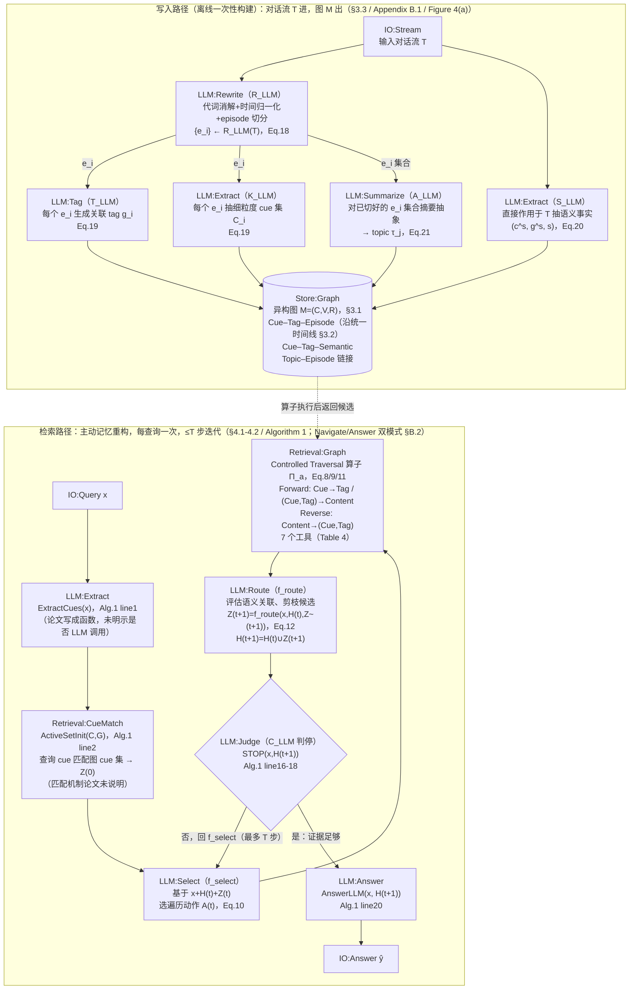
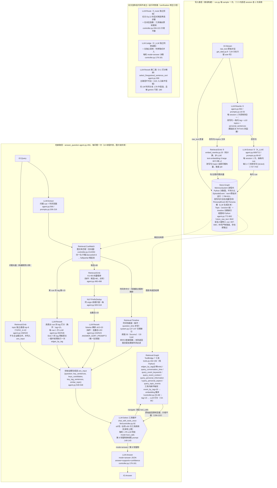

# MRAgent methodology 流程图

> [!note] 来源与口径
> 基于同目录 [[paper-architecture]] 与 [[code-architecture]]，勘误已按 [[verification]] 复核结论修正：「两路 LLM 精排取并集」实为一路（第二路主路径不可达）、「论文完全没写 2-prompt 结构」被 Appendix E 证伪而撤回、Alg.1 line20 为 `AnswerLLM(x, H^(t+1))` 而非 `H^(T)`、7 个工具映射算子仅 2 个真正出自 §3.1（其余只在 Table 4 出现）。词汇表与图例见全项目规范 `METHODOLOGY-FLOW-SPEC`。

## Paper 视角

Ji, Li, Hooi 2026, *Memory is Reconstructed, Not Retrieved: Graph Memory for LLM Agents*, arXiv:2606.06036（ICML 2026 / PMLR 306）。

![[assets/mragent-paper-flow.png]]

### 核验真源



> [!info] Paper 侧边界（论文自己的划分）
> 图 `M=(C,V,R)` + 7 个映射算子 `ϕ`（Table 4）归**记忆系统本体**——只按结构化条件存取，不做语义判断（txt:461-462）；`f_select` / `f_route` / `C_LLM` / `AnswerLLM` 全部归 **LLM 推理侧**——所有决策（选动作、剪枝、判停、组织答案）都发生在 LLM 一侧。

## Code 视角

repo `~/Documents/repo/MRAgent` @ `7441506`（单提交仓库，无 tag；静态读码未运行）。

![[assets/mragent-code-flow.png]]

### 核验真源



> [!warning] 与论文的核心分歧（verification 逐条确认）
> 1. **图里存的 episode 文本是原始对话行，不是论文宣称的 R_LLM 改写句**（agent.py:798-811 三处交叉验证）——改写句只活在向量空间，「代词消解让 cue 显式」仅体现于向量层面。
> 2. 论文 5 个抽取函数（R/T/K/S/A）→ 代码每 session **2 次调用**（rewrite 四合一 + keyword）；论文 Appendix E 的 2-prompt 结构事实上已给出同样合并（txt:1919-1990）。
> 3. 论文对 MRAgent **无任何 embedding 成分**（embedding 只出现在 baseline 描述）；代码有 3 处向量检索（K1 粗排 / topic top-8 / event_by_tag 内部重排）。
> 4. timeline 未作为工具暴露给 LLM，只在循环前的时间快通道用一次（论文 §3.2 宣称支撑检索期时间约束）。
> 5. 论文 `ActiveSetInit` 一行伪代码 → 代码在进循环前实际跑了 5 种机制（图文本匹配→K1 粗排→前缀去重→一路 LLM 精排→topic 向量 top-8+条件 tag 打分）。

> [!bug] 复核顺带发现的代码问题（verification 附录，文档未记）
> - `agent.py:698` 调 `check_key_json(keys_out, text, replace=True)`，而 `schema.py:144` 签名为 `(text, ref_obj=None)`——关键词抽取第 3 次重试失败会抛 TypeError。
> - LM 时间分支 `agent.py:192-193` 算出的 `key_candidates`/`key_tag_sentences` 未装入 `ans_input`（:195-199）即被丢弃，纯浪费 LLM 调用。
> - 工具循环空转轮：既无 answer 也无 tool_calls 时 `controller.py:229-232` 走 `continue`，白烧 MAX_ROUNDS 预算。

## 新登记 module

- `IO:Stream`：跨 session 的完整输入对话流（论文 `T` / 代码 `raw_text`）；`IO:Session` 语义偏单会话、`IO:TurnPair` 偏单轮，均不匹配 MRAgent 的整段批处理粒度。
- `Retrieval:CueMatch`：cue 集合对图 cue 节点的纯文本匹配（归一化/子集/Jaccard）；论文 `ActiveSetInit` 的对应，非向量非 BM25 的第三种检索入口。
- `Retrieval:Timeline`：时间线日期索引快速通道（代码独有，`system.py:137-147`）；论文侧的时间线只是 episodic 层组织方式，检索算子里无时间查询工具。
- `LLM:Select`：多步循环中选择遍历动作/工具调用决策（论文 `f_select`，Eq.10）。
- `LLM:Route`：候选语义路由与剪枝（论文 `f_route`，Eq.12）；代码无实现，code 图以 dead 展示。
- `LLM:Rerank`：LLM listwise 精排/相关性打分（代码 r8/r9/r14 三处；论文无对应）。跨系统高频组件，建议统一登记。
- `NLP:PrefixDedup`：同源前缀规则去重（`agent.py:505-518`），区别于 mem0 的 `NLP:HashDedup`（md5）。

## 不确定处

1. **f_select 与 f_route 是否两次独立 LLM 调用**：论文正文未显式说明；Appendix E 只有一份 QA and Tool-Use Prompt（answer/navigate 二选一）+ B.2「选工具→调用→评估」的描述，强烈指向每轮一次调用同时完成两个决策（verification P48/P58）。paper 图按论文形式化分画两个节点，此张力保留。
2. `C_LLM`（§4.2）与 `STOP(x,H(t+1))`（Alg.1 line16）两处表述论文无桥接说明（P49）；代码侧判停隐式并入 mode=answer，无独立调用。
3. `ActiveSetInit` 的匹配机制（精确/模糊/向量）论文未写（P56）；代码用文本归一化/子集/Jaccard（D7）。
4. `A_LLM({e_i})` 的输入粒度（单 session vs 跨 session）论文未写（P50）；代码 topic 为 session 级直接从原文生成（D3）。
5. Table 6 只报告 5/7 工具的证据覆盖率，缺 `query event keywords` / `query personal information`，论文未解释（P47/D15）；代码中两工具均启用。
6. Table 3 的 token/runtime 只给汇总（caption 写明含构建+检索），未拆分项——循环前初始证据包的多次 LLM 调用（r1/r8/r9）是否计入「retrieval」口径不明（P55）。

## 生图 prompt 素材

### Paper flow prompt

```text
Create a wide academic systems flowchart for MRAgent paper view in the approved Mem0 visual style. White background; two horizontal lanes; canonical colors and shapes. INGEST lane: IO:Stream -> LLM:Rewrite, then branches to LLM:Tag, LLM:Extract (cues), LLM:Extract (semantic facts), LLM:Summarize (topics); all write one gray cylinder Store:Graph labeled heterogeneous cue-tag-content graph. RETRIEVE lane: IO:Query -> LLM:Extract (query cues) -> Retrieval:CueMatch -> LLM:Select -> Retrieval:Graph -> LLM:Route -> LLM:Judge. Judge loops back to Select when evidence is insufficient and flows to LLM:Answer -> IO:Answer when sufficient. Draw Store:Graph into Retrieval:Graph. LLM blue, Retrieval orange, stores gray cylinders, IO purple pills. Short English labels only; canonical legend; no citations, equations, icons, or decoration.
```

### Code flow prompt

```text
Create a wide academic systems flowchart for MRAgent code view in the approved Mem0 visual style. INGEST lane: IO:Stream -> LLM:Rewrite (one four-in-one call) -> LLM:Extract (cues) -> Retrieval:Emb -> Store:Graph; also connect raw stream directly to Store:Graph. RETRIEVE lane: IO:Query -> LLM:Extract (cues + time) -> Retrieval:CueMatch, then conditional Retrieval:Timeline, Retrieval:Emb coarse rank, NLP:PrefixDedup, LLM:Rerank, and a parallel Retrieval:Emb topic top-8; converge into initial evidence -> LLM:Select tool loop <-> Retrieval:Graph seven tools -> LLM:Answer -> IO:Answer. Add a red dashed PAPER-ONLY / DEAD panel: LLM:Route independent pruning, LLM:Judge independent stop call, second LLM:Rerank path. LLM blue, Retrieval orange, NLP green, store gray cylinder, IO purple pills, dead red dashed. Short English labels only; canonical legend; no citations or decoration.
```
