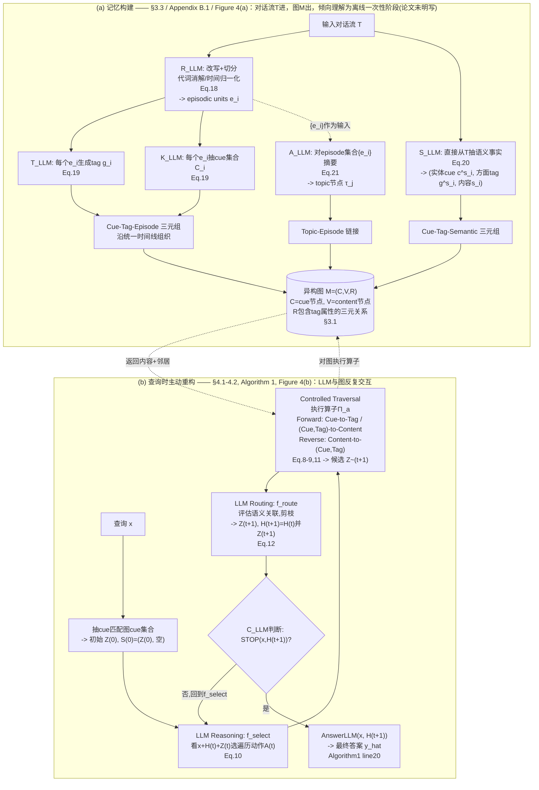

# MRAgent 论文架构

> 读的是 `Ji-2026-Memory-is-Reconstructed-Not-Retrieved-Graph-Memory-for-LLM-Agents.txt`
> （arXiv:2606.06036，ICML 2026 / PMLR 306，NUS Shuo Ji / Yibo Li / Bryan Hooi，正文+全部附录 A-E，共1984行纯文本，已通读），
> 补充参考了 vault 笔记 `research-vault/2-fleeting/papers/Ji-2026-...md`。
> 本文档只讲论文说了什么；论文和代码实现不一致的地方在 `code-architecture.md` 第6节，这里不重复。
> **2026-09-05 勘误**：本文已按同目录 `verification.md` 的逐条复核结论修正（共 13 处：3 处事实、3 处行号/锚点、7 处表述限定）。原始未修正版本见 git 历史。

## 1. 一句话机制

论文把这套系统叫"主动记忆重构"（active memory reconstruction）：把记忆组织成 Cue（细粒度线索）–Tag（关联标签）–Content（记忆内容）三元关联图，检索时不是查一次向量库就结束，而是让 LLM 在这张图上像人类回忆一样"边想边找"——每一步都根据已经积累的证据决定下一步该沿哪条线索/标签继续走、要不要收尾（Abstract；§2.1 Eq.1-2；Figure 1）。论文还给了一个理论结果：在"允许 T 步自适应检索"这个假设类下，主动策略严格比被动策略（一次性给定全部检索目标）更有表达力（§4.3，Theorem 4.1，证明见 Appendix C）。

## 2. 记忆是怎么存进去的

**什么时候触发**：论文没有明确写"实时逐轮"还是"整段离线批量"，但 §3.3 原文是"记忆系统通过一个应用在输入流 `T` 上的自动蒸馏管线被填充"（"populated through an automated distillation pipeline applied to the input stream T"）。Figure 4(a) 常被读成"对一整段对话流做处理、产出图 `M` 的一次性阶段"，但纯文本版里能核实的只有 Figure 4 的图注（"MRAgent constructs an associative memory system from dialogues"），图形内容本身核实不了——所以"一次性阶段"是我基于图注加 §3.3 措辞的**推测**，不是论文的明文表述。综合起来倾向于理解为对完整输入流做批处理，而不是逐轮在线写入。

**存的是什么 / 调不调 LLM**：三层结构，均由 LLM 抽取（§3.2, §3.3, Appendix B.1）：

- **Episodic 层（Cue–Tag–Episode）**：输入流 `T` 先被 `R_LLM` 处理——"包括代词消解、时间归一化、episode 切分"（§B.1 原文，对应 Eq.18：`{e_i} ← R_LLM(T)`），切出一组"自包含的" episodic units `e_i`，每个对应一次发生在特定上下文里的具体经历（§3.2）。然后对每个 episodic segment 分别跑 `T_LLM` 生成一个概括该 episode 核心语义/关系模式的短 tag `g_i`，`K_LLM` 抽取一组细粒度 cue `C_i`（Eq.19）。注意论文自身记号在这里不一致：§B.1 正文写的是 "For each episodic segment `e_i`"，Eq.19 的公式却写成 `g_i ← T_LLM(x_i)`、`C_i ← K_LLM(x_i)`，紧接着一句又说 "We then add nodes for `x_i`"，`e_i` 与 `x_i` 是否同一对象论文没有交代，本文按正文理解为同一个东西。cue 的类型，Eq.19 下方的说明用的是 "entities, attributes, and other salient descriptors"；"实体、动作、上下文关键词"（"entities, actions, or contextual keywords"）则是 §3.2 Episodic Layer 那一段的措辞，两处并不完全一致。`C_i` 里每个 cue 都通过 tag `g_i` 连到 `e_i`，构成 Cue–Tag–Episode 三元组，是这一层的最终产物。Episodic 层额外沿一条统一时间线组织，支撑时间推理（§3.2）。
- **Semantic 层（Cue–Tag–Semantic）**：捕捉"相对稳定的知识"——个人属性、偏好、一般性事实（§3.2）。由 `S_LLM` **直接作用于原始输入流 `T`**（不是作用于已切好的 episode），产出一组三元组 `(c^s_i, g^s_i, s_i)`（Eq.20）：`c^s_i` 是实体级 cue（比如人名），`g^s_i` 是"方面级"标签（aspect-level tag，比如性格特质/长期偏好/事实属性），`s_i` 是语义内容本身。论文原文把这一步写成和 episodic 抽取**并列**的一个独立 LLM *函数*（"we extract such semantic units from the input text T via an LLM-based semantic extraction function"，Eq.20），但论文从未说这对应一次独立的 LLM *调用*——恰恰相反，Appendix E 的 Dialogue Processing Prompt 把 `personal_sentences` 和逐句改写放在了同一份 prompt、同一个 Output Schema 里（详见第5节和第6节第3条）。
- **Topic 抽象层**：`A_LLM` 对**已经抽出的 episode 集合 `{e_i}`** 做摘要式抽象，生成一组 topic 节点 `τ_j`，每个概括一组"共享重复语义模式"的相关 episode（Eq.21）；再把 `τ_j` 和它涵盖的 episode 建立 topic–episode 链接。论文明确写输入是 `{e_i}`（Eq.21：`{τ_j} ← A_LLM({e_i})`），不是原始对话流 `T`——这点和 episodic/semantic 两层直接作用于 `T` 不同。

三层抽取（`R_LLM`+`T_LLM`+`K_LLM` 一组、`S_LLM`、`A_LLM`）在论文文字和公式里呈现为**三个概念上独立**的 LLM 函数族，都算"存的过程调 LLM"，且都是"抽取/改写/摘要"后的产物，不是原文照抄进图。

**图本身怎么存**：论文只给了数学抽象——"我们把记忆系统建模成一个异构图 `M=(C,V,R)`"（§3.1），`C` 是 cue 节点集合、`V` 是 content 节点集合、`R⊆C×G×V` 是带 tag 属性的三元关系集合；论文没有提工程实现层面的数据结构、是否持久化、是否跨对话共享（这些只有代码能回答，见 `code-architecture.md`）；**存储开销**倒是在 §7 局限性里被点过一句——"our static construction does not update or consolidate memory over time, so the memory graph grows monotonically as interactions accumulate, raising storage overhead in long-lived deployments"——但也只是定性提及，没有任何量化或实现层面的说明。

## 3. 记忆是怎么被用起来的

**什么时候触发**：每个查询 `x` 一次（§4.2 开篇）。

**拿什么去找**：先从查询里抽一组细粒度 cue，去匹配图里已有的 cue 集合，得到初始 active set `Z^(0)` 和初始重构状态 `S^(0)=(Z^(0), ∅)`（§4.2 正文；Algorithm 1 line 1-4，Appendix B.2）。论文没有展开"匹配"具体怎么做（精确匹配？向量相似？——论文没写，见第5节）。

**一步到位还是多步迭代**：明确是多步迭代，这是全文核心论点（标题"Memory is Reconstructed, Not Retrieved"）。循环体由三个角色反复交替（§4.1-4.2，Eq.7/10-12，Algorithm 1 line 5-19）：

1. **LLM Reasoning（`f_select`）**：基于查询 `x`、累积上下文 `H^(t)`、当前 active set `Z^(t)`，选出一组要执行的遍历动作 `A^(t)⊆A`（Eq.10）——"减少噪声，同时因为条件依赖于累积证据 `H^(t)`，使 agent 能发现新 cue、动态调整推理轨迹"（§4.2 原文）。
2. **Controlled Traversal**：对 `A^(t)` 里每个被选中的动作执行对应的图遍历算子 `Π_a`，产出候选集合 `Z̃^(t+1)`（Eq.11）。动作分两类（Eq.8-9）：**Forward**（`Cue→Tag` 激活候选标签，`(Cue,Tag)→Content` 取回具体内容，沿图正向扩大证据）和 **Reverse**（`Content→(Cue,Tag)`，从已经取回的内容反向识别新的 cue/tag，用于"发现新检索线索、重定向重构轨迹"）。
3. **LLM Routing（`f_route`）**：评估查询、已重构上下文、新取回内容三者之间的语义关联，从候选里选出真正相关的、剪掉不相关分支，更新 active set 和累积上下文——`Z^(t+1)=f_route(x,H^(t),Z̃^(t+1))`，`H^(t+1)=H^(t)∪Z^(t+1)`（Eq.12）。论文强调这一步"不是表层匹配或预定义遍历，而是纳入了图暴露出来的语义关联和结构关系"。
4. **STOP 判断**：`H^(t+1)` 交给 `C_LLM` 判断证据是否足够回答查询，不够则回到步骤1继续，最多 `T` 步（Algorithm 1 line 16-18；§4.2："following the state update, the accumulated context H^(t+1) is evaluated by C_LLM to determine if the evidence is sufficient..."）。

执行时用两种模式区分当前在做什么：`Ψ∈{Navigate, Answer}`——Navigate 模式下持续调工具箱扩证据，证据够了转 Answer 模式生成最终回答（§B.2）。工具箱固定 **7 个工具**（Table 4，Appendix B.2），每个都对应一个映射算子 `ϕ`——但这些算子**并不都是 §3.1 定义过的**：§3.1 Eq.5 只定义了 `ϕ_c→g` 和 `ϕ_(c,g)→v` 两个（Table 4 里的 `ϕ_(c,g)→e` 是后者在 episode 上的特化写法），`ϕ_τ→e` 出现在 §3.2 的 Topic 段，其余五个（`ϕ_e→t`、`ϕ_e→(c,g)`、`ϕ_e→ctx`、`ϕ_cs→gs`、`ϕ_(cs,gs)→vs`）全文只在 Table 4 里出现过，正文从未给出定义。B.2 原文的措辞也只是 "Each tool corresponds to a typed mapping between memory components"，并没有回指 §3.1。七个工具与算子的对应关系是：`query_tag_events`(`ϕ_(c,g)→e`)、`query_conversation_time`(`ϕ_e→t`)、`query_event_keywords`(`ϕ_e→(c,g)`)、`query_event_context`(`ϕ_e→ctx`)、`query_personal_information`(`ϕ_cs→gs`)、`query_personal_aspect`(`ϕ_(cs,gs)→vs`)、`query_topic_events`(`ϕ_τ→e`)。

**找到之后怎么交给模型**：`H^(t+1)` 就是"重构出来的上下文"，循环结束后最终答案 `ŷ = AnswerLLM(x, H^(t+1))`（Algorithm 1 line 20；伪代码原文写的是 `ŷ ← ANSWERLLM(x, H^(t+1))`，即循环退出时的那一份累积上下文，论文并没有另写成 `H^(T)`）——把整段累积证据一次性交给一个回答函数生成答案。论文正文没有细描述这一步的 prompt 结构，Appendix E 给了一份精简版的"MRAgent QA and Tool-Use Prompt"（回答规则：是非题输出 Yes/No/Likely yes/Likely no，地点题给具体地名，计数题给数字，其余给最简短的具体实体/短语；两种模式 `answer`/`navigate` 的 JSON 输出格式）。

## 4. 架构图

**边界说明**：Figure 4 明确画了两个阶段的边界——(a) construction（agent/系统侧的对话流 `T` 进，图 `M` 出，属于"记忆系统的建造过程"）和 (b) query-time reconstruction（查询进来后，LLM 和图之间反复交互：LLM 发起遍历动作 → 图执行算子返回候选 → LLM 再路由/剪枝 → 循环，直到 LLM 自己判断够了）。论文把"图数据结构 + `ϕ` 系列映射算子（含 Table 4 的 7 个工具）"归为记忆系统本身——只负责按结构化条件存和取，不做语义判断；把 `f_select`（选动作）、`f_route`（剪枝路由）、`C_LLM`（停止判断）、`AnswerLLM`（生成答案）全部归为 LLM 推理侧——所有"决策"（选哪个动作、留哪些候选、何时停、怎么组织答案）都发生在 LLM 一侧，图只是被动执行算子、返回结果，从不主动做筛选或排序。

## 5. 我没搞清楚的

- Table 6（Appendix D.7，"不同工具在各题型上的证据覆盖率"）只列了 5 个工具：`query tag events` / `query conversation time` / `query event context` / `query personal aspect` / `query topic events`；Table 4 定义的 7 个工具里 `query event keywords` 和 `query personal information` 没有出现在 Table 6 里，论文没解释为什么（覆盖率太低被略去？统计口径不同？）。
- `f_select`（Eq.10）和 `f_route`（Eq.12）在实现层面是两次独立的 LLM 调用，还是同一次调用里做出的两个决策，论文正文和 Algorithm 1 都只给了数学函数记号，没有一句显式说明。不过附录里有两条指向"每轮一次调用"的间接证据：Appendix E 只给出**一份** "MRAgent QA and Tool-Use Prompt"，里面是 `answer`/`navigate` 二选一的单一输出格式；B.2 也把"选工具 → 调用 → 评估返回结果 → 决定扩展/细化/终止"描述成同一步里的连续动作。所以更准确的说法是：论文没有把话说死，但附录结构已经强烈倾向于同一次调用。
- `STOP(x, H^(t+1))`（Algorithm 1 line 16）的具体判据是什么——模型自己输出一个"证据够了"的信号？还是有专门的规则/分类器？论文正文用 `C_LLM` 描述这个判断（§4.2），但 Algorithm 1 伪代码里写的是 `STOP(x, H^(t+1))` 这个函数名，两处的表述（`C_LLM` vs `STOP`）到底是不是同一个东西，只读论文文本无法百分百确认。
- Topic 抽象 `A_LLM({e_i})`（Eq.21）的输入范围——是单个 session 内切出来的 episode，还是跨多个 session/整段对话累积后的 episode 集合？论文没写清楚，Figure 4(a) 的示意图也没标注这个粒度。
- §5.3/§7 强调 construction 阶段"lightweight"、把复杂关系构建"推迟到检索阶段"，但 Eq.18-21 列出的 `R_LLM`/`T_LLM`/`K_LLM`/`S_LLM`/`A_LLM` 五个抽取函数在实现里到底对应几次实际 LLM API 调用（是每个函数一次共5次，还是合并成更少的调用），论文**正文**的数学记号完全没有对应到具体调用次数。不过 Appendix E 事实上已经给出了答案的轮廓：Dialogue Processing Prompt 在同一个 Output Schema 里同时输出 `sentence[].text`/`.tag`、`topics{}` 和 `personal_sentences[]`（即 `R_LLM`+`T_LLM`+`A_LLM`+`S_LLM` 合成一份 prompt），Keyword Extraction Prompt（对应 `K_LLM`）另算一份——正好是"5 个函数 → 2 份 prompt"的结构。所以这一条不是"论文完全没写"，而是"正文的形式化没写、附录的 prompt 已经隐含写了，两者之间没有对齐说明"；具体到每份 prompt 实际被调用几次（代码里是**每 session** 各一次）仍然只有代码能回答，见 `code-architecture.md` 第6节。
- Appendix E 只给了 3 段 prompt（QA与工具使用、关键词抽取、对话处理）。**论文并没有把它们标注成精简版或摘要**——全文没有 simplified / abridged / condensed / for brevity 之类的字样，这一点我此前写反了。可以确认的只是："MRAgent QA and Tool-Use Prompt" 里只有回答规则列表和两种模式的 JSON schema，没有工具箱的完整描述文本，看上去比实际发给模型的 system prompt 要短；但"是不是被删节过"只是我的推测，不是原文的说法。`T_LLM`（tag生成）、`K_LLM`（cue抽取，如果和对话处理是分开的调用的话）、`S_LLM`（语义抽取）、`A_LLM`（topic抽象）各自的完整 prompt 论文没有单独给出，只能确认"对话处理 prompt"里同时出现了 topic 和 personal_sentences 的输出字段（这条已经越界到需要对照代码才能确认的程度，这里只记录"论文没给完整 prompt"这个事实）。
- Table 3 的 token/runtime 统计**范围**论文其实写了——caption 明写 "Results include both memory construction and retrieval"，构建与检索都算在内。没写的是**逐项拆解**：检索阶段里 `f_select`/`f_route` 产生的推理文本、初始 active set 构建的开销各占多少，论文只给了汇总数字。

## 6. 论文没写清楚的地方

这里挑 3 个最影响"能不能只凭论文复现"的点展开（其余零散的小空白见第5节）：

1. **`ActiveSetInit(C,G)`（Algorithm 1 line 2）到底怎么把一组 cue 变成初始候选集合，论文完全没有算法层面的说明。** 全文唯一相关的一句话是"matches them against the stored cue set"（§4.2），"匹配"是精确字符串匹配、模糊匹配还是向量相似度检索，论文没有交代。这个初始化步骤直接决定了整个后续多轮重构从哪里起步，但论文把它当成一句带过的前置条件，没有像 Forward/Reverse 遍历动作那样给出对应的数学算子定义。
2. **`f_select` 和 `f_route` 是否共享同一次 LLM 调用/同一个 prompt，论文的表述方式本身就存在张力。** §4.2 正文把两者写成流程上先后独立的两步（"LLM Reasoning and Action Selection" 和 "LLM Routing and State Update" 是两个独立小标题），但 Algorithm 1 的伪代码里两者也确实是循环体内两条分开的赋值语句（line 7 和 line 14）。可是论文正文从未**明说**这是两次独立的 API 调用还是同一次调用里模型一并给出"选哪些动作"+"怎么路由已获得的候选"（Appendix E 只给了一份 QA and Tool-Use Prompt、B.2 把选工具与评估返回结果写成同一步，是指向"同一次调用"的间接证据，但论文没有把这条结论写进正文）——如果是同一次调用，那"reasoning"和"routing"这两个论文里反复强调的独立认知步骤，在执行层面可能只是同一段模型输出的不同字段；如果是两次调用，那 Table 3 的 token 消耗统计就需要把这部分也算进去（呼应第5节最后一条）。这个空白直接影响"论文声称的多步推理，每一步的计算成本到底该怎么算"。
3. **Semantic 层抽取 `S_LLM(T)` 和 Episodic 层抽取 `R_LLM(T)`/`T_LLM`/`K_LLM` 都写成"直接作用于原始流 `T`"的独立函数（Eq.18 vs Eq.20），但论文**正文**没有说明这是否意味着原始对话文本会被完整地喂给模型两次（一次用于 episodic 抽取，一次用于 semantic 抽取）。** 单看正文，如果确实是两次独立调用、各自完整重读一遍 `T`，这和 §5.3/§7 反复强调的"construction 阶段 lightweight"存在潜在张力——两次读完整对话流的 token 成本不算小。**但 Appendix E 其实已经间接回答了"不是两次"**：Dialogue Processing Prompt 在同一个 Output Schema 里同时产出改写句和 `personal_sentences`，也就是 `R_LLM` 和 `S_LLM` 共用一次调用、多个输出头。所以真正的空白不是"论文完全没写"，而是**正文的数学记号（分开写成 `R_LLM`、`S_LLM` 两个函数）和自己附录里的 prompt 结构（合并成一份）之间缺一句桥接说明**：只读正文会以为要把 `T` 读两遍，读了附录才知道实际上是合并的，而论文从头到尾没有点破这件事，也就无从判断它声称的效率优势该记在哪一笔账上。
