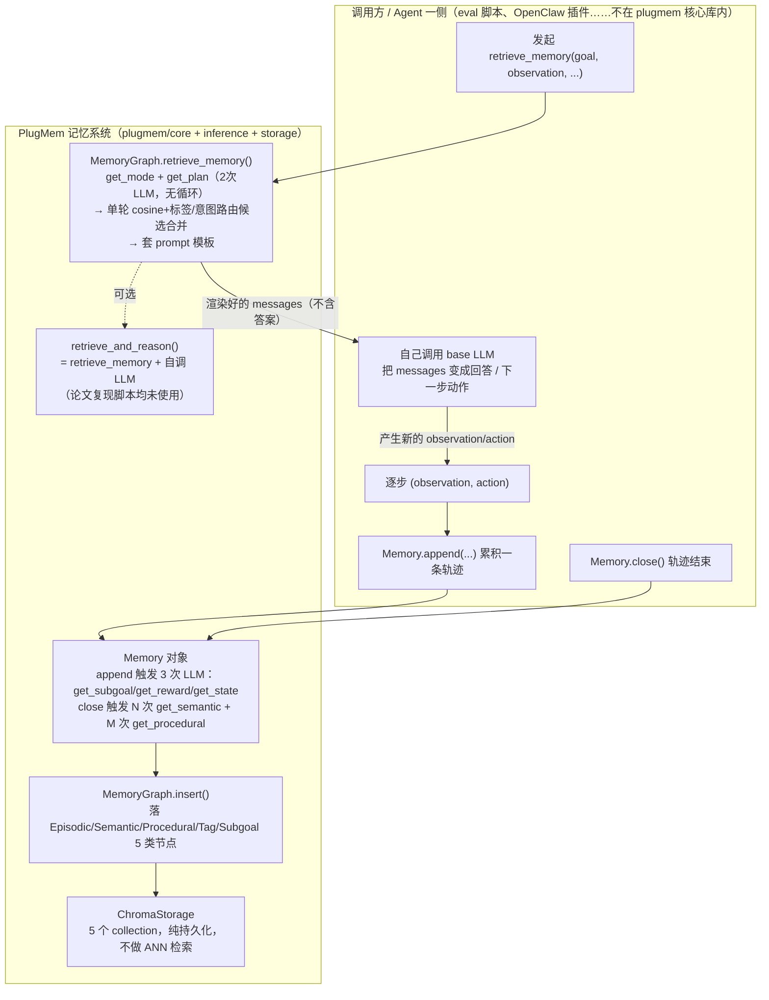

# PlugMem 代码架构

> 调研范围：`/Users/guanhongli/Documents/repo/PlugMem`（官方 TIMAN-group/PlugMem，克隆时 HEAD=`3b2ce75`）。
> 仓库里其实有**两套并行实现**，读之前先说清楚，后面所有结论都会标明是哪一套：
> - `src/memory_retrieving/` + `src/memory_structuring/` + `src/memory_reasoning/` + `src/eval/*`：原始研究代码，**三个基准（LongMemEval / HotpotQA / WebArena）的官方复现脚本全部 import 这一套**，是论文数字的直接来源。存储是纯文件（JSON）。
> - `plugmem/`：重构后的服务化包（ChromaDB 持久化 + FastAPI HTTP 服务），核心算法（节点类型、检索/插入逻辑、value function 设计）和 `src/` 高度一致，但新增了 `confidence`/`source` 元数据和一整套"编码助手记忆晋升"机制（`plugmem/inference/promotion.py`），是论文之外的东西（README 显示这部分 2026-05 才上，晚于 2026-04 ICML 接收）。
>
> 本文档以 `plugmem/`（更新、更完整、命名和论文标题一致）为主线举证，遇到两套实现有分歧的地方会明确指出并分别给行号。

## 1. 一句话机制

PlugMem 把 agent 一步步的原始交互（observation/action）先标准化，再靠 LLM 从中"提炼"出两类知识——事实性的语义记忆（命题+标签）和经验性的程序记忆（意图+工作流）——分层存进一张图；检索时先用 LLM 判断这次要哪种记忆、生成查询标签，再做"直接向量相似度 + 标签/意图路由"**一轮**候选合并排序，取 top-K 拼成 prompt **返回给调用方**，由调用方自己的模型把这份 prompt 变成回答或下一步动作。

证据：`plugmem/core/memory.py`（结构化）、`plugmem/core/memory_graph.py:363`（`insert`）、`plugmem/core/memory_graph.py:988`（`retrieve_memory`）。

## 2. 记忆是怎么存进去的

### 2.1 触发时机：一条轨迹/一段对话跑完才写图，不是逐步写

调用方逐步调 `Memory.append(action, observation)` 累积，最后调 `Memory.close()`，再把整个 `Memory` 对象交给 `MemoryGraph.insert(memory)`（`plugmem/core/memory_graph.py:363`）。WebArena 的参考实现验证了这个顺序：整段 episode 跑完才 `self.memory.close()` 紧接着 `mg.insert(self.memory)`（`src/eval/webarena/plugmem_agent.py:431,436`），不是每步都写图。

### 2.2 三层记忆，存的东西完全不是一回事

| 层 | 产生时机 | 存的是原文 / LLM 改写 / LLM 生成 | 触发几次 LLM |
|---|---|---|---|
| Episodic（情景） | 每次 `append()` | `observation`/`action` **原文**逐字存；但同一次 `append()` 里 `state`/`subgoal`/`reward` 三个字段是 LLM 生成的 | 每步 3 次（见下） |
| Semantic（语义） | `close()` 时，对每一步都跑一次 | LLM **改写生成**的"命题"（消解代词指代后的完整事实陈述，不是原句摘录）+ 标签 | 每步 1 次 |
| Procedural（程序） | `close()` 时，对每一段轨迹跑一次 | LLM **反思生成**的 (intent, prescription)：一句目标 + 一段经验描述 | 每段 1 次 |

**`Memory.append()`**（`plugmem/core/memory.py:59-102`）：每收到一步 `(action_t0, observation_t1)`，连续调 3 次 LLM——`get_subgoal()`（这步在干嘛，`memory.py:60`）、`get_reward()`（自然语言评价这步做得好不好，不是打分，`memory.py:68`）、`get_state()`（滚动更新的状态摘要，`memory.py:95`）。轨迹分段规则写死在这里：连续两步的 subgoal 向量相似度 **< 0.75** 就切一段（`memory.py:81`，`if similarity_subgoal < 0.75:`），切出来的每一段后面单独抽一次程序记忆。

**`Memory.close()`**（`memory.py:104-134`）：对已收集的每一步跑 `get_semantic()` 抽取"命题+标签"列表（`memory.py:115`，对应 prompt 见 `plugmem/prompts/structuring.py` 的 `GetSemanticPrompt`——明确要求"消解代词/模糊指代成具体实体名""合并去重""单条最多 4 句话"，不是原文摘录）；对每一段轨迹跑一次 `get_procedural()`（`memory.py:123`）生成 `(procedural_memory, goal, _return)` 三元组。

**⚠️ 一个直接影响"质量感知复用"的实现细节**：`get_procedural()`（`plugmem/inference/structuring.py:111-125`）把返回的 `_return` **硬编码成 `0.0`**（第 124 行），仓库里确实存在一个专门给 prescription 打 1-10 分的 `get_return()` 函数（`plugmem/inference/structuring.py:96-109`，对应 `GetReturnPrompt`），但 `Memory.close()` 全程**没有调用它**。也就是说程序记忆节点的"质量分"字段从生产出来那一刻起就恒为 0，从未被真正计算过。详见第 6 节。

### 2.3 图里怎么连边（写入侧）

`MemoryGraph.insert()`（`plugmem/core/memory_graph.py:363-597`）把结构化数据落成 5 类节点：`EpisodicNode`、`SemanticNode`、`TagNode`（标签≈"概念"）、`ProceduralNode`、`SubgoalNode`（子目标≈"意图"），定义见 `plugmem/core/graph_node.py:13-226`。

- 语义节点 ↔ 标签节点：多对多双向链表；同一个标签字符串复用同一个 `TagNode`（`tag2node` 是 Python dict，按字符串精确匹配去重，`plugmem/core/memory_graph.py:442-450`）。
- 语义节点 → 情景节点：`episodic_nodes` 字段，记它是从哪一步抽出来的（溯源）。
- **程序节点的"意图"去重不是向量相似度，是精确字符串匹配**：`subgoal_node = self.subgoal2node.get(subgoal_str)`（`plugmem/core/memory_graph.py:515`）——只有 dict 里已经有一模一样的 subgoal 文本才会触发合并（调 `get_new_subgoal()` LLM 改写两个字符串，`plugmem/core/memory_graph.py:519`），否则直接新建节点。真正做向量相似度匹配的 `retrieve_subgoal_nodes()`（`plugmem/core/memory_graph.py:892`）只在**检索时**用，插入去重时用不上。详见第 6 节。

### 2.4 落盘

`plugmem/` 用 ChromaDB，每个 `graph_id` 开 5 个 collection（`plugmem/storage/chroma.py:19,73-83`）。但这只是"耐久存储"：实际检索时会把全部节点 `load()` 进 Python 内存列表，再暴力遍历算 cosine 相似度（见第 3 节），完全没用 Chroma 自带的 HNSW 近邻检索——`retrieve_semantic_nodes()` 里是手写的 `for node in self.semantic_nodes: get_similarity(...)` 循环（`plugmem/core/memory_graph.py:694-701`），不是 `collection.query()`。

`src/memory_retrieving/memory_graph.py` 那一套落盘方式是纯文件（每类节点一个目录、JSON 序列化，README 里 `mkdir -p episodic_memory semantic_memory procedural_memory tag subgoal` 就是给它用的），核心算法和 `plugmem/` 一致。

### 2.5 Embedding 与相似度

默认走自托管 `NV-Embed-v2`（`nvidia/NV-Embed-v2`）的 OpenAI 兼容 HTTP 接口（`HTTPEmbeddingClient`，`plugmem/clients/embedding.py:34-61`），相似度是标准 cosine（`get_similarity()`，`embedding.py:167`起）。

## 3. 记忆是怎么被用起来的

### 3.1 触发：调用方主动发起，不是被动/自动

任何时候要决策/回答，调用方调 `MemoryGraph.retrieve_memory(goal, subgoal, state, observation, ...)`（`plugmem/core/memory_graph.py:988-1105`）。

### 3.2 先问"要哪种记忆"——2 次 LLM

`retrieve_memory()` 一进来（除非调用方强制传 `mode`）先调：
1. `get_mode()`——判断这次该用 `episodic_memory` / `semantic_memory` / `procedural_memory` 三选一（`plugmem/core/memory_graph.py:1011-1015`，对应 `GetModePrompt`）。
2. `get_plan()`——生成"下一步子目标"+ 若干检索标签 `query_tags`（`plugmem/core/memory_graph.py:1019-1022`，对应 `GetPlanPrompt`）。

### 3.3 三种模式，检索方式完全不同（本文档最关键的发现之一）

**Semantic 模式**（`retrieve_semantic_nodes()`，`plugmem/core/memory_graph.py:663-808`）：
1. Phase 1：query 向量直接和**全部**语义节点算 cosine，取 top-5（`sem_node_topk = 5`，`plugmem/core/memory_graph.py:686`，硬编码，不受外部 k 参数影响）。
2. Phase 2：`query_tags` 逐个去匹配"标签节点"（`retrieve_tag_nodes()`，`plugmem/core/memory_graph.py:599`，1 个标签只取 1 个最相似的 `TagNode`，阈值 0.8），命中的 `TagNode` 下挂的所有 `SemanticNode` 都算候选，并记一个 `tag_vote`（命中次数 + 权重）。
3. Phase 3：两路候选**取并集**，重新打分，按分数排序取 top-K（默认 `k=10`，`SemanticRelevant(k=10, value_threshold=0.0)`，`value_functions.py:70-72`）。

**关键细节**：Phase 3 的打分函数 `value_func.evaluate(Relevance=relevance, Recency=recency, Importance=importance_score, Credibility=...)` 传了 4 个信号，但默认 `SemanticRelevant` 类（`value_functions.py:70-89`）里 `compute_importance`/`compute_recency`/`compute_credibility` **全部硬编码返回 0**，只有 `compute_relevance` 是恒等函数。也就是说：**标签投票（对应"概念路由"）只影响候选池大小，完全不影响最终排序**——最终排序 100% 是纯文本 embedding 的 cosine 相似度。而且 `ValueBase.evaluate()`（`plugmem/core/value_base.py:17-30`）连算出来的 `v_credibility` 都直接漏加进总分（第 30 行只加了 `v_importance+v_relevance+v_recency+v_return` 四项），这个漏洞在新旧两套代码里都一样（`src/memory_retrieving/value_base.py:17-26` 同款字节级相同逻辑）。

**Procedural 模式**（`retrieve_procedural_nodes()`，`plugmem/core/memory_graph.py:916-987`）：
1. 先且只找**一个**最相似的 `SubgoalNode`（`retrieve_subgoal_nodes()`，`plugmem/core/memory_graph.py:892-915`，返回类型是 `Optional[SubgoalNode]`，不是列表），相似度不够阈值（`SubgoalRelevant.value_threshold=0.1`）直接返回空列表。
2. 只在**这一个** `SubgoalNode` 挂的 `ProceduralNode` 列表里再按 cosine 排序取 top-K。

这一路是真正意义上"图路由"——先定位 1 个意图节点，再在它的子树里找——比 semantic 模式的"扩大候选池但不改排序"更贴近论文说的"高层节点路由、只保留低层节点"，但同样是**一轮**、不迭代。

**Episodic 模式**（`retrieve_episodic_nodes()`，`plugmem/core/memory_graph.py:847-880`）：
1. 调用的是 `retrieve_semantic_nodes_wo_tag()`——顾名思义**跳过标签路由**，纯全局 cosine，取前 30（`semantic_nodes[:30]`，`plugmem/core/memory_graph.py:855`）。
2. 按命中语义节点的 `session_id` 分组投票，一个 session 命中 **≥3** 条才把该 session **整段原始情景记忆**（`get_session_memory()`）搬出来；没到 3 条阈值的，直接返回**那条语义节点自己的命题文本**（不是它的溯源情景原文）。

### 3.4 一步到位还是多步迭代？——`MemoryGraph` 本身永远是一轮，没有通用"多跳"

以上三种模式，`retrieve_memory()`/`retrieve_with_trace()`（`plugmem/core/memory_graph.py:1110-1273`）全程只跑**一轮**：没有循环、没有"再查一次"的判断、没有跳数上限参数。

仓库里唯一真正实现"多跳循环 + LLM 判断够不够"的代码是 `src/eval/hotpotqa/eval_qa_all.py:122-219`（`multi_hop_retrieval_sem()` + `_llm_select_topn()`），但这是 **HotpotQA 这一个基准脚本自己在外面套的循环**：重复调用 `memgraph.retrieve_memory()`（最多 `max_rounds=3` 轮，`eval_qa_all.py:128`），每轮把上一轮 LLM 判定器（`enough`/`top_node_ids` 的 JSON 格式和论文 Listing 10 一致）选中的候选文本拼接进新 query 字符串（不是 embedding 层面的融合，是纯字符串拼接），并且**明确只对 `semantic_memory` 模式生效**——如果 `get_mode()` 判成 `procedural_memory` 或 `episodic_memory`，函数直接打日志"⚠️ memory type is NOT supported for multi-hop"并原样返回单轮结果（`eval_qa_all.py:155`）。

LongMemEval（`src/eval/longmemeval/eval_longmemeval_all.py:100`）、WebArena（`src/eval/webarena/plugmem_agent.py:225`）的官方复现脚本都只调**一次** `retrieve_memory()`，从未触发多跳。详见第 6 节。

### 3.5 检索完之后怎么交给模型——记忆系统只管拼 prompt，不管生成答案

`retrieve_memory()` 把检索到的记忆文本套进对应的 prompt 模板（`DefaultSemanticPrompt`/`DefaultProceduralPrompt`/`DefaultEpisodicPrompt`，来自 `plugmem/prompts/reasoning.py`），**返回渲染好的 `messages`，自己不调 LLM**。真正调 LLM 把这份 prompt 变成"压缩后的可执行指导"（论文里的 Reasoning Module 输出）这一步，是**调用方自己做的**：三个基准的官方复现脚本拿到 `messages` 后都是自己调外部 LLM——`eval_longmemeval_all.py:102` 调 `wrapper_call_model(model_name="gpt-4o", messages=messages)`。

`MemoryGraph` 上还有个把两步包在一起、自己调 LLM 的便捷方法 `retrieve_and_reason()`（`plugmem/core/memory_graph.py:1274-1297`），但**三个基准的官方复现脚本没有一个调用它**——这不是我漏看了调用点，是仓库里确实没有任何 `.retrieve_and_reason(` 的调用出现在 `src/eval/` 下（已用检索工具确认）。

### 3.6 更新/删除（这条不是每次检索都会跑，是单独的维护操作）

`update_semantic_subgraph()`（`plugmem/core/memory_graph.py:1348-`）：按标签找候选、算相似度、超过阈值（默认 `merge_threshold=0.5`）就调 `merge_semantic()`（`plugmem/core/memory_graph.py:1298`）用 LLM 合并两条语义记忆并决定软删除哪一条（`is_active=False`，物理数据不删）。这个方法**不在 `insert()` 里自动触发**，需要调用方显式调用；`eval_longmemeval_all.py:91` 里由 `--update_merge_first` 命令行开关控制，默认不开。

## 4. 架构图

记忆系统（`plugmem/core` + `inference` + `storage`）和调用方（eval 脚本 / OpenClaw 插件 / Claude Code 插件）之间的边界非常干净：调用方喂"结构化前的原始步骤"进来，拿到"结构化好的 prompt"出去，**中间所有 LLM 调用（结构化 5 类、检索 2 类）都在记忆系统这一侧**，只有"把 prompt 变成最终答案/动作"这最后一次 LLM 调用留在调用方那一侧（官方复现脚本的默认走法；`retrieve_and_reason()` 提供了把这最后一次也收进记忆系统的选项，但没被论文复现脚本使用）。

HotpotQA 的多跳循环（`multi_hop_retrieval_sem`）严格来说**不属于上图任何一侧**，它是 eval 脚本里、包在 `A3→M4→A5` 这一圈外面的又一层 Python for 循环，重复调用 `M4` 并用另一次 LLM 判断要不要再来一轮——本质上是调用方自己实现的编排逻辑，不是记忆系统暴露的能力。

## 5. 我没搞清楚的

- `src/memory_retrieving/memory_graph.py:1444` 定义的局部变量 `max_w`，只在 `elif mode == "semantic_memory":` 分支里赋值，却在紧接着的 `elif mode == "procedural_memory":` 分支（第 1457 行）里被引用——如果一次检索直接判成纯 `procedural_memory` 模式，这行按 Python 作用域规则应该抛 `NameError`。这个路径在实际产出论文数字的跑分过程中是否真的被触发过（也许 `get_mode()` 在 HotpotQA/LongMemEval 场景下从不判成纯 procedural、或者上游有 try/except 吞掉了），**未验证**——需要真的跑一遍代码或翻当时的运行日志才知道。
- `subgoal2node.get(subgoal_str)` 精确字符串匹配的实际去重命中率有多低，**未做统计**，只能从"LLM 自由生成的自然语言文本很难逐字重复"推断命中率接近零，不是实测数字。
- `src/eval/longmemeval/eval_longmemeval_all.py:102,116` 把 reasoning/最终答题的模型硬编码成 `"gpt-4o"`，但论文 Table 3 + Appendix E.1 说 PlugMem 那一行用 Qwen2.5-32B（结构化/检索）+ Qwen2.5-72B（推理），且"Qwen2.5-72B-Instruct 作为所有方法的 base agent"。这处矛盾**未完全验证**——我只读了 `eval_longmemeval_all.py` 这一个变体（README Quick Start 唯一指向的入口），不确定是否存在别的命令行参数、环境变量或脚本版本（比如 `eval_longmemeval_sota.py`）覆盖了这个硬编码，也不确定这个脚本是否就是产出 Table 3 数字的确切版本。
- `plugmem/`（重构包）本身是否被用来跑过任何论文数字，还是完全是论文接收后（README 时间线：2026-05 更新晚于 2026-04 ICML 接收）新增的产品化代码——README 的时间线支持"后加"的判断，但没有直接证据（比如 commit 历史）核实到这一点；本次调研没有跑 `git log`。
- `openclaw-plugmem-plugin/`、`plugmem-coding-claude-code/`、`plugmem-coding-core/` 这几个编码助手集成目录只看了目录结构和 `inference/promotion.py`，具体怎么触发"记忆晋升"（什么时候判定为 `failure_delta`/`correction`）、和论文方法的关系，**未深入验证**。
- ChromaDB 的 5 个 collection 是否在除 `retrieve_*_nodes` 之外的某些代码路径（比如 `api/routes/`）下真被用来做向量近邻检索，而不是我看到的暴力 Python 循环——只排查了核心检索路径，没有排查全部 API 路由。

## 6. 与论文的冲突点

以下按重要程度排序。除非特别说明，都是拿 `plugmem/`（当前版本）和论文对照；凡是 `src/` 与 `plugmem/` 表现不一致的地方会单独指出。

### 6.1（头号冲突）多跳检索控制器的落地范围，远小于论文描述

论文 §3.2（标题行 759，因双栏抽取正文散在 745-784 附近）+ Appendix C.3（标题行 2519）+ Table 14 伪代码，把"MULTI HOP CTRL 判断够不够、循环直到 $T_{max}$"描述成 Retrieval Module **默认就有**的核心能力，且同时适用于语义图 $G_S$ 和程序图 $G_P$。

代码里这套循环**根本不存在于 `MemoryGraph` 类本身**——`retrieve_memory()`/`retrieve_with_trace()` 永远只跑一轮，没有 `Tmax`、没有停止判据参数。真正的多跳循环只在 `src/eval/hotpotqa/eval_qa_all.py:122-219` 这一个基准脚本里作为外部胶水代码存在，而且硬编码只处理 `semantic_memory` 模式（procedural/episodic 直接跳过多跳，见 `eval_qa_all.py:150-161` 的显式日志）。LongMemEval、WebArena 的官方复现脚本从未调用这个多跳函数。

也就是说，论文三个旗舰基准里，有两个（LongMemEval、WebArena）从未实际跑过 Appendix C.3 描述的迭代多跳算法；唯一真正实现它的 HotpotQA，实现范围也比论文正文暗示的"$G_S$ 和 $G_P$ 都能多跳"要窄（只支持语义）。以代码为准：**"abstraction-specificity 交替多跳"是 HotpotQA 一个基准的评测脚本级功能，不是 PlugMem 记忆系统本身的通用能力。**

### 6.2 程序记忆的质量分（return score）从未被真正计算

论文正文（行 728）+ Appendix C.2（行 2426-2428）明确写"每条 prescription 都会被单独一个 LLM 评委打 1-10 分（$ρ^{(i)}$），条件是 intent + 该段轨迹"，并给出了这个评委的 prompt（Get_Return）。

代码里 `get_procedural()`（`plugmem/inference/structuring.py:111-125`）把 `_return` **硬编码成 `0.0`**（第 124 行）；对应的 `get_return()` 函数（`plugmem/inference/structuring.py:96-109`，prompt 内容和论文一致）在整个 `Memory.close()` 里**从未被调用**——是彻底的死代码。以代码为准：**发布的复现代码里，程序记忆节点从来没有真实的质量分，"quality-aware reuse"这个设计没有落地。**

### 6.3 意图（Intent）去重不是论文说的向量相似度匹配，是精确字符串匹配

论文 Appendix C.2（行 2429-2431）："新 intent 的 embedding 和已有 intent 节点算 cosine similarity，超过阈值 $θ_{equal}$ 就用 LLM 合并两个 intent 字符串"。

代码 `insert()` 里实际做法是 `self.subgoal2node.get(subgoal_str)`（`plugmem/core/memory_graph.py:515`）——Python dict **精确字符串匹配**，不算任何向量相似度。对自由生成的 LLM 文本来说两次独立生成拿到完全相同字符串的概率很低，意味着"意图合并"这条 LLM 调用路径（`get_new_subgoal()`）在插入阶段几乎不会被触发（未做统计验证，见第 5 节，但逻辑上的结构性缺陷是确定的）。真正用 cosine 相似度做意图匹配的 `retrieve_subgoal_nodes()`（`plugmem/core/memory_graph.py:892`）只在**检索时**用，插入去重时用不上。

### 6.4（贯穿性冲突）论文说的"importance 参与重排"，代码里被架空

论文多处（§3.2 行 754-755："re-ranked and pruned based on relevance **and importance**"；Appendix C.3 行 2531："a value function (primarily relevance, optionally combined with metadata such as importance/recency)"）强调候选按 relevance **和** importance 一起重排剪枝。

代码确实算了一个 `importance_score`（来自标签投票次数和权重，`memory_graph.py` Phase 2/3），但默认 value function `SemanticRelevant.compute_importance()`（`value_functions.py`）恒返回 0——这个信号被算出来又被扔掉，排序退化成纯 embedding cosine 相似度。三个基准官方复现脚本用的正是这套默认 value function（`src/memory_retrieving/value_longmemeval.py` 与 `plugmem/core/value_functions.py` 内容一致，不是我挑了个非默认配置）。以代码为准：**"概念/意图路由"在语义检索里只扩大候选池，不改变最终排名；最终排名 100% 是文本 embedding 的余弦相似度。**（程序检索例外：intent→prescription 这一步是真正的图路由，见 3.3 节。）

### 6.5 附带发现：credibility 是纯代码概念，论文完全没提

`SemanticNode.Credibility`（默认值 10，`graph_node.py`）和它的衰减机制（`update_semantic_subgraph()` 的 `min_credibility_to_keep_active`/`credibility_decay` 参数）在论文正文和全部附录里**一次都没出现**（已用检索工具确认 "credibility" 零命中）。同样，`confidence`/`source` 字段和整个 `inference/promotion.py` 编码助手记忆晋升机制也是论文之外、专为 Claude Code 插件加的东西（`confidence` 在论文里只出现在决策置信度/信息论分析的语境，不是记忆节点的元数据）。

### 6.6 附带发现：`plugmem/` 相比 `src/` 修掉了一个真实的 NameError 风险

见第 5 节提到的 `max_w` 问题：`src/memory_retrieving/memory_graph.py:1444` 定义的 `max_w` 只在 `semantic_memory` 分支赋值却在 `procedural_memory` 分支（第 1457 行）被引用；`plugmem/core/memory_graph.py` 对应位置（约 1080 行附近）的 `procedural_memory_str` 拼接不再依赖任何跨分支变量，规避了这个问题。这不是论文-代码冲突，是仓库内部两套实现的差异，放在这里是为了提醒：**引用本仓库时要说清楚引用的是哪一套实现**，两套的行为不完全等价。

### 6.7 附带发现：产出主结果的脚本，模型配置疑似和论文表头不一致

`eval_longmemeval_all.py:102,116` 把 reasoning/最终答题模型硬编码成 `"gpt-4o"`，论文 Table 3 + Appendix E.1 写的是 Qwen2.5-32B/72B。已在第 5 节标注为"未验证"，不作为确定结论，但从静态代码读，这处确实和论文表头对不上。
