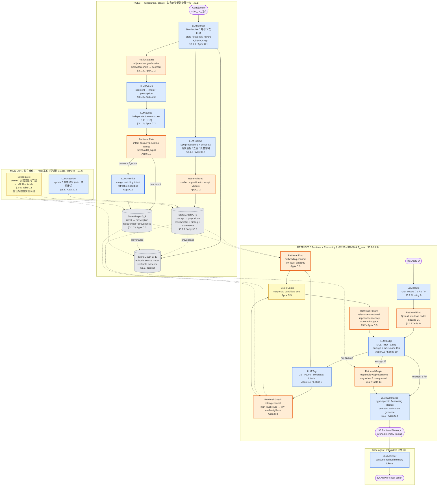
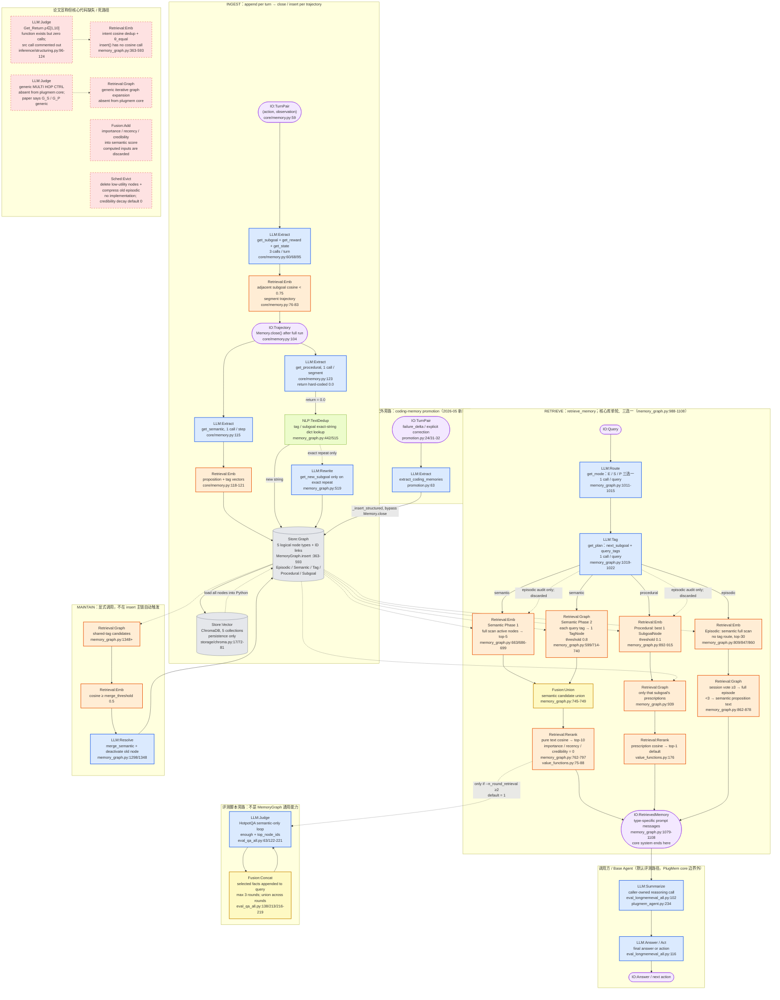

# PlugMem methodology 流程图

> [!note] 来源与采信顺序
> 基于同目录 [[paper-architecture]] 与 [[code-architecture]]，并已吸收 [[verification]]（2026-09-05，论文 83 条 + 代码 71 条逐项核对）的勘误。凡 architecture 与 verification 冲突，一律以 verification 为准。关键修正包括：当前 LongMemEval / WebArena 脚本通过 `PlugMemClient` 访问 `plugmem/` 服务；`plugmem/` 首次提交早于 ICML 接收；默认三基准均不启用多跳；return scorer 是死代码；intent 写入去重是精确字符串匹配；semantic rerank 实际退化为纯 cosine。统一词汇表见 `METHODOLOGY-FLOW-SPEC`。

## Paper 视角

Yang et al. 2026, *PlugMem: A Task-Agnostic Plugin Memory Module for LLM Agents*, arXiv:2603.03296（ICML 2026）。

![[assets/plugmem-paper-flow.png]]

### 核验真源



> [!warning] 论文自身未消解的张力
> - Memory type：Table 14 的 `F ⊆ {E,S,P}` 允许多类型子集，Listing 8 却要求 “only one”；图按可比较主链画 E/S/P 路由，不把“可多选”当成已确认能力。
> - `RerankPrune` 只说 relevance 为主、可叠加 importance/recency，没有闭式公式、权重或 importance 定义；图保留论文宣称，不补造打分细节。
> - `ToEpisodic(C,G_E)` 只有伪代码一行，provenance 映射的一对一/聚合规则未披露。
> - Table 2 渲染出的 solves 箭头方向与正文语义描述不一致；图采用正文与 Appendix C.2 支持的 intent → prescription 方向。

## Code 视角

repo `~/Documents/repo/PlugMem` @ `3b2ce75`。主图以 `plugmem/core` + `plugmem/inference` + `plugmem/storage` 的当前服务实现为主，并单独标出 `src/eval/hotpotqa` 的外挂多跳；当前 LongMemEval / WebArena 评测入口通过 `PlugMemClient` 访问该服务，但仍复用部分 `src/` structuring / value 代码。

![[assets/plugmem-code-flow.png]]

### 核验真源



> [!warning] 代码与运行配置退化
> 1. **多跳默认全关**：LongMemEval / WebArena 各只调用一次 `retrieve_memory()`；HotpotQA 的外挂循环仅支持 semantic，且 `--n_round_retrieval` 默认 1。论文的 G_S / G_P 通用多跳不是核心库能力。
> 2. **quality-aware reuse 缺失**：`get_return()` 存在但零调用，`get_procedural()` 将 `_return` 写死为 `0.0`；`src` 对应调用甚至被注释掉。
> 3. **intent 去重退化**：写入时只做 `subgoal2node.get(subgoal_str)` 精确字符串匹配，不做论文的 embedding cosine + `θ_equal`。即使命中，合并分支只刷新 embedding/time，未把 merged string 写回节点文本。
> 4. **semantic 路由与重排退化**：tag route 只扩大候选池；`compute_importance` / `compute_recency` / `compute_credibility` 恒为 0，最终排序 100% 是文本 cosine。`ValueBase.evaluate()` 还漏加 `v_credibility`。
> 5. **Chroma 退化为持久化层**：四个 `query_*` ANN 方法全仓零调用；查询先把节点载入 Python，再全量 `for` 循环算 cosine，未使用 Chroma HNSW。
> 6. **episodic 模式额外浪费**：先跑 semantic + procedural 两路写入 audit 后丢弃，再单独跑 episodic；其 `_wo_tag` semantic 路径不检查 `is_active`，软删除节点仍可能重新命中。
> 7. **Reasoning 边界外移**：`retrieve_memory()` 只返回 prompt messages；`retrieve_and_reason()` 虽存在，但三个 eval 目录没有调用点。论文系统内的 Reasoning Module 在默认代码路径由调用方 LLM 完成。

> [!info] 代码来源口径修正
> `plugmem/` 并非论文接收后才出现：其首个提交为 2026-03-19，早于 2026-04 ICML 接收；只有 coding plugin / promotion 旁路是 2026-05 新增。当前 LongMemEval / WebArena 入口无条件使用 HTTP `PlugMemClient`，不能再把三个基准概括成“全部 import `src/memory_retrieving`”。

## 新登记 module

以下均以当前中央规范 `METHODOLOGY-FLOW-SPEC` 为判定基准；其中部分名称已在其他系统的 methodology 文件出现，但尚未回填中央词汇表。

| module | 类别 | 理由 |
|---|---|---|
| `IO:Trajectory` | IO | PlugMem create 的输入与 close/insert 的提交粒度是完整 trajectory；区别于逐步进入 `Memory.append()` 的 `IO:TurnPair`。 |
| `IO:RetrievedMemory` | IO | 检索末端输出的是 refined memory tokens（论文）或渲染好的 prompt messages（代码），不是最终 answer。 |
| `LLM:Route` | LLM | GET MODE / get_mode 负责在 episodic / semantic / procedural 之间路由；与生成 concept/intent 查询标签的 `LLM:Tag` 分开。 |
| `NLP:TextDedup` | NLP | 代码插入使用 tag/subgoal 文本的精确字符串 dict lookup；区别于 embedding 阈值去重与 hash 去重。 |
| `Fusion:Union` | Fusion | 论文和代码 semantic 检索都把 dense 与 graph-route 两个候选集合做集合并；不应误写成加权求和或纯 concat。 |
| `Fusion:Concat` | Fusion | HotpotQA 外挂多跳把 focus facts 直接拼接进下一轮 query 字符串，不做 embedding 融合。 |
| `Retrieval:Rerank` | Retrieval | 候选召回后的确定性打分、排序与 top-k pruning；区别于 LLM listwise reranker。 |

已直接复用中央词汇表既有项：`LLM:Extract`、`LLM:Judge`、`LLM:Rewrite`、`LLM:Tag`、`LLM:Summarize`、`LLM:Resolve`、`LLM:Answer`、`Retrieval:Emb`、`Retrieval:Graph`、`Fusion:Add`、`Sched:Evict`、`Store:Graph`、`Store:Vector`、`IO:Query`、`IO:Answer`、`IO:TurnPair`。

## 不确定处

1. **论文 memory type 是单选还是多选**：Listing 8 的 “only one” 与 Table 14 的集合 `F ⊆ {E,S,P}` 冲突，论文无勘误。
2. **论文 rerank 公式**：importance 的定义、relevance/importance/recency 权重及是否在主实验启用均未披露。
3. **论文 episodic 回映射**：`ToEpisodic(C,G_E)` 的粒度与聚合规则未写；代码的“session 命中 ≥3 才回整段，否则返回 proposition”只能视为实现选择，不能反推论文。
4. **intent 精确字符串去重的实际命中率**：静态控制流已确认，但仓库没有统计或运行日志，不能量化“几乎不命中”。
5. **旧 `src` 纯 procedural 分支的 `max_w` NameError 是否在历史跑分触发**：静态作用域风险成立，但未运行该路径或取得历史日志。
6. **Figure 2/3/4 的视觉细节**：本轮核验依据 txt 正文、图注与代码，没有读取论文图片像素；图中若有正文未提字段，仍未核实。
7. **LongMemEval 主结果的精确历史代码版本**：当前 `eval_longmemeval_all.py` 将 reasoning / answer 硬编码为 `gpt-4o`，与论文 Qwen2.5-72B 配置确定冲突；当前 HEAD 是否等于产出 Table 3 的历史 commit，缺运行记录和版本锚点。

## 生图 prompt 素材

### Paper flow prompt

```text
Create a clean horizontal academic systems diagram titled “PlugMem — Paper Methodology”. White background, compact sans-serif labels, thin charcoal arrows, no gradients or decoration. Use four swimlanes: INGEST, RETRIEVE, MAINTAIN, BASE AGENT. Use canonical short labels exactly: blue rectangles for LLM, orange rectangles for retrieval, yellow rectangles for fusion or scheduling, gray cylinders for stores, pale-purple rounded rectangles for IO. INGEST: IO:Trajectory → LLM:Extract “Standardize” → Store:Graph G_E; branch to LLM:Extract “Semantic” → Retrieval:Emb → Store:Graph G_S, and Retrieval:Emb “Segment” → LLM:Extract “Procedural” → LLM:Judge “Return 1–10” → Retrieval:Emb “Intent Dedup” → optional LLM:Rewrite → Store:Graph G_P. Show provenance links from G_S and G_P to G_E. RETRIEVE: IO:Query → LLM:Route → Retrieval:Emb “Init” → LLM:Judge “Enough?”; if no, LLM:Tag → parallel Retrieval:Emb and Retrieval:Graph → Fusion:Union → Retrieval:Rerank → back to “Enough?”; if yes, optional Retrieval:Graph “To Episodic” → LLM:Summarize → IO:RetrievedMemory → external LLM:Answer → IO:Answer. MAINTAIN: LLM:Resolve “Update” and Sched:Evict “Delete”. Keep all image labels short; omit file paths and long citations.
```

### Code flow prompt

```text
Create a matching horizontal academic systems diagram titled “PlugMem — Code Methodology”, using the same white academic visual system and canonical color legend. Use five main swimlanes: INGEST, RETRIEVE, CALLER, EVAL-ONLY, PAPER-ONLY DEAD; add compact MAINTAIN and CODE-ONLY sidebands. INGEST: IO:TurnPair → LLM:Extract “State / Subgoal / Reward” → Retrieval:Emb “Segment <0.75” → IO:Trajectory; branch to LLM:Extract “Semantic” → Retrieval:Emb, and LLM:Extract “Procedural, return=0” → NLP:TextDedup “Exact String”; merge into Store:Graph → Store:Vector “Chroma Persistence”. RETRIEVE starts IO:Query → LLM:Route “Memory Type” → LLM:Tag “Query Plan”, then three single-pass branches: Semantic = parallel Retrieval:Emb “Global Top-5” plus Retrieval:Graph “Tag Route” → Fusion:Union → Retrieval:Rerank “Cosine Top-10”; Procedural = Retrieval:Emb “One Intent” → Retrieval:Graph “Child Prescriptions” → Retrieval:Rerank “Top-1”; Episodic = Retrieval:Emb “Semantic Top-30” → Retrieval:Graph “Session Vote ≥3”. All end at IO:RetrievedMemory, then cross the system boundary to caller-owned LLM:Summarize → LLM:Answer → IO:Answer. EVAL-ONLY: optional semantic-only LLM:Judge loop, default off. MAINTAIN: Retrieval:Graph → Retrieval:Emb → LLM:Resolve → Store:Graph. CODE-ONLY: IO:TurnPair “Failure / Correction” → LLM:Extract → Store:Graph. PAPER-ONLY DEAD: red dashed LLM:Judge “Return Scorer”, Retrieval:Emb “Intent Cosine Dedup”, LLM:Judge “Generic Multi-Hop”, Fusion:Add “Importance”, and Sched:Evict “Episodic Compression”. Add a small warning strip: default benchmarks are single-pass; Chroma ANN unused; semantic rerank is pure cosine; reasoning is caller-owned. Keep labels short and omit code citations.
```
