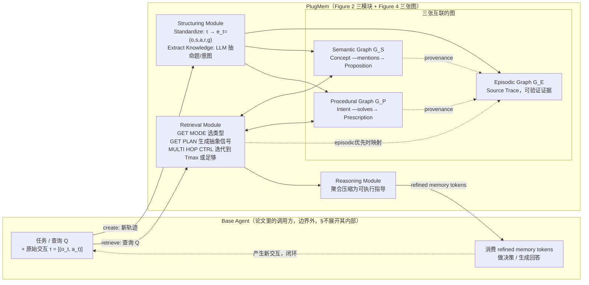

# PlugMem 论文架构

> 调研范围：`Yang-2026-PlugMem-A-Task-Agnostic-Plugin-Memory-Module-for-LLM-Agents.txt`（arXiv:2603.03296，ICML 2026，UIUC+清华+MSR）。本文档只依据论文正文与附录文字，不引用代码；章节号（§/Appendix/Table/Listing）以论文自己的编号为准，是最可靠的定位方式。行号指向纯文本提取版论文（正文共 3953 行）里**能用检索精确定位到原文那句话**的位置，已逐条核对；但这份 txt 是双栏 PDF 抽取出来的，**物理行序会把左右两栏的文字交错排列**，同一段的行号不一定连续递增，行号只用来“精确定位这句话在哪行”，不代表阅读顺序，不要根据行号大小推断前后因果。图片本身（Figure 2/3/4）没有被读到，只读到了图注文字，见第 5 节说明。

## 1. 一句话机制

论文的核心主张是"知识稀疏性"（knowledge sparsity）：agent 决策真正用得上的信息是**浓缩的抽象知识**，不是冗长的原始经验。于是借认知科学对长期记忆的三分（episodic / semantic / procedural，Tulving 1972），把 agent 的原始交互先标准化成情景记忆，再抽象成两类知识——语义记忆（命题性知识，knowing that）和程序记忆（处方性知识，knowing how）——组成三张互联的图；检索时用高层节点（概念/意图）当路由信号去激活相邻的低层节点（命题/处方），允许多跳迭代直到证据够了；最后用一个推理模块把检索到的知识压缩成一段紧凑的、可执行的指导交给 base agent。

证据：Abstract（"decision-relevant information is concentrated as abstract knowledge rather than raw experience"）；引言（"our approach consists of: i) a structuring module ... ii) a retrieval module ... iii) a reasoning module"，行 172-177）；Figure 2 图注（"P LUG M EM organizes raw memory and outputs refined memory tokens to help the base agent's decision-making"）。

## 2. 记忆是怎么存进去的

论文没有像"逐 API 调用"那样交代协议细节（那属于 agent 侧集成方式，论文不讨论），只描述"给一条原始轨迹 τ，标准化+抽取知识"这个处理单元；可以合理理解为**一批/一段处理**（一条完整轨迹或一段对话），而不是逐字流式写入，但论文没有明确用"逐步 vs. 批量"这样的语言表态。

### 2.1 Standardize（标准化）：先把异构原始记录变成统一五元组

原始轨迹表示为观测-动作对序列 $τ = [(o_t, a_t)]_{t=1}^{T}$（§3.1.1 "Episodic Formalization"段，公式实际在行 454）。每一步被格式化成五元组：

$$e_t = (o_t, s_t, a_t, r_t, g_t)$$

其中 $s_t$（agent 状态）由上一状态 $s_{t-1}$、上一动作 $a_{t-1}$、当前观测 $o_t$ 经 **LLM 信息抽取**推导（"The state st is derived from (st−1 , at−1 , ot ) via LLM-based information extraction"，行 482-483）；$g_t$（子目标）和 $r_t$（奖励）也都由 LLM 在给定任务指令和局部交互上下文的条件下标注（"Both gt and rt are annotated by an LLM conditioned on the task instruction and local interaction context"，行 483-484）。所有标准化步骤汇总成情景记忆序列 $M_{epi} = [e_t]_{t=1}^{T}$。

**这一步存的是什么**：只有 $o_t/a_t$ 是原文，$s_t/g_t/r_t$ 三个字段都是 **LLM 生成**的结构化标注，不是纯粹的"原文照抄"。

证据：§3.1.1 Standardize 标题在行 430（因双栏抽取，这个标题在物理行序上甚至早于它自己的上级标题"3. Methodology"行 434，确认为双栏交错所致），五元组定义 $e_t=(o_t,s_t,a_t,r_t,g_t)$ 在行 469，本小节在行 487 指向 Appendix C.1；Appendix C.1（标题行 2151，含 Get_State/Get_Subgoal/Get_Reward 三个 prompt 模板 Listing 1/2/4）。

### 2.2 Extract Knowledge（抽取知识）：从情景记忆里提炼语义与程序知识

**语义记忆（Semantic，存进语义图 $G_S$）**：给定一个标准化 episodic 单元 $e_t$，用 LLM 抽取一组"原子命题"（proposition），每条命题配一组"概念"（concept，当索引/标签用）。论文举例："Tam Sventon, known in Swedish as Ture Sventon, is a fictional private detective based in Stockholm."，关联概念集合 {Tam Sventon, fictional private detective, Stockholm}（§3.1.2，行 630-634）。为保证抽取质量，明确要求三条约束：**指代消解**（coreference resolution）、**命题去重**（proposition deduplication）、**长度控制**（length control，行 634-637）。

存进 $G_S$ 的节点：每条命题、每个概念各自是一个节点，都缓存 dense embedding。两类边：
- **membership 边**：命题 → 关联概念（"Concept ←mentions— Proposition"，Table 2）
- **provenance 边**：命题 → 源 episodic 单元（可回溯验证）

Appendix C.2 补充：一次 LLM 调用最多返回 $N_{max}=10$ 条命题；多条命题若来自同一个 episodic 单元，还会额外连"sibling 边"保留局部共现结构（行 2340-2344）。

**程序记忆（Procedural，存进程序图 $G_P$）**：给定完整 episodic 序列 $M_{epi}$，先按"相邻子目标 $g_{t-1}, g_t$ 的相似度低于预定阈值就切一段"做轨迹分段（§3.1.2，"the module first segments the trajectory into coherent sub-trajectories"，行 638；Appendix C.2 说这个阈值就是计算相邻子目标 embedding 相似度，行 2437-2438）。每段轨迹被线性化成一段紧凑的过程描述（状态-动作-奖励），丢给 LLM 生成一对 **(intent, prescription)**：intent 是这段的目标抽象，prescription 是"环境无关、可复用的动作工作流"。论文举例："To identify the lowest price of an item, search for the item using the search bar, sort the results by price, and verify the minimum across variants."（行 724）。

**质量感知复用**：论文明确强调"每条 prescription 会被赋一个标量 return 分数 $ρ^{(i)} ∈ [1,10]$，用一个**单独的 LLM 评委**打分，条件是 intent 和该段轨迹"（正文行 728 ，"assigned a scalar return score. The score is obtained using an LLM-based evaluator that assesses whether the intent is achieved"；Appendix C.2 行 2426-2428 给出精确表述与评分范围，并配了专门的 Get_Return prompt）。这是论文里除了"抽取 (intent, prescription)"之外，明确交代的**第三次独立 LLM 调用**。

**意图去重**：新 intent 的 embedding $φ(u)$ 去和已有 intent 节点算 **cosine 相似度**；若最高相似度超过阈值 $θ_{equal}$，用 LLM 把两个 intent 字符串合并改写、刷新该节点 embedding；否则新建一个 intent 节点（Appendix C.2，行 2429-2431）。

存进 $G_P$ 的边（行 743-747，"Edges in GP encode two types of relations. First, hierarchical edges link each high-level intent node to its associated low-level prescription nodes. Second, provenance edges link prescription nodes to their originating episodic units"）：**hierarchical 边**（intent → 其下的 prescription，单向，"Intent —solves→ Prescription"）+ **provenance 边**（prescription → 其所有源 episodic 单元）。

证据：§3.1.2 Extract Knowledge（标题在行 592，本节内容一直延伸到 GP 边定义的行 743-747）；Table 2（Memory Type → Graph Structure 映射表）；Figure 3 图注（结构化模块的可视化流程）；Appendix C.2（标题行 2319，含 Get_Semantic / Get_Procedural / Get_Return / Get_New_Subgoal 四个 prompt，Listing 5-7）。

### 2.3 情景记忆自己的定位

论文把 episodic 明确定位为"**可验证的证据，而不是直接可用的知识**"（"episodic memory captures concrete interaction traces and serves primarily as verifiable evidence rather than directly actionable knowledge"，§3.1 设计原则第一条，行 477），存进 $G_E$，作为 $G_S$/$G_P$ 溯源边的落点，Table 2 里管它叫"Source Trace (Event Window)"。

## 3. 记忆是怎么被用起来的

### 3.1 触发时机

论文没有讨论"agent 在什么时机发起一次检索"这个协议细节，只说"Given a task description or query Q, an LLM-based retriever first determines which memory types to emphasize"（§3.2，行 781）——检索的入口是一次性给定的查询 $Q$，触发节奏留给具体场景。

### 3.2 拿什么去找——先选类型，再交替走"抽象层路由 + 具体层扩展"

检索由三个 LLM 提示协同驱动（三个提示的名字和分工由 Appendix C.3 明确给出，"the retriever is orchestrated by three LLM prompts: GET MODE ... GET PLAN ... MULTI HOP CTRL"，行 2522-2524；§3.2 正文只笼统描述了行为，没有点名这三个 prompt）：
- **GET MODE**（Listing 8）：判断这次查询该侧重哪种记忆类型——episodic / semantic / procedural。
- **GET PLAN**（Table 9/Listing 9）：为下一跳生成"抽象查询信号"——对 $G_S$ 是一组概念（concept tags），对 $G_P$ 是一组意图/子目标。
- **MULTI HOP CTRL**（Listing 10）：检索控制器，判断当前证据是否足够停止，或者该优先深挖哪些低层节点。

检索主要在 $G_S$/$G_P$ 上进行，论文称这套策略为"**abstraction-specificity interleaving**"（抽象层-具体层交替，§3.2 行 782）。当 episodic 记忆被优先选中时，"同样的检索流程会被套用，但系统最终返回的是带溯源关系（provenance-linked）的情景节点"（§3.2 行 782-784）。

### 3.3 一步到位还是多步迭代？——论文明确是"迭代直到够了或到跳数上限"

Appendix C.3（行 2524-2538）+ Table 14 伪代码给出的算法：

1. **初始化候选**：把查询 $Q$ 编码成向量 $q$，直接对全部低层节点（命题/处方）算相似度打分，取一批构成候选集 $C_0$。
2. **每一跳 $t$**（$t = 1$ 到 $T_{max}$）：
   - 若当前候选已被判定"足够"（`Stop(Q, Ct)`），跳出循环。
   - 用 GET PLAN 生成本跳的抽象查询 $q_t^a$（$G_S$ 是概念集合，$G_P$ 是意图集合）。
   - **embedding 通道**：直接对低层节点算相似度，取高分节点。
   - **linking 通道**：$q_t^a$ 去匹配对应的高层节点（概念/意图），激活它们相邻的低层节点（沿 membership/hierarchical 边）。
   - 两路候选**取并集**，按预算 $K$ 重排剪枝（`RerankPrune`，主要用 relevance，可选叠加 importance/recency 等元数据，行 2530-2531）。
   - 高层节点全程只当"中间路由信号"，从不进入候选集 $C_t$（行 2531-2532）。
3. **停止判断**：调 MULTI HOP CTRL，输入是问题 $Q$ + 当前可用节点 ID + 已检索事实文本，输出严格 JSON：`{"enough": true/false, "top_node_ids": [...]}`（Listing 10）。若 `enough=true`，检索提前终止，返回当前候选（若这次要的是 episodic，就把命题/处方节点**沿 provenance 边映射回**对应的 episodic 节点）；否则只保留被选中的候选节点（"focus set"，受 `n_facts_new_query` 上限约束）并入下一跳查询 $Q_{t+1}$。
4. **下一跳查询怎么构造**：论文说"可以用 LLM 改写来融合 $Q_t$ 和选中事实，但我们发现简单拼接效果相当且更省，默认用拼接"（行 2536-2538）。
5. 循环直到 MULTI HOP CTRL 判定足够，或达到跳数上限 $T_{max}$（行 2538-2539）。

论文把这套多跳能力当作 Retrieval Module 的**默认设计**，同时适用于 $G_S$ 和 $G_P$（Table 14 里 `F ← TaskAdapter(Q)` 显式包含 $\{E, S, P\}$ 三种，`ExpandLowLevel(q^a, \{G_S, G_P\})` 也是两张图并列）。Appendix F.2 的"Test-time Scaling"实验专门验证了 $T_{max}$ 是核心可调超参：在 HotpotQA 子集上把 $T_{max}$ 从 2 调到 4，EM/F1 从 66.00/74.73 涨到 69.00/78.11（行 3879），并类比"reasoning-centric 方法里的 test-time scaling"。Appendix F.2 还提到这套检索设计"受 HippoRAG2 启发"——借鉴其"识别（recognition，过滤/挑选相关结构化单元）与扩展（expansion，图上传播找支撑证据）分离"的思路（"Our retrieval design is partly inspired by HippoRAG2"，行 3867），泛化到带类型的 agent 记忆上。

### 3.4 找到之后怎么交给模型——Reasoning Module 做压缩，不做检索

Reasoning Module 是一个"**test-time running module**"（§3.3，行 768）：检索到的多条知识可能彼此重叠、冗长但各自相关，该模块用 LLM 把这些信息聚合压缩成一段紧凑、任务对齐的可执行指导。论文针对三种记忆类型设计了不同的推理 prompt（Appendix C.4，行 2660-2766，Listing 11-13）：
- **Reason_Episodic**：情景记忆通常长且非结构化，论文发现直接让 LLM"逐条推理并回答问题"比先抽取信息再回答更有效，整段推理过程本身就当作抽取出的信息保留下来（行 2672-2678）。
- **Reason_Semantic**：要求"尽量用原话，不要替换成近义词"，抽取出和问题相关的信息（Listing 12）。
- **Reason_Procedural**：要求整合"成功和失败经验"，生成"连贯、可执行"的下一步指导（行 2679-2683，Listing 13）。

消融实验支持"Reasoning 模块主要影响效率，不是任务是否成功的主因"这一定位：去掉 reasoning，准确率几乎不掉，但记忆 token 用量涨 1-2 个数量级（§4.4，Table 6/7/8，例如 LongMemEval 从 362.58 涨到 9478.59 token）。

### 3.5 图操作总览（论文 §3.4 给出的四个通用 API）

- **create**：把新观测到的情景经验插入结构化记忆（标准化 + 触发知识归纳）。
- **retrieve**：给定任务/查询，检索相关的语义/程序/情景记忆。
- **update**：有新证据时修订已有记忆条目（语义："检测并缓解矛盾"；程序："优化工作流效率"）。
- **delete**：移除过时或低效用的记忆（Table 13："衰减低效用节点，同时压缩旧的情景节点以节省空间"）。

论文明确说明主论文的基准评测"主要评测 create 和 retrieve 两个操作，update/delete 的效果实验放在 Appendix C.5"（§3.4/§4.2，"The benchmark evaluations in the main paper primarily evaluate the create and retrieve operations"，行 815-817）。

证据：§3.2 Retrieval Module（标题行 759，正文内容散在 745-784 附近，因双栏抽取不完全连续）；§3.3 Reasoning Module（标题行 761，"test-time running module" 句在行 768）；§3.4 Summary and Supported Operations（标题行 788）；Appendix C.3（标题行 2519，含 Table 14 伪代码 + Listing 8-10）；Appendix C.4（标题行 2660）；Appendix C.5（标题行 2767）；Appendix F.2（标题行 3866，Tmax 消融实验在行 3879）。

## 4. 架构图

论文 Figure 2 给出的是最外层的黑盒视角（Structuring → Retrieval → Reasoning，输入原始记忆、输出"refined memory tokens"喂给 base agent）；Figure 4 给出的是记忆图内部的四种操作（Create/Retrieve/Update/Delete）视角。下图把两者合并，标出论文文字里"记忆系统"和"base agent"的边界：

边界很清楚：**Structuring/Retrieval/Reasoning 三个模块 + 三张图，全部在 PlugMem 一侧**；base agent 一侧只负责"产生原始交互"和"消费压缩后的记忆 token 做决策"，论文没有交代 base agent 内部怎么把这些 token 用进它自己的 prompt（那是"6 行代码接入"级别的集成细节，论文正文未展开）。

## 5. 我没搞清楚的

- Table 14 伪代码里 `RerankPrune(C, K)` 具体怎么把 relevance 和 importance/recency 组合成一个分数——论文只说"a value function (primarily relevance, optionally combined with metadata such as importance/recency)"（Appendix C.3，行 2531），没给出闭式公式或权重系数；"importance"全文只在这里和 §3.2（行 754-755）各出现一次，从未被单独定义，不清楚它具体是什么信号（节点被引用次数？人工标注？检索命中频率？）。
- Intent 合并阈值 $θ_{equal}$ 的具体取值，正文和附录都没给数字（Appendix C.5 给了**语义节点** update 消融的两个阈值 $τ∈\{0.6, 0.7\}$，但那是另一个操作的另一个阈值，不是插入时的 intent 去重阈值）。
- Episodic 检索模式下"map via provenance"（Table 14 最后一步 `ToEpisodic(C, G_E)`）具体规则没写：是每个命中的命题/处方各自跳回它唯一的 source，还是有类似"多条命题指向同一 session 才聚合返回整段"的规则？§3.2 正文只有一句"the system ultimately returns provenance-linked episodic nodes"，没有展开。
- GET MODE / GET PLAN / MULTI HOP CTRL 三个检索侧 LLM 具体用哪个底座模型、什么解码参数，论文 Appendix E.1 只笼统说"structuring and retrieval modules"整体用 Qwen2.5-32B-Instruct，没有把 MULTI HOP CTRL 单独拎出来确认。
- §3.4 承诺"update 和 delete 操作的效果实验都在 Appendix C.5"，但通读 C.5 全文（行 2767-2867），内容全部是**语义节点 update（合并）**的消融（合并阈值、图紧凑度、候选可控性），**没有看到任何独立的 delete/decay 实验数据**——Table 13 描述 delete 操作时提到的"compress old episodic nodes"，具体压缩机制正文和附录都没有进一步展开。
- Figure 2/3/4 本身没有被读到（本次读的是纯文本提取版论文，图片内容缺失），只读到了图注和正文引用图的文字；图中具体的视觉布局、是否有本文字段没提到的细节，无法核实。
- 论文没有交代 base agent 一侧具体怎么把 refined memory tokens 用进自己的决策 prompt（"6 行代码接入"是仓库 README 的表述，不是论文正文的表述）；这属于集成细节，论文只交代了模块边界，没交代边界另一侧的实现。
- Appendix F 的"任务适配"实验（为 LongMemEval 换抽取 prompt/更新策略、为 HotpotQA 调高 $T_{max}$）和 Abstract 强调的"unchanged across three heterogeneous benchmarks"之间是什么关系，论文没有明确划界——不确定 Table 3/4/5 的主结果本身是否已经包含了部分基准特定的超参数选择（比如不同基准用不同底座模型规格），还是完全共享同一套超参。这一点需要更细致地比对 Table 3/4/5 表头和 Appendix E 各节的设置才能确认，本次只读到了表面的不一致（见第 6 节 c）。

## 6. 论文没写清楚的地方

区别于上面第 5 节"具体查不到答案的空白点"，这里列的是论文**表述本身**容易让人误解、内部不完全自洽、或者"承诺了但没兑现"的地方：

**a. Delete 操作"说了要有实验，实际没有独立实验"**。§3.4/§4.2（行 816-817左右）明确写"Additional experiments evaluating the effectiveness of the update **and delete** operations are provided in Appendix C.5"，但 C.5 全文（行 2767-2867）只有 update（语义合并）的消融，delete/衰减机制没有任何量化实验支撑。读者按这句措辞会预期在 C.5 里同时看到两种操作的效果数据，实际只看到一种。

**b. "importance" 被反复提及但从未定义**。这个词在全文只在两处实质性出现（§3.2 行 754-755、Appendix C.3 行 2531），且两次都只是"重排时可选叠加的信号"这种插入语式的一笔带过，没有给出计算方式、消融实验或哪怕一个具体例子。读者读完全文也无法知道"importance"在实际实验里是不是真的被启用过、权重多大。

**c. "unchanged across three benchmarks" 的措辞容易被过度解读**。Abstract 强调"We evaluate P LUG M EM unchanged across three heterogeneous benchmarks"，但 Table 3/4/5 的表头显示三个基准实际用的底座模型规格并不完全相同（LongMemEval 用 Qwen2.5-32B+72B，HotpotQA 用 Qwen2.5-32B，WebArena 用 Qwen2.5-32B+GPT-4o），而且 Appendix F 整章都在讲"在 PlugMem 之上叠加任务特定改动"（为 LongMemEval 换抽取 prompt 和更新策略、为 HotpotQA 调高跳数上限 $T_{max}$）。"unchanged"更准确的含义应该是"模块结构和核心算法不变"，而不是"所有超参数/底座模型完全一致"，但摘要的措辞容易让读者先入为主理解成后者，论文正文没有在第一次使用这个词时就澄清边界。

**d. Episodic 检索的"映射回情景节点"细节，主文完全没交代，压缩成了伪代码里的一行**。§3.2 正文只有一句"the system ultimately returns provenance-linked episodic nodes"，具体怎么从命中的命题/处方映射回情景节点（一对一？聚合？有没有阈值？）全部压缩在 Table 14 伪代码的 `ToEpisodic(C, GE)` 一行里，普通读者按主文段落是拼不出这一步具体怎么做的，必须去啃伪代码和第 5 节列的那些空白。

**e. Return score 评委是"第三次独立 LLM 调用"，但正文表述容易让人以为是顺带产出**。§3.1.2 正文描述程序记忆抽取时，"assigned a scalar return score. The score is obtained using an LLM-based evaluator"只是行 728 一句带过，紧跟在"LLM 抽取 (intent, prescription)"这句话后面，容易让人以为 return score 是同一次 LLM 调用顺带给出的；要读到 Appendix C.2（行 2426-2428）并看到 Get_Return 是一个独立于 Get_Procedural 的 prompt（Listing 6 和 Listing 3/"Prompt Get_Return"分开列出）才能确认这是额外一次推理开销，不是免费的副产品。
