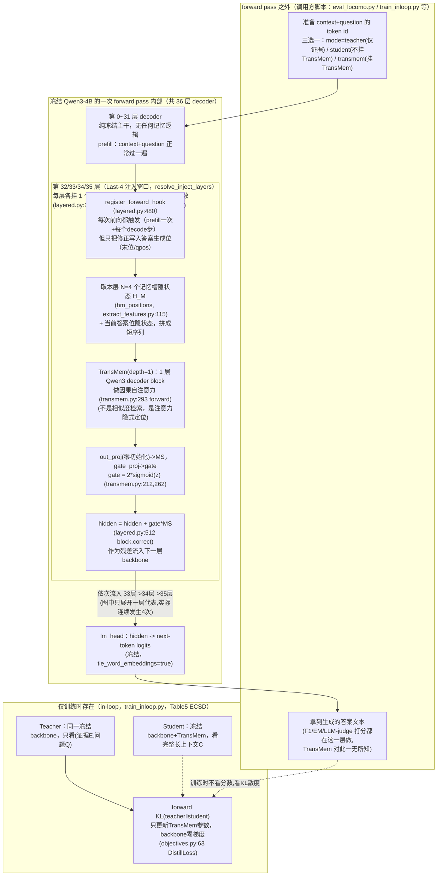

# TransMem 代码架构

> 读的是 `/Users/guanhongli/Documents/repo/TransMem`（`git remote` 确认 origin =
> `https://github.com/Haodong-Lei-Ray/TransMem`，克隆时 `HEAD=6d7a6127967ad44482c958b555d8c83bfb75e9b9`，
> commit message `vanish`，2026-08-09）。核心逻辑集中在 `transmem/transmem.py`（单个注入层的 TransMem 模块本体）、
> `transmem/layered.py`（把多个 TransMem 模块接到 LLM 多层上的"层级注入"实现，论文主结果用的就是这一套）、
> `transmem/extract_features.py`（记忆槽位置计算 + 训练用特征抽取）、`transmem/train_inloop.py`（论文主推的
> "在环"训练脚本）。
>
> 术语先解释一遍：**隐状态（hidden state）**＝ Transformer 每一层、每个 token 位置算出来的那一串数字向量，
> 是模型"看完前面内容后脑子里的表示"；**KV cache（键值缓存）**＝自回归生成时把已经算过的 key/value 存下来，
> 避免每生成一个新 token 就把前面全部重算一遍；**RoPE（旋转位置编码）**＝一种把"第几个位置"编码进
> attention 计算里的方法；**残差（residual）**＝ `新值 = 旧值 + 修正量` 这种"在原有基础上加一点"的写法；
> **门控（gate）**＝一个 0~2 之间的缩放系数，用来决定"这次修正要打几折甚至放大"；**教师强制（teacher
> forcing）**＝训练时不管模型自己生成什么，都喂给它"标准答案"的前缀去预测下一个词；**正向 KL 散度
> （forward KL divergence）**＝衡量两个概率分布差多远的一种指标，这里用来让学生的输出分布逼近老师；
> **消融（ablation）**＝去掉某个组件看性能掉多少，用来证明这个组件有没有用；**热启动（warm start）**＝
> 用现成的权重初始化一个新模块，而不是从随机数开始训。
>
> **先说清楚一个前提，避免用"外部记忆系统"的直觉去套这套代码**：TransMem 不是一个独立进程/服务，也不是
> 数据库——它就是冻结 LLM 一次前向计算（forward pass）内部，寄生在几个 decoder 层输出端的一小段网络。
> 它没有任何跨请求/跨会话的持久化存储；这次前向算出来的"记忆"，前向一结束就跟这次请求的其它中间变量一样
> 被丢弃，下次请求会重新算一遍。第 2、3 节会反复回到这一点。
>
> **2026-09-05 勘误**：本文已按同目录 `verification.md` 的逐条复核结论修正（共 20 处：2 处事实、6 处行号/锚点、12 处表述限定）。原始未修正版本见 git 历史。

## 1. 一句话机制

冻结的 LLM 在处理长上下文（context）时，本来就会在每一层、每个 token 位置产出隐状态；TransMem 只在
模型**开始生成答案**的那一刻，从上下文里挑出几个位置（默认切成 4 段，每段取最后一个 token 的隐状态）当
"记忆特征"，喂给一个只有 1 层、结构和主干 LLM 完全一样的小 Transformer block（仅限 Qwen3 backbone：`layers.py:48
  to_qwen3_config` 永远构造 `Qwen3Config`，backbone 换成 Llama3.1-8B 时 block 内部架构并不同构，仓库也确有
  `config_layered_llama31_8b_dynamic_gate.json`）做自回归注意力，算出一个
"记忆修正向量"，再用一个可学习的 sigmoid 门控决定这个修正打多大折扣，最后原地加回当前生成位置的隐状态里，
作为残差继续往上层传。这套小模块（连同门控）在 LLM 的最后 4 层（Last-4，对 36 层的 Qwen3-4B 就是第
32/33/34/35 层，`transmem/layered.py:43` `resolve_inject_layers`）各装一份，互不共享参数；训练时只更新
这些小模块的参数，LLM 主干一个字节都不改（真正的冻结证据在 `transmem/train_inloop.py:366 self.model.requires_grad_(False)`，
  optimizer 只取 `self.mem.parameters()`（`:457-464`），梯度裁剪也只作用于 `self.mem`（`:584`）；`layered.py:244`
  只是 `TransMemLayered` 模块类定义，本身不是冻结证据）。

## 2. 记忆是怎么存进去的

**关键澄清（读这节前必须先知道）**：这里的"存"几乎不成立——TransMem 没有数据库、没有向量库、没有任何
跨请求持久化的地方。所谓"记忆"就是同一次 forward pass 里，冻结 LLM 主干本来就会计算出来的隐状态本身，
被顺手拿来当特征用，用完这次请求就没了。下一次换一个新的 context，一切从头重新算。

- **触发时机**：prefill 阶段（模型读完 context + question、还没开始吐第一个答案 token 的那一刻）。
  推理侧对应 `LayeredRollout.generate_from_ids`（`transmem/layered.py:453`）：hook 其实在前向之前就已经注册好
  （`layered.py:519-520`），随后对完整的 `context+question` 做的那次前向（`layered.py:528 self.model.model(...)`，
  不是 `:565`——那里是 `values = (torch.stack(chosen_log_probs)...)`）**不是**"不带 TransMem 修正的标准前向"：
  挂在第 32~35 层上的 forward hook（`layered.py:480` `mk_hook`）在这次前向里同时完成了"读 `H_M`"（`:488`）和
  "写修正"（`:512 h[:, -1, :] = block.correct(...)`）。真正"不挂 TransMem"的纯前向另有其人，是 overflow 路径的
  `capture_memory_from_ids`（`:391-394 use_cache=False`，见下一条"超长上下文的例外"）。

- **存的是什么**：不是原文、不是摘要、不是图、也不是"写进向量库的向量"——是**该层 decoder 输出的原始隐状态
  张量本身**（`hm_limit = source[0, hm_idx_t, :]`，`transmem/layered.py:488`）。具体选哪几个位置由
  `hm_positions(len_cl, N, mode)` 决定（`transmem/extract_features.py:115-127`）：把 context 的
  token 长度按 `N`（配置项 `n_mem`，默认 4，`transmem/layered.py:119` / `transmem/transmem.py:85`）
  切成等长的 N 段，取每段**最后一个 token** 的位置。代码提供两种取位公式：
  `floor`（`seg=len_cl//N; idx=(i+1)*seg-1`，历史默认，`extract_features.py:126-127`）和
  `frac`（`idx=ceil((i+1)*len_cl/N)-1`，末位严格对齐文末、且不同 N 的取位集合互为子集，是为专门做
  "记忆池"消融设计的，论文正文完全没提这第二种取位公式，`extract_features.py:124-125`）。
  每个注入层各自独立取一份自己的 `H_M`（4 个位置 × hidden_dim），互不共享。`floor` 是默认取位方式，但当
  context 长度不能被 `N` 整除时，`floor` 取不到论文公式里严格意义上的最后一个 token `h_L`，最多相差
  `N−1` 个 token；真正逐字等价于论文 `H_M=[h_n,...,h_L]` 写法的是 `frac`，但 `frac` 只在 overflow 路径
  被强制启用（见下一条）。

- **超长上下文的例外（唯一跨"多次前向"的情况）**：如果 context 长度超过 backbone 的上下文窗口，
  `capture_memory_from_ids`（`transmem/layered.py:327`）/ `capture_memory_from_context`
  （`layered.py:407`）会把 context 切成多个 chunk，每个 chunk 单独做一次**不挂 TransMem 修正、不带
  LLM KV cache** 的纯前向，各自留下 N 个记忆位置的隐状态，再由 `_normalize_overflow_memory`
  （`layered.py:420`）校验拼接——但分块/拼接这两步实际发生在**调用方**（`eval_memory_agent_bench.py:937-947`），
  不在 `layered.py` 内部。这仍然不是持久化，但“结束就丢”需要收窄：同一份 `overflow_memory` 会在同一个
  ContextWindow 内**跨多个问题复用**（`eval_memory_agent_bench.py:951-963`），不是每个 query 各自独立算一次。
  另外这条路径默认关闭（`--retain_overflow_hm` 是 `store_true`）、且只在 MemoryAgentBench 评测脚本里接得上，
  `eval_locomo.py` 全程不传 `overflow_memory`——**LoCoMo 从未触发过 chunk-wise**，这正好回答了
  `paper-architecture.md` 第 6 节最后一条关于“LoCoMo 是否触发溢出策略”的开放问题。

- **存的过程调不调 LLM**：不额外调"另一个"LLM 去做抽取或摘要——这些隐状态是冻结 backbone 自己前向的
  副产品，本来就要算这一遍（因为要处理 context 才能回答问题），没有独立的"写入记忆"这一步。会调的是
  TransMem 自己这个可训练小模块的前向（1 层 Qwen3 decoder block，`transmem/transmem.py:293` `forward`），
  这是"记忆模块自己算一下"，不是"调用一个独立的 LLM 做记忆管理"，跟 mem0 那种"调 LLM 抽取事实"的写入
  方式完全是两回事。

- **训练时的另一条数据路径（容易和"推理时怎么存"搞混，专门分开说）**：训练不是直接在
  `LayeredRollout` 上做梯度更新，而是至少有 **5 条**并行存在的路子（不止 3 条），仓库里都能找到代码：
  ① **离线特征（Stage 0 / off-policy）**——`transmem/extract_features.py` 提前把 teacher/student 的
  隐状态和 answer token 一次性抽出来存成 `.pt` 文件（不加载完整训练图，省显存但和真实推理有"一次性缓存 vs
  逐步产生"的近似误差）；② **on-policy rollout**——`transmem/train_onpolicy.py`，训练时用当前策略在线
  生成轨迹；③ **in-loop（论文最终采用的方案）**——`transmem/train_inloop.py` 调
  `LayeredRollout.teacher_forced_forward`（`layered.py:572`），把冻结 LLM 保留在计算图里，教师强制并行
  地把所有答案位置一次性算出隐状态和记忆提案，数学上和逐步 rollout 因果等价（"梯度经真实 LLM 上层流回各块
  ...这就是'LLM 层进训练环'"这句 docstring 实际属于它内部调用的 `_teacher_forced_forward_with_handles`
  （`layered.py:608`），不是 `teacher_forced_forward`（`:572`）本身）；④ **off-policy SFT**——`train_offpolicy.py --loss ce`
  （"SFT-on-golden"，`:329,720`）；⑤ **GRPO**——`train_grpo.py`+`rl.py`。②③④⑤ 恰好对应论文 Table 5 的 OPD/ECSD/
  SFT/GRPO 四种训练目标，四支在仓库里都有实现。五条路子共用同一个 `hm_positions` 取位逻辑，
  但数据流完全不同，做架构判断时不要把"Stage 0 抽特征"当成"记忆的常规存法"——它只是训练时的一种工程优化。

## 3. 记忆是怎么被用起来的

- **触发时机**：修正只写入**生成答案 token** 对应的位置，但这条边界要收窄一点——prefill 阶段被改写的其实
  是**提示序列的最后一位**（`layered.py:511-512 h = target.clone(); h[:, -1, :] = block.correct(...)`），
  这一位正是产出第一个答案 token 的位置，context/question 更早的 token 确实不受影响，但"完全不受影响"字面
  上不够准确。推理侧：`generate_from_ids` 里 `phase["mode"]` 从 `"prefill"`（只在最后一个 context+question 位置
  触发一次，产出第一个答案 token 前的修正）切到 `"decode"`（之后每生成一个新 token，就在该 token 位置
  再触发一次，`layered.py:494-512`）。训练侧（in-loop）：`_teacher_forced_forward_with_handles`
  （`layered.py:608` 起，不是 `:598`）里 `qpos = arange(len_cq-1, len_cq+M-1)`（`layered.py:627`，不是
  `:614`——`:614` 是描述这行行为的 docstring 那一句），精确对应"prefill
  末位 + 之后每个 decode 位"这一组答案生成位置，和推理侧逐位一致。

- **拿什么去找 / 怎么找**：不是"检索"（没有相似度打分、没有 top-k 排序、没有向量库查询）。做法是把选定的
  `N` 个记忆隐状态 `H_M` 和当前答案侧的隐状态 `H_A` **直接拼成一个短序列**（`X = torch.cat([hm, hq_source],
  dim=1)`，例如 `layered.py:497-499`），喂进 TransMem 自己的 1 层 Qwen3 decoder block 做**因果自注意力**
  （`transmem/transmem.py:293` `forward`，内部复用 HF 的 `Qwen3DecoderLayer`，`transmem/layers.py:48`
  `to_qwen3_config`）。"该记住哪部分、该忽略哪部分"完全交给这层 attention 自己学，不是显式的向量相似度
  比较——这是和检索式记忆系统最本质的区别。

- **一步到位还是多步迭代**：单次前向，没有"检索→反思→再检索"的循环。但因为最后 4 层各自独立装了一份
  TransMem（`transmem/layered.py:252` `self.blocks = nn.ModuleDict(...)`），"多步"体现在**层间**——
  第 32 层修正完的隐状态会继续流入第 33 层，第 33 层的 TransMem 再基于（已经被 32 层修正过的）隐状态做
  第二次修正，依此类推到第 35 层，是"深注入"（layered.py 顶部 docstring 语），不是同一层内部的多轮检索。

- **找到之后怎么交给模型**：TransMem block 输出的 query 位隐状态先过 `out_proj`（零初始化的线性层，
  `transmem/transmem.py:212`）得到记忆修正向量 `MS`；再过 `gate_proj` 算门控标量
  `gate = 2·sigmoid(z)`（`gate_mode="centered_sigmoid"` 时，`transmem.py:281-289`；`_read_gate` 方法本身
  定义在 `:277`，不在 `:262-271`——那段是 `_init_weights` 尾部与 `warm_start_from` 开头）；
  最终 `correct()` 方法（`transmem.py:359`）把 `hidden + gate*MS` 写回该位置
  （推理侧落地在 `h[:, -1, :] = block.correct(target[:, -1, :], proposal)`，`layered.py:512`）。
  这是纯粹的**向量级叠加**，不经过文本化、不进 prompt——下游 LLM 层"看不出"这是记忆修正过的隐状态，
  只是数值被悄悄挪了个方向，继续正常往上算。`out_proj` 零初始化保证训练刚开始时 `MS=0`，修正后的隐状态
  和不加 TransMem 时完全一致（恒等启动，`transmem.py:247` `if self.config.zero_init_out`），这是为了
  训练稳定，论文正文没有提这个工程细节。

## 4. 架构图

TransMem 完全活在"一次 forward pass 内部"，不存在进程边界或网络调用；下面用"forward pass 内 / 外"当边界线，
对应任务要求（这不是 agent/进程层面的记忆系统，画进程边界没有意义）。

**边界说明**：调用方脚本（训练/评测代码）负责准备输入 token、选择要不要挂 TransMem、以及在拿到最终输出后
做打分——它完全不知道、也不需要知道 TransMem 内部怎么处理隐状态。TransMem 自己也不知道下游怎么打分、
怎么用这个答案。两边通过"token id 进 / 生成文本或 logits 出"这一个窄接口交换信息，中间的记忆修正过程
100% 封装在 forward pass 内部，对调用方完全透明——这和 amem/mandol 那种"MCP 工具调用穿越进程边界"的架构
是两种完全不同的记忆范式。

## 5. 我没搞清楚的

- **论文头号结果（Table 1，Qwen3-4B，LoCoMo 54.11 F1）对应哪个确切的训练命令**：现存的通用训练脚本
  `scripts/train/run_inloop.sh` 默认 `CONFIG=transmem/config_layered.json`（脚本内
  `CONFIG=${CONFIG:-$PROJ/transmem/config_layered.json}`），而这个默认配置文件
  `gate_mode="constant"`（`transmem/config_layered.json:26`）——即**没有门控网络**，与论文头号模型
  （Table 3 显示"w/o Gating Network"会掉分，说明头号模型必须带门控）不符。要复现头号结果，必须显式把
  `CONFIG` 换成 `transmem/config_layered_dynamic_gate.json`（`gate_mode="centered_sigmoid"`，
  `config_layered_dynamic_gate.json:27`）——但光换这一个文件**并不充分**：该文件本身 `inject_layers: [35]`
  （`:33`），只是 Last-**1**，真正的 Last-4 还得靠 `scripts/train/run_inloop.sh:30` 强制要求的 `D=4`
  （或显式传 `--inject_layers`）去覆盖（`train_inloop.py:112, 381-388`）。产出论文数字时实际使用的那次 sbatch 提交命令
  （大概率在已被删除的 `scripts/version5/` 目录下）现在找不到了，无法在仓库里核实这一步。**未验证**。
- **仓库内部自评的验证状态是否已过期**：`transmem/README.md` 明确写"CPU 已验证：TransMem 前向/反传/形状...
  off-policy 训练全链路 overfit" vs "需 GPU + 模型验证：Stage 0 抽取...on-policy rollout...evaluate
  长度外推"。这份说明写于仓库某个历史时间点，不确定是不是在论文数字产出**之前**就已过期（后续可能补测过
  但没更新这份说明），也不确定是不是训练论文头号结果之前的状态。**未验证**。
- **warm_start（热启动）是否用于头号结果**：所有已读到的 config json 的 `warm_start` 字段均为
  `false`/未出现（`transmem/config.json` 无此字段，走 dataclass 默认 `False`，`transmem.py`
  `warm_start: bool = False`）；`layered.py` 的 `LayeredConfig` 甚至没有 `warm_start` 字段
  （对照 `layered.py:101-141` 的字段列表）。`layered.py` 里的层级（论文头号）路径下，热启动结构性不可达：`warm_start_from`（`transmem.py:269`）
  全仓**零调用点**，且 `layered.py:191` 在 `block_config()` 里直接**硬编码 `warm_start=False`**——
  可以确定论文头号结果（Last-4 层级注入）**没有用**热启动，这条不是"未验证"，是死代码。
- **gate_temperature（门控温度 τ）、gate_shift 等的实际训练取值**：配置文件里 `gate_temperature: 1.0` 确实是 `config_layered_dynamic_gate.json:30` 写明的值；但
  `gate_shift=0.0` **不在**这个文件里，是走 dataclass 默认值，而且 `transmem.py:124-126` 在非
  `shifted_sigmoid` 模式下会**强制校验** `gate_shift` 必须为 0——这不是"配置默认"，是"被校验强制"，
  没有调节空间。没有看到训练日志能交叉核对这就是头号结果实际使用的值，**未验证**。
- **checkpoints/eval_results/data 三个目录均被 `.gitignore` 排除**（`.gitignore` 末尾
  `/checkpoints`、`/eval_results`、`/data` 等行），仓库里没有任何一次真实训练或评测的产物可供核对——
  只能核对"代码逻辑是否和论文公式对得上"，没法核对"这份代码实际跑出来的数字是否等于论文表格"。
  README 提到发布了 HuggingFace 权重（`Rayleihaodong/TransMem-qwen3-4B-D4` 等），但本次任务范围内没有
  下载验证。**未验证**。

## 6. 与论文的冲突点

1. **数值冲突（B=5 vs B=4）**：论文 *Method > Inference with TransMem* 段原文写
   "The size of HM remains small, with the optimal value being only 5"——字面声称最优段数是 5。但
   **全仓库找不到任何 `n_mem=5` 的配置**：所有默认/训练用配置（`transmem/config.json`、
   `transmem/config_layered.json:18`、各 `*_dynamic_gate.json`）的 `n_mem` 一律是 4
   （`transmem/layered.py:119` `n_mem: int = 4`）；连专门为分段数消融准备的
   `transmem/configs_nmem/` 目录（覆盖 n4/n8/n16/n32/n64/n128/n256/n384 共 8 个粒度）都**没有 n5**
   这个选项。论文自己的附录 *Appendix > Sensitivity to the Number of Memory Segments* 段也写明
   "We reuse the Qwen3-4B TransMem checkpoint trained with B = 4" 并"retain B = 4 as the default"。
   即：论文正文的"5"和论文自己的附录、以及整个代码库的默认实现（都指向 4）自相矛盾。**以代码 +
   论文附录一致的 4 为准**，正文"5"大概率是写作时的笔误或早期设计遗留未同步。
2. **仓库定位需要澄清（"官方实现"≠"为复现整理过的仓库"）**：论文摘要写"Our code is available at
   https://github.com/Haodong-Lei-Ray/TransMem"。经核实 `git remote -v` 确为该地址，且 45 条提交里
   多数作者邮箱 `16002677+lei-haodong-ray@user.noreply.gitee.com` / `leihaodong@seu.edu.cn`
   与论文一作单位（东南大学）一致——**这确实是官方作者本人的仓库**，不是冒名或第三方复现。但它的
   实际形态是**未经清理就直接公开的私人研究工作区快照**，证据：commit message 里有纯研究日志式的中文
   记录（如 `e3f33f9`: "v3 P1-5(LME 域内/depth2/混域)| **项目首个正结果**..."，以及 `ac0988e`:
   "我也不知道写个inloop是为了什么"）；脚本里硬编码作者所在机构的私有 Slurm 分区名
   （`#SBATCH -p DataFrontier_Explore`，`scripts/train/run_inloop.sh`）、私有对象存储 endpoint
   （`d-ceph-ssd-inside.pjlab.org.cn`）和绝对路径（`/mnt/petrelfs/leihaodong/Project4`）；
   `docs/` 目录本身确实因 `.gitignore` 排除 `/docs` 而在公开仓库里不存在；但引用它的不全是 README——
   `transmem/README.md:7` 只引用了 `../docs/plan.md`，而 `docs/version2/transmem正常化修改意见.md` 是被
   `transmem.py:3`、`train_offpolicy.py:7`、`train_onpolicy.py:10`、`test_shapes.py:126` 这几个**代码文件**
   引用的，不是 README；仓库最后一次提交 `vanish`（`6d7a612`，2026-08-09）一次性删除了
   75 个历史实验脚本文件（3215 行，覆盖 `scripts/version3/`、`version4/`、`version5/` 整批目录）。
   **结论：这确实是论文的官方作者仓库，但不是通常意义上"为方便他人复现而整理发布"的代码仓库**，而更接近
   作者个人工作区在某个时间点的直接暴露。
3. **可复现性断裂（README 引用的文件已被仓库自己删除）**：当前 `README.md` 仍然引用两个文件——
   第 148 行 `scripts/version4/run_eval_locomo_s32_parallel.sh`（"An internal Slurm/S3 example"）
   和第 310 行 `scripts/version5/run_train_inloop_generic.sh`（明确称其为"the current layered
   dynamic-gate recipe"，即论文头号结果理应对应的训练配方）。但这两个文件**都在同一仓库最后一次提交
   "vanish" 里被彻底删除**（`git show 6d7a612 --stat` 逐行确认在删除文件列表中），且此后没有任何后续
   提交补回或修正引用。也就是说，跟着 README 走这条"训练/评测配方"的路径，目前是断的——只能靠反推
   `transmem/train_inloop.py` 的 argparse 定义（`train_inloop.py:91-222`）和现存的通用脚本
   `scripts/train/run_inloop.sh` 去重建大致等价的调用方式，无法拿到作者当初实际跑出论文数字的原始命令。
4. **术语容易读岔，但代码本身消除了歧义（非严重冲突，仅提醒）**：论文 *Method* 段"TransMem module at the
   K-th layer consists of a Transformer block f_m^K..."这句话，字面读容易误解成"K 是一个可调的单一超
   参数"，但结合 *Experimental Setup > Implementation Details* 段"Its transformer block consists of
   a single layer"以及消融 Table 4 的"Last-2/Last-4/Last-8/Middle..."多层组合，正确理解应为：**每个被
   选中注入的层各自拥有一份独立的、内部只有 1 层的小 Transformer block，互不共享参数**。代码的
   `TransMemLayered`（`transmem/layered.py:244-252`，`nn.ModuleDict{layer_idx: TransMem(depth=1)}`）
   精确对应这个理解，不存在实现层面的歧义，只是论文这一句单独摘出来读可能让人以为是"一个模块里有 K 层"。
5. **默认配置文件是复现头号结果的一个隐藏陷阱**：不带后缀的默认配置
   `transmem/config.json`（顶层 `TransMemConfig` 默认）和 `transmem/config_layered.json`
   （层级注入默认，`config_layered.json:26` `gate_mode="constant"`）都**不带门控网络**，是论文
   Table 3 消融里的"w/o Gating Network"**或更弱**的版本——"更弱"不是虚指，`config_layered.json` 同时
   把注入层退化成了论文根本没测过的配置（层数上和门控上都比 w/o Gating 更弱）。必须显式指定
   `*_dynamic_gate.json` 系列配置（如 `config_layered_dynamic_gate.json`，
   `gate_mode="centered_sigmoid"`、`gate_max=2.0`）才是论文头号模型的门控设计，但这个配置文件本身
   `inject_layers: [35]` 只是 Last-1，还需要另外覆盖 `D=4` 才是 Last-4（见上一条）。而且哪怕层数和
   门控开关都配对了，**门控粒度和论文 Eq.6 并不是"精确对应"**：论文 Eq.6 `W_g ∈ R^{d×d}` + Eq.7 的
   `⊙` 是逐维向量门控，代码是 `gate_proj = nn.Linear(dim, 1)`（`transmem.py:213`），且 `gate_granularity`
   被 `__post_init__` 硬性限死为 `"token_scalar"`（`:111-114`）——`gate_max=2.0` 对应的只是标量幅度
   `α=2`，不是逐维矩阵。这是本文档唯一漏报的**架构级**分歧（论文附录反而是标量口径，与代码一致，落单
   的是论文正文，见 txt:1344-1347）。这不算逻辑错误（两套配置都是仓库里"合法"的消融分支），但对照
   README 直接跑默认配置的人，跑出来的不会是论文 Table 1 的数字，而是论文自己消融表里更低的一档。
