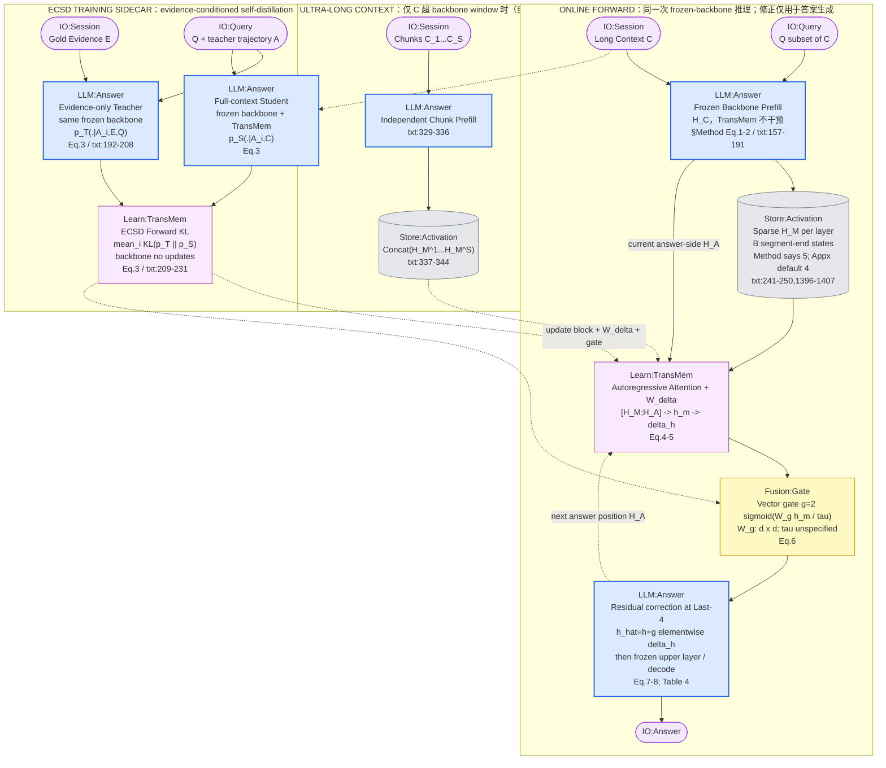
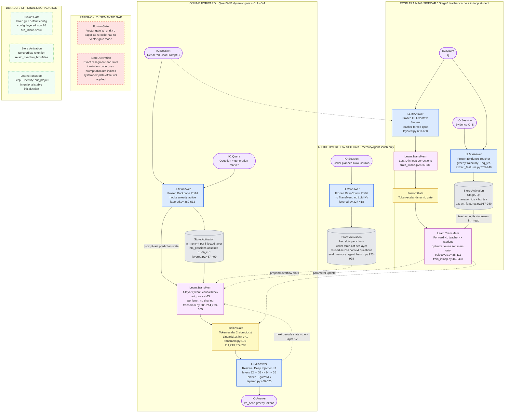

# TransMem methodology 流程图

> [!note] 来源与口径
> 基于同目录 [[paper-architecture]] 与 [[code-architecture]]，勘误以 [[verification]] 为准（2026-09-05 全量复核：120 条，✓97 / ✗5 / ◐17 / ?1）。本系统没有“写入数据库→查询检索”的传统二段式；按统一规范适配为**在线 forward path**与**证据条件自蒸馏训练旁路**。图内 canonical module 使用短英文标签，精确证据保留在 Mermaid 核验真源。词汇表见 [[METHODOLOGY-FLOW-SPEC]]。

## Paper 视角

Lei et al. 2026, *TransMem: Transforming Hidden States into Memory for Large Language Models*, arXiv:2607.29032v1。论文核心：冻结 backbone 的稀疏历史 hidden states 构成 `Store:Activation`，`Learn:TransMem` 把它们变换成 memory shift，`Fusion:Gate` 决定逐维注入强度；ECSD 用 evidence-only teacher 的 soft distribution 训练该能力。

![[assets/transmem-paper-flow.png]]

### 核验真源



> [!important] 论文 gate 是 vector gate
> Eq.6 明写 `W_g ∈ R^{d×d}`，Eq.7 用 `g_m ⊙ Δh`，因此 paper 图按逐维 `Fusion:Gate` 绘制。`τ` 没有具体值。代码改成 token-scalar，这不是仅仅“符号写法不同”，而是参数量与调制粒度都改变。

> [!warning] B 的论文内冲突
> Method 称 `|H_M|` 最优为 5（txt:249-250），但 Appendix Table 13 只验证 Qwen3 checkpoint trained with B=4，并保留 B=4 为默认（txt:1396-1407）。图中不把 5 当可靠默认。

## Code 视角

repo `~/Documents/repo/TransMem` @ `6d7a612`。下图以论文目标架构“Qwen3-4B + dynamic gate + CLI `--D 4`”为主路径；现存通用 runner 的默认 fixed-gate 路径单列为退化。代码没有持久化 memory DB，`Store:Activation` 仅表示当前 forward 或 caller 暂存的 hidden tensor。

![[assets/transmem-code-flow.png]]

### 核验真源



> [!danger] 常规 H_M 的 prompt-offset 偏差
> `build_chat_prompt_ids()` 先产生 `system + user("Context: ... Question: ...") + generation marker`（extract_features.py:1255-1298、1354-1362），但 `len_cl` 只统计裸 context tokens（:758-760），`hm_positions` 结果直接作为整个 prompt 的 absolute indices（layered.py:467-488）。所以代码主路径不是论文的“每个 context segment 最后一位”。这属于代码语义偏差，不是环境退化。overflow raw-chunk capture 直接 tokenize chunk，因此不受此偏差影响。

> [!warning] 默认配置退化
> `scripts/train/run_inloop.sh` 必须提供 `D`，但默认读取 `config_layered.json` 的 `gate_mode="constant"`，即 fixed `g=1`。论文目标路径要求 `CONFIG=.../config_layered_dynamic_gate.json D=4`；dynamic 配置自己的 `inject_layers:[35]` 会被 `train_inloop.py:381-393` 的 CLI 结果覆盖。只换 config、不传 Last-4 拓扑不足以复现论文架构。

> [!warning] 训练路线不要混用
> `train_offpolicy.py` / `train_onpolicy.py` 是早期 final-hidden 单模块；`train_layered.py` 是源码明确标为“已被排除”的离线分层方案；论文主结构对应 `train_inloop.py`。code 图只画 Stage0 teacher cache + in-loop Last-D student，避免把历史实验分支画成主方法。

> [!warning] 可复现性断裂
> README 仍引用 `scripts/version4/run_eval_locomo_s32_parallel.sh` 与 `scripts/version5/run_train_inloop_generic.sh`，两者已在 HEAD `vanish` 提交中删除；训练数据、checkpoint 与 eval outputs 也未入库。因此图能保证“代码控制流真实”，不能保证“当前工作树可复现论文 54.11”。

## 新登记 module

无。`Store:Activation`、`Learn:TransMem`、`Fusion:Gate`、`LLM:Answer`、`IO:Session/Query/Answer` 均已在统一词汇表登记。

## 不确定处

1. **发布 adapter 的 provenance**：未下载 `Rayleihaodong/TransMem-qwen3-4B-D4`，无法核实其 checkpoint 内 inject_layers、gate temperature、train_mode、seed 与实际 state dict shape。
2. **54.11 的确切 recipe**：删除前脚本可证明 dynamic-gate/Last-4 训练路径存在，但当前 repo 无日志或 checkpoint 把某条命令绑定到 Table 1 结果。
3. **prompt-offset 是 bug 还是未写出的刻意约定**：源码注释反复称“C_L 前 len_cl 个位置”，却没有计算 context-start offset；以实际张量索引判断是偏差。需用真实 tokenizer 打印 selected token 文本做最小裁决实验。
4. **Figure 原图视觉细节**：本流程依赖 txt 正文、公式和 caption，没有逐像素转录论文 Figure 2；结构证据完整，但框线布局不声明与原图完全相同。

## 生图 prompt 素材

### Paper flow prompt

```text
Create a rigorous horizontal academic methodology diagram for TransMem, paper perspective, on a clean white background. Use three left-to-right swimlanes: ONLINE FORWARD, ULTRA-LONG CONTEXT, and ECSD TRAINING SIDECAR. Apply the canonical visual grammar exactly: LLM modules are blue rectangles, Learn modules are purple rectangles, Fusion modules are yellow rectangles, activation stores are gray cylinders, and IO modules are pale-purple rounded rectangles. Keep all labels short and in English. Do not include citations, equations, file paths, long prose, decorative gradients, icons, or a title card.

ONLINE FORWARD: IO:Session "Long Context C" and IO:Query "Q" both feed LLM:Answer "Frozen Prefill". Frozen Prefill writes Store:Activation "Sparse H_M per layer, B segment ends". Frozen Prefill also provides "Current H_A" to Learn:TransMem. Store:Activation and Current H_A feed Learn:TransMem "Causal Attention + Projection". Then Learn:TransMem -> Fusion:Gate "Vector 2-sigmoid gate" -> LLM:Answer "Residual Last-4 Decode" -> IO:Answer. Add a thin recurrent arrow from Residual Last-4 Decode back to Learn:TransMem labeled "next answer state". Tiny subtitles only: "B=4 default; Method says 5", "Eq.4-5", "Wg d-by-d; tau unknown", and "layers 32-35".

ULTRA-LONG CONTEXT: IO:Session "Chunks C1...CS" -> LLM:Answer "Independent Chunk Prefill" -> Store:Activation "Concat Chunk Memories". Connect that store to Learn:TransMem with a dashed read edge.

ECSD TRAINING SIDECAR: IO:Session "Gold Evidence E" and IO:Query "Q + Teacher Trajectory" -> LLM:Answer "Evidence-only Teacher". In parallel, Long Context C and the same trajectory feed LLM:Answer "Full-context Student + TransMem". Both feed Learn:TransMem "Forward KL, Teacher to Student". Add dashed parameter-update arrows from the KL node to Learn:TransMem and Fusion:Gate in the online lane. Visually emphasize Learn:TransMem plus Fusion:Gate as the central hidden-state correction mechanism. Include a compact legend using the canonical colors and shapes.
```

### Code flow prompt

```text
Create a rigorous horizontal academic methodology diagram for TransMem, verified code perspective, on a clean white background. Use four left-to-right swimlanes: ONLINE FORWARD, CALLER-SIDE OVERFLOW, ECSD TRAINING SIDECAR, and PAPER-ONLY / DEGRADED. Apply the canonical visual grammar exactly: LLM modules are blue rectangles, Learn modules are purple rectangles, Fusion modules are yellow rectangles, activation stores are gray cylinders, IO modules are pale-purple rounded rectangles, paper-only mismatches are pale-red rectangles with red dashed borders, and optional or degraded paths are pale-green rectangles with dashed borders. Keep all labels short and in English. Do not include citations, file paths, line numbers, equations, long prose, decorative gradients, icons, or a title card.

ONLINE FORWARD: IO:Session "Rendered Chat Prompt" and IO:Query "Question" -> LLM:Answer "Frozen Prefill, Hooks Active". The prefill writes Store:Activation "4 Absolute Prompt Slots per Layer" and sends "Prompt-last State" to Learn:TransMem. Store:Activation and Prompt-last State -> Learn:TransMem "1-layer Qwen3 + out_proj" -> Fusion:Gate "Token-scalar 2-sigmoid" -> LLM:Answer "Residual Deep Injection x4" -> IO:Answer. Add a recurrent arrow from Deep Injection back to Learn:TransMem labeled "next decode state + per-layer KV". Tiny subtitles: "CLI D=4: layers 32-35", "independent modules", "Linear d-to-1", and "hidden + gate times MS".

CALLER-SIDE OVERFLOW: IO:Session "Caller-planned Raw Chunks" -> LLM:Answer "Frozen Chunk Prefill, no TransMem" -> Store:Activation "frac Slots + Caller Concat". Connect this store to online Learn:TransMem with a dashed edge labeled "prepend and reuse across questions".

ECSD TRAINING SIDECAR: IO:Session "Evidence" and IO:Query "Q" -> LLM:Answer "Frozen Evidence Teacher" -> Store:Activation "Stage0 answer_ids + hq_tea". Rendered full context -> LLM:Answer "Teacher-forced Student" -> Learn:TransMem "In-loop Last-D" -> Fusion:Gate "Token-scalar". Teacher activation and student output feed Learn:TransMem "Forward KL"; dashed update arrows return to the online Learn:TransMem and Fusion:Gate nodes.

PAPER-ONLY / DEGRADED: two red dashed nodes, Fusion:Gate "Vector Gate Missing" and Store:Activation "Exact Context Segment Ends Missing". Three green dashed nodes: Fusion:Gate "Default Fixed g=1", Store:Activation "Overflow Retention Off", and Learn:TransMem "Step-0 Identity, out_proj zero". Add a prominent warning strip: "Prompt-offset drift: absolute indices include chat-template prefix and miss context tail". Add a smaller warning: "README training and evaluation recipes deleted; paper score not reproducible from current tree". Visually emphasize Learn:TransMem plus Fusion:Gate as the core correction path. Include a compact legend using canonical colors and shapes.
```
