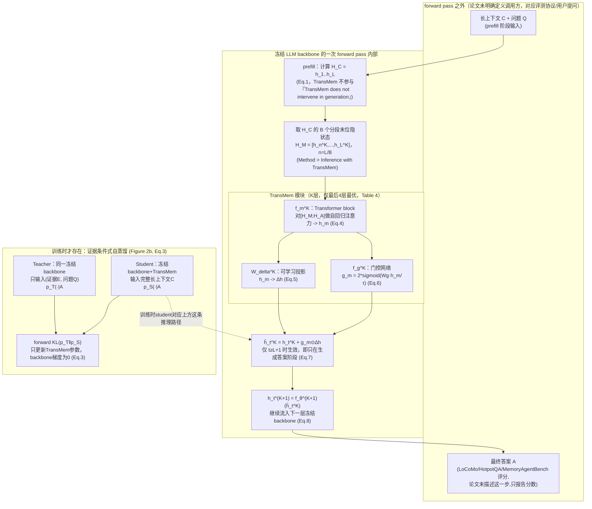

# TransMem 论文架构

> 读的是 `/Users/guanhongli/Documents/wafo-base/literature/papers/Lei-2026-TransMem-Transforming-Hidden-States-into-Memory-for-Large-Language-Models.txt`
> （arXiv:2607.29032v1，2026-07-31，东南大学 + 上海 AI Lab；AAAI 投稿格式 © 2027 AAAI）。本篇**只谈论文
> 写了什么**，不掺代码事实——论文与当前公开代码仓库的对照、以及"这是不是真的官方复现仓库"的判断见
> `code-architecture.md` 第 6 节。
>
> 术语先解释一下：**参数化记忆（parametric memory）**＝把信息直接编码进模型参数里，而不是存在外部数据库/
> 文件里；**隐状态（hidden state）**＝ Transformer 每一层、每个 token 位置算出来的一串数字向量；
> **自回归（autoregressive）**＝一个词一个词地往下生成，每一步都依赖前面已经生成的内容；**近因偏差
> （recency bias）**＝模型倾向于更重视靠后、离当前生成位置更近的内容，容易"忘记"更早的信息；
> **门控网络（gating network）**＝一个学出来的"该不该采纳这次修正、采纳多少"的缩放系数；**自蒸馏
> （self-distillation）**＝用同一个模型自己的两种不同输入方式，一个当"老师"、一个当"学生"，让学生的
> 输出逼近老师；**prefill（预填充）**＝模型读完全部已知输入（上下文+问题）、还没开始吐第一个答案字的阶段；
> **decode（解码）**＝模型逐个吐出答案字的阶段。
>
> **2026-09-05 勘误**：本文已按同目录 `verification.md` 的逐条复核结论修正（共 10 处：1 处事实、4 处引用出处/位置、5 处表述限定）。原始未修正版本见 git 历史。

## 1. 一句话机制

论文的核心主张是：长上下文里那些**已经算过的、按位置分散存放**的隐状态本身就足够当"记忆"用，不需要
另外花一次计算去重新编码整段历史——只要用一个轻量的、和主干 LLM 结构一样的小 Transformer（严格说只在 Qwen3
backbone 下成立：论文用 Llama3.1-8B 做主干时，TransMem block 本身仍固定沿用 Qwen3 架构，txt:387-389），把几个挑选出来
的历史隐状态变换成一个"记忆偏移量"，配合一个学出来的门控网络决定加多少，在生成答案时叠加进当前隐状态即可；
训练方式是"证据条件式自蒸馏"（Evidence-Conditioned Self-Distillation, ECSD）：让同一个冻结 LLM，一边
只看"标准证据+问题"当老师，一边看"完整长上下文＋挂着 TransMem"当学生，用 KL 散度逼学生的输出分布靠近
老师，这样模型学到的是"如何从长上下文里提炼有用信息"这个**能力**，而不是死记某一篇文章的内容
（*Introduction* 段，*Conclusion* 段）。

## 2. 记忆是怎么存进去的

- **触发时机**：prefill 阶段。论文 *Preliminaries* 段把输入切成 `x_{1:t} = [C; A_{≤t}]`，
  `C = x_{1:L}` 是长上下文，`A_{≤t}` 是已生成的答案前缀；`C` 的隐状态 `H_C` 是在 prefill 阶段算出来的，
  论文原文明确写"The context features H_C are computed during prefill, during which TransMem does
  not intervene in generation"——即 TransMem 在 context 处理阶段完全不参与、不修改任何东西，"存"这个
  动作本质上就是冻结 backbone 正常做一次 forward 这件事本身，没有额外的"写入记忆"步骤（该句在 Eq.1 之后、
  Eq.2 之前，不是"Eq.1、2 之后"）。
- **存的是什么**：原始的、未经压缩/摘要/向量化的隐状态本身。*Method > Inference with TransMem* 段：
  把 `H_C` 按段长 `n = L/B` 切成 `B` 段，取每段**最后一个 token** 的隐状态，组成
  `H_M = [h_n^K, h_{2n}^K, ..., h_L^K]`。论文特别强调"The size of HM remains small, with the
  optimal value being only 5, which ensures the sparsity of the memory representation"——即认为
  记忆槽数量本身就应该非常稀疏（这个"5"和论文自己附录用的默认值不一致，见第 6 节）。这是**逐层各自独立**
  的一份记忆（论文用上标 `K` 标注是第几层），插入几层就有几份互不共享的 `H_M`。
- **超长上下文的例外**：当 `C` 超过 backbone 的最大上下文窗口时，论文提出"chunk-wise 记忆聚合"策略：
  把 `C` 切成 `S` 个 chunk `{C_1,...,C_S}`，每个 chunk 独立产出一份 `H_M^i`，生成答案时把所有 chunk 的
  记忆拼接起来 `H_M = Concat(H_M^1,...,H_M^S)`（*Method* 段，Eq.4 之后、Experiments 之前的最后一段）。
- **调不调 LLM**：论文没有描述"额外调用一个 LLM 去做抽取/摘要"这一步——`H_C`/`H_M` 直接来自冻结 backbone
  处理 `C` 时本来就要做的那次前向计算，backbone 的这次前向不算"另一个独立的 LLM 调用"，因为它是回答问题
  本身必须做的计算。真正引入的可训练成分只有 TransMem 自己那个 1 层 Transformer block（见第 3 节），
  论文管它叫"lightweight inference-time parametric memory module"（Abstract）。

## 3. 记忆是怎么被用起来的

- **触发时机**：只在**生成答案 A** 的阶段。Eq.7 明确写 `t ≥ L+1`，并注明"indicating that the memory
  correction is applied only during answer generation"——context/question 本身的 token 不受任何影响，
  这与 *Introduction* 里反复强调的"inference-time"、"without repeatedly encoding the preceding
  context"是同一个意思：TransMem 不重新处理长上下文，只在吐答案的时候起作用。
- **拿什么去找**：论文其实用过"检索（retrieval）"这个词——在 Ablation Studies 段有一句"the gating
  mechanism facilitates the retrieval and utilization of relevant memory representations"
  （txt:432-433）。但这只是对门控作用的比喻性描述，论文实质上没有描述显式的相似度打分/排序：做法是把
  `H_M` 和答案侧隐状态 `H_A`
  一起喂进 TransMem 自己的 Transformer block `f_m^K`，"they first undergo standard autoregressive
  attention to produce the memory feature h_m"（*Method* 段，Eq.4 前）。即：靠 block 自身的**注意力
  机制**去隐式判断该重视 `H_M` 里的哪部分，不是显式的相似度打分或排序检索。
- **一步到位还是多步迭代**：论文没有描述任何"检索→反思→再检索"式的循环，是单次前向产出记忆偏移量
  `Δh`（Eq.4、5）。但因为 TransMem **不插在所有层**，而是"inserting memory modules into only the
  last four layers"（这句在 *Method* 段，不在 *Experimental Setup > Implementation Details*——后者用的是另一句
  "inserted into the final four transformer layers"），效果上是逐层各自发生一次
  独立修正，论文称这类多层设计能让"memory corrections interact with different stages of the backbone
  computation"（*Appendix > Early Final-Hidden TransMem* 段，解释为什么从单点 final-hidden 设计改成
  多层设计）。
- **找到之后怎么交给模型**：完整公式链是 Eq.4-8：
  1. `h_m = f_m^K(H_M, H_A)`——TransMem 自己的 Transformer block 输出记忆特征（Eq.4）；
  2. `Δh = W_Δ^K · h_m`——一个可学习投影 `W_Δ ∈ R^{d×d}` 把记忆特征变成最终的记忆偏移量（Eq.5）；
  3. `g_m = f_g^K(h_m) = α·σ(W_g·h_m/τ)`，其中 `σ` 是 sigmoid，`α=2`，`τ` 是门控温度，
     `W_g ∈ R^{d×d}` 可学习（Eq.6）——门控网络决定这次修正打多大折扣，论文解释这一步是因为
     "not every memory shift Δh is useful, and noisy shifts may adversely affect the output"；
  4. `ĥ_t^K = h_t^K + g_m ⊙ Δh`，仅当 `t ≥ L+1`（生成答案阶段）才生效（Eq.7）；
  5. `h_t^{K+1} = f_θ^{K+1}(ĥ_t^K)`——修正后的隐状态继续正常流入下一层冻结 backbone（Eq.8）。
  这是纯粹的向量级叠加（残差形式），不经过任何文本化或重新拼 prompt 的步骤——论文强调这正是它比"检索后
  拼进上下文"式外部记忆更轻量的原因（*Introduction* 段对比外部记忆"summarizing, retrieving, or storing
  information outside the current computation"）。

## 4. 架构图

TransMem 不是独立进程/服务，论文本身也是围绕"一次 forward pass 内部发生了什么"来描述整个方法的
（*Method* 段开篇："During inference, the frozen backbone performs its standard forward computation,
while TransMem abstracts a small set of historical hidden states into a memory shift"），因此下面用
"forward pass 内 / 外"画边界，对应 Figure 2(a)（推理）与 Figure 2(b)（训练时的师生对照）的关系。

**边界说明**：论文对"记忆系统"和"调用方/Agent"之间的边界几乎没有专门讨论——整篇论文的叙述视角就是"冻结
LLM backbone 的一次标准前向计算 + 寄生其中的 TransMem"，没有像系统类论文那样明确画出服务/接口边界。
唯一能确认边界的地方是 *Preliminaries* 段那句"TransMem does not intervene in generation"（针对 context
处理阶段）和 Eq.7 的 `t≥L+1` 条件（针对答案生成阶段）——这两处合起来划定了"TransMem 只在什么时候起作用"，
但论文没有说调用方（下游 agent/评测脚本）具体怎么发起一次带 TransMem 的推理请求、需要传什么参数、
拿到什么格式的返回值，这些工程接口层面的内容论文完全没有涉及（*Method* 段和 *Experiments* 段都是围绕
"效果"和"公式"展开，不涉及调用协议）。

## 5. 我没搞清楚的

- **Figure 1/2/3/4 是图片**，本次只读取了论文文本层的正文描述和图注文字，没有单独做图像解析——如果图里
  有文字描述之外的额外视觉信息（例如 Figure 2 具体的框线分组画法、Figure 4 曲线的确切形状细节），
  这次没有覆盖。**未验证**。
- **Table 1、Table 2 这两张主结果大表的文本抽取存在列错位**（PDF 转文本对多列表格常见的问题，能看到
  数字但和列名对不齐，例如某些差值标注 `-4.11`/`+0.19` 等穿插在数字中间，无法确定每个数字精确对应哪一列/
  哪个基线方法）。本文档涉及主结果数值时只引用了摘要/正文段落里明确给出、且格式清晰的范围数字（如
  "11.58–29.25 F1 on LoCoMo"），没有逐格核对 Table 1/2 的每个单元格。Table 3（消融）文本抽取清晰、
  已核对，可信度更高。
- ***Insertion Depth*（Table 4）里"Middle 12-16"等具体层区间怎么选出来的**：论文只报告了测过哪些区间
  （Last-2/4/8，Middle 12-16/18-21/22-25/28-31），没有说明这些区间的选择依据（穷举？先验？），也没有
  测更浅的区间（如 0-4 层）作对照。
- **Table 8（Early Final-Hidden 变体，`L_TM=2/4`）和主结果（Last-4）之间的关系**：论文原文明确说
  "the final row [TransMem (Ours)] is included as a reference rather than a directly controlled
  comparison"——论文自己承认这两组数字不可直接比较，但没有说明当前的 Last-4 多层设计具体是从
  final-hidden 单点设计经过哪些没写出来的中间尝试演化来的。
- **计算效率对比（Figure 3）的具体测量条件**：计时口径其实已经说了——"We report the additional latency
  introduced by the memory module, excluding the frozen backbone prefill computation"（txt:711-713），
  且给了 10K→100K 上下文与 δ-mem 每 10k 约 100 GFLOPs 的定量描述（txt:713-722）；没有报的是 GPU 型号、
  batch size（训练用 A100，txt:353-354，但未在 Figure 3 处重述），“只给出定性结论”这一描述也偏重了。

## 6. 论文没写清楚的地方

- **段数 B 的数值前后矛盾**：*Method > Inference with TransMem* 段正文写"the optimal value being
  only 5"，但通篇所有报告结果（Table 1/2 主结果、Table 13 的 B 敏感性实验）都是围绕 `B=4` 展开——
  *Appendix > Sensitivity to the Number of Memory Segments* 段明确说"We reuse the Qwen3-4B TransMem
  checkpoint trained with B = 4"并"retain B = 4 as the default"，`B=5` 这个被正文称为"optimal"的值
  从未出现在任何一张实验表格里、也没有被单独验证过。这是论文自身内部的表述矛盾，不是笔者理解偏差。
- **`n = L/B` 里 `B` 的主结果取值，Method 正文全程只用符号，没有给出具体整数**：要到 *Appendix* 里
  才第一次看到"B=4"字样（实际仅出现在 *Sensitivity to the Number of Memory Segments*/Table 13
  小节，Table 6 小节本身没有 B=4 字样），且是作为消融对象出现（"we vary only B at inference
  time"），并非在方法部分或实验设置部分被正式声明为"主结果使用的固定值"。
- **门控温度 `τ`（Eq.6）从未给出具体数值**：正文和附录的公式里都只写符号 `τ`，*Appendix > Gate
  Parameterization* 段虽然比较了三种门控参数化方式（`g=1` 固定 / `g=2σ(z)` / `g=3σ(z)-1`），但同样
  没有报告 `τ` 本身的实际取值。
- **消融变体"w/o Transformer Block"具体怎么运作没有描述**（Table 3）：去掉 Transformer block 之后，
  `H_M` 怎么变成 `Δh`？是直接线性投影、简单平均、还是别的什么替代结构？论文只报告了这一行的分数
  （40.79，与 Table 1 里 Qwen3-4B-Instruct 基线的 40.79 **完全相等**，不是"接近"——说明这个消融相当于直接
  关掉整个模块），没有描述这个消融变体的具体实现方式。
- **是否使用了某种初始化策略（如用 backbone 权重初始化 TransMem block）**：*Method* 部分
  和 *Experimental Setup* 部分确实都没有讨论 TransMem 本体的参数初始化方式；但 Appendix Table 7 图注
  明写"All dynamic gates are initialized at g = 1"（txt:1064-1065），所以门控网络自身的初始化其实有交代，
  只是 block 本体（非门控部分）的初始化仍无从论文本身判断。
- **实验方差/置信区间缺失**：论文提到"All experiments are conducted with a fixed random seed of 42"
  （该句实际落在 *Baselines* 段末尾，txt:416-417，不在 *Implementation Details* 段），但所有表格看起来都是单次运行的结果，没有报告多次重复实验的标准差或
  置信区间，无法评估 Table 1-13 里那些两位小数差异（例如 Table 4 里 53.14 vs 54.11）的统计显著性。
- **LoCoMo（约 16K token）/HotpotQA 实验是否真的触发了 chunk-wise 溢出策略没有交代**：*Method* 部分
  描述了"当 C 超过 backbone 最大上下文窗口时"的 chunk-wise 聚合策略，但 *Experiments* 部分没有说明
  三个主评测数据集（LoCoMo、HotpotQA、MemoryAgentBench）里，哪些具体样本的上下文长度真的超过了三个
  backbone（Qwen3-4B、Qwen2.5-14B、Llama3.1-8B）各自的上下文窗口、从而实际用到了这条策略——只有
  MemoryAgentBench 一句"many examples exceeding 256K tokens"暗示大概率会触发，LoCoMo 是否触发未提。（以上仅基于论文文本；代码侧
  证据表明 LoCoMo 从不触发此策略，见 `code-architecture.md` 第 2 节“超长上下文的例外”。）
